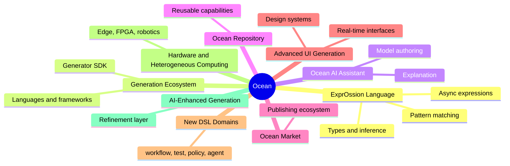
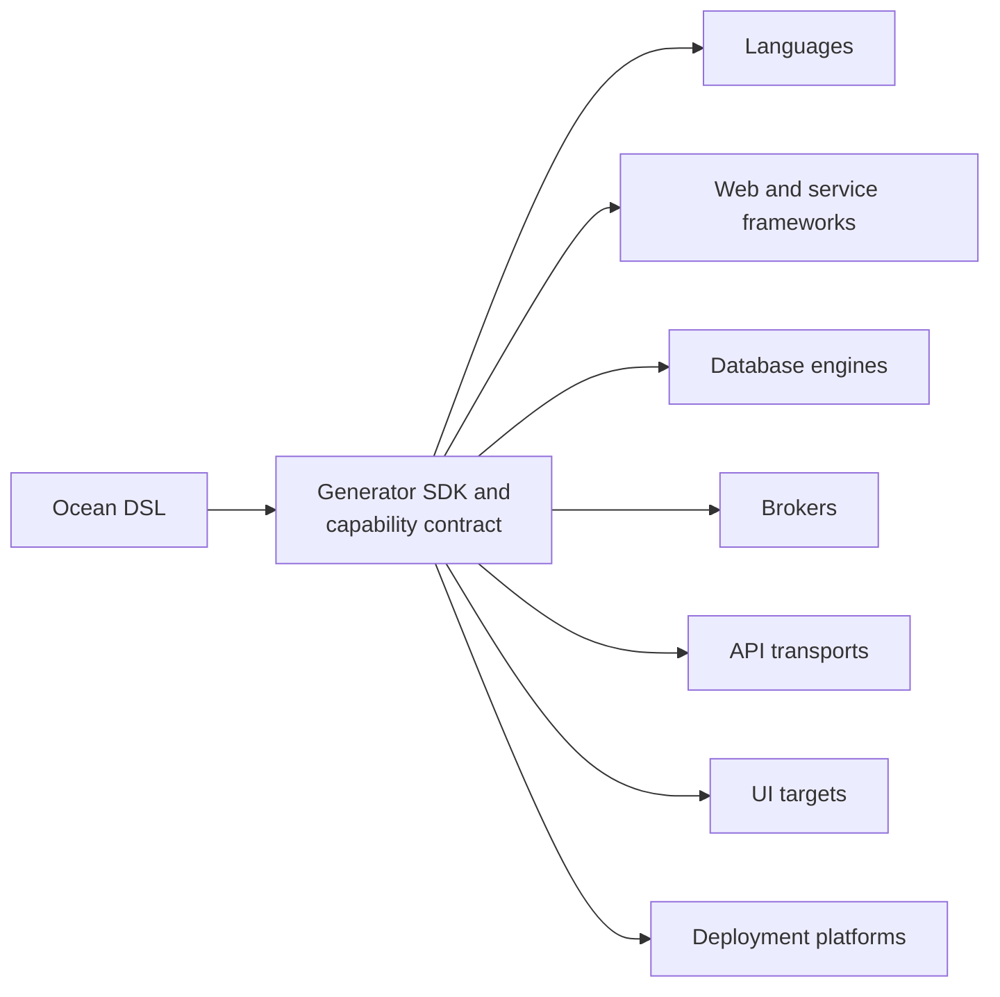
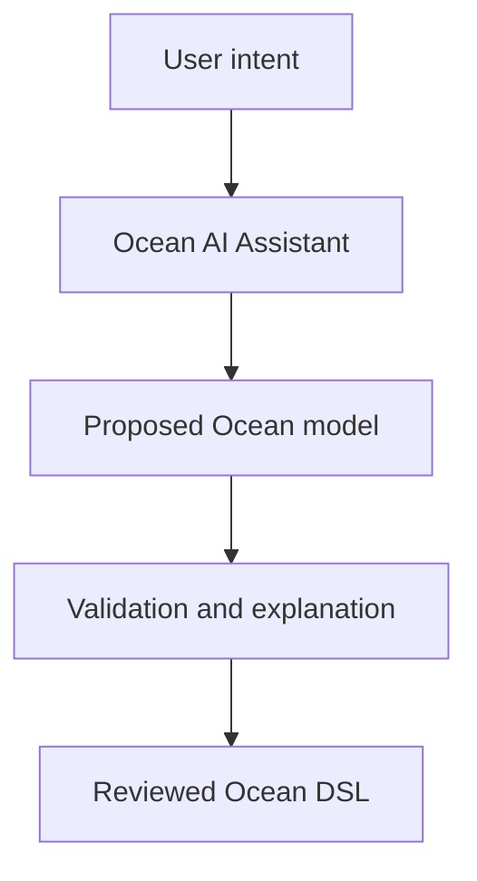
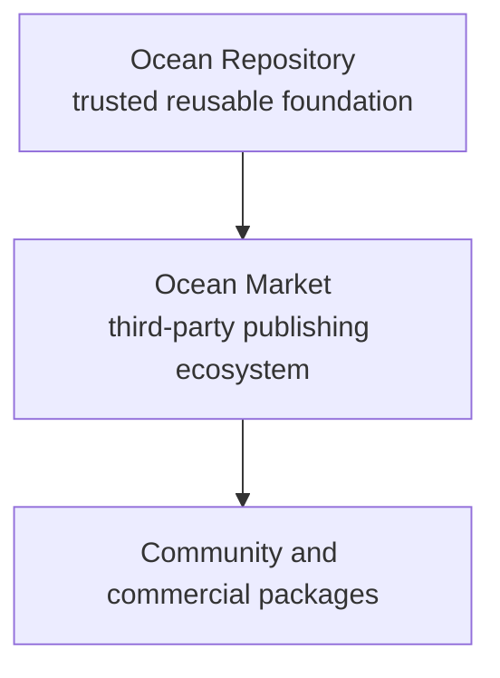
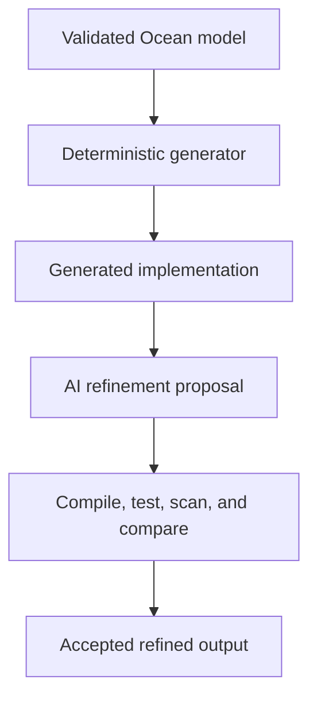
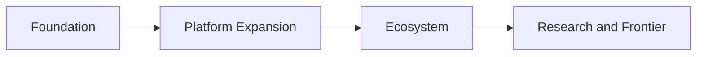
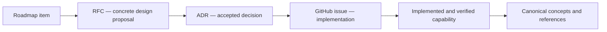

# Decisions and Roadmap

> Generated from Ocean-Atlas v0.1.0 (content baec097c). Canonical source: https://atlas.ocean-lab.ai/decisions/

**Contents**

- [Architecture Decision Records](#architecture-decision-records)
- [Requests for Comment](#requests-for-comment)
- [Roadmap — planned, not yet available](#roadmap--planned-not-yet-available)

## Architecture Decision Records

Each entry gives the decision status and a summary. Full text is included only for accepted decisions that DSL, concept or guide pages reference; otherwise follow the Source link.

### Atlas Builder Boundary

Establishes a technology-independent Atlas Builder Core between canonical Ocean-Atlas knowledge and presentation-specific builders such as Astro and Starlight.

Source: https://atlas.ocean-lab.ai/decisions/adrs/adr-atlas-builder-boundary/

Status: Accepted · Authority: Authoritative

Decision record: Decision · ID `adr.atlas-builder-boundary`

Full text is not bundled; open the Source link if the details matter.

### Canonical Markdown and Structured Build Model

Ocean-Atlas knowledge is authored as plain Markdown files with a structured `## Metadata` block and typed relationships, discovered and validated by a build-time pipeline rather than stored in a database or CMS.

Source: https://atlas.ocean-lab.ai/decisions/adrs/adr-canonical-markdown-build-model/

Status: Accepted · Authority: Authoritative

Decision record: Decision · Created 2026-08-14 · ID `adr.canonical-markdown-build-model`

Full text is not bundled; open the Source link if the details matter.

### Example Knowledge Facets: Horizon, Voyage, and Implementation

Every Ocean example is published as three distinct modeled facets — Horizon, Voyage, and Implementation — backed by separate explanation and source responsibilities so each can be read and reused independently.

Source: https://atlas.ocean-lab.ai/decisions/adrs/adr-example-knowledge-facets/

Status: Accepted · Authority: Authoritative

Decision record: Decision · Created 2026-08-14 · ID `adr.example-knowledge-facets`

Full text is not bundled; open the Source link if the details matter.

### External Examples Repository Integration

Runnable Ocean examples live in the separate `ocean-examples` repository, consumed by Ocean-Atlas as a git submodule and published through a dedicated example pipeline rather than as ordinary canonical Markdown.

Source: https://atlas.ocean-lab.ai/decisions/adrs/adr-external-examples-repository/

Status: Accepted · Authority: Authoritative

Decision record: Decision · Created 2026-08-14 · ID `adr.external-examples-repository`

Full text is not bundled; open the Source link if the details matter.

### Knowledge API Service

Ocean-Atlas exposes a private, read-only runtime HTTP API over builders/core's normalized AtlasModel, reachable only from other Ocean services on Fly's private network, superseding the static-artifact approach proposed in rfc.versioned-atlas-model now that a concrete consumer set exists.

Source: https://atlas.ocean-lab.ai/decisions/adrs/adr-knowledge-api-service/

Status: Accepted · Authority: Authoritative

Decision record: Decision · Created 2026-08-25 · ID `adr.knowledge-api-service`

Full text is not bundled; open the Source link if the details matter.

### Knowledge Chunking and Indexing Pipeline

Ocean-Atlas chunks canonical knowledge along heading boundaries with stable, ID-derived chunk identity, and keeps the resulting embeddings current through a versioned, lock-safe background reconciliation — published atomically in one transaction only after all required embedding calls succeed — that adds and removes chunks incrementally rather than re-embedding the whole corpus on every process start.

Source: https://atlas.ocean-lab.ai/decisions/adrs/adr-knowledge-chunking-and-indexing/

Status: Accepted · Authority: Authoritative

Decision record: Decision · Created 2026-08-26 · ID `adr.knowledge-chunking-and-indexing`

Full text is not bundled; open the Source link if the details matter.

### Search Today and Structured Retrieval Tomorrow

Ocean-Atlas uses Starlight's Pagefind-based static search with Atlas-specific query and example indexing enhancements, while future retrieval or RAG must consume Core's structured `AtlasModel` rather than rendered HTML.

Source: https://atlas.ocean-lab.ai/decisions/adrs/adr-search-today-structured-retrieval-tomorrow/

Status: Accepted · Authority: Authoritative

Decision record: Decision · Created 2026-08-14 · ID `adr.search-today-structured-retrieval-tomorrow`

Full text is not bundled; open the Source link if the details matter.

### Stable Knowledge Identity Independent of Filesystem Layout

Every canonical knowledge item carries an author-assigned, immutable stable ID that relationships reference directly, kept distinct from its source file path and its derived presentation route.

Source: https://atlas.ocean-lab.ai/decisions/adrs/adr-stable-knowledge-identity/

Status: Accepted · Authority: Authoritative

Decision record: Decision · Created 2026-08-14 · ID `adr.stable-knowledge-identity`

Full text is not bundled; open the Source link if the details matter.

### Vector Storage and Embedding Provider

Ocean-Atlas stores knowledge embeddings in a dedicated database on the existing shared Fly Postgres cluster using the pgvector extension, and generates them with Voyage AI's voyage-4 model (1024 dimensions) behind a provider-independent embedding interface.

Source: https://atlas.ocean-lab.ai/decisions/adrs/adr-vector-storage-and-embedding-provider/

Status: Accepted · Authority: Authoritative

Decision record: Decision · Created 2026-08-26 · ID `adr.vector-storage-and-embedding-provider`

Full text is not bundled; open the Source link if the details matter.

## Requests for Comment

RFCs are proposals. Anything marked Draft, Proposed or Superseded is not a settled decision.

### Publish a Versioned AtlasModel for Search, APIs, and RAG

Publish a safe, versioned JSON projection of Core's `AtlasModel` so search, future APIs, and RAG ingestion share one supported structured distribution format without exposing internal build fields.

Source: https://atlas.ocean-lab.ai/decisions/rfcs/rfc-versioned-atlas-model/

Status: Superseded · Authority: Proposed

Decision record: RFC · Created 2026-08-14 · ID `rfc.versioned-atlas-model`

Full text is not bundled; open the Source link if the details matter.

## Roadmap — planned, not yet available

> **Caution — Not available yet:** everything below describes planned or proposed work. Do not present any of it as an existing Ocean feature.

### Roadmap

Directional overview of Ocean's planned capability streams — language, generation, AI assistance, reuse, UI, new DSL domains, hardware, and AI-enhanced generation — organized into roadmap horizons.

Source: https://atlas.ocean-lab.ai/roadmap/

Status: Accepted · Authority: Informative

#### 1. Overview

This roadmap communicates **direction, not delivery dates or commitments**.
It describes intended capability streams for Ocean and Ocean-Atlas — where
the platform is headed, and roughly in what order — not a schedule and not
currently available behavior. Per Ocean-Atlas's own knowledge-architecture
rules for Roadmap Items, nothing in this document should be read as
implemented unless it is separately documented as such by a DSL reference,
a concept page, or an accepted ADR.

The unifying vision behind everything below:

> Ocean enables people and agents to describe systems once, reuse trusted
> capabilities, and generate implementations across software, AI, cloud,
> edge, and hardware platforms.

#### 2. Ocean at a Glance

Nine capability streams, described in [Section 3](#3-capability-streams),
group into four roadmap horizons, described in
[Section 4](#4-roadmap-horizons).

##### 2.1 Roadmap States

Horizons communicate rough sequencing; roadmap states communicate the
maturity of an idea. They are intentionally separate:

| State | Meaning |
| --- | --- |
| **Exploratory** | A direction worth investigating, without an accepted design or delivery commitment. |
| **Planned** | A direction selected for further definition, normally through an RFC, but not yet committed for delivery. |
| **Committed** | Work backed by an accepted design, an implementation plan, and explicitly assigned delivery ownership. |
| **Completed** | Delivered behavior reflected in the current canonical concepts and references. |
| **Abandoned** | A direction deliberately discontinued, retained here when the historical context remains useful. |

No capability stream in this roadmap is currently a delivery commitment.
The classifications below describe planning maturity only; they do not
claim implementation or promise a release.

##### 2.2 Current Classification

| Capability stream | State | Rationale |
| --- | --- | --- |
| ExprOssion Language Evolution | **Planned** | Extends an established DSL capability, but its scope and name still require design decisions. |
| Generation Ecosystem | **Planned** | Expands Ocean's existing generation role; the extension contract remains to be designed. |
| Ocean AI Assistant (Ateala) | **Exploratory** | The intended role is clear, but architecture, trust boundaries, and evaluation criteria remain open. |
| Ocean Repository Expansion | **Planned** | Evolves an existing Ocean concept; package and compatibility models require concrete proposals. |
| Ocean Market | **Exploratory** | Depends on a mature Repository plus substantial publishing, security, and governance capabilities. |
| Advanced UI Generation | **Planned** | Builds on the existing UI DSL and generators, with scope still to be proposed incrementally. |
| New DSL Domains | **Exploratory** | Each candidate domain requires an independent conceptual boundary and design process. |
| Hardware and Heterogeneous Computing | **Exploratory** | Requires research into hardware-specific semantics beyond ordinary generator extensions. |
| AI-Enhanced Generation | **Exploratory** | Requires a safe, reproducible refinement model and objective acceptance checks. |

There are currently no streams classified as **Committed**, **Completed**,
or **Abandoned**. Existing Ocean capabilities are documented in canonical
concept and reference pages rather than being relabeled as roadmap work.

#### 3. Capability Streams

##### 3.1 ExprOssion Language Evolution

"ExprOssion" is a proposed identity for a more advanced Ocean expression
language, keeping the Ocean identity visible. This stream can cover:

- richer types and type inference;
- pattern matching;
- collection and data-transformation operations;
- error and result types;
- async and concurrent expressions;
- reusable expression libraries;
- better external-function integration;
- validation and testing support;
- debugging and evaluation tooling;
- expression optimization.

**Open naming question:** whether ExprOssion becomes the new canonical name
for Ocean's [`@expression`](/dsl/expression/) language, or an advanced
expression subsystem built on top of it. That choice affects
documentation, compatibility, and naming, and is not yet decided.

##### 3.2 Generation Ecosystem

This stream covers both target languages and the generators that produce
them:

- more implementation languages;
- more web and service frameworks;
- more database engines;
- more brokers;
- more API transports;
- more UI targets;
- more deployment platforms;
- a generator SDK and extension model;
- generator capability declarations;
- cross-generator compatibility testing.

The architectural goal is not simply "many generators." Ocean needs a
predictable generator contract so third parties can add targets without
changing the DSL core.

##### 3.3 Ocean AI Assistant

The design-time assistant, named **Ateala**, that helps a person author an Ocean model:

Potential capabilities:

- convert ideas and requirements into an initial Bundle;
- ask clarifying architecture questions;
- recommend patterns and repository packages;
- generate or modify DSL;
- explain validation errors;
- compare alternative system designs;
- generate Horizon and Voyage documentation;
- check a model against canonical Atlas knowledge.

Crucially, the assistant should **generate proposals, not silently
establish architecture**. The user remains responsible for accepting the
model.

##### 3.4 Ocean Repository Expansion

The reusable capability library described conceptually by
[Ocean Repository](concepts.md#ocean-repository) is intended to grow well
beyond its current scope:

- datatypes;
- expressions;
- components;
- FSMs;
- APIs;
- broker contracts;
- database models;
- service definitions;
- UI elements;
- deployment definitions;
- complete reusable standalone services.

The Repository should evolve from a small standard library into a broad
catalogue of off-the-shelf system capabilities. Each item will eventually
need:

- stable identity and version;
- ownership;
- license;
- compatibility metadata;
- supported generators;
- dependencies;
- documentation and examples;
- validation status;
- security and quality signals.

##### 3.5 Ocean Market

A later evolution of the Repository, not merely another name for it:

A market requires considerably more governance than a repository:

- publisher identities;
- package signing;
- ownership verification;
- licensing and commercial terms;
- versioning and dependency resolution;
- vulnerability reporting;
- malware and secret scanning;
- quality certification;
- ratings and discovery;
- deprecation and transfer policies;
- private organizational registries.

"Ocean Market" names the ecosystem vision; "Ocean Repository" remains the
underlying technical package system.

##### 3.6 Advanced UI Generation

The current UI layer ([`@ui`](/dsl/ui/) and its widgets) is a proof-of-concept
foundation. This stream can evolve it toward:

- responsive layouts;
- navigation and routing;
- form validation;
- authentication and authorization;
- role-aware views;
- state and data binding;
- design systems and themes;
- accessibility;
- rich tables and visualization;
- real-time interfaces;
- mobile and desktop targets;
- custom widgets;
- a UI extension SDK;
- AI-assisted layout generation.

Ocean should continue describing UI intent and interaction, while
generators decide how that intent maps to React, Vue, mobile, desktop, or
other technologies.

##### 3.7 New DSL Domains

Additional top-level sections could expand Ocean beyond its current system
model:

- `@repl` — interactive execution and exploration;
- `@agent` — AI-agent roles, tools, memory, policies, and workflows;
- `@workflow` — durable multi-step orchestration;
- `@test` — behavioral and contract verification;
- `@policy` — security, authorization, and compliance rules;
- `@schedule` — recurring and delayed execution;
- `@observability` — logs, metrics, traces, and alerts;
- `@stream` — continuous event and data processing;
- `@model` — AI/ML model integration;
- `@pipeline` — data or generation pipelines.

None of these are accepted DSL sections today — see the
[reserved and future sections](dsl/overview.md#8-reserved-and-future-sections) noted
by the DSL overview. Each should only be introduced after its system
concept and technology-independent boundary are clear. Otherwise, Ocean
risks becoming a collection of target-specific configuration formats.

##### 3.8 Hardware and Heterogeneous Computing

Ambitious, but consistent with Ocean's technology-independent philosophy:

- microcontrollers;
- PLCs and industrial automation;
- FPGA targets;
- GPU kernels and compute pipelines;
- edge devices;
- robotics;
- IoT systems;
- real-time systems.

This will likely require more than new generators. Hardware introduces
concepts such as timing and latency guarantees, memory constraints, pin
and peripheral definitions, clock domains, parallelism, safety
requirements, device topology, resource allocation, and
hardware/software partitioning. This stream belongs on the long-term
research horizon, not as an ordinary generator extension.

##### 3.9 AI-Enhanced Generation

Distinct from the Ocean AI Assistant: the assistant helps author the Ocean
*model*; AI-enhanced generation would improve the concrete generated
*implementation*.

AI should not replace deterministic generation. It should operate as an
optional refinement layer with:

- traceable changes;
- reproducible prompts and model metadata;
- compilation and tests;
- security scanning;
- semantic comparison against the Ocean model;
- the ability to regenerate without losing approved customizations;
- a clear distinction between generated and AI-modified code.

#### 4. Roadmap Horizons

Horizons describe rough sequencing, not scheduled releases. A stream may
appear in more than one horizon as it matures.

##### 4.1 Foundation

- strengthen ExprOssion ([3.1](#31-exprossion-language-evolution));
- improve existing DSL sections;
- mature UI generation beyond proof-of-concept ([3.6](#36-advanced-ui-generation));
- expand generator and engine coverage ([3.2](#32-generation-ecosystem));
- grow the official Ocean Repository ([3.4](#34-ocean-repository-expansion)).

##### 4.2 Platform Expansion

- generator extension SDK ([3.2](#32-generation-ecosystem));
- Repository package model and compatibility metadata ([3.4](#34-ocean-repository-expansion));
- Ocean AI Assistant ([3.3](#33-ocean-ai-assistant));
- new DSL domains such as workflow, test, policy, and agent ([3.7](#37-new-dsl-domains));
- more complete UI application generation ([3.6](#36-advanced-ui-generation)).

##### 4.3 Ecosystem

- third-party generators ([3.2](#32-generation-ecosystem));
- third-party repository packages ([3.4](#34-ocean-repository-expansion));
- publisher verification and package signing ([3.5](#35-ocean-market));
- Ocean Market ([3.5](#35-ocean-market));
- private organizational repositories ([3.5](#35-ocean-market)).

##### 4.4 Research and Frontier

- AI-refined generated implementations ([3.9](#39-ai-enhanced-generation));
- FPGA, GPU, microcontroller, PLC, robotics, and edge targets ([3.8](#38-hardware-and-heterogeneous-computing));
- mixed hardware/software system modeling ([3.8](#38-hardware-and-heterogeneous-computing));
- constraint-aware and optimization-driven generation ([3.8](#38-hardware-and-heterogeneous-computing), [3.9](#39-ai-enhanced-generation)).

#### 5. From Direction to Delivery

A capability on this roadmap is not a commitment. It becomes real through
the same path as any other significant Ocean-Atlas change:

A roadmap item moves into an [RFC](https://atlas.ocean-lab.ai/decisions/rfcs/) once its technical
design becomes concrete enough for review, into an
[ADR](https://atlas.ocean-lab.ai/decisions/adrs/) once a decision from that review is accepted, and
then into GitHub issues for implementation. Delivery is not complete until
the implementation is verified and the affected canonical concepts and
references describe the resulting behavior. Until that entire path is
complete, the roadmap remains direction rather than authoritative evidence
of current Ocean behavior.

Moving a stream between roadmap states requires evidence:

- **Exploratory → Planned:** the direction and intended outcomes have been
  selected for concrete design;
- **Planned → Committed:** an accepted design, delivery owner, and
  implementation plan exist;
- **Committed → Completed:** implementation and verification are complete,
  and canonical documentation reflects the delivered behavior;
- **Any active state → Abandoned:** the decision to discontinue the
  direction and its rationale are recorded.

RFCs, ADRs, and implementation issues remain the sources of truth for the
details of a particular initiative. This page only summarizes their place
in Ocean's broader direction.

#### 6. Related Knowledge

- [Expression DSL Reference](dsl/expression.md) — the current `@expression`
  language this roadmap's ExprOssion stream would extend.
- [UI DSL Reference](dsl/ui.md) — the current UI layer this roadmap's
  advanced UI stream would extend.
- [Ocean Repository](concepts.md#ocean-repository) — the current reuse model
  this roadmap's Repository and Market streams would extend.
- [Ocean DSL](dsl/overview.md) — the current set of accepted DSL sections this
  roadmap's new-domains stream would extend.
- [Requests for Comment](https://atlas.ocean-lab.ai/decisions/rfcs/) — where a roadmap item becomes a
  concrete proposal.
- [Architecture Decision Records](https://atlas.ocean-lab.ai/decisions/adrs/) — where an accepted
  proposal becomes a recorded decision.
