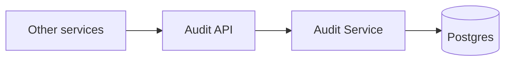

# Audit Service: Walkthrough

> Generated from Ocean-Atlas v0.1.0 (content baec097c). Canonical source: https://atlas.ocean-lab.ai/examples/audit-service/

**Contents**

- [Horizon](#horizon)
- [Voyage](#voyage)

Horizon and Voyage explanation for the Audit Service example.

Source: https://atlas.ocean-lab.ai/examples/audit-service/

## Horizon

### Audit Service at a Glance

#### Overview

Compliance, security, and support workflows all need a durable, append-only record of who did what, when, to what, and with what outcome. This example models a single Audit Service that other services call to record a completed action attempt, retrieve one record by id, and list an actor's or a tenant's history.

#### Architecture



Every endpoint reads or writes the single `AuditAction` entity; nothing else in the system participates.

#### What It Demonstrates

- `@datatype` — one wide, thoroughly documented audit record that groups tenant, actor, action, target, request-context, and outcome fields, most of them optional so a caller supplies only what applies to its action.
- `@database` — a Postgres entity with an explicit primary key, compound indexes that support time-ordered actor/tenant pagination, and a hand-written command that makes recording an action idempotent on its caller-generated id.
- `@api` — a REST API tagged `internal` whose methods connect straight to generated database queries and commands, with no expression layer in between.
- `@config` and `@deploy` — shared, imported Postgres configuration and a packaged Postgres image, deployed with multiple service replicas.

#### Expected Result

You will record an audit action, retrieve it by id, and list an actor's and a tenant's action history ordered most-recent-first, observing offset/limit pagination and idempotent re-recording.

## Voyage

### 1. Problem and Constraints

- An accepted audit record is immutable — there is no update or delete endpoint.
- The caller generates the record's id before submitting it, so a request can be retried safely.
- Resubmitting an existing id with identical content is an idempotent retry; resubmitting it with different content must be rejected.
- Actor ids are globally unique, so actor lookups need no tenant scope.
- Most fields are optional — the shape must fit system, anonymous, and pre-authentication actions, not only end-user ones.
- Actor and tenant history is returned most-recent-first, with `id` as a tie-breaker, and supports offset/limit pagination.

### 2. Prerequisites

- The Ocean toolchain, at the version this example targets.
- Docker, to run the generated Postgres database service.
- [hurl](https://hurl.dev), to run the included component test suite (optional).

### 3. Example Structure

Executable model files are grouped by DSL section:

```text
0012-audit-service/
├── audit-dt.ocn
├── audit-cfg.ocn
├── audit-db.ocn
├── audit-service.ocn
├── audit-deploy.ocn
├── api/
│   ├── audit-api.ocn
│   └── *.hurl
└── example-info/
    └── example-info.html
```

`api/` holds both the API declaration and a hurl component test suite covering recording, retrieval, pagination, and error behavior — documented further in [Verify the Result](audit-service-walkthrough.md).

### 4. Model the Domain

`AuditAction` groups its fields by concern — tenant, actor, action, target, request context, and outcome — so a caller can see at a glance which fields apply to its situation. Nearly every field beyond identity and outcome is optional.

```ocean-dsl
@datatype

AuditAction
    id           pattern ACT-ULID
    occurredAt : DateTime

    tenantId    : *String

    actorId     : *String
    actorType   : String
    actorRole   : *String

    action       : String
    actionType   : *String
    actionSource : String

    targetType  : *String
    targetId    : *String

    requestId   : *String
    ipAddress   : *String
    userAgent   : *String

    result       : String
    errorCode    : *String
    errorMessage : *String

    metadata    : Map<String,String>
```

`action` follows a stable `<Resource>.<Operation>` naming convention (for example `User.Login`), and `metadata` is reserved for small, non-sensitive context that has no dedicated typed field.

### 5. Persist Actions as an Append-Only Log

Two compound indexes support paginated, time-ordered lookups by actor and by tenant. The insert command is hand-written rather than generated, because it must enforce idempotency on the caller-supplied id instead of always inserting.

```ocean-dsl
@database

Database AuditDb
    engine = postgres
    configType = DatabaseConfig
    tags = audit

    Entity AuditAction
        key(id)
        indexes: index(actorId, occurredAt, id), index(tenantId, occurredAt, id)

        query findAuditActionById(id:String) : AuditAction
        query listAuditActionsByActor(actorId:String, offset:Int, limit:Int) : List<AuditAction>
        query listAuditActionsByTenant(tenantId:String, offset:Int, limit:Int) : List<AuditAction>

        # An existing id with identical content is an idempotent retry.
        # An existing id with different content must be rejected.
        command T recordAuditAction(action:AuditAction) : AuditAction
```

### 6. Define the API

Pagination is expressed directly in the path, and lookups by actor or tenant are separate endpoints rather than a single filtered query.

```ocean-dsl
@api

AuditApi style: rest
    engine = gin
    configType = ApiConfig
    tags = internal
    version = 1.0.0
    basePath = /
    generateSwagger = true

    post /audit/actions                            recordAuditAction(action:AuditAction) : AuditAction
    get  /audit/actions/{id}                        getAuditActionById(id:String) : AuditAction
    get  /audit/actors/{actorId}/{offset}/{limit}   listAuditByActor(actorId:String, offset:Int, limit:Int) : List<AuditAction>
    get  /audit/tenants/{tenantId}/{offset}/{limit} listAuditByTenant(tenantId:String, offset:Int, limit:Int) : List<AuditAction>
```

### 7. Assemble the Service Without an Expression Layer

Unlike an example that bridges API and database through `@expression`, every method here connects directly to its matching generated database query or command. There is no intermediate transformation because the API and entity shapes are already the same.

```text
AuditService
    use config AuditServiceConfig as myCfg
    impl api AuditApi as api on myCfg.apiConfig.port
    use database AuditDb as auditDb

    connect myCfg.dbConfig -> auditDb

    connect api.recordAuditAction  -> AuditAction.recordAuditAction
    connect api.getAuditActionById -> AuditAction.findAuditActionById
    connect api.listAuditByActor   -> AuditAction.listAuditActionsByActor
    connect api.listAuditByTenant  -> AuditAction.listAuditActionsByTenant
```

### 8. Select Technologies and Configure Generation

The API is generated with a REST engine (gin) on a configurable port, the database uses a packaged Postgres image, and the service runs two replicas since recording and reading audit actions carry no in-process state.

```ocean-dsl
@deploy

@import service P.db.postgres.docker@1.0.0 as PostgresqlDB

AuditDeploy
    service     AuditService
    replica     2
    export      9092:AuditService.api
    dependsOn   AuditDatabase

AuditDatabase
    service     PostgresqlDB
```

### 9. Validate, Generate, and Run

1. From `0012-audit-service/`, validate and generate the example with the Ocean toolchain.
2. Start the generated Postgres database and `AuditService`; wait for a healthy `/health/ready` response on port `9092`.

### 10. Verify the Result

Record an action, read it back by id, then list it by actor:

```text
POST /v1/audit/actions
    {"actorId":"actor-1","actorType":"user","action":"user.login",
     "actionSource":"web-app","result":"success"}
    -> {"id":"ACT-...","actorId":"actor-1","action":"user.login",...}

GET /v1/audit/actions/ACT-...
    -> {"id":"ACT-...","actorId":"actor-1","action":"user.login",...}

GET /v1/audit/actors/actor-1/0/10
    -> [{"id":"ACT-...","actorId":"actor-1",...}]
```

The `api/` hurl suite automates this and more: a fully-populated round trip and zero-value defaults (`10_record_action_happy_path.hurl`, `11_record_action_defaults.hurl`), a client-supplied id being discarded (`12_record_action_client_id_ignored.hurl`), actor/tenant pagination (`21_list_by_actor.hurl`, `22_list_by_tenant.hurl`), and invalid-input handling; run any of them with `hurl --test --variable host=http://localhost:9092 api/<file>.hurl`.

### 11. Troubleshooting

- **`getAuditActionById` returns `500 Internal Server Error` for an id that was never recorded:** the "record not found" error from the database does not currently match the generic error classifier's `NOT_FOUND` heuristics, so it falls through to a generic 500 instead of 404.
- **`recordAuditAction` accepts an almost-empty body:** no field-level validation runs beyond JSON binding, so an empty `{}` is persisted with zero-value fields rather than rejected — only malformed JSON returns `400`.
- **A client-supplied `id` in the request body is silently replaced:** the recording command always generates a fresh id server-side; supply the id you expect to see back only for your own idempotency tracking, not as a way to choose it.
- **Non-numeric `offset`/`limit` path segments return `400` with `"invalid offset"` or `"invalid limit"`:** both are parsed before any database query runs.

### 12. Experiments and Extensions

- Resubmit the exact same recorded action twice and confirm the identical id and content round-trip as an idempotent retry, then resubmit the same id with different content and observe the rejection.
- Add field-level validation to `recordAuditAction` so a missing `action` or `actorType` returns `400` instead of persisting a zero-value record.
- Tighten the error classifier so a database "not found" is recognized as `NOT_FOUND`, and update the expectation in `20_get_action_not_found.hurl` from `500` to `404`.
- Add a query that filters by `actionType` or `result` to support "show me all failed logins" style investigations.
