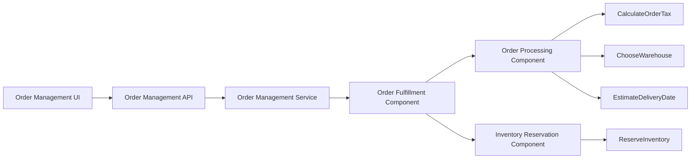

# Component Order Fulfillment

> Generated from Ocean-Atlas v0.1.0 (content baec097c). Canonical source: https://atlas.ocean-lab.ai/examples/component-order-fulfillment/

**Contents**

- [Overview](#overview)
- [Intended Component Topology](#intended-component-topology)
- [Key Design Decisions](#key-design-decisions)
- [Source Layout](#source-layout)
- [Expected Learning Outcome](#expected-learning-outcome)
- [Files](#files)
- [DSL source files](#dsl-source-files)
- [Walkthrough](#walkthrough)

Build a single order-management service from reusable, explicitly wired components that validate, enrich, reserve, and fulfill an order.

Source: https://atlas.ocean-lab.ai/examples/component-order-fulfillment/

Level: medium · Estimated time: 25 minutes · Version: 1.0.0 · Onboarding example: no

Components: 1 services, 0 brokers, 0 databases

Tags: component, composition, expression, order-management, service

## Overview

This example is the reference scenario for composing business capabilities
with Ocean `@component`. It models a single Order Management Service without
splitting a focused component example across unrelated services or runtime
infrastructure.

An incoming `OrderSubmission` is assigned a server-generated order ID, enriched
into a `ProcessedOrder`, and then fulfilled.
The processing capability uses independent expressions to calculate
route-aware tax, choose a warehouse, estimate a delivery date, and assemble
the enriched result. Fulfillment contains an `InventoryReservationComponent`
as a nested component, demonstrating that a component can reuse another
component through its public ports while keeping its private wiring hidden.

The executable DSL files sit beside this entry and are validated as one bundle.
They generate a compiling Go service and HTMX dashboard UI, making the example
suitable as both a learning reference and a regression fixture for component
composition.

## Intended Component Topology



| Component | Input | Outputs | Purpose |
| --- | --- | --- | --- |
| `OrderProcessingComponent` | `Order` | `ProcessedOrder` | Enriches an order through tax, warehouse, and delivery calculations. |
| `OrderFulfillmentComponent` | `OrderSubmission` | `ProcessedOrder` | Assigns the canonical ID, then composes processing and reservation. |
| `InventoryReservationComponent` | `ProcessedOrder` | `ProcessedOrder` | Nested fulfillment capability that adds reservation details and status. |

## Key Design Decisions

- The service owns one public API use case; it does not expose expressions as a
  public application contract.
- `OrderProcessingComponent` owns the calculation pipeline, making it reusable
  without coupling it to a transport or service implementation.
- Processing and inventory reservation are nested under fulfillment because
  they are internal fulfillment concerns, not top-level application APIs.
- Components communicate through declared typed ports. Their internal aliases
  and expressions remain encapsulated.
- The example starts without a database or broker so its graph and generated
  code isolate component behavior. Those infrastructure dependencies can be
  added as later extensions.
- `JsonView` receives the form result and presents the complete nested
  `ProcessedOrder` with expandable objects and a copy action.

## Source Layout

```text
0020-component-order-fulfillment/
├── 00-cof-info.ocn
├── 10-cof-datatype.ocn
├── 20-cof-api.ocn
├── 30-cof-config.ocn
├── 40-cof-expression.ocn
├── 46-cof-component.ocn
├── 50-cof-service.ocn
├── 55-cof-dashboard.ocn
├── 56-cof-ui.ocn
├── 60-cof-deploy.ocn
├── example.md
└── example-info/
    └── example-info.html
```

## Expected Learning Outcome

After inspecting the executable model, a reader can inspect the Component DSL
graph, service graph, and BigPicture Flow view and identify exactly where an
order is enriched, reserved, and fulfilled—then submit its commercial details
through the generated dashboard UI and inspect the complete returned order
without inspecting implementation code.

## Files

DSL source comes first, then diagrams; the long Horizon and Voyage walkthroughs are at the end. You can stop after the source files.

| File | Section | Lines |
| --- | --- | --- |
| `00-cof-info.ocn` | `@info` | 18 |
| `10-cof-datatype.ocn` | `@datatype` | 60 |
| `20-cof-api.ocn` | `@api` | 22 |
| `30-cof-config.ocn` | `@config` | 23 |
| `40-cof-expression.ocn` | `@expression` | 71 |
| `46-cof-component.ocn` | `@component` | 60 |
| `50-cof-service.ocn` | `@service` | 22 |
| `55-cof-dashboard.ocn` | `@dashboard` | 52 |
| `56-cof-ui.ocn` | `@ui` | 40 |
| `60-cof-deploy.ocn` | `@deploy` | 25 |

## DSL source files

### `00-cof-info.ocn`

```ocean-dsl
# @ocean-meta-start
# tags:
#   - component
#   - order-management
#   - fulfillment
# perspective:
#   feature: component-order-fulfillment
#   service: order-management-service
# @ocean-meta-end

@info

ComponentOrderFulfillment
    name        = Component Order Fulfillment
    version     = 1.0.0
    description = A focused order-management service that composes reusable processing and inventory components into one fulfillment capability.
```

### `10-cof-datatype.ocn`

```ocean-dsl
# @ocean-meta-start
# tags:
#   - datatype
#   - order-management
# perspective:
#   feature: component-order-fulfillment
#   service: order-management-service
# @ocean-meta-end

@datatype

# The caller submits commercial data only. The service assigns the canonical
# order ID at its boundary, so clients can never choose or collide with it.
OrderSubmission
    name      : String
    source    : String
    destination : String
    quantity  : Float
    unitPrice : Float
    currency  : String

# The canonical order is created by the fulfillment component before it enters
# the reusable processing pipeline.
Order
    id        : String
    name      : String
    source    : String
    destination : String
    quantity  : Float
    unitPrice : Float
    currency  : String

# Intermediate contracts make each processing decision observable in the
# component graph and retain the original order throughout the pipeline.
TaxedOrder
    order       : Order
    tax         : Float
    totalAmount : Float

WarehouseSelectedOrder
    order       : Order
    tax         : Float
    totalAmount : Float
    warehouseId : String

ProcessedOrder
    order        : Order
    tax          : Float
    totalAmount  : Float
    warehouseId  : String
    deliveryDate : DateTime
    reservation  : InventoryReservation
    status       : String

InventoryReservation
    orderId      : String
    warehouseId  : String
    quantity     : Float
    deliveryDate : DateTime
```

### `20-cof-api.ocn`

```ocean-dsl
# @ocean-meta-start
# tags:
#   - api
#   - rest-api
# perspective:
#   feature: component-order-fulfillment
#   service: order-management-service
# @ocean-meta-end

@api

OrderManagementApi style:rest
    engine          = gin
    configType      = ApiConfig
    tags            = external, order-management
    version         = 1.0.0
    description     = Submit an order for processing and fulfillment.
    basePath        = /orders
    generateSwagger = true

    post /submit submitOrder(order:OrderSubmission) : ProcessedOrder
```

### `30-cof-config.ocn`

```ocean-dsl
# @ocean-meta-start
# tags:
#   - config
# perspective:
#   feature: component-order-fulfillment
#   service: order-management-service
# @ocean-meta-end

@config

@import config O.log.config@1.0.0 as LogConfig

OrderManagementConfig
    apiConfig : ApiConfig
    logConfig : LogConfig

ApiConfig
    port : Int (default=8080)

UiConfig
    port      : Int (default=8081)
    logConfig : LogConfig
```

### `40-cof-expression.ocn`

```ocean-dsl
# @ocean-meta-start
# tags:
#   - expression
#   - order-management
# perspective:
#   feature: component-order-fulfillment
#   service: order-management-service
# @ocean-meta-end

@expression

# The boundary owns ID assignment. The caller sends an OrderSubmission, while
# reusable components always receive an Order with a generated canonical ID.
CreateOrder
    input  : submission:OrderSubmission
    output : order:Order
    logic
        order.id = GetUUID()
        order.name = submission.name
        order.source = submission.source
        order.destination = submission.destination
        order.quantity = submission.quantity
        order.unitPrice = submission.unitPrice
        order.currency = submission.currency

# Processing is deliberately expressed as three small, independently reusable
# decisions. The component below owns their composition.
CalculateOrderTax
    input  : order:Order
    output : taxed:TaxedOrder
    logic
        taxed.order = order
        taxed.tax = order.quantity * order.unitPrice * 0.21
        taxed.totalAmount = order.quantity * order.unitPrice + taxed.tax

ChooseWarehouse
    input  : taxed:TaxedOrder
    output : selected:WarehouseSelectedOrder
    logic
        selected.order = taxed.order
        selected.tax = taxed.tax
        selected.totalAmount = taxed.totalAmount
        selected.warehouseId = "nl-amsterdam"

EstimateDeliveryDate
    input  : selected:WarehouseSelectedOrder
    output : processed:ProcessedOrder
    logic
        processed.order = selected.order
        processed.tax = selected.tax
        processed.totalAmount = selected.totalAmount
        processed.warehouseId = selected.warehouseId
        processed.deliveryDate = nowUTC()

ReserveInventory
    input  : processed:ProcessedOrder
    output : completed:ProcessedOrder
    logic
        var reservation InventoryReservation
        completed.order = processed.order
        completed.tax = processed.tax
        completed.totalAmount = processed.totalAmount
        completed.warehouseId = processed.warehouseId
        completed.deliveryDate = processed.deliveryDate
        reservation.orderId = processed.order.id
        reservation.warehouseId = processed.warehouseId
        reservation.quantity = processed.order.quantity
        reservation.deliveryDate = processed.deliveryDate
        completed.reservation = reservation
        completed.status = "reserved"
```

### `46-cof-component.ocn`

```ocean-dsl
# @ocean-meta-start
# tags:
#   - component
#   - nested-component
#   - order-management
# perspective:
#   feature: component-order-fulfillment
#   service: order-management-service
# @ocean-meta-end

@component

# A reusable, inspectable enrichment pipeline. Its single public contract
# hides the three calculation aliases from any host component or service.
OrderProcessingComponent
    @perspectives: version:1.0.0, lifestyle:stable

    input  : order:Order
    output : processedOrder:ProcessedOrder

    use expression CalculateOrderTax as tax
    use expression ChooseWarehouse as warehouse
    use expression EstimateDeliveryDate as delivery

    connect order     -> tax
    connect tax       -> warehouse
    connect warehouse -> delivery
    connect delivery  -> processedOrder

# Reservation is independently reusable, but its hosting component decides
# whether it is part of a larger fulfillment use case.
InventoryReservationComponent
    @perspectives: version:1.0.0, lifestyle:stable

    input  : processedOrder:ProcessedOrder
    output : completedOrder:ProcessedOrder

    use expression ReserveInventory as reserve

    connect processedOrder -> reserve
    connect reserve        -> completedOrder

# This is the service-facing capability. It assigns an ID, composes the other
# components only through their public ports, and returns the entire enriched
# order including the reservation outcome.
OrderFulfillmentComponent
    @perspectives: version:1.0.0, lifestyle:stable

    input  : submission:OrderSubmission
    output : processedOrder:ProcessedOrder

    use expression CreateOrder as create
    use component OrderProcessingComponent as processing
    use component InventoryReservationComponent as inventory

    connect submission              -> create
    connect create                  -> processing.order
    connect processing.processedOrder -> inventory.processedOrder
    connect inventory.completedOrder -> processedOrder
```

### `50-cof-service.ocn`

```ocean-dsl
# @ocean-meta-start
# tags:
#   - service
#   - component-host
# perspective:
#   feature: component-order-fulfillment
#   service: order-management-service
# @ocean-meta-end

@service

OrderManagementService
    @perspectives: version:1.0.0, lifestyle:stable

    use config OrderManagementConfig as cfg
    impl api OrderManagementApi as api on cfg.apiConfig.port
    use component OrderFulfillmentComponent as fulfillment

    # The API delegates one business use case to one public component port.
    # Processing and inventory remain reusable nested capabilities.
    connect api.submitOrder -> fulfillment.submission
```

### `55-cof-dashboard.ocn`

```ocean-dsl
# @ocean-meta-start
# tags:
#   - dashboard
#   - component
#   - order-management
# perspective:
#   feature: component-order-fulfillment
#   service: order-management-ui
# @ocean-meta-end

@dashboard

OrderFulfillmentDashboard
    title: Order Fulfillment
    subtitle: Submit an order and inspect the composed fulfillment outcome.
    layout: SingleColumnLayout

    Widget PipelineGuide of type Text
        title = One API call, three reusable components
        subtitle = Processing enriches the order; reservation and fulfillment complete it.
        content = <p>The Order Management API delegates <b>submitOrder</b> to the public port of <b>OrderFulfillmentComponent</b>. That component composes Order Processing and Inventory Reservation through their typed ports. The UI remains coupled only to the API contract.</p>

    Widget SubmitOrderForm of type Form
        title = Submit an order for fulfillment
        datatype = OrderSubmission
        resultView = ProcessedOrderResult
        buttons:
            submit : Fulfill order
            cancel : Reset

    Widget ProcessedOrderResult of type JsonView
        title = Processed order
        subtitle = Full result from the reusable fulfillment pipeline
        datatype = ProcessedOrder
        emptyMessage = Submit an order to inspect the complete response.
        copy = true

    Widget PipelineSummary of type Text
        title = Expected outcome
        subtitle = The response displays the full enriched and reserved order.
        content = <p>The service generates the order ID, calculates tax, selects the modeled Amsterdam warehouse, estimates delivery, and reserves inventory. The response contains the original order, all enrichment values, reservation details, and the final <b>reserved</b> status.</p>

AboutComponentDashboard
    title: About Components
    subtitle: Reusable in-process business capabilities.
    layout: SingleColumnLayout

    Widget ComponentGuide of type Text
        title = Why this is a component example
        subtitle = Services own transport; components own reusable behavior.
        content = <p>OrderProcessingComponent owns tax, warehouse, and delivery decisions. InventoryReservationComponent owns reservation details. OrderFulfillmentComponent nests both through public ports, so neither the API handler nor the service needs to know their internal aliases.</p>
```

### `56-cof-ui.ocn`

```ocean-dsl
# @ocean-meta-start
# tags:
#   - ui
#   - dashboard
#   - component
# perspective:
#   feature: component-order-fulfillment
#   service: order-management-ui
# @ocean-meta-end

@ui

OrderManagementUi
    @perspectives: version:1.0.0, lifestyle:stable

    framework: htmx
    styling: bootstrap
    template: go-html-template
    backend: go-gin
    static: static
    configType: UiConfig

    nav Fulfillment dashboard = OrderFulfillmentDashboard
    nav About dashboard = AboutComponentDashboard

    header title = Component Order Fulfillment
    header subtitle = A typed, reusable order-processing pipeline
    header align = center

    footer title = Built with Ocean
    footer subtitle = Component composition example
    footer align = center

    use dashboard OrderFulfillmentDashboard as fulfillment
    use dashboard AboutComponentDashboard as about
    use api OrderManagementApi as orders

    connect fulfillment.SubmitOrderForm.submit -> orders.submitOrder
```

### `60-cof-deploy.ocn`

```ocean-dsl
# @ocean-meta-start
# tags:
#   - deployment
#   - component
# perspective:
#   feature: component-order-fulfillment
#   service: shared
# @ocean-meta-end

@deploy

Name: ComponentOrderFulfillmentDeploy

OrderManagementDeploy
    service OrderManagementService
    replica 1
    export 9090:OrderManagementService.api

OrderManagementUiDeploy
    service OrderManagementUi
    replica 1
    export 9091:OrderManagementUi.config
    dependsOn OrderManagementDeploy
```

## Walkthrough

A long, step-by-step explanation (Horizon and Voyage) is in [Component Order Fulfillment walkthrough](component-order-fulfillment-walkthrough.md). Read it only if you need the reasoning behind the design.
