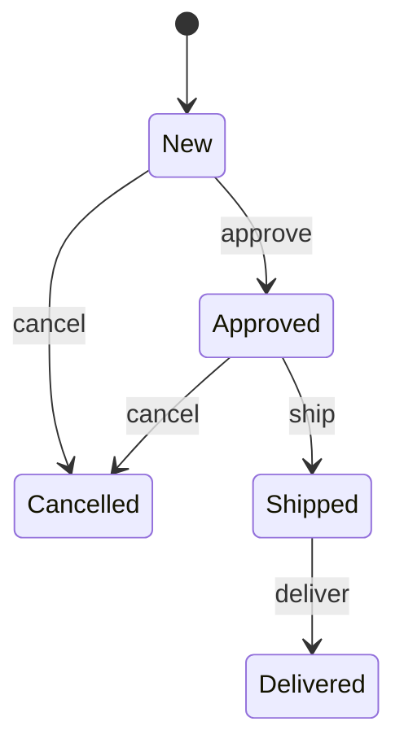
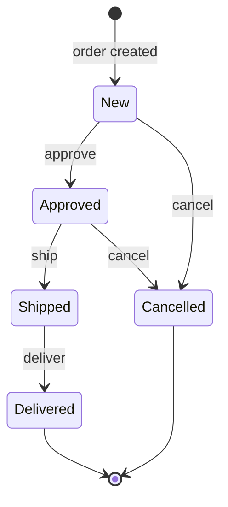

# Order Management: Entity-Based FSM: Walkthrough

> Generated from Ocean-Atlas v0.1.0 (content baec097c). Canonical source: https://atlas.ocean-lab.ai/examples/entity-order-fsm/

**Contents**

- [Horizon](#horizon)
- [Voyage](#voyage)

Horizon and Voyage explanation for the Order Management: Entity-Based FSM example.

Source: https://atlas.ocean-lab.ai/examples/entity-order-fsm/

## Horizon

### Order Lifecycle at a Glance

#### Learning Scenario

Every order has its own lifecycle. A new order may be approved or cancelled; an approved order may be shipped; and a shipped order may be delivered. Actions that do not make sense in the current state should not be available as valid transitions.

An entity-based FSM expresses these rules next to the entity it controls. Each order is identified independently, and its current status remains part of the persisted order rather than process-local memory.

#### Lifecycle



#### What It Demonstrates

- An FSM controlling the status field of an identified entity.
- Different valid events in different lifecycle states.
- Updating entity data as part of a transition.
- Lifecycle commands alongside creation, deletion, and queries.
- Initializing status and timestamps before persistence.

#### Expected Result

You will be able to create and find orders, move each order through its valid lifecycle, and observe its updated status and timestamp after every successful transition.

## Voyage

### 1. Model Orders and Their States

Start by naming every state an order may occupy. Using an enum prevents arbitrary strings from becoming lifecycle states.

```ocean-dsl
@datatype

enum OrderStatus
    new
    approved
    shipped
    delivered
    cancelled
```

The FSM will control the `status` field. The patterned ID is equally important because it identifies which order should transition.

```text
Order
    id         pattern O-UUID
    name      : String
    status    : OrderStatus
    customerId: String
    total     : Float
    createdAt : DateTime
    updatedAt : DateTime
```

### 2. Make Order a Persistent Entity

Declaring `Order` as an entity gives each FSM instance a persistent record. The entity key will match the FSM key used later.

```ocean-dsl
@database

Database OrderDb
    engine = postgres
    configType = DatabaseConfig

    Entity Order
        key(id)
        indexes: index(status), index(customerId), index(createdAt)
```

Queries support lookup, pagination, and searches. Commands cover normal persistence operations; lifecycle updates will be owned by the FSM.

```text
query findById(id:String) : Order
query listOrders(offset:Int, limit:Int) : List<Order>
query findByStatus(status:OrderStatus) : List<Order>
query findByCustomerId(customerId:String) : List<Order>

command T createOrder(order:Order) : Order
command T updateOrder(order:Order) : Order
command deleteOrder(id:String) : _
```

### 3. Separate Queries from Lifecycle Commands

Read endpoints expose the entity without changing its state. Callers can retrieve an order, page through orders, or search by useful fields.

```text
get /order/{id} getOrder(id:String) : Order
get /orders/{offset}/{limit} listOrders(offset:Int, limit:Int) : List<Order>
get /order/find/by-status/{status} findByStatus(status:OrderStatus) : List<Order>
```

Approve, ship, deliver, and cancel are explicit business commands. Each receives only an ID; the FSM uses it to find the entity and its state.

```text
post /order createOrder(order:Order) : Order
post /order/{id}/approve approveOrder(id:String) : Order
post /order/{id}/ship shipOrder(id:String) : Order
post /order/{id}/deliver deliverOrder(id:String) : Order
post /order/{id}/cancel cancelOrder(id:String) : Order
post /order/{id}/delete deleteOrder(id:String) : _
```

### 4. Initialize Every New Order Consistently

Callers should not choose initial lifecycle data. This expression sets both timestamps and forces every new order into the expected state.

```text
AddNewOrderWithTimestamp
    input: order:Order
    output: result:Order
    logic
        var ts DateTime
        ts = nowUTC()
        order.createdAt = ts
        order.updatedAt = ts
        order.status = OrderStatus.new
        result = Order.createOrder(order)
```

### 5. Bind the FSM to the Entity

The first line contains the key idea of an entity-based FSM:

```ocean-dsl
@fsm

OrderFSM controls Order.status
    key: id
```

- `OrderFSM` names the machine.
- `controls Order.status` binds state to the entity field.
- `key: id` identifies the particular order being changed.

Order A can therefore be New while Order B is Shipped. Each lifecycle state belongs to—and remains stored with—its own entity.

#### Declare typed lifecycle events

The ID is implicit because it is the FSM key. No other event input is needed, and every event returns the updated order.

```text
event approve in(_) out(order:Order)
event ship in(_) out(order:Order)
event deliver in(_) out(order:Order)
event cancel in(_) out(order:Order)
```

#### See the complete lifecycle



### 6. Define Valid Transitions State by State

A New order accepts only `approve` and `cancel`. `next` changes the controlled status, while `this` refers to the order currently handled by the FSM.

```text
state New
    on event approve:
        next Approved: this.updatedAt = nowUTC()

    on event cancel:
        next Cancelled: this.updatedAt = nowUTC()
```

The transition changes status and refreshes `updatedAt` together. The event returns the resulting entity declared by its output.

#### Continue the lifecycle

```text
state Approved
    on event ship:
        next Shipped: this.updatedAt = nowUTC()
    on event cancel:
        next Cancelled: this.updatedAt = nowUTC()

state Shipped
    on event deliver:
        next Delivered: this.updatedAt = nowUTC()
```

Missing handlers express business rules. New cannot be shipped, and a Shipped order cannot be approved or cancelled in this model.

#### Mark terminal states

```text
state Delivered

state Cancelled
```

Empty bodies are intentional: these are valid persisted states with no outgoing lifecycle events.

### 7. Wire Persistence and Lifecycle Operations

The service brings the API, database, FSM, and creation expression together without duplicating their responsibilities.

```text
OrderMgtService
    impl api OrderApi as api on myCfg.apiConfig.port
    use database OrderDb as odb
    use fsm OrderFSM as oFsm
    use expression AddNewOrderWithTimestamp as addOrder
```

Creation and queries connect to expressions or entity operations:

```text
connect api.createOrder -> addOrder
connect api.getOrder -> Order.findById
connect api.listOrders -> Order.listOrders
connect api.deleteOrder -> Order.deleteOrder
connect api.findByStatus -> Order.findByStatus
```

Lifecycle commands must go through the FSM so status cannot bypass its transition rules.

```text
connect api.approveOrder -> oFsm.approve
connect api.shipOrder -> oFsm.ship
connect api.deliverOrder -> oFsm.deliver
connect api.cancelOrder -> oFsm.cancel
```

### 8. Configure the API and Persistence

The backend needs an API port, database connection, and logging. Keeping these in config types avoids embedding environment details in the model.

```ocean-dsl
@config

@import config O.database.postgres.config@1.0.0 as DatabaseConfig
@import config O.log.config@1.0.0 as LogConfig

OrderMgtConfig
    apiConfig: ApiConfig
    dbConfig: DatabaseConfig
    logConfig: LogConfig
```

### 9. Build a UI Around the Lifecycle

Separate dashboards cover viewing, creating, searching, and managing orders. Every management form asks for the FSM key: the order ID.

```text
connect view.OrderTable.listRows -> OrderApi.listOrders
connect order.CreateForm.submit -> OrderApi.createOrder

connect manage.ApproveForm.submit -> OrderApi.approveOrder
connect manage.ShipForm.submit -> OrderApi.shipOrder
connect manage.DeliverForm.submit -> OrderApi.deliverOrder
connect manage.CancelForm.submit -> OrderApi.cancelOrder
```

The UI never writes status directly. It invokes business commands, and the service routes those commands through the FSM.

### 10. Deploy the Persistent Workflow

The backend depends on the database and exposes its API on port `9097`. The UI is exposed on `8087` and depends on the backend.

```text
OrderMgtDeploy
    service OrderMgtService
    replica 1
    export 9097:OrderMgtService.api
    dependsOn OrderMgtDatabase

OrderMgtDatabase
    service PostgresqlDB

OrderMgtUiDeploy
    service OrderMgtUi
    replica 1
    export 8087:OrderMgtUi.config
    dependsOn OrderMgtDeploy
```

Because state is stored in each order entity, lifecycle progress remains available after the backend restarts.

### 11. Exercise Valid and Invalid Lifecycles

1. Validate and generate the complete example.
2. Start the database, backend, and UI.
3. Open `localhost:8087` and create two orders.
4. Verify that both begin in `new`.
5. Approve, ship, and deliver the first order in sequence.
6. Cancel the second order directly from New.
7. Search by status and inspect each updated timestamp.
8. Try shipping a New order or cancelling a Delivered order.
9. Restart the backend and confirm that statuses remain stored.

Advancing one order changes only the entity identified by that ID. All other orders remain in their own independent lifecycle states.

### 12. Conclusion

The FSM does more than assign a status. It identifies an entity, checks which event is valid in its current state, updates the controlled field and related data, persists the change, and returns the resulting order.

Afterwards, you should understand how to:

- bind an FSM to an entity field with `controls`;
- identify independent FSM instances using `key`;
- declare events whose entity ID is implicit;
- define allowed events separately for each state;
- transition with `next` and update `this`;
- represent terminal states with empty state bodies;
- route lifecycle commands through the FSM;
- combine persisted workflows with CRUD and search operations.
