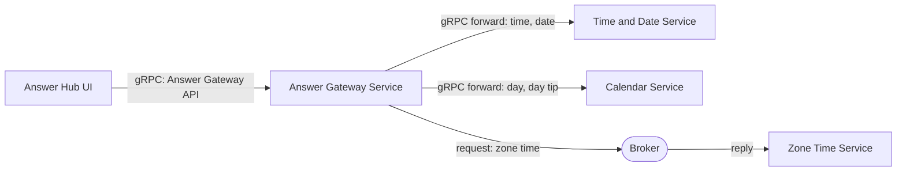

# gRPC Gateway Answer Hub: Walkthrough

> Generated from Ocean-Atlas v0.1.0 (content baec097c). Canonical source: https://atlas.ocean-lab.ai/examples/grpc-gateway-answer-hub/

**Contents**

- [Horizon](#horizon)
- [Voyage](#voyage)

Horizon and Voyage explanation for the gRPC Gateway Answer Hub example.

Source: https://atlas.ocean-lab.ai/examples/grpc-gateway-answer-hub/

## Horizon

### Example at a Glance

#### Overview

Clients should not need to know which service answers which question. This example gives them one public gRPC Answer API, with a single `.proto` contract, for the current time, date, day, day tip, and Amsterdam zone time. A gateway service owns that boundary: it forwards most methods to the provider gRPC APIs that already offer them, and routes the one method without a provider API through a broker request-response topic.

It is the gRPC counterpart of `gateway-answer-hub` (REST) and `soap-gateway-answer-hub` (SOAP). Only the API style changes: every API is declared with `style:grpc`, and the services, broker, UI, and deployment stay the same.

Draft: the gRPC style is specified, but its code generation is not implemented yet, so this example cannot be generated or run until gRPC support lands.

#### Architecture



The UI calls only the gateway gRPC service. Four methods are forwarded automatically to included APIs; zone time is routed explicitly to a broker responder.

#### What It Demonstrates

- `@api` — `style:grpc` APIs with their own protobuf package and server reflection, each generating a proto3 contract, typed server, and typed client.
- `@api` — `include` composes two provider gRPC APIs into one public gateway gRPC service that adds its own method.
- `@service` — `impl gateway api ... including` forwards matching operations automatically, and an explicit `connect` routes the rest.
- `@broker` — a request-response topic answered by a service that exposes no API.
- `@expression` — small provider expressions that produce each answer.
- `@dashboard` and `@ui` — a generated interface whose buttons call only the gateway API.
- `@config` and `@deploy` — shared service configuration and deployment of the gateway, providers, broker, and UI.

#### Expected Result

Each dashboard button calls one gRPC method of the public gateway API and displays its answer. Time, date, day, and day tip come from their provider services through automatic forwarding; zone time comes from the broker responder through the explicit route.

## Voyage

### 1. Problem and Constraints

A public API should be declared once and routed without repeating a `connect` for every operation that a provider already implements. Operations that no provider API offers must still be routable, and an explicit route must be visible in the model. All APIs use gRPC, so the public contract is one `.proto` service even though the methods come from several services. Streaming, `@from-context` metadata, and deadlines are out of scope, as are gateway policies such as authentication and rate limiting.

### 2. Prerequisites

- Ocean UI with the gateway capability of `@service`, API composition in `@api`, and gRPC code generation (specified, not implemented yet).
- A container runtime for the generated deployment.
- Recommended: `gateway-answer-hub` and `soap-gateway-answer-hub`, the same example with REST and SOAP APIs.
- Optional: `grpcurl`, or `curl` over the Connect protocol, for calling the services directly.

### 3. Example Structure

```text
0017-grpc-gateway-answer-hub/
├── 00-ggah-info.ocn
├── 10-ggah-api.ocn
├── 20-ggah-broker.ocn
├── 30-ggah-config.ocn
├── 40-ggah-expression.ocn
├── 50-ggah-service-calendar.ocn
├── 50-ggah-service-gateway.ocn
├── 50-ggah-service-time-date.ocn
├── 50-ggah-service-zone-time.ocn
├── 55-ggah-dashboard.ocn
├── 56-ggah-ui.ocn
├── 60-ggah-deploy.ocn
├── architecture.mmd
├── broker-communication.mmd
└── example-info/example-info.html
```

### 4. Declare and Compose the gRPC APIs

`10-ggah-api.ocn` defines the two provider APIs and the public `AnswerGatewayApi`, all with `style:grpc`. Each API uses the `connect` engine, declares its own `protoPackage`, and serves reflection; Ocean generates a proto3 contract, typed server, and typed client for each one.

```text
TimeDateApi style:grpc
    engine       = connect
    configType   = ApiConfig
    version      = 1.0.0
    protoPackage = oceanlab.examples.answerhub.timedate.v1
    reflection   = true

    rpc getTime() : String
    rpc getDate() : String
```

`include` reuses the provider operations without repeating them. The gateway API owns the transport settings, so the included operations become methods of its own protobuf service, in its package and its `.proto` contract.

```text
AnswerGatewayApi style:grpc
    engine       = connect
    configType   = ApiConfig
    version      = 1.0.0
    protoPackage = oceanlab.examples.answerhub.answers.v1
    reflection   = true

    include TimeDateApi, CalendarApi

    rpc getZoneTime() : String
```

The effective public service is `oceanlab.examples.answerhub.answers.v1.AnswerGatewayApi` with the methods `GetTime`, `GetDate`, `GetDay`, `GetDayTip`, and `GetZoneTime`; each is served at `/<protoPackage>.<ApiName>/<RpcName>`. Every method takes no input and returns a `String`, so on the wire the request is `google.protobuf.Empty` and the response is a generated message with one `value` field, such as `GetTimeResponse`.

Each API has its own package: the gateway's contract repeats the providers' methods and their generated messages, which would collide in a shared package.

### 5. Implement the Gateway Service

`50-ggah-service-gateway.ocn` implements the public gRPC API as a gateway. Every name after `including` is a local `use api` alias. `getTime`, `getDate`, `getDay`, and `getDayTip` match included operations and are forwarded automatically from the gateway's gRPC service to the provider's gRPC service. `getZoneTime` has no included counterpart, so it is connected explicitly to the broker topic.

```text
use api TimeDateApi as timeDate
use api CalendarApi as calendar
use broker AnswerHubBroker as broker

impl gateway api AnswerGatewayApi as gw on gwCfg.apiConfig.port
    including timeDate, calendar

connect gw.getZoneTime -> broker.answers.zoneTime
```

An explicit `connect` on a gateway operation also takes precedence over automatic forwarding, so the same form can override a forwarded route.

### 6. Provide the Answers

`TimeDateService` and `CalendarService` implement their provider gRPC APIs with ordinary `impl api` and `connect` statements to expressions; nothing in a service changes because an API uses gRPC. Services see each operation in its Ocean form, not its wire messages. `ZoneTimeService` implements no API: it answers the request-response topic declared in `20-ggah-broker.ocn`.

```text
AnswerHubBroker
    engine = nats
    configType = AnswerHubBrokerConfig

    answers.zoneTime : _-String as request-response with timeout:2s

ZoneTimeService
    use broker AnswerHubBroker as broker
    use expression GetAmsterdamTime as zoneTime

    connect broker.answers.zoneTime -> zoneTime
```

`GetAmsterdamTime` calls `GetZoneTimeString("Europe/Amsterdam")`.

### 7. Call Only the Gateway from the UI

`AnswerHubUi` uses `AnswerGatewayApi`, through its generated gRPC client, and nothing else. Each button on `AnswerHubDashboard` calls one public operation, so the UI does not depend on where each answer is produced.

```text
use api AnswerGatewayApi as gateway

connect answers.TimeButton.click -> gateway.getTime
connect answers.ZoneTimeButton.click -> gateway.getZoneTime
```

### 8. Select Technologies and Deploy

The APIs use the `connect` gRPC engine, the broker uses `nats`, and the UI is generated with HTMX, Bootstrap, and Go templates. `60-ggah-deploy.ocn` imports a NATS container and starts the gateway after its providers and the broker.

```text
GatewayDeploy
    service AnswerGatewayService
    replica 1
    export 9100:AnswerGatewayService.gw
    dependsOn TimeDateDeploy, CalendarDeploy, ZoneTimeDeploy, Broker

AnswerHubUiDeploy
    service AnswerHubUi
    replica 1
    export 8085:AnswerHubUi.config
    dependsOn GatewayDeploy
```

The provider gRPC APIs are also exported on ports `9101` and `9102` for direct inspection. The UI does not use them.

### 9. Validate, Generate, and Run

1. Once gRPC generation is available, open the `gRPC Gateway Answer Hub` example in Ocean UI.
2. Validate and generate the complete model, including the `.proto` contract of each gRPC API.
3. Follow the generated `Readme.md` to start the broker, services, and UI.
4. Open the UI at `localhost:8085`.

### 10. Verify the Result

1. Use the time, date, day, and day tip buttons; each answer is forwarded by the gateway to its provider service.
2. Use the Amsterdam zone time button; the answer is returned by `ZoneTimeService` through the broker.
3. List the gateway's services through reflection and confirm that `AnswerGatewayApi` has all five methods, although only `GetZoneTime` is declared locally:
  ```text
  grpcurl -plaintext localhost:9100 list
  grpcurl -plaintext localhost:9100 describe oceanlab.examples.answerhub.answers.v1.AnswerGatewayApi
  ```
4. Call `GetTime` on the gateway and on `TimeDateService` and compare the answers:
  ```text
  grpcurl -plaintext localhost:9100 oceanlab.examples.answerhub.answers.v1.AnswerGatewayApi/GetTime
  grpcurl -plaintext localhost:9101 oceanlab.examples.answerhub.timedate.v1.TimeDateApi/GetTime
  ```
   The `connect` engine also accepts the Connect protocol, so plain HTTP works too:
  ```text
  curl -X POST localhost:9100/oceanlab.examples.answerhub.answers.v1.AnswerGatewayApi/GetTime \
    -H 'Content-Type: application/json' -d '{}'
  ```
5. Stop `ZoneTimeService` and call `GetZoneTime`; the call fails with a gRPC error status after its two-second timeout while the forwarded methods still answer.

### 11. Experiments

- Add `connect gw.getTime -> broker.answers.zoneTime` and observe that the explicit route overrides automatic forwarding.
- Remove `calendar` from `including` and validate; `getDay` and `getDayTip` become unresolved public operations.
- Remove the `9101` and `9102` exports so that the gateway is the only reachable API.
- Give `CalendarApi` the gateway's `protoPackage` and compare the generated contracts; the gateway's `GetDayResponse` and `GetDayTipResponse` messages would now collide with the provider's.
- Change `CalendarApi` to `style:rest` and validate; the include is rejected because every included API must use the same style as the composing API.

### 12. Related Knowledge

- `dsl.api` — the gRPC style and API composition with `include`.
- `dsl.service` — gateway implementations.
- `dsl.broker` — request-response topics.
- `examples.gateway-answer-hub` and `examples.soap-gateway-answer-hub` — the same gateway with REST and SOAP APIs.
- `examples.answer-sync` and `examples.answer-async` — the same answers combined through aggregation.
