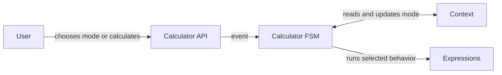
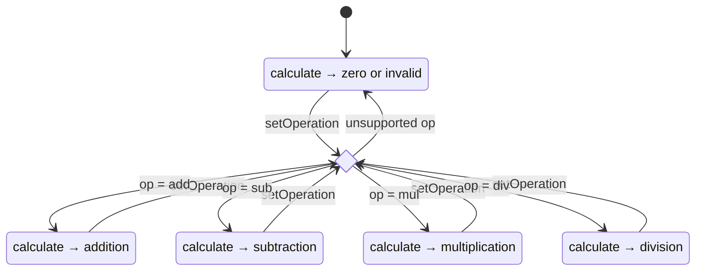

# Calculator: In-Memory FSM: Walkthrough

> Generated from Ocean-Atlas v0.1.0 (content baec097c). Canonical source: https://atlas.ocean-lab.ai/examples/in-memory-calculator-fsm/

**Contents**

- [Horizon](#horizon)
- [Voyage](#voyage)

Horizon and Voyage explanation for the Calculator: In-Memory FSM example.

Source: https://atlas.ocean-lab.ai/examples/in-memory-calculator-fsm/

## Horizon

### Calculator FSM at a Glance

#### Learning Scenario

Imagine a calculator where you choose the operation once. It remembers whether it is adding, subtracting, multiplying, or dividing, and every later calculation follows that active mode until you change it.

This small example makes state visible and practical. The finite state machine owns the current mode, a context stores its description, and each state selects the matching calculation behavior.

#### Architecture



#### What It Demonstrates

- An in-memory FSM with a default state.
- Events, transitions, and state lifecycle actions.
- A shared event handler available from every state.
- Context updates and state-specific expression routing.
- Plain and validated calculation results.

#### Expected Result

You will be able to select a mode, inspect it, and calculate through the behavior of the active state. Before a mode is selected, the calculator safely returns an invalid or zero result.

## Voyage

### 1. Model a Validated Result

Most calculations can return a number directly. Some failures, such as division by zero, also need to tell the caller whether that number is meaningful. We will model both pieces together.

```ocean-dsl
@datatype

CalcResult
    result: Float
    isValid: Boolean
```

`result` carries the calculated value, while `isValid` makes success or failure explicit. The FSM will use this datatype for its validated calculation event.

### 2. Define the Calculator API

The API exposes the four interactions needed to explore the state machine: inspect the current mode, change it, calculate a plain value, or calculate a validated result.

```ocean-dsl
@api

CalcApi style: rest
    engine = gin
    configType = ApiConfig
    basePath = /
    generateSwagger = true

    get /mode getMode(_) : String
post /set-op/{op} setOperation(op:String) : String
post /calc/{a}/{b} calculate(a:Float, b:Float) : Float
post /calc-valid/{a}/{b} calculateWithValidation(a:Float, b:Float) : CalcResult
```

Notice that `calculate` does not receive an operation. That is intentional: the active FSM state decides which operation runs. `setOperation` changes that state beforehand.

### 3. Define Arithmetic Expressions

Keep arithmetic outside the FSM itself. Each small expression accepts two floats and implements exactly one operation.

```text
CalcAdd
    input: a:Float & b:Float
    output: r:Float
    logic
        r = a + b

CalcSub
    input: a:Float & b:Float
    output: r:Float
    logic
        r = a - b
```

Multiplication follows the same pattern. Plain division protects itself from division by zero by returning zero.

A second family of expressions returns `CalcResult`. This lets the caller distinguish a real zero from an invalid calculation.

```text
CalcWithValidationDiv
    input: a:Float & b:Float
    output: r:CalcResult
    logic
        if b==0 then
            r.result = 0
            r.isValid = false
        else
            r.result = a / b
            r.isValid = true
        end
```

`GenerateInvalidCalcResult` provides the same explicit invalid result when no operation has been selected yet.

### 4. Keep a Small Piece of In-Memory Context

The state name already controls behavior. The context stores a friendly description so callers can ask which mode is active.

```ocean-dsl
@context

CalcFsmContext
    mode: String (default=no operation)
```

This context is used by an `in-memory` FSM, so it is transient: it belongs to the running instance and is not stored in a database. A restart begins again from the FSM's default state and context value.

### 5. Define the In-Memory FSM

Now we can define the central concept. Adding `in-memory` after the FSM name selects transient state handling for this machine.

```ocean-dsl
@fsm

CalcFSM in-memory
    states: NoOp, Adding, Subtracting, Multiplying, Dividing
    default: NoOp
```

`states` lists every possible mode. `default` chooses where a new FSM starts. Here, `NoOp` prevents calculations from accidentally using an operation before one is selected.



Because `setOperation` is handled by `Every`, each operation can be selected from any current state. An unsupported value returns the machine to `NoOp`.

#### Declare typed events

Events are the FSM's public operations. Their inputs and outputs match the API methods that will connect to them later.

```text
event getMode in(_) out(mode:String)
    event setOperation in(op:String) out(result:String)
    event calculate in(a:Float & b:Float) out(r:Float)
    event calculateWithValidation in(a:Float & b:Float) out(r:CalcResult)
```

#### Make context and expressions available

The FSM imports its context with an alias and does the same for several expressions. Aliases such as `add` and `divV` keep the state handlers compact.

```text
use context CalcFsmContext as fsmCtx

use expression CalcAdd as add
use expression CalcSub as sub
use expression CalcMul as mul
use expression CalcDiv as div
use expression CalcWithValidationAdd as addV
use expression CalcWithValidationSub as subV
use expression CalcWithValidationMul as mulV
use expression CalcWithValidationDiv as divV
use expression GenerateInvalidCalcResult
```

### 6. Add Shared Transitions and State Behavior

#### Handle mode changes from every state

`Every` is a shared state section. Its handlers are available regardless of which concrete state is active, so we only need to define `setOperation` and `getMode` once.

```text
state Every
    on event setOperation: logic
        if op == "add" then
            next Adding: result = "ADD"
        end
        if op == "sub" then
            next Subtracting: result = "SUB"
        end
        if op == "mul" then
            next Multiplying: result = "MUL"
        end
        if op == "div" then
            next Dividing: result = "DIV"
        end
        next NoOp

    on event getMode: logic
        emit mode = fsmCtx.mode
```

`next` changes the active state and can also assign an event output. `emit` returns a value without changing state. If no supported operation matches, the final `next NoOp` provides a safe fallback.

#### Use lifecycle handlers

A state's `on enter` handler runs when that state becomes active. Here it updates the friendly mode stored in context.

```text
state Adding
    on enter:
        update fsmCtx.mode = "Adding mode."

    on event calculate:
        emit r = add(a, b)

    on event calculateWithValidation: logic
        emit r = addV(a, b)

    on exit: placeholder
```

This one state demonstrates the main FSM actions: `update` changes context, and `emit` returns the expression result. A `placeholder` exit marks a lifecycle hook without adding behavior yet.

#### Give each state its own calculation

Subtracting, Multiplying, and Dividing keep the same event contract but invoke different expressions. A handler may call an imported alias such as `sub(a, b)`, or the expression name directly, as the multiplying and dividing handlers demonstrate.

```text
state Dividing
    on enter:
        update fsmCtx.mode = "Dividing mode"
    on event calculate:
        emit r = CalcDiv(a, b)
    on event calculateWithValidation:
        emit r = CalcWithValidationDiv(a, b)
```

#### Keep the default state safe

```text
state NoOp
    on enter: logic
        update fsmCtx.mode = "No-operation mode. Returns zero"
    on event calculate: logic
        emit r = 0
    on event calculateWithValidation: logic
        emit r = GenerateInvalidCalcResult()
    on exit: empty
```

`empty` explicitly says that no exit work is needed. The source also demonstrates an `external` exit hook on the Subtracting state; that hook delegates lifecycle work to a named method in a source file and is separate from the calculator's main learning flow.

### 7. Connect the API to the FSM

The service does not choose arithmetic behavior itself. It implements the API, imports one FSM instance, and forwards each API method to the matching typed event.

```ocean-dsl
@service

CalcService
    use config CalcConfig as myCfg
    impl api CalcApi as api on myCfg.apiConfig.port
    use fsm CalcFSM as fsm

    connect api.getMode -> fsm.getMode
    connect api.setOperation -> fsm.setOperation
    connect api.calculate -> fsm.calculate
    connect api.calculateWithValidation -> fsm.calculateWithValidation
```

This is an important separation: the service owns integration, the FSM owns state and dispatch, and expressions own the arithmetic logic.

### 8. Configure the Service and UI

This example needs no broker or database configuration. The service only needs an API port and logging, while the UI gets its own port and logging settings.

```ocean-dsl
@config

@import config O.log.config@1.0.0 as LogConfig

CalcConfig
    apiConfig: ApiConfig
    logConfig: LogConfig

ApiConfig
    port: Int (default=8080)

UiConfig
    port: Int (default=8080)
    logConfig: LogConfig
```

### 9. Build a Dashboard for Exploring State

The dashboard deliberately separates mode selection from calculation. That lets you change the FSM once and then observe how the same inputs produce different results in different states.

```ocean-dsl
@dashboard

Widget OpForm of type Form
    title = ⚙️ Choose Operation!
    fields:
        - operation String
    buttons:
        submit: Choose

Widget ModeButton of type Button
    label = Which Operation?
```

Two calculation forms accept `a` and `b`. One returns a plain float; the other returns `CalcResult` so you can inspect its validity flag.

### 10. Connect UI Actions to FSM-Backed APIs

The UI uses only `CalcApi`. It does not need to know that an FSM sits behind the service or that context holds the readable mode.

```text
use dashboard CalcDashboard as cal
use api CalcApi

connect cal.OpForm.submit -> CalcApi.setOperation
connect cal.ModeButton.click -> CalcApi.getMode
connect cal.CalcForm.submit -> CalcApi.calculate
connect cal.CalcValForm.submit -> CalcApi.calculateWithValidation
```

Afterwards, choosing `add`, `sub`, `mul`, or `div` will change how both calculation forms behave.

### 11. Deploy One Stateful Service Instance

The calculator service runs with one replica because its FSM state lives in that process's memory. The API is exposed on port `9096`.

```ocean-dsl
@deploy

CalcDeploy
    service CalcService
    replica 1
    export 9096:CalcService.api

CalcUiDeploy
    service CalcUi
    replica 1
    export 8086:CalcUi.config
    dependsOn CalcDeploy
```

The UI is exposed on `8086` and starts after the calculator service. For an in-memory FSM, adding replicas would create independent state in each instance; shared or durable state would require a different design.

### 12. Run Through the State Transitions

1. Validate and generate the complete example.
2. Start the generated service and UI.
3. Open `localhost:8086` and ask for the initial mode.
4. Calculate before selecting an operation and inspect the safe result.
5. Select `add`, calculate two numbers, and check the mode.
6. Switch to `sub`, `mul`, and `div`.
7. Try validated division with zero as the second number.
8. Submit an unsupported operation and verify the return to NoOp.

The useful observation is that the calculation request never changes. Only the FSM state changes, and that state selects the expression that handles the event.

### 13. Conclusion

You have used a finite state machine to turn one calculator API into several state-dependent behaviors. The example stays small, but it demonstrates the complete FSM loop: receive an event, inspect or change state, update context, run state-specific logic, and emit a result.

Afterwards, you should understand how to:

- declare an `in-memory` FSM and its default state;
- define typed input and output for FSM events;
- use `Every` for behavior shared by all states;
- move between states with `next`;
- return event results with `emit`;
- update readable state information in context;
- use enter and exit lifecycle hooks;
- delegate state-specific work to reusable expressions;
- connect a service API cleanly to an FSM.
