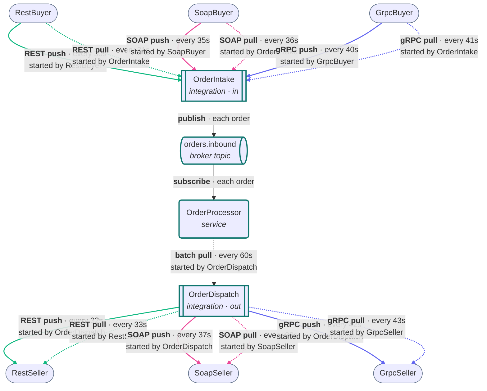
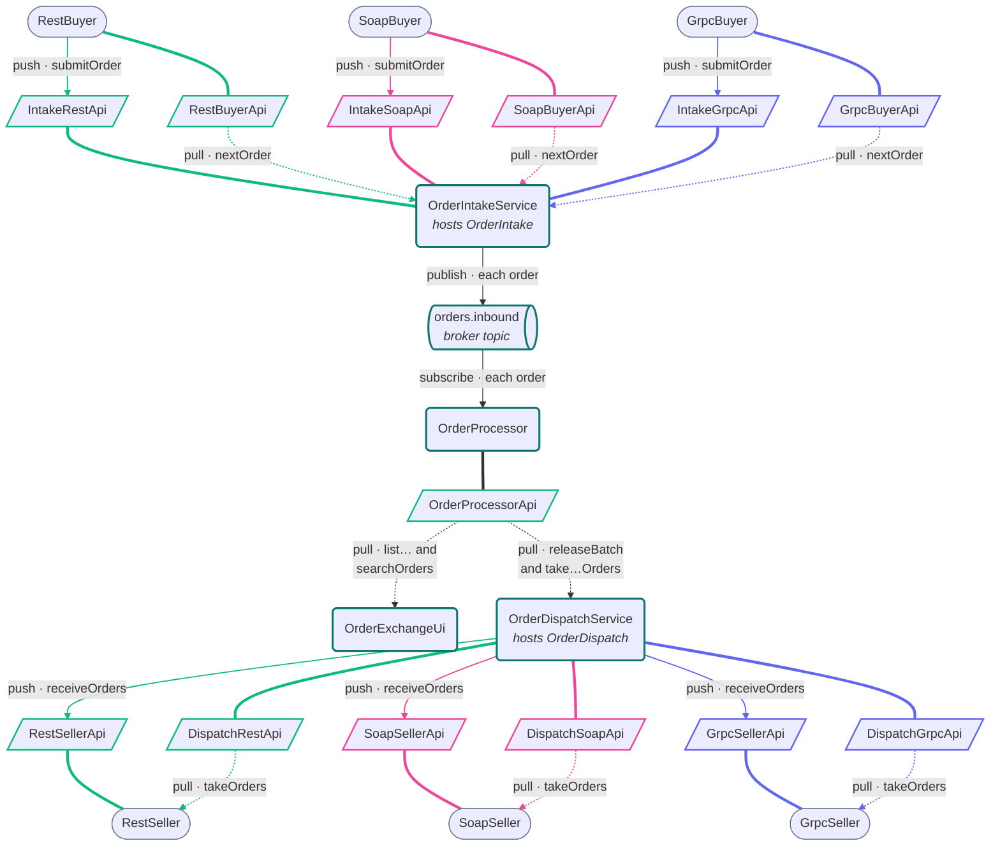

# Order Exchange: Walkthrough

> Generated from Ocean-Atlas v0.1.0 (content baec097c). Canonical source: https://atlas.ocean-lab.ai/examples/order-exchange/

**Contents**

- [Horizon](#horizon)
- [Voyage](#voyage)

Horizon and Voyage explanation for the Order Exchange example.

Source: https://atlas.ocean-lab.ai/examples/order-exchange/

## Horizon

### Example at a Glance

#### Overview

Real integrations rarely meet one kind of partner. This exchange takes orders from three buyers and hands them on to three sellers, and every partner speaks its own API style, REST, SOAP, or gRPC, with its own order format. Each partner is reached both ways: it pushes to Ocean, and Ocean pulls from it. That makes twelve flows, one for every combination of style, direction, and push or pull.

Draft: the model follows the Ocean references, but the engine cannot yet generate the SOAP and gRPC outbound aggregates or the scheduled pulls. Everything else validates, generates, and compiles.

#### Architecture



Solid lines are pushes and dotted lines are pulls. Each label names the party whose timer starts the call. REST flows are green, SOAP flows pink, and gRPC flows indigo.

#### What It Demonstrates

- `@integration` — an inbound and an outbound integration, each hosted by a thin service, with push and pull derived from their shape.
- `@api` — REST, SOAP, and gRPC APIs side by side, implemented by integrations and partners and used across them.
- `@expression` — a mapper for each partner format on the way in and on the way out, around one canonical `Order`.
- `@schedule` — scheduled connections and aggregates, each owned by the party that starts the call.
- `@broker` — an event topic as the queue between intake and processing.
- `@context` — the processor's orders, from which the six outboxes are derived.
- `@dashboard` and `@ui` — a flow monitor, order and dispatch lists, and a search form.
- `@config` and `@deploy` — one port type per API style, so one service can serve all three.

#### Expected Result

The Flow Monitor lists all twelve flows. Inbound counts grow as buyers push and OrderIntake polls; once a minute OrderDispatch releases the processed batch, and the outbound counts grow as each seller is pushed to or polls. The Orders dashboard shows every order with the flow it came in on, the flow it goes out on, and its status. The Dispatched dashboard shows which seller got each order and how long it waited, and the Search dashboard finds the orders of any buyer or seller.

## Voyage

### 1. Problem and Constraints

Every partner has its own protocol, its own format, and its own idea of who calls whom. The exchange must accept pushes and run polls on the way in, make pushes and serve polls on the way out, and keep one canonical order inside. Push and pull are never declared in Ocean; they follow from which side implements an API and which side runs the schedule, so each timer lives with whoever starts the call.

### 2. Prerequisites

- Ocean UI with the SOAP and gRPC API styles and hosted integrations.
- A container runtime for the generated deployment.
- Recommended: `purchase-order-orchestration` for integrations and aggregates, and the three gateway answer hubs for the REST, SOAP, and gRPC styles.

### 3. Example Structure

```text
0018-order-exchange/
├── 00-oex-info.ocn
├── 01-oex-context.ocn
├── 10-oex-datatype.ocn
├── 20-oex-api-dispatch-grpc.ocn
├── 20-oex-api-dispatch-rest.ocn
├── 20-oex-api-dispatch-soap.ocn
├── 20-oex-api-grpc-buyer.ocn
├── 20-oex-api-grpc-seller.ocn
├── 20-oex-api-intake-grpc.ocn
├── 20-oex-api-intake-rest.ocn
├── 20-oex-api-intake-soap.ocn
├── 20-oex-api-order-processor.ocn
├── 20-oex-api-rest-buyer.ocn
├── 20-oex-api-rest-seller.ocn
├── 20-oex-api-soap-buyer.ocn
├── 20-oex-api-soap-seller.ocn
├── 20-oex-broker.ocn
├── 30-oex-config.ocn
├── 40-oex-expression-buyers.ocn
├── 40-oex-expression-dispatch-mappers.ocn
├── 40-oex-expression-intake-mappers.ocn
├── 40-oex-expression-processor.ocn
├── 40-oex-expression-sellers.ocn
├── 50-oex-integration-dispatch.ocn
├── 50-oex-integration-intake.ocn
├── 51-oex-service-grpc-buyer.ocn
├── 51-oex-service-rest-buyer.ocn
├── 51-oex-service-soap-buyer.ocn
├── 52-oex-service-order-dispatch.ocn
├── 52-oex-service-order-intake.ocn
├── 52-oex-service-order-processor.ocn
├── 53-oex-service-grpc-seller.ocn
├── 53-oex-service-rest-seller.ocn
├── 53-oex-service-soap-seller.ocn
├── 55-oex-dashboard-dispatched.ocn
├── 55-oex-dashboard-flows.ocn
├── 55-oex-dashboard-orders.ocn
├── 55-oex-dashboard-search.ocn
├── 56-oex-ui.ocn
├── 60-oex-deploy.ocn
├── architecture.mmd
├── services.mmd
├── expression/order-exchange.go
└── example-info/example-info.html
```

### 4. Services and the APIs Between Them

The architecture shows the twelve flows; this view shows what carries them. Every API sits between the service that calls it and the service that implements it. Arrows follow the orders: solid lines are pushes, dotted lines are pulls, and each label names the operation. A thick line joins an API to the service that implements it.



Buyers and sellers each implement one API and call another, which is how every partner is reached both ways. OrderIntakeService and OrderDispatchService implement one API per style through their hosted integrations. Only orders.inbound goes through the broker.

### 5. Give Every Partner Its Own Format

`10-oex-datatype.ocn` defines the canonical `Order` and one format per partner, each with its own vocabulary. The gRPC buyer and the SOAP seller also nest their line item.

```text
RestBuyerOrder                GrpcBuyerOrder
    orderId  : String             code    : String
    product  : String             line    : GrpcBuyerLine
    quantity : Int                account : String
    buyer    : String             channel : String
    channel  : String
```

Mappers convert at the boundary, in `40-oex-expression-intake-mappers.ocn` and `40-oex-expression-dispatch-mappers.ocn`: `MapRestBuyerOrder`, `MapSoapBuyerOrder`, and `MapGrpcBuyerOrder` on the way in, and `MapToRestSellerOrders`, `MapToSoapSellerOrders`, and `MapToGrpcSellerOrders` on the way out. Their Go bodies are in `expression/order-exchange.go`.

### 6. Take Orders In: Push and Pull

`OrderIntake` implements one intake API per style, which the buyers push to, and uses each buyer's API, which it polls. Both paths map the buyer's format and publish the result.

```text
impl api IntakeSoapApi as soapIn on cfg.soapApiConfig.port
use api SoapBuyerApi as soapBuyer
use expression MapSoapBuyerOrder as fromSoapBuyer

# Push: the buyer calls on its own timer.
connect soapIn.submitOrder -fromSoapBuyer-> broker.orders.inbound

# Pull: OrderIntake polls on its timer.
connect soapBuyer.nextOrder -fromSoapBuyer-> broker.orders.inbound schedule every 36s
```

The buyer's push is its own scheduled connection, in `51-oex-service-soap-buyer.ocn`: `connect push -> intake.submitOrder schedule every 35s`.

### 7. Queue and Process

`orders.inbound` is an event topic, the queue between intake and processing. `OrderProcessor` consumes it and keeps every order in `ProcessorContext` with an outbound flow, assigned in turn across the six seller flows, and a status.

```text
connect broker.orders.inbound -> process()
```

An integration keeps no state, so the outboxes live here: the released orders of each outbound flow. `OrderProcessorApi` releases the processed batch and hands out each flow's outbox.

### 8. Hand Orders On: Push and Pull

`OrderDispatch` releases the processed batch every sixty seconds, then runs one aggregate per outbound flow. A push aggregate runs on OrderDispatch's own schedule and delivers to the seller; a pull aggregate runs when the seller polls the dispatch API and responds.

```text
aggregate PushToSoapSeller
    schedule every 37s
    result: List<OrderBatch>
    collect processor.takeSoapPushOrders
    deliver soapSeller.receiveOrders using toSoapSeller

aggregate ServeSoapSeller
    trigger soapOut.takeOrders
    result: List<OrderBatch>
    collect processor.takeSoapPullOrders
    respond using toSoapSeller
```

The seller's poll is its own scheduled connection, in `53-oex-service-soap-seller.ocn`: `connect dispatch.takeOrders -> accept() schedule every 38s`.

### 9. One Port per API Style

`OrderIntakeService` and `OrderDispatchService` each serve REST, SOAP, and gRPC at once, so each style has its own port type and default: `ApiConfig` (8080), `SoapApiConfig` (8081), and `GrpcApiConfig` (8082). A config field is named after its type, as the generated services expect.

```text
CommonServiceConfig
    apiConfig     : ApiConfig
    soapApiConfig : SoapApiConfig
    grpcApiConfig : GrpcApiConfig
    brokerConfig  : BrokerConfig
    logConfig     : LogConfig
```

### 10. Watch the Flows and Track the Orders

`OrderExchangeUi` reads `OrderProcessorApi` in four dashboards:

- **Flow Monitor**: one row per flow, with who starts it, its schedule, and its order count.
- **Orders**: every order, newest first, with its buyer and seller, flows, status, and times.
- **Dispatched**: the orders handed on to sellers, with how long each waited in the exchange.
- **Search**: a form that finds orders by buyer, by seller, or both.

OrderProcessor stamps each order when it accepts it and when its outbox is taken, so every order can be followed from buyer to seller. The search form is backed by an operation that takes the form's datatype:

```text
OrderQuery
    buyer  : String
    seller : String

post /orders/search searchOrders(query:OrderQuery) : List<OrderRow>

connect search.OrderSearchForm.submit -> OrderProcessorApi.searchOrders
```

### 11. Validate, Generate, and Run

1. Open the `Order Exchange` example in Ocean UI and validate it.
2. Once the engine supports SOAP and gRPC aggregates and scheduled API calls, generate the complete model.
3. Follow the generated `Readme.md` to start the broker, services, and UI.
4. Open the UI at `localhost:8086`.

### 12. Verify the Result

1. Within a minute, all six inbound rows on the Flow Monitor count orders.
2. After the first batch release, at sixty seconds, the six outbound rows start counting as well.
3. On the Orders dashboard, orders move from processed to released to dispatched, spread evenly over the six outbound flows.
4. The Dispatched dashboard fills with orders from all three buyers, each with its seller and waiting time.
5. Search for seller `SoapSeller`: every result goes out on a SOAP flow. Add buyer `GrpcBuyer` to narrow it to orders that also came in over gRPC.
6. Each seller's log reports every delivery, pushed or pulled.

### 13. Experiments

- Change a buyer's push interval and watch its inbound row count faster or slower.
- Stop `OrderProcessor`: intake keeps publishing, and the orders wait in the broker topic.
- Add a field to `SoapBuyerOrder` and carry it through its mapper to `Order`.
- Replace the round-robin assignment in `AcceptOrder` with routing by product.

### 14. Related Knowledge

- `dsl.integration` — direction, derived push and pull, and hosting.
- `dsl.api` — the REST, SOAP, and gRPC styles.
- `dsl.schedule` — scheduled connections and aggregates.
- `dsl.service` — aggregates and hosted integrations.
- `examples.purchase-order-orchestration` — the integration and aggregate patterns this example builds on.
