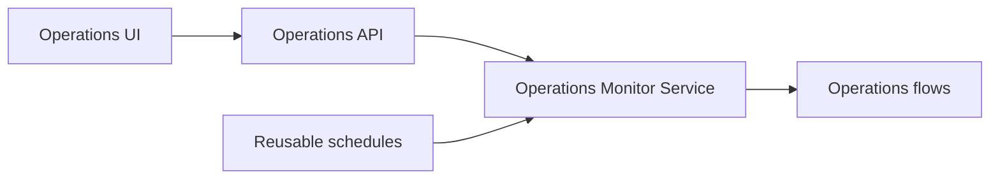

# Scheduled Operations Monitor: Walkthrough

> Generated from Ocean-Atlas v0.1.0 (content baec097c). Canonical source: https://atlas.ocean-lab.ai/examples/scheduled-operations-monitor/

Horizon and Voyage explanation for the Scheduled Operations Monitor example.

Source: https://atlas.ocean-lab.ai/examples/scheduled-operations-monitor/

## Horizon

### Example at a Glance

#### Overview

Operational tasks often recur at different cadences: collecting pending work, producing daily reports, reconciling state during the week, and closing a reporting period. This example models those triggers as reusable logical schedules, separate from the work that they invoke.

#### Architecture



The UI observes the modeled operations while the schedules independently trigger their flows.

#### What It Demonstrates

- `@service` — named and inline schedules applied to operations, connections, and aggregate fan-out.
- `@expression` — zero-input scheduled sources and their downstream processing flows.
- `aggregate` — scheduled API fan-out across data and reporting services.
- `@api` — read endpoints that expose operational schedule information to the UI.
- `@dashboard` and `@ui` — a generated interface defined entirely in Ocean DSL.
- `@config` and `@deploy` — configuration and deployment for both the service and UI.

#### Expected Result

The generated service registers independent jobs for interval, daily, weekly, and monthly work. The generated UI provides an operations view whose buttons call the generated API endpoints.

## Voyage

### 1. Problem and Constraints

A schedule must state when work runs without coupling the model to a particular scheduling product. Each scheduled binding needs its own overlap behavior: skip a duplicate trigger, queue one follow-up run, or permit parallel executions.

### 2. Example Structure

```text
0013-scheduled-operations-monitor/
├── 00-som-info.ocn
├── 10-som-datatype.ocn
├── 20-som-api.ocn
├── 30-som-config.ocn
├── 40-som-expression.ocn
├── 50-som-service.ocn
├── 51-som-data-service.ocn
├── 52-som-reporting-service.ocn
├── 55-som-dashboard.ocn
├── 56-som-ui.ocn
├── 60-som-deploy.ocn
└── example-info/example-info.html
```

### 3. Model Reusable Schedules

`50-som-service.ocn` names four logical schedules. The daily schedule includes seconds and an IANA timezone; the interval intentionally has no timezone. Named schedules can be reused, while the Friday and Sunday examples show one-off inline schedules.

```text
schedule DailyReporting daily at 02:00:35 timezone Europe/Amsterdam overlap queue
schedule MonthlyClose monthly on day 1 at 00:05 timezone UTC overlap skip

operation dailyReport schedule DailyReporting
aggregate api.getMonthlyState -> data.getPendingOperations | data.getReconciliationState | reporting.getMonthlyStatus schedule MonthlyClose
```

### 4. Generate the Operations UI

The dashboard and UI use ordinary API connections. They do not duplicate scheduling behavior in the browser; scheduled work stays in the service boundary, while the UI remains an observable, independently generated view.

### 5. Validate, Generate, and Run

1. Open this directory in Ocean UI and validate the complete model.
2. Generate the configured target and inspect the service scheduler runtime and scheduler registration files.
3. Run the generated deployment and open the Operations UI.

### 6. Verify the Result

1. Inspect the generated service scheduler: each scheduled operation, connection, and aggregate is a distinct job.
2. Confirm the daily registration loads `Europe/Amsterdam` and the calendar schedules use their declared timezones.
3. Use the UI buttons to call the overview, daily-report, and monthly-state API endpoints.

### 7. Experiments

- Change `FastCollection` from `skip` to `queue` and observe the generated overlap policy.
- Add Thursday to `WeeklyReconciliation` and regenerate.
- Replace the inline Friday schedule with a named definition when another binding needs the same cadence.
