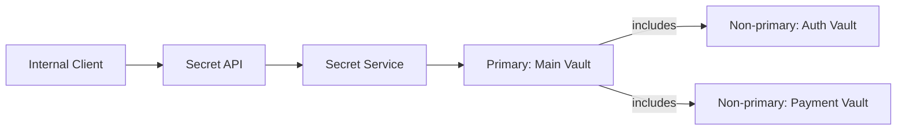
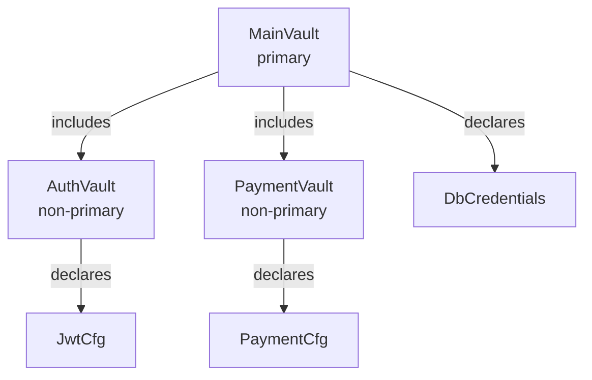

# Simple Vault Usage: Walkthrough

> Generated from Ocean-Atlas v0.1.0 (content baec097c). Canonical source: https://atlas.ocean-lab.ai/examples/simple-vault-usage/

**Contents**

- [Horizon](#horizon)
- [Voyage](#voyage)

Horizon and Voyage explanation for the Simple Vault Usage example.

Source: https://atlas.ocean-lab.ai/examples/simple-vault-usage/

## Horizon

### Vault Usage at a Glance

#### What Is a Vault?

A vault describes a logical collection of secrets. Ocean models the name, type, and purpose of each secret while keeping its actual value outside application logic and source models.

This example separates database credentials, authentication settings, and payment settings. The service can ask for a typed secret without knowing where or how its value is stored at runtime.

#### Primary and Non-Primary Vaults

A **non-primary vault** is a focused, reusable group of secrets. Here, Auth Vault owns authentication configuration and Payment Vault owns payment-provider configuration.

A **primary vault** is the main vault definition for the application. Main Vault owns the database credentials and includes both non-primary vaults, bringing the three secret areas into one composition.

#### Architecture



#### What It Demonstrates

- Typed secret contracts without embedded secret values.
- A primary vault composed from focused non-primary vaults.
- Reading secrets in expressions.
- Keeping secret values outside source models.

#### Expected Result

You will build an internal learning API that retrieves typed database, authentication, and payment configuration through logical vaults.

## Voyage

### 1. Define Secret Types

Describe the shape of each secret without providing its value. Consumers can then retrieve secrets as ordinary typed data.

```ocean-dsl
@datatype

DatabaseCredentials
    username: String
    password: String

JwtConfig
    secret: String
    issuer: String

PaymentApiConfig
    apiKey: String
    endpoint: String
```

These are contracts, not credentials. No username, password, signing secret, or payment API key is embedded in the model.

### 2. Define AuthVault in the First Vault File

`vault1.ocn` contains a focused, non-primary vault for authentication settings.

```ocean-dsl
@vault

Vault AuthVault
    primary = false

    Secret JwtCfg
        type = JwtConfig
        description = JWT signing configuration
```

The Secret declaration provides a logical name, expected datatype, and human-readable purpose—still without containing the runtime value.

### 3. Define PaymentVault in the Second Vault File

`vault2.ocn` begins with the other non-primary vault. Payment settings stay separate from authentication settings.

```text
Vault PaymentVault
    primary = false

    Secret PaymentCfg
        type = PaymentApiConfig
        description = Payment provider configuration
```

This declaration was missing from the previous documentation. It is the source of `PaymentVault.PaymentCfg` used later by the service.

### 4. Compose Them with the Primary MainVault

The second file also declares the primary vault. It includes both non-primary vaults and owns the database credentials itself.

```text
Vault MainVault
    primary = true
    includes = AuthVault, PaymentVault
    engine = hashicorp

    Secret DbCredentials
        type = DatabaseCredentials
        description = Database credentials
```



Included secrets keep their declaring vault names. Composition does not change `AuthVault.JwtCfg` into a MainVault reference.

### 5. Define an Internal Learning API

Each endpoint returns the datatype of one declared secret.

```text
get /db-credentials getDbCredentials() : DatabaseCredentials
get /jwt-config getJwtConfig() : JwtConfig
get /payment-config getPaymentConfig() : PaymentApiConfig
```

The API is tagged internal. Returning raw secrets is useful for this focused example, but it should not be treated as a public API pattern.

### 6. Read Secrets from All Three Vaults

A secret reference follows `VaultName.SecretName`. Each expression returns one typed value without handling storage details.

```text
GetDbCredentials
    output: out:DatabaseCredentials
    logic
        out = MainVault.DbCredentials

GetJwtConfig
    output: out:JwtConfig
    logic
        out = AuthVault.JwtCfg

GetPaymentConfig
    output: out:PaymentApiConfig
    logic
        out = PaymentVault.PaymentCfg
```

### 7. Assemble the Secret Service

The service declares every vault it depends on and connects each API method to its corresponding retrieval expression.

```text
use vault MainVault
use vault AuthVault
use vault PaymentVault

connect api.getDbCredentials -> GetDbCredentials
connect api.getJwtConfig -> GetJwtConfig
connect api.getPaymentConfig -> GetPaymentConfig
```

This makes the complete dependency set visible: one primary vault, two non-primary vaults, and three typed Secret entries.

### 8. Separate Vault Definitions from Configuration

The logical vault model says what secrets exist. Runtime configuration supplies the settings needed to access a vault implementation.

```ocean-dsl
@import config O.vault.config.local@1.0.0 as LocalVaultConfig

AppConfig
    apiConfig: ApiConfig
    logConfig: LogConfig
    vaultConfig: LocalVaultConfig
```

### 9. Choose a Vault Runtime

Deployment realizes the logical vault using a packaged runtime and starts the secret service after it.

```ocean-dsl
@import service P.vault.hashicorp.docker@1.0.0 as Hashicorp

SecretDeploy
    service SecretService
    export 9098:SecretService.api
    dependsOn Vault

Vault
    service Hashicorp
```

The API is exposed on port `9098`. The vault runtime remains a dependency rather than becoming part of the public service contract.

### 10. Validate the Complete Composition

1. Validate and generate the example.
2. Confirm MainVault is primary.
3. Confirm AuthVault and PaymentVault are non-primary and included.
4. Provide values using the generated runtime guidance.
5. Start the vault runtime and SecretService.
6. Call all three internal endpoints and inspect their typed shapes.
7. Confirm actual secret values do not appear in the Ocean sources.

### 11. Conclusion

MainVault now acts as the primary composition, while AuthVault and PaymentVault remain focused non-primary vaults. Together they expose three typed secret contracts without embedding their values in code.

Afterwards, you should understand how to:

- define the datatype expected from a secret;
- declare named and documented Secret entries;
- choose primary and non-primary vault roles;
- compose vaults with `includes`;
- read values through `Vault.Secret` references;
- separate logical definitions from runtime configuration;
- declare all vault dependencies explicitly in a service.
