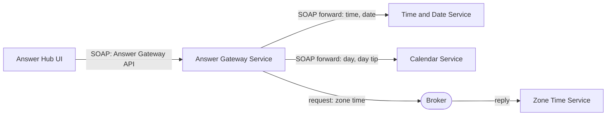

# SOAP Gateway Answer Hub: Walkthrough

> Generated from Ocean-Atlas v0.1.0 (content baec097c). Canonical source: https://atlas.ocean-lab.ai/examples/soap-gateway-answer-hub/

**Contents**

- [Horizon](#horizon)
- [Voyage](#voyage)

Horizon and Voyage explanation for the SOAP Gateway Answer Hub example.

Source: https://atlas.ocean-lab.ai/examples/soap-gateway-answer-hub/

## Horizon

### Example at a Glance

#### Overview

Clients should not need to know which service answers which question. This example gives them one public SOAP Answer API, with a single WSDL, for the current time, date, day, day tip, and Amsterdam zone time. A gateway service owns that boundary: it forwards most operations to the provider SOAP APIs that already offer them, and routes the one operation without a provider API through a broker request-response topic.

It is the SOAP counterpart of `gateway-answer-hub`. Only the API style changes: every API is declared with `style:soap`, and the services, broker, UI, and deployment stay the same.

#### Architecture



The UI calls only the gateway SOAP endpoint. Four operations are forwarded automatically to included APIs; zone time is routed explicitly to a broker responder.

#### What It Demonstrates

- `@api` — `style:soap` APIs with their own namespace, endpoint path, and SOAP version, each generating a SOAP server, typed client, and WSDL.
- `@api` — `include` composes two provider SOAP APIs into one public gateway SOAP API that adds its own operation.
- `@service` — `impl gateway api ... including` forwards matching operations automatically, and an explicit `connect` routes the rest.
- `@broker` — a request-response topic answered by a service that exposes no API.
- `@expression` — small provider expressions that produce each answer.
- `@dashboard` and `@ui` — a generated interface whose buttons call only the gateway API.
- `@config` and `@deploy` — shared service configuration and deployment of the gateway, providers, broker, and UI.

#### Expected Result

Each dashboard button calls one SOAP operation of the public gateway API and displays its answer. Time, date, day, and day tip come from their provider services through automatic forwarding; zone time comes from the broker responder through the explicit route.

## Voyage

### 1. Problem and Constraints

A public API should be declared once and routed without repeating a `connect` for every operation that a provider already implements. Operations that no provider API offers must still be routable, and an explicit route must be visible in the model. All APIs use SOAP, so the public contract is one WSDL even though the operations come from several services. SOAP faults, explicit actions, SOAP headers, and WS-Security are out of scope, as are gateway policies such as authentication and rate limiting.

### 2. Prerequisites

- Ocean UI with the gateway capability of `@service`, API composition in `@api`, and the SOAP API style.
- A container runtime for the generated deployment.
- Recommended: `gateway-answer-hub`, the same example with REST APIs.
- Optional: a SOAP client such as SoapUI, or `curl`, for calling the endpoints directly.

### 3. Example Structure

```text
0016-soap-gateway-answer-hub/
├── 00-sgah-info.ocn
├── 10-sgah-api.ocn
├── 20-sgah-broker.ocn
├── 30-sgah-config.ocn
├── 40-sgah-expression.ocn
├── 50-sgah-service-calendar.ocn
├── 50-sgah-service-gateway.ocn
├── 50-sgah-service-time-date.ocn
├── 50-sgah-service-zone-time.ocn
├── 55-sgah-dashboard.ocn
├── 56-sgah-ui.ocn
├── 60-sgah-deploy.ocn
├── architecture.mmd
├── broker-communication.mmd
└── example-info/example-info.html
```

### 4. Declare and Compose the SOAP APIs

`10-sgah-api.ocn` defines the two provider APIs and the public `AnswerGatewayApi`, all with `style:soap`. Each API declares its own XML `namespace`, `endpointPath`, and `soapVersion`; Ocean generates a SOAP server, typed client, and WSDL for each one.

```text
TimeDateApi style:soap
    engine       = soap
    configType   = ApiConfig
    version      = 1.0.0
    namespace    = https://ocean-lab.ai/examples/answer-hub/time-date/v1
    endpointPath = /time-date
    soapVersion  = 1.2

    operation getTime() : String
    operation getDate() : String
```

`include` reuses the provider operations without repeating them. The gateway API owns the transport settings, so the included operations are exposed through its namespace, `/answers` endpoint path, SOAP version, and WSDL.

```text
AnswerGatewayApi style:soap
    engine       = soap
    configType   = ApiConfig
    version      = 1.0.0
    namespace    = https://ocean-lab.ai/examples/answer-hub/answers/v1
    endpointPath = /answers
    soapVersion  = 1.2

    include TimeDateApi, CalendarApi

    operation getZoneTime() : String
```

The effective public API is one SOAP endpoint, `/answers`, with the operations `getTime`, `getDate`, `getDay`, `getDayTip`, and `getZoneTime`. No operation declares `action`, so each SOAP action is derived as `<namespace>/<OperationName>`, for example `https://ocean-lab.ai/examples/answer-hub/answers/v1/getTime`.

### 5. Implement the Gateway Service

`50-sgah-service-gateway.ocn` implements the public SOAP API as a gateway. Every name after `including` is a local `use api` alias. `getTime`, `getDate`, `getDay`, and `getDayTip` match included operations and are forwarded automatically from the gateway's SOAP endpoint to the provider's SOAP endpoint. `getZoneTime` has no included counterpart, so it is connected explicitly to the broker topic.

```text
use api TimeDateApi as timeDate
use api CalendarApi as calendar
use broker AnswerHubBroker as broker

impl gateway api AnswerGatewayApi as gw on gwCfg.apiConfig.port
    including timeDate, calendar

connect gw.getZoneTime -> broker.answers.zoneTime
```

An explicit `connect` on a gateway operation also takes precedence over automatic forwarding, so the same form can override a forwarded route.

### 6. Provide the Answers

`TimeDateService` and `CalendarService` implement their provider SOAP APIs with ordinary `impl api` and `connect` statements to expressions; nothing in a service changes because an API uses SOAP instead of REST. `ZoneTimeService` implements no API: it answers the request-response topic declared in `20-sgah-broker.ocn`.

```text
AnswerHubBroker
    engine = nats
    configType = AnswerHubBrokerConfig

    answers.zoneTime : _-String as request-response with timeout:2s

ZoneTimeService
    use broker AnswerHubBroker as broker
    use expression GetAmsterdamTime as zoneTime

    connect broker.answers.zoneTime -> zoneTime
```

`GetAmsterdamTime` calls `GetZoneTimeString("Europe/Amsterdam")`.

### 7. Call Only the Gateway from the UI

`AnswerHubUi` uses `AnswerGatewayApi`, through its generated SOAP client, and nothing else. Each button on `AnswerHubDashboard` calls one public operation, so the UI does not depend on where each answer is produced.

```text
use api AnswerGatewayApi as gateway

connect answers.TimeButton.click -> gateway.getTime
connect answers.ZoneTimeButton.click -> gateway.getZoneTime
```

### 8. Select Technologies and Deploy

The APIs use the `soap` engine, the broker uses `nats`, and the UI is generated with HTMX, Bootstrap, and Go templates. `60-sgah-deploy.ocn` imports a NATS container and starts the gateway after its providers and the broker.

```text
GatewayDeploy
    service AnswerGatewayService
    replica 1
    export 9100:AnswerGatewayService.gw
    dependsOn TimeDateDeploy, CalendarDeploy, ZoneTimeDeploy, Broker

AnswerHubUiDeploy
    service AnswerHubUi
    replica 1
    export 8085:AnswerHubUi.config
    dependsOn GatewayDeploy
```

The provider SOAP APIs are also exported on ports `9101` and `9102` for direct inspection. The UI does not use them.

### 9. Validate, Generate, and Run

1. Open the `SOAP Gateway Answer Hub` example in Ocean UI.
2. Validate and generate the complete model, including the WSDL of each SOAP API.
3. Follow the generated `Readme.md` to start the broker, services, and UI.
4. Open the UI at `localhost:8085`.

### 10. Verify the Result

1. Use the time, date, day, and day tip buttons; each answer is forwarded by the gateway to its provider service.
2. Use the Amsterdam zone time button; the answer is returned by `ZoneTimeService` through the broker.
3. Open the generated WSDL of `AnswerGatewayApi` and confirm that it lists all five operations under the `https://ocean-lab.ai/examples/answer-hub/answers/v1` namespace, although only `getZoneTime` is declared locally.
4. Call `getTime` directly on `localhost:9100/answers` and compare it with `getTime` on `localhost:9101/time-date`. Adjust the body element if it differs from the generated WSDL:
  ```text
  curl -X POST localhost:9100/answers \
    -H 'Content-Type: application/soap+xml; charset=utf-8; action="https://ocean-lab.ai/examples/answer-hub/answers/v1/getTime"' \
    -d '<soap:Envelope xmlns:soap="http://www.w3.org/2003/05/soap-envelope">
          <soap:Body><getTime xmlns="https://ocean-lab.ai/examples/answer-hub/answers/v1"/></soap:Body>
        </soap:Envelope>'
  ```
5. Stop `ZoneTimeService` and call `getZoneTime`; the call returns a SOAP fault after its two-second timeout while the forwarded operations still answer.

### 11. Experiments

- Add `connect gw.getTime -> broker.answers.zoneTime` and observe that the explicit route overrides automatic forwarding.
- Remove `calendar` from `including` and validate; `getDay` and `getDayTip` become unresolved public operations.
- Remove the `9101` and `9102` exports so that the gateway is the only reachable API.
- Change `AnswerGatewayApi` to `soapVersion = 1.1`; clients now call the gateway with SOAP 1.1 while the providers stay on SOAP 1.2.
- Change `CalendarApi` to `style:rest` and validate; the include is rejected because every included API must use the same style as the composing API.

### 12. Related Knowledge

- `dsl.api` — the SOAP style and API composition with `include`.
- `dsl.service` — gateway implementations.
- `dsl.broker` — request-response topics.
- `examples.gateway-answer-hub` — the same gateway with REST APIs.
- `examples.answer-sync` and `examples.answer-async` — the same answers combined through aggregation.
