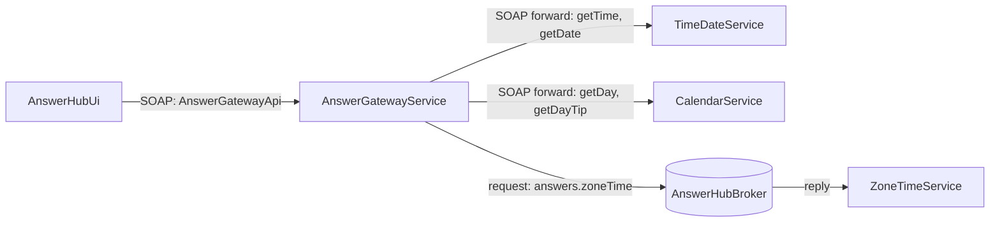
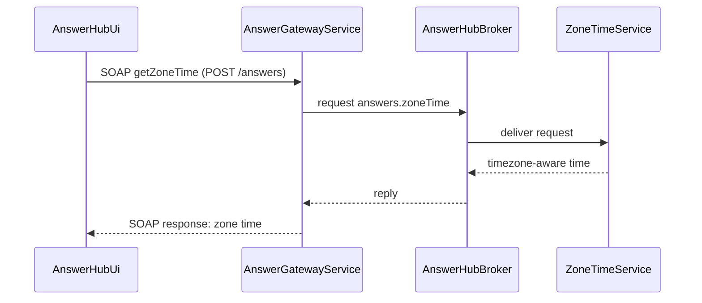

# SOAP Gateway Answer Hub

> Generated from Ocean-Atlas v0.1.0 (content baec097c). Canonical source: https://atlas.ocean-lab.ai/examples/soap-gateway-answer-hub/

**Contents**

- [Overview](#overview)
- [SOAP contracts](#soap-contracts)
- [API composition](#api-composition)
- [Routing model](#routing-model)
- [Public boundary](#public-boundary)
- [Files](#files)
- [DSL source files](#dsl-source-files)
- [Diagrams](#diagrams)
- [Walkthrough](#walkthrough)

Expose one public SOAP API over independent answer providers, forwarding matching operations to provider SOAP APIs automatically and routing one explicitly through broker request-response.

Source: https://atlas.ocean-lab.ai/examples/soap-gateway-answer-hub/

Level: medium · Estimated time: 15 minutes · Version: 1.0.0 · Onboarding example: no

Components: 4 services, 1 brokers, 0 databases

Tags: api, api-composition, api-facade, broker, dashboard, gateway, request-response, soap, ui, wsdl

## Overview

This example is the reference for Ocean's SOAP API style. It is the SOAP
counterpart of `examples.gateway-answer-hub`: the services, broker,
expressions, UI, and deployment are the same, and every API is declared with
`style:soap` instead of REST. Comparing the two examples shows that the
gateway and routing model is independent of the API style.

`AnswerGatewayService` exposes one public SOAP API, `AnswerGatewayApi`, while
the answers themselves are produced by independent provider services behind
it. Its executable DSL and its Horizon and Voyage explanation are maintained
together in this example directory.

## SOAP contracts

Each SOAP API declares its own transport attributes. Ocean generates a SOAP
server, typed client, and WSDL contract for each of them, using the
document-literal-wrapped binding.

| API | Namespace | Endpoint path | SOAP version |
| --- | --- | --- | --- |
| `TimeDateApi` | `https://ocean-lab.ai/examples/answer-hub/time-date/v1` | `/time-date` | `1.2` |
| `CalendarApi` | `https://ocean-lab.ai/examples/answer-hub/calendar/v1` | `/calendar` | `1.2` |
| `AnswerGatewayApi` | `https://ocean-lab.ai/examples/answer-hub/answers/v1` | `/answers` | `1.2` |

No operation declares `action`, so each SOAP action is derived as
`<namespace>/<OperationName>`.

## API composition

`AnswerGatewayApi` composes the operations of `TimeDateApi` and `CalendarApi`
with `include`, and declares one operation of its own, `getZoneTime`. The
gateway API owns the transport configuration: every operation is exposed
through its namespace, `/answers` endpoint path, SOAP version, and WSDL.

| Public operation | Derived SOAP action | Source |
| --- | --- | --- |
| `getTime` | `https://ocean-lab.ai/examples/answer-hub/answers/v1/getTime` | included from `TimeDateApi` |
| `getDate` | `https://ocean-lab.ai/examples/answer-hub/answers/v1/getDate` | included from `TimeDateApi` |
| `getDay` | `https://ocean-lab.ai/examples/answer-hub/answers/v1/getDay` | included from `CalendarApi` |
| `getDayTip` | `https://ocean-lab.ai/examples/answer-hub/answers/v1/getDayTip` | included from `CalendarApi` |
| `getZoneTime` | `https://ocean-lab.ai/examples/answer-hub/answers/v1/getZoneTime` | declared locally |

## Routing model

`AnswerGatewayService` implements `AnswerGatewayApi` with
`impl gateway api ... including timeDate, calendar`. Public operations with a
matching, contract-compatible operation in an included API are forwarded
automatically, from the gateway's SOAP endpoint to the provider's SOAP
endpoint:

- `getTime`, `getDate` → `TimeDateService`
- `getDay`, `getDayTip` → `CalendarService`

`getZoneTime` has no provider API counterpart. The gateway connects it
explicitly to the `answers.zoneTime` request-response topic of
`AnswerHubBroker`, which `ZoneTimeService` serves. Its responder expression
calls `GetZoneTimeString("Europe/Amsterdam")`.



`architecture.mmd` and `broker-communication.mmd` contain the same topology
and the zone-time request-response sequence.

## Public boundary

`AnswerHubUi` uses only `AnswerGatewayApi`, through its generated SOAP client;
it has no dependency on the provider APIs. The deployment exports the gateway
on port `9100` and the UI on port `8085`. It also exports `TimeDateService`
and `CalendarService` on ports `9101` and `9102` so that their SOAP endpoints
and WSDLs can be inspected directly; remove those exports to make the gateway
the only externally reachable API.

SOAP faults, explicit `action` values, one-way operations, SOAP headers, and
WS-Security are outside this routing-focused example. Gateway-wide policies
such as authentication, authorization, rate limiting, tracing, and error
normalization are a planned extension of the gateway model and will be
introduced separately.

## Files

DSL source comes first, then diagrams; the long Horizon and Voyage walkthroughs are at the end. You can stop after the source files.

| File | Section | Lines |
| --- | --- | --- |
| `00-sgah-info.ocn` | `@info` | 36 |
| `10-sgah-api.ocn` | `@api` | 45 |
| `20-sgah-broker.ocn` | `@broker` | 20 |
| `30-sgah-config.ocn` | `@config` | 30 |
| `40-sgah-expression.ocn` | `@expression` | 42 |
| `50-sgah-service-calendar.ocn` | `@service` | 23 |
| `50-sgah-service-gateway.ocn` | `@service` | 30 |
| `50-sgah-service-time-date.ocn` | `@service` | 23 |
| `50-sgah-service-zone-time.ocn` | `@service` | 21 |
| `55-sgah-dashboard.ocn` | `@dashboard` | 45 |
| `56-sgah-ui.ocn` | `@ui` | 43 |
| `60-sgah-deploy.ocn` | `@deploy` | 46 |

## DSL source files

### `00-sgah-info.ocn`

```ocean-dsl
# @ocean-meta-start
# tags:
#   - soap
#   - gateway
#   - api-facade
#   - broker-request-response
# perspective:
#   feature: soap-gateway-answer-hub
#   boundedContext: answer-hub
# @ocean-meta-end

@info

name: SOAP Gateway Answer Hub
version: 1.0.0
title: SOAP Gateway Answer Hub
subtitle: One public SOAP API for independent answer providers
shortDescription: A focused SOAP API gateway example with WSDL-backed API composition, automatic forwarding, and an explicit broker-backed operation.

description:

Overview
SOAP Gateway Answer Hub exposes one public SOAP API for time, date, day, day tip, and zone time. It is the SOAP counterpart of Gateway Answer Hub: the same gateway and routing model, with every API declared as style:soap instead of REST.

SOAP contracts
Each API declares its own XML namespace, endpoint path, and SOAP version. Ocean generates a SOAP server, typed client, and WSDL contract for every API from the same definition.

Automatic forwarding
The gateway includes the TimeDateApi and CalendarApi. Their operations are exposed through the gateway's own namespace, endpoint path, SOAP version, and WSDL. Operations with the same name and compatible contracts are forwarded automatically to their owning services.

Explicit routing
Zone time is intentionally not exposed by an internal API. The gateway routes getZoneTime explicitly through a NATS request-response topic to ZoneTimeService.

UI
AnswerHubUi calls only AnswerGatewayApi. Each dashboard action independently invokes one public SOAP operation, so users see the gateway as the sole public boundary.
```

### `10-sgah-api.ocn`

```ocean-dsl
# @ocean-meta-start
# tags:
#   - soap-api
#   - gateway-contract
# perspective:
#   feature: soap-gateway-answer-hub
#   boundedContext: answer-hub
# @ocean-meta-end

@api

TimeDateApi style:soap
    engine       = soap
    configType   = ApiConfig
    version      = 1.0.0
    namespace    = https://ocean-lab.ai/examples/answer-hub/time-date/v1
    endpointPath = /time-date
    soapVersion  = 1.2

    operation getTime() : String
    operation getDate() : String

CalendarApi style:soap
    engine       = soap
    configType   = ApiConfig
    version      = 1.0.0
    namespace    = https://ocean-lab.ai/examples/answer-hub/calendar/v1
    endpointPath = /calendar
    soapVersion  = 1.2

    operation getDay() : String
    operation getDayTip() : String

AnswerGatewayApi style:soap
    engine       = soap
    configType   = ApiConfig
    version      = 1.0.0
    namespace    = https://ocean-lab.ai/examples/answer-hub/answers/v1
    endpointPath = /answers
    soapVersion  = 1.2

    include TimeDateApi, CalendarApi

    operation getZoneTime() : String
```

### `20-sgah-broker.ocn`

```ocean-dsl
# @ocean-meta-start
# tags:
#   - broker
#   - nats
#   - request-response
# perspective:
#   feature: soap-gateway-answer-hub
#   boundedContext: answer-hub
# @ocean-meta-end

@broker

AnswerHubBroker
    @perspectives: version:1.0.0, lifestyle:stable
    engine = nats
    configType = AnswerHubBrokerConfig
    tags = primary, shared

    answers.zoneTime : _-String as request-response with timeout:2s
```

### `30-sgah-config.ocn`

```ocean-dsl
# @ocean-meta-start
# tags:
#   - configuration
# perspective:
#   feature: soap-gateway-answer-hub
#   boundedContext: answer-hub
#   service: shared
# @ocean-meta-end

@config

@import config O.broker.nats.config@1.0.0 as BrokerConfig
@import config O.log.config@1.0.0 as LogConfig

ApiConfig
    port : Int (default=8080)

CommonServiceConfig
    apiConfig    : ApiConfig
    brokerConfig : BrokerConfig
    logConfig    : LogConfig

AnswerHubBrokerConfig
    brokerConfig : BrokerConfig
    logConfig    : LogConfig

UiConfig
    port      : Int (default=8080)
    logConfig : LogConfig
```

### `40-sgah-expression.ocn`

```ocean-dsl
# @ocean-meta-start
# tags:
#   - expression
#   - answer-provider
# perspective:
#   feature: soap-gateway-answer-hub
#   boundedContext: answer-hub
#   service: shared
# @ocean-meta-end

@expression

GetTimeString
    input: _
    output: result:String
    logic
        result = nowTimeString()

GetDateString
    input: _
    output: result:String
    logic
        result = nowDateString()

GetDayString
    input: _
    output: result:String
    logic
        result = today()

GetDayTip
    input: _
    output: result:String
    logic
        result = tipOfTheDay()

GetAmsterdamTime
    input: _
    output: result:String
    logic
        result = GetZoneTimeString("Europe/Amsterdam")
```

### `50-sgah-service-calendar.ocn`

```ocean-dsl
# @ocean-meta-start
# tags:
#   - service
#   - provider
# perspective:
#   feature: soap-gateway-answer-hub
#   boundedContext: answer-hub
#   service: calendar-service
# @ocean-meta-end

@service

CalendarService
    @perspectives: version:1.0.0, lifestyle:stable

    use config CommonServiceConfig as svcCfg
    impl api CalendarApi as api on svcCfg.apiConfig.port
    use expression GetDayString as day
    use expression GetDayTip as tip

    connect api.getDay -> day
    connect api.getDayTip -> tip
```

### `50-sgah-service-gateway.ocn`

```ocean-dsl
# @ocean-meta-start
# tags:
#   - service
#   - gateway
#   - api-facade
#   - soap
# perspective:
#   feature: soap-gateway-answer-hub
#   boundedContext: answer-hub
#   service: answer-gateway-service
# @ocean-meta-end

@service

AnswerGatewayService
    @perspectives: version:1.0.0, lifestyle:stable

    use config CommonServiceConfig as gwCfg
    use api TimeDateApi as timeDate
    use api CalendarApi as calendar
    use broker AnswerHubBroker as broker

    impl gateway api AnswerGatewayApi as gw on gwCfg.apiConfig.port
        including timeDate, calendar

    # getTime, getDate, getDay, and getDayTip are automatically forwarded
    # from the gateway's SOAP endpoint to the providers' SOAP endpoints.
    # Zone time is intentionally broker-backed and therefore routed explicitly.
    connect gw.getZoneTime -> broker.answers.zoneTime
```

### `50-sgah-service-time-date.ocn`

```ocean-dsl
# @ocean-meta-start
# tags:
#   - service
#   - provider
# perspective:
#   feature: soap-gateway-answer-hub
#   boundedContext: answer-hub
#   service: time-date-service
# @ocean-meta-end

@service

TimeDateService
    @perspectives: version:1.0.0, lifestyle:stable

    use config CommonServiceConfig as svcCfg
    impl api TimeDateApi as api on svcCfg.apiConfig.port
    use expression GetTimeString as time
    use expression GetDateString as date

    connect api.getTime -> time
    connect api.getDate -> date
```

### `50-sgah-service-zone-time.ocn`

```ocean-dsl
# @ocean-meta-start
# tags:
#   - service
#   - broker-responder
# perspective:
#   feature: soap-gateway-answer-hub
#   boundedContext: answer-hub
#   service: zone-time-service
# @ocean-meta-end

@service

ZoneTimeService
    @perspectives: version:1.0.0, lifestyle:stable

    use config CommonServiceConfig as svcCfg
    use broker AnswerHubBroker as broker
    use expression GetAmsterdamTime as zoneTime

    connect broker.answers.zoneTime -> zoneTime
```

### `55-sgah-dashboard.ocn`

```ocean-dsl
# @ocean-meta-start
# tags:
#   - dashboard
#   - gateway
# perspective:
#   feature: soap-gateway-answer-hub
#   boundedContext: answer-hub
#   service: answer-hub-ui
# @ocean-meta-end

@dashboard

AnswerHubDashboard
    title: SOAP Gateway Answer Hub
    layout: SingleColumnLayout

    Widget GatewayGuide of type Text
        title = One public SOAP API, three provider services
        subtitle = SOAP forwarding for time, date, day, and day tip; broker request-response for zone time
        content = <p>Each action calls a SOAP operation of <b>AnswerGatewayApi</b>. The gateway automatically forwards matching operations to the provider SOAP APIs and explicitly delegates zone time to a broker responder.</p>

    Widget TimeButton of type Button
        label = Current time

    Widget DateButton of type Button
        label = Current date

    Widget DayButton of type Button
        label = Current day

    Widget DayTipButton of type Button
        label = Day tip

    Widget ZoneTimeButton of type Button
        label = Amsterdam zone time

AboutDashboard
    title: About this example
    layout: SingleColumnLayout

    Widget AboutText of type Text
        title = SOAP gateway routing patterns
        subtitle = Automatic forwarding and explicit routing in one service
        content = <p>This example demonstrates an Ocean service that implements a SOAP gateway API. Matching operations are forwarded to included SOAP APIs automatically. A distinct operation is explicitly connected to a broker request-response topic.</p>
```

### `56-sgah-ui.ocn`

```ocean-dsl
# @ocean-meta-start
# tags:
#   - ui
#   - gateway
# perspective:
#   feature: soap-gateway-answer-hub
#   boundedContext: answer-hub
#   service: answer-hub-ui
# @ocean-meta-end

@ui

AnswerHubUi
    @perspectives: version:1.0.0, lifestyle:stable

    framework: htmx
    styling: bootstrap
    template: go-html-template
    backend: go-gin
    static: static
    configType: UiConfig

    nav Answers dashboard = AnswerHubDashboard
    nav About dashboard = AboutDashboard

    header title = SOAP Gateway Answer Hub
    header subtitle = One public SOAP API for independent answer providers
    header align = center

    footer title = Built with Ocean-lab
    footer subtitle = SOAP gateway feature example
    footer align = center

    use dashboard AnswerHubDashboard as answers
    use dashboard AboutDashboard as about
    use api AnswerGatewayApi as gateway

    connect answers.TimeButton.click -> gateway.getTime
    connect answers.DateButton.click -> gateway.getDate
    connect answers.DayButton.click -> gateway.getDay
    connect answers.DayTipButton.click -> gateway.getDayTip
    connect answers.ZoneTimeButton.click -> gateway.getZoneTime
```

### `60-sgah-deploy.ocn`

```ocean-dsl
# @ocean-meta-start
# tags:
#   - deployment
#   - gateway
# perspective:
#   feature: soap-gateway-answer-hub
#   boundedContext: answer-hub
#   service: shared
# @ocean-meta-end

@deploy

Name: SoapGatewayAnswerHubDeploy

@import service P.broker.nats.docker@1.0.0 as NATS

TimeDateDeploy
    service TimeDateService
    replica 1
    export 9101:TimeDateService.api

CalendarDeploy
    service CalendarService
    replica 1
    export 9102:CalendarService.api

ZoneTimeDeploy
    service ZoneTimeService
    replica 1
    dependsOn Broker

GatewayDeploy
    service AnswerGatewayService
    replica 1
    export 9100:AnswerGatewayService.gw
    dependsOn TimeDateDeploy, CalendarDeploy, ZoneTimeDeploy, Broker

Broker
    service NATS

AnswerHubUiDeploy
    service AnswerHubUi
    replica 1
    export 8085:AnswerHubUi.config
    dependsOn GatewayDeploy
```

## Diagrams

### `architecture.mmd`


### `broker-communication.mmd`



## Walkthrough

A long, step-by-step explanation (Horizon and Voyage) is in [SOAP Gateway Answer Hub walkthrough](soap-gateway-answer-hub-walkthrough.md). Read it only if you need the reasoning behind the design.
