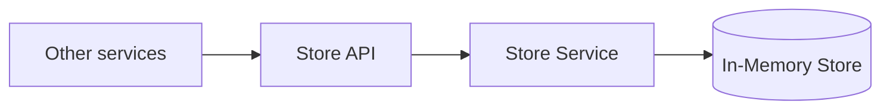

# Store Service: Walkthrough

> Generated from Ocean-Atlas v0.1.0 (content baec097c). Canonical source: https://atlas.ocean-lab.ai/examples/store-service/

**Contents**

- [Horizon](#horizon)
- [Voyage](#voyage)

Horizon and Voyage explanation for the Store Service example.

Source: https://atlas.ocean-lab.ai/examples/store-service/

## Horizon

### Store Service at a Glance

#### Overview

Many systems need a small place to stash short-lived, loosely structured data — a hand-off payload between requests, a piece of work-in-progress state, a value another service will read back once — without standing up a purpose-built schema and database for each shape. This example models one generic Store service: callers put an arbitrary JSON value under a key with a time-to-live, and later get, pop, check, or delete it by that key.

#### Architecture



The service exposes a small internal REST surface over a single in-memory entity; every operation reads or writes exactly one item by its key.

#### What It Demonstrates

- `@datatype` — a generic request and stored-item shape that carries an arbitrary JSON value alongside a key, an optional remark, and TTL-derived expiry.
- `@database` — an in-memory entity whose full operation set (put, get, pop, exists, delete) is generated automatically from a single declaration, including TTL-based expiry and an atomic pop, without hand-written queries or commands.
- `@expression` — a small conversion step plus thin pass-through logic that calls the generated entity operations directly.
- `@api` — a REST API tagged `internal`, intended for consumption by other microservices rather than public clients.
- `@config` and `@deploy` — shared, imported configuration and a packaged Redis image used as the in-memory backing store.

#### Expected Result

You will put an arbitrary JSON value under a key with a TTL, read it back, pop it atomically, check whether a key still exists, and delete it — observing that a popped or deleted key no longer exists.

## Voyage

### 1. Problem and Constraints

- A stored value is arbitrary JSON — the store does not constrain its shape.
- Every stored item carries a time-to-live; expiry is derived from it, not stored as a raw duration.
- A key uniquely identifies one item; putting the same key again overwrites it.
- `pop` must read and remove an item as one atomic operation.
- The API is internal: it exists to be called by other services, not end users.

### 2. Prerequisites

- The Ocean toolchain, at the version this example targets.
- Docker, to run the generated Redis database service.
- [hurl](https://hurl.dev), to run the included component test suite (optional).

### 3. Example Structure

Executable model files are grouped by DSL section:

```text
0011-store-service/
├── store-datatype.ocn
├── store-config.ocn
├── in-mem-db.ocn
├── store-api.ocn
├── store-expressions.ocn
├── store-service.ocn
├── store-deploy.ocn
├── api/
│   └── *.hurl
└── example-info/
    └── example-info.html
```

`api/` holds a hurl component test suite covering the store lifecycle, atomic pop, missing-key behavior, input validation, and generic routing — documented further in [Verify the Result](store-service-walkthrough.md).

### 4. Model the Domain

`StoreRequest` is what a caller sends; `StoreItem` is what the store persists and returns. Both carry the value as untyped `Json`, so the store never needs to know a caller's schema.

```ocean-dsl
@datatype

StoreRequest
  key:    String
  value:  Json
  remark: *String
  ttlSeconds: Int

StoreItem
  key:    String
  value:  Json
  remark: *String
  expiresAt: *DateTime
```

A request carries a relative `ttlSeconds`; the stored item instead carries an absolute `expiresAt`, computed once at write time.

### 5. Persist Items with a Fully Generated Entity

The database is declared as an in-memory Redis-backed store. Naming `StoreItem` as its only entity is enough: Ocean generates the complete put, get, pop, exists, and delete operation set — including TTL handling and an atomic pop — without any hand-written query or command.

```ocean-dsl
@database

Database StoreDb
    type = in-memory
    engine = redis
    configType = StoreDbConfig
    tags = in-memory

    Entity StoreItem

    # all PUT, GET, POP, EXISTS and DELETE endpoints are generated automatically
```

### 6. Define the API

Five REST endpoints map directly onto the generated entity operations. The API is tagged `internal` and generates a Swagger document for the services that will call it.

```ocean-dsl
@api

StoreApi style: rest
    engine = gin
    configType = ApiConfig
    tags = internal
    version = 1.0.0
    basePath = /
    generateSwagger = true

    post    /store/put           putData(req:StoreRequest) : String
    get     /store/get/{key}     getData()                 : StoreItem
    get     /store/pop/{key}     popData()                 : StoreItem
    get     /store/exists/{key}  existsData()              : Boolean
    delete  /store/delete/{key}  deleteData()              : _
```

The generated REST engine prefixes every route with the API's major version, so `/store/put` is served at `/v1/store/put`.

### 7. Convert and Bridge with Expressions

`ConvertStoreRequestToStoreItem` derives an absolute expiry from the request's relative TTL using the built-in `TtlToExpire` helper. Every other expression is a thin pass-through into the entity operation `StoreDb` already generated for `StoreItem`.

```ocean-dsl
@expression

ConvertStoreRequestToStoreItem
    input:  r:StoreRequest
    output: i:*StoreItem
    logic
        i.key = r.key
        i.value = r.value
        i.remark = r.remark
        exp = TtlToExpire(r.ttlSeconds)
        i.expiresAt = &exp

PutData
    input:   req: StoreRequest
    output:  out: String
    logic
        var s *StoreItem
        s = ConvertStoreRequestToStoreItem(req)
        out = StoreItem.PutStoreItemWithIdAndTtl(req.key, s, req.ttlSeconds)
```

`GetData`, `PopData`, `ExistsData`, and `DeleteData` follow the same shape, each calling its matching generated operation (`GetStoreItem`, `PopStoreItem`, `ExistsStoreItem`, `DeleteStoreItem`) by key.

### 8. Assemble the Service

```text
StoreService
    use config StoreConfig as cfg
    impl api StoreApi as api on cfg.apiConfig.port
    use database StoreDb as db

    connect cfg.dbConfig -> db

    use expression PutData
    use expression GetData
    use expression PopData
    use expression ExistsData
    use expression DeleteData

    connect api.putData     -> PutData
    connect api.getData     -> GetData
    connect api.popData     -> PopData
    connect api.existsData  -> ExistsData
    connect api.deleteData  -> DeleteData
```

Every API method connects straight to its expression; none of them touch the database directly, keeping the generated entity operations as the single place that talks to Redis.

### 9. Select Technologies and Configure Generation

The API is generated with a REST engine (gin) on a configurable port, the database uses a packaged Redis image, and the service depends on it at deploy time. Database connection settings — including retry and TLS behavior — live in configuration, separate from the model.

```ocean-dsl
@config

StoreDbConfig
  url: String (default=localhost:6379)
  password: String (default=)
  db: Int (default=0)
  retriesNo: Int (default=10)
  retriesDelaySec: Int (default=30)
  tls: Boolean (default=false)
  dialTimeoutSec: Int (default=5)

@deploy

@import service P.db.redis.docker@1.0.0 as RedisInMemDB

StoreDeploy
    service     StoreService
    replica     1
    export      9093:StoreService.api
    dependsOn   InMemStorDatabase

InMemStorDatabase
    service     RedisInMemDB
```

### 10. Validate, Generate, and Run

1. From `0011-store-service/`, validate and generate the example with the Ocean toolchain.
2. Start the generated Redis database and `StoreService`; wait for a healthy `/health/ready` response on port `9093`.

### 11. Verify the Result

Put a value with a TTL, read it back, then pop it and confirm it is gone:

```text
POST /v1/store/put
    {"key":"demo-1","value":{"msg":"hello","n":42},"remark":"first item","ttlSeconds":120}
    -> "demo-1"

GET /v1/store/get/demo-1
    -> {"key":"demo-1","value":{"msg":"hello","n":42},"remark":"first item","expiresAt":"..."}

GET /v1/store/pop/demo-1
    -> {"key":"demo-1","value":{"msg":"hello","n":42},"remark":"first item","expiresAt":"..."}

GET /v1/store/exists/demo-1
    -> false
```

The `api/` hurl suite automates this and more: the full lifecycle (`20_store_lifecycle.hurl`), atomic pop (`30_store_pop.hurl`), missing-key behavior (`40_store_not_found.hurl`), input validation (`50_store_validation.hurl`), and generic routing (`60_routing.hurl`); run any of them with `hurl --test --variable base_url=http://localhost:9093 api/<file>.hurl`.

### 12. Troubleshooting

- **`getData` or `popData` returns `500 Internal Server Error` for a key that was never stored:** the underlying "not found" error from Redis does not currently match the generic error classifier's `NOT_FOUND` heuristics, so it falls through to a generic 500 instead of 404. `existsData` is unaffected and correctly returns `false`.
- **`putData` returns `500` instead of `400` for a missing/empty key or a non-positive `ttlSeconds`:** only malformed JSON is rejected at the binding layer with `400`; other field-level validation currently surfaces as a generic `500` rather than a structured `400`.

### 13. Experiments and Extensions

- Put the same key twice with different values and confirm the second `put` overwrites the first.
- Store TTLs are handled by Redis directly — try a short `ttlSeconds` and confirm `existsData` turns `false` once it elapses, without ever calling `delete`.
- Tighten the error classifier so a Redis "not found" is recognized as `NOT_FOUND`, and update the expected status in `40_store_not_found.hurl` from `500` to `404`.
- Add structured field validation to `PutData` so an empty key or non-positive `ttlSeconds` returns `400` instead of `500`.
