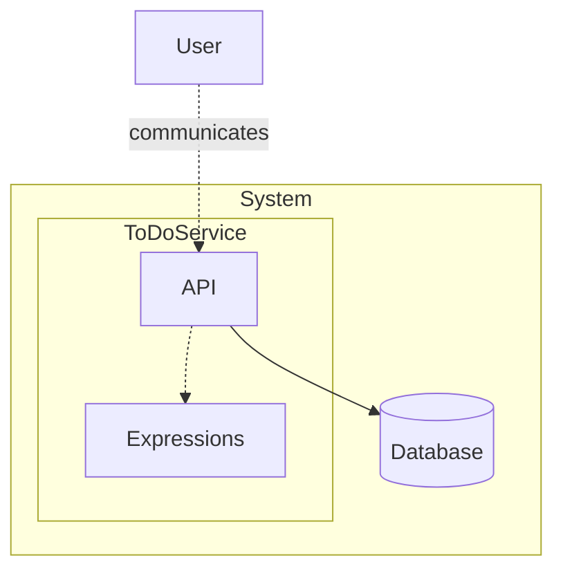
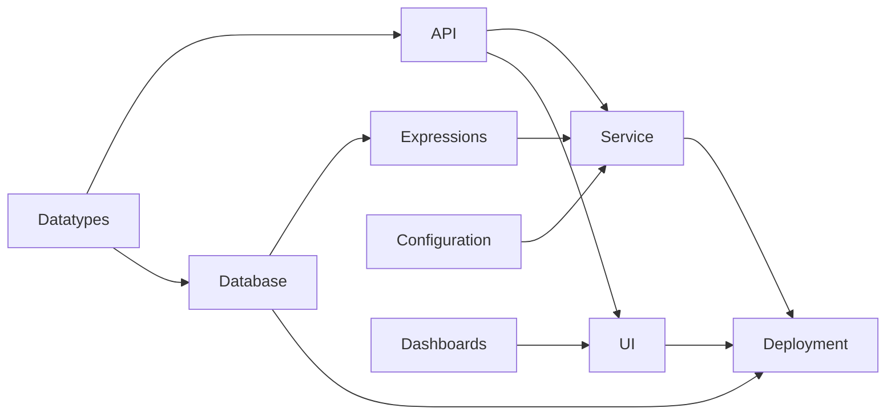

# Task Manager: Walkthrough

> Generated from Ocean-Atlas v0.1.0 (content baec097c). Canonical source: https://atlas.ocean-lab.ai/examples/task-manager/

**Contents**

- [Horizon](#horizon)
- [Voyage](#voyage)

Horizon and Voyage explanation for the Task Manager example.

Source: https://atlas.ocean-lab.ai/examples/task-manager/

## Horizon

### Task Manager at a Glance

#### Overview

This example models a task manager built around a persistent `TodoItem`. Each task has a title, due date, priority, and lifecycle status. An API supports creating, finding, updating, and deleting tasks, while a database preserves them.

#### Architecture

`TodoService` exposes `TodoApi`, delegates task rules to expressions, and reads or writes `TodoDB`.



User requests enter through the API. The service invokes expressions for task rules and uses the database for persistent CRUD operations.

#### What It Demonstrates

- Task and lifecycle modeling with `@datatype`.
- Persistent CRUD with `@api`, `@database`, and `@service`.
- Default and overdue-status rules with `@expression`.
- Task-oriented views with `@dashboard` and `@ui`.

#### Expected Result

A task-management API and UI backed by persistent storage. Tasks remain available across requests, support search and updates, start as `inProgress`, and can become `done` or `expired`.

## Voyage

### 1. Voyage Overview

You will build the task manager from its domain model outward. You will define tasks, expose operations, persist data, express business rules, wire the service, add a UI, and package the complete system.

This example uses:

- Gin for the generated REST API;
- PostgreSQL for persistent task storage;
- HTMX, Bootstrap, and Go templates for the generated UI;
- Docker-oriented deployment definitions for the system runtime.

You will follow the dependencies in order, so every new section can use the pieces introduced in the previous ones.



Datatypes provide the shared language. The API, database, expressions, and configuration become a service; dashboards and the API become the UI; deployment brings the complete system together.

### 2. Model the Datatypes

#### Define a task

A task manager needs a clear definition of a task, so you will begin with a datatype named `TodoItem`. Datatype names start with a capital letter.

Inside the datatype, you will add fields as name-and-type pairs. For example, `title: String` means that every task has a title stored as text, while `dueDate: DateTime` gives it a deadline.

The `id` field is special because it uniquely identifies each task. Its `TI-UUID` pattern combines the prefix `TI`, for TodoItem, with a generated UUID. The remaining fields describe the task's priority, lifecycle status, and two values used later to demonstrate encrypted persistence.

```ocean-dsl
@datatype

TodoItem
    id pattern TI-UUID
    title: String
    dueDate: DateTime
    priority: Priority
    status: TaskLifecycle
```

#### Give priority a fixed set of values

`Priority` is used as a field type, but still needs a definition. A priority should only be low, medium, or high. Instead of allowing any text, you will define those choices with an enum.

```text
enum Priority
    low
    medium
    high
```

Afterwards, Ocean will be able to use the same three values everywhere—for example, in API inputs, database queries, and UI forms.

#### Describe the task lifecycle

You will use another enum for `TaskLifecycle`. A task starts in progress, may be marked as done, or becomes expired when it passes its due date. Later, you will add the rules for these changes with expressions.

```text
enum TaskLifecycle
    inProgress
    done
    expired
```

Afterwards, the domain model will be ready. The API, database, expressions, dashboards, and UI will all share the same language: `TodoItem`, `Priority`, and `TaskLifecycle`.

### 3. Define the API

#### Create a REST API

With the task model defined, users and other applications will need a way to work with tasks. You will expose a REST API named `TodoApi`.

The metadata below tells Ocean how to generate the API: `style` selects REST, `engine` selects Gin, `configType` points to the API settings you will define later, and `basePath` sets the root URL. The final setting asks Ocean to generate Swagger documentation.

```ocean-dsl
@api

TodoApi style: rest
    engine = gin
    configType = ApiConfig
    tags = external
    version = 1.0.0
    description = ToDo API Description
    basePath = /
    generateSwagger = true
```

#### How an endpoint is written

In a REST API, each endpoint follows the same basic shape:

```text
<verb> <path> <method>(<inputs>) : <output>
```

- **Verb** describes the action: `get`, `post`, `put`, or `delete`.
- **Path** is the URL. Values inside braces, such as `{id}`, are path parameters.
- **Method** gives the operation a name that you can connect later in the service.
- **Inputs** are typed values passed to the method. An underscore means the input is inferred from the path.
- **Output** is the returned type. An underscore means there is no response body.

#### Return some service information

You will start with a small endpoint. It takes no input and returns a string generated by the `getInfo` method.

```text
get /todo/info getInfo(_) : String
```

#### List and retrieve tasks

Listing uses `offset` and `limit` path parameters so callers can page through tasks. Looking up one task uses its ID and returns a single `TodoItem`.

```text
get /todo/items/{offset}/{limit} listItems(offset:Int, limit:Int) : List<TodoItem>
get /todo/item/{id} getItem(_) : TodoItem
get /todo/item2/{id} getItem2(_) : TodoItem
```

`getItem` and `getItem2` intentionally expose the same kind of lookup. Later, you will connect one through an expression and the other directly to the database to compare both approaches.

#### Search for tasks

The next endpoints show three common filters: title only, title and priority, and title or priority. Notice how `Priority` from the datatype page will be reused as an input type.

```text
get /todo/title/{title} findItemByTitle(title:String) : List<TodoItem>
get /todo/title-and-priority/{title}/{priority} findItemByTitleAndPriority(title:String, priority:Priority) : List<TodoItem>
get /todo/title-or-priority/{title}/{priority} findItemByTitleOrPriority(title:String, priority:Priority) : List<TodoItem>
```

#### Create a task

Creating data uses `post`. The method receives a `TodoItem` and returns the task after it has been created.

```text
post /todo/item createItem(item:TodoItem) : TodoItem
```

#### Update a task

Updating uses `put`. It accepts the changed task—including a new lifecycle status—and returns the stored result.

```text
put /todo/item adjustItem(item:TodoItem) : TodoItem
```

#### Delete a task

Finally, deletion takes the ID from the URL. Its output is `_` because there is no task to return after deletion.

```text
delete /todo/item/{id} deleteItem(_) : _
```

Afterwards, the task manager will have its public contract. The next step will be defining where these endpoints preserve their tasks.

### 4. Define Persistence

#### Add a database

The API will accept tasks, but those tasks need somewhere to persist. You will define `TodoDB` as a PostgreSQL database. `configType` tells Ocean which configuration to use, and `encryptionKey = generate` enables encrypted fields.

```ocean-dsl
@database

Database TodoDB
    engine = postgres
    configType = DatabaseConfig
    encryptionKey = generate
```

#### Turn TodoItem into an entity

A datatype describes the shape of a task; an entity tells the database to preserve it. You will use `key(id)` to identify each row and add indexes for values that will be searched or sorted.

```text
Entity TodoItem
    key(id)
    indexes: unique(title), index(title), index(dueDate)
```

#### Add queries for reading tasks

A query reads data without changing it. Its shape is familiar: a name, typed inputs, and a typed output. These queries will match the list, lookup, and search operations defined in the API.

```text
query listTodoItems(offset:Int, limit:Int) : List<TodoItem>
query findById(id: String) : TodoItem
query findByTitle(title: String) : List<TodoItem>
query findByTitleAndPriority(title: String, priority: Priority) : List<TodoItem>
```

#### Add commands for changing tasks

A command changes stored data. Creation and update are transactional, written as either `Transactional` or its shorter form `T`. Deletion only needs the task ID and returns nothing.

```text
command Transactional createTodoItem(item:TodoItem) : TodoItem
command T updateTodoItem(item:TodoItem) : TodoItem
command deleteTodoItem(id:String) : _
```

Afterwards, the database will offer everything the API needs. Before wiring them together, you will add the task rules that sit between them.

### 5. Express the Business Rules

#### Set the initial status

Expressions are where you will describe business logic. When a task is created, callers should not decide its starting state. The `CreateItem` expression sets it to `inProgress`, calls the database command, and returns the checked task.

```ocean-dsl
@expression

CreateItem
    input  : todo:TodoItem
    output : result:TodoItem
    logic
        todo.status = TaskLifecycle.inProgress
        temp = TodoItem.createTodoItem(todo)
        result = CheckItem(temp)
```

#### Check whether a task is overdue

Small expressions are easy to understand and reuse. This one compares the current time with the task's due date and returns a Boolean.

```text
IsOverdue
    input  : todo:TodoItem
    output : result:Boolean
    logic
        result = now() > todo.dueDate
```

#### Mark unfinished overdue tasks as expired

You will then use `IsOverdue` inside another expression. If the task is overdue and not already done, its returned status becomes `expired`. Completed tasks stay completed.

```text
CheckItem
    input  : todo:TodoItem
    output : result:TodoItem
    logic
        overdue = IsOverdue(todo)
        if todo.status != TaskLifecycle.done AND overdue then
            todo.status = TaskLifecycle.expired
        end
        result = todo
```

#### Use the rule when reading a task

`GetItem` will first call the database query defined earlier, then passes the result to `CheckItem`. This is composition: each expression will do one small job, and the expressions will combine into a flow.

```text
GetItem
    input  : id:String
    output : result:TodoItem
    logic
        temp = TodoItem.findById(id)
        result = CheckItem(temp)
```

You will also find similar expressions for listing, updating, and deleting tasks. Afterwards, both storage operations and business rules will be ready. Configuration will be the next piece needed before the service can be assembled.

### 6. Configure the Components

#### Reuse existing configuration types

Configuration will keep environment-specific values out of the model. Ocean already provides PostgreSQL and logging configuration types, so you will import them and give them local names instead of redefining every option.

```ocean-dsl
@config

@import config O.database.postgres.config@1.0.0 as DatabaseConfig
@import config O.log.config@1.0.0 as LogConfig
```

#### Collect the backend settings

The backend will need settings for its API, database, and logging. You will group these under `TodoServiceConfig`, giving the service one clear configuration contract.

```text
TodoServiceConfig
    apiConfig : ApiConfig
    dbConfig  : DatabaseConfig
    logConfig : LogConfig
```

#### Give the API and UI a port

You will then define the small local configuration types. Both the API and UI will need a port, and the UI will also use the imported logging settings. Default values make the example easy to run while remaining overridable.

```text
ApiConfig
    port: Int (default=8080)

TodoUiConfig
    port: Int (default=8080)
    logConfig : LogConfig
```

Afterwards, all the building blocks needed for the service will be ready.

### 7. Wire the Service

#### Assemble the service

A service is where the pieces defined so far will become one working unit. It will use the configuration and database, implement the API on the configured port, and gives each expression a short local alias.

```ocean-dsl
@service

TodoService
    use config TodoServiceConfig as myCfg
    impl api TodoApi as api on myCfg.apiConfig.port
    use database TodoDB as appDb
    use expression CreateItem as crt
    use expression AdjustItem as adj
    use expression GetItem as get
    use expression GetAll as all
    use expression DeleteItem as dlt
```

#### Connect API methods to business logic

A `connect` statement routes a method on the left to its implementation on the right. Creation, updates, retrieval, listing, and deletion go through expressions because they coordinate logic and persistence.

```text
connect api.createItem -> crt
connect api.adjustItem -> adj
connect api.getItem -> get
connect api.listItems -> all
connect api.deleteItem -> dlt
```

#### Connect simple searches directly

Not every method needs an expression. These searches have no extra business rule, so you will connect them straight to the generated entity queries. Ocean lets us choose the simplest useful path for each method.

```text
connect api.findItemByTitle -> TodoItem.findByTitle
connect api.findItemByTitleAndPriority -> TodoItem.findByTitleAndPriority
connect api.findItemByTitleOrPriority -> TodoItem.findByTitleOrPriority
```

Afterwards, the backend will be complete: requests will enter through the API, follow the connections, apply rules where needed, and reach the database. The next step will give users a visual way to work with it.

### 8. Build Dashboards and UI

#### Start with a dashboard

A dashboard describes what users will see and do. For task creation, you will use a single-column layout with a form. The form will ask only for title, priority, and due date—the expression will set the initial status.

```ocean-dsl
@dashboard

TodoSubmitDashboard
    title: Create Todo
    layout: SingleColumnLayout

    Widget CreateTodoForm of type Form
        fields:
            - title String
            - priority Priority
            - dueDate DateTime
        buttons:
            submit : Create Todo
```

#### Choose how the UI will be generated

The `@ui` section will turn dashboards into an application. Here you will choose HTMX for interactions, Bootstrap for styling, Go HTML templates for rendering, and Gin for the UI backend.

```ocean-dsl
@ui

TodoUi
    framework: htmx
    styling: bootstrap
    template: go-html-template
    backend: go-gin
    configType: TodoUiConfig
```

#### Add the dashboards to navigation

The example contains dashboards for the main task workflows. You will add them as navigation entries, giving users pages for viewing, searching, creating, editing, and deleting tasks.

```text
nav View dashboard = TodoViewDashboard
    nav Search dashboard = TodoSearchDashboard
    nav Submit dashboard = TodoSubmitDashboard
    nav Edit dashboard = TodoEditDashboard
    nav Delete dashboard = TodoDeleteDashboard
```

#### Connect user actions to the API

Buttons will not contain business logic. Instead, you will connect each form action to the matching API method. The same contract will then support both programmatic clients and the generated UI.

```text
connect submit.CreateTodoForm.submit -> TodoApi.createItem
    connect edit.EditTodoForm.submit -> TodoApi.adjustItem
    connect delete.TodoDeleteForm.submit -> TodoApi.deleteItem
```

Afterwards, the task manager will have both a working backend and a user interface. The last modeling step will describe how all components run together.

### 9. Define Deployment

#### Provide a database runtime

The database section describes what needs to be stored. Deployment will choose how to run it. You will import Ocean's packaged PostgreSQL service and expose it locally as `TodoDatabase`.

```ocean-dsl
@deploy

@import service P.db.postgres.docker@1.0.0 as PostgresqlDB

TodoDatabase
    service PostgresqlDB
```

#### Run the task service

`TodoDeploy` runs two replicas of `TodoService`, exposes its API on port 9091, and uses `dependsOn` to say that the database must be available first.

```text
TodoDeploy
    service     TodoService
    replica     2
    export      9091:TodoService.api
    dependsOn   TodoDatabase
```

#### Run the user interface

The UI will be a separate deployable component. You will run one replica, expose it on port 8081, and declare that it depends on the task service.

```text
TodoUiDeploy
    service     TodoUi
    replica     1
    export      8081:TodoUi.config
    dependsOn   TodoDeploy
```

Afterwards, the complete topology will be ready: UI → task service → database. The domain model will remain technology-independent, while Voyage will introduce the choices needed to generate and run it.

### 10. Validate and Explore

After defining the complete model, you will validate that its pieces fit together and explore what Ocean produces.

1. Open the `Task Manager` example in Ocean-lab.
2. Validate the complete model and resolve any reported references.
3. Generate the API, persistence, UI, and deployment artifacts.
4. Follow the instructions in the generated `Readme.md` file to deploy and test the application.
5. You can access the backend API at `localhost:9091/swagger/index.html`.
6. Access the user interface at `localhost:8081`.
7. Create a task and confirm its initial status is `inProgress`.
8. Update it to `done`, then retrieve it again.
9. Create an overdue unfinished task and inspect its returned status.

Take a moment to inspect the generated Swagger contract (OpenAPI), database artifacts, dashboards, and deployment output. This is where you can see how the decisions made in one Ocean model flow through every layer.

### 11. Conclusion

By the end of this example, you will have started with a small `TodoItem` and gradually turned it into a complete task manager. Afterwards, you should understand how to:

- share one typed domain model across multiple DSL sections;
- combine generated persistence with expression-based rules;
- wire API operations directly or through business logic;
- build task-focused dashboards on top of the same API;
- separate the system model from runtime technology configuration.

Useful next experiments include adding task descriptions, introducing a new lifecycle state, filtering by due date, or enforcing allowed status transitions with a finite state machine.
