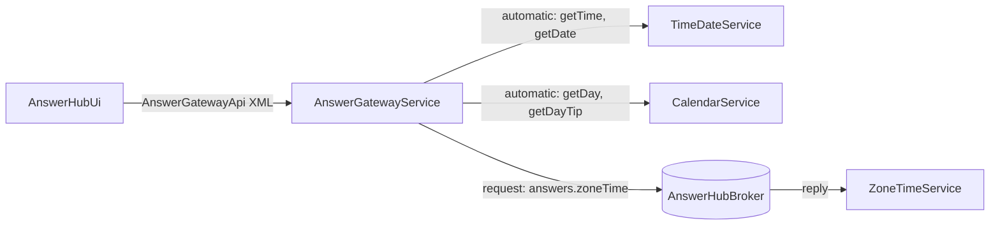
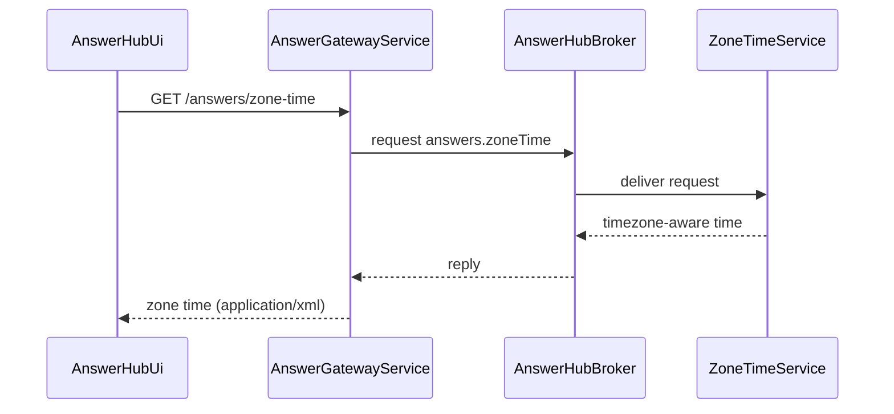

# XML Gateway Answer Hub

> Generated from Ocean-Atlas v0.1.0 (content baec097c). Canonical source: https://atlas.ocean-lab.ai/examples/xml-gateway-answer-hub/

**Contents**

- [Overview](#overview)
- [Payload representation](#payload-representation)
- [API composition](#api-composition)
- [Routing model](#routing-model)
- [Public boundary](#public-boundary)
- [Files](#files)
- [DSL source files](#dsl-source-files)
- [Diagrams](#diagrams)
- [Walkthrough](#walkthrough)

Expose the same gateway over independent answer providers as Gateway Answer Hub, but with every operation declaring @response:xml so it answers in XML instead of JSON.

Source: https://atlas.ocean-lab.ai/examples/xml-gateway-answer-hub/

Level: medium · Estimated time: 15 minutes · Version: 1.0.0 · Onboarding example: no

Components: 4 services, 1 brokers, 0 databases

Tags: api, api-composition, api-facade, broker, dashboard, gateway, payload-representation, request-response, rest-api, ui, xml

## Overview

This example is the reference for Ocean's REST payload representation
attributes (`dsl.api` §3.5). It is the XML counterpart of
`examples.gateway-answer-hub`: the services, broker, expressions, UI, and
deployment are identical, and every REST operation stays `style:rest` with
the `gin` engine. The only change is that each operation adds
`@response:xml`, so Ocean generates handlers and clients that answer in XML
instead of the JSON default.

Comparing this example with `examples.gateway-answer-hub` shows that payload
representation is orthogonal to routing: the gateway, its automatic
forwarding, and its explicit broker route are unchanged. Comparing it with
`examples.soap-gateway-answer-hub` shows the difference between the two ways
Ocean produces XML: SOAP is a distinct API style whose envelope is always
XML, while here the API style stays REST and only its payload representation
changes, operation by operation.

`AnswerGatewayService` exposes one public API, `AnswerGatewayApi`, while the
answers themselves are produced by independent provider services behind it.
Its executable DSL and its Horizon and Voyage explanation are maintained
together in this example directory.

## Payload representation

`10-xgah-api.ocn` is `10-gah-api.ocn` with `@response:xml` added to every
operation. No operation declares `@request`: every operation here is a
bodyless `GET`, and `dsl.api` §3.5 rejects `@request` on `GET`/`DELETE`
altogether, since they carry no request body to represent.

| Operation | Route | Response representation |
| --- | --- | --- |
| `getTime` | `GET /answers/time` | `application/xml` (`@response:xml`) |
| `getDate` | `GET /answers/date` | `application/xml` (`@response:xml`) |
| `getDay` | `GET /answers/day` | `application/xml` (`@response:xml`) |
| `getDayTip` | `GET /answers/day-tip` | `application/xml` (`@response:xml`) |
| `getZoneTime` | `GET /answers/zone-time` | `application/xml` (`@response:xml`) |

Each operation returns a plain `String`. Ocean's generated handler writes it
with `c.XML(http.StatusOK, result)` instead of `c.JSON(...)`, which
`encoding/xml` renders as `<string>the answer</string>`; the generated
Swagger annotations declare `@Produce application/xml` accordingly, and the
generated backend client (used by both service-to-service calls and the UI)
decodes the same representation on the way back.

## API composition

`AnswerGatewayApi` composes the operations of `TimeDateApi` and `CalendarApi`
with `include`, and declares one operation of its own, `getZoneTime`. The
gateway API owns the transport configuration: every operation is exposed
under its `/answers` base path, and every operation — included or local —
keeps the `@response:xml` representation declared on its own definition.

| Public operation | Route | Source |
| --- | --- | --- |
| `getTime` | `GET /answers/time` | included from `TimeDateApi` |
| `getDate` | `GET /answers/date` | included from `TimeDateApi` |
| `getDay` | `GET /answers/day` | included from `CalendarApi` |
| `getDayTip` | `GET /answers/day-tip` | included from `CalendarApi` |
| `getZoneTime` | `GET /answers/zone-time` | declared locally |

## Routing model

`AnswerGatewayService` implements `AnswerGatewayApi` with
`impl gateway api ... including timeDate, calendar`. Public operations with a
matching, contract-compatible operation in an included API are forwarded
automatically:

- `getTime`, `getDate` → `TimeDateService`
- `getDay`, `getDayTip` → `CalendarService`

`getZoneTime` has no provider API counterpart. The gateway connects it
explicitly to the `answers.zoneTime` request-response topic of
`AnswerHubBroker`, which `ZoneTimeService` serves. Its responder expression
calls `GetZoneTimeString("Europe/Amsterdam")`. The broker hop itself is
unaffected by `@response:xml`: it only governs the gateway's own REST
response to the UI, not how the broker delivers the request or the reply.



`architecture.mmd` and `broker-communication.mmd` contain the same topology
and the zone-time request-response sequence.

## Public boundary

`AnswerHubUi` uses only `AnswerGatewayApi`, through its generated backend
client; it has no dependency on the provider APIs. The deployment exports the
gateway on port `9100` and the UI on port `8085`. It also exports
`TimeDateService` and `CalendarService` on ports `9101` and `9102` so that
they can be inspected directly; remove those exports to make the gateway the
only externally reachable API.

Gateway-wide policies such as authentication, authorization, CORS, rate
limiting, tracing, and error normalization are deliberately outside this
routing-focused example, exactly as in `examples.gateway-answer-hub`.

## Files

DSL source comes first, then diagrams; the long Horizon and Voyage walkthroughs are at the end. You can stop after the source files.

| File | Section | Lines |
| --- | --- | --- |
| `00-xgah-info.ocn` | `@info` | 37 |
| `10-xgah-api.ocn` | `@api` | 44 |
| `20-xgah-broker.ocn` | `@broker` | 20 |
| `30-xgah-config.ocn` | `@config` | 30 |
| `40-xgah-expression.ocn` | `@expression` | 42 |
| `50-xgah-service-calendar.ocn` | `@service` | 23 |
| `50-xgah-service-gateway.ocn` | `@service` | 28 |
| `50-xgah-service-time-date.ocn` | `@service` | 23 |
| `50-xgah-service-zone-time.ocn` | `@service` | 21 |
| `55-xgah-dashboard.ocn` | `@dashboard` | 45 |
| `56-xgah-ui.ocn` | `@ui` | 43 |
| `60-xgah-deploy.ocn` | `@deploy` | 46 |

## DSL source files

### `00-xgah-info.ocn`

```ocean-dsl
# @ocean-meta-start
# tags:
#   - gateway
#   - api-facade
#   - broker-request-response
#   - xml
#   - payload-representation
# perspective:
#   feature: xml-gateway-answer-hub
#   boundedContext: answer-hub
# @ocean-meta-end

@info

name: XML Gateway Answer Hub
version: 1.0.0
title: XML Gateway Answer Hub
subtitle: One public API for independent answer providers, answering in XML
shortDescription: The REST/JSON gateway example with every operation declaring @response:xml instead of the JSON default.

description:

Overview
XML Gateway Answer Hub is the REST/XML counterpart of Gateway Answer Hub. It exposes the same one public API for time, date, day, day tip, and zone time, but every operation declares @response:xml so Ocean generates XML-serializing handlers and clients instead of the JSON default.

Payload representation
Each operation in 10-xgah-api.ocn adds @response:xml. Nothing about the gateway, forwarding, or broker routing model changes: it demonstrates that payload representation is an orthogonal, per-operation concern from routing.

Automatic forwarding
The gateway includes the TimeDateApi and CalendarApi. Operations with the same name and compatible contracts are forwarded automatically to their owning services, XML representation included.

Explicit routing
Zone time is intentionally not exposed by an internal API. The gateway routes getZoneTime explicitly through a NATS request-response topic to ZoneTimeService.

UI
AnswerHubUi calls only AnswerGatewayApi. Its generated backend client decodes each XML response transparently, so the dashboard code is unaware of the representation.
```

### `10-xgah-api.ocn`

```ocean-dsl
# @ocean-meta-start
# tags:
#   - rest-api
#   - gateway-contract
#   - xml
#   - payload-representation
# perspective:
#   feature: xml-gateway-answer-hub
#   boundedContext: answer-hub
# @ocean-meta-end

@api

TimeDateApi style:rest
    engine = gin
    configType = ApiConfig
    version = 1.0.0
    basePath = /time-date
    generateSwagger = true

    get /time getTime() : String @response:xml
    get /date getDate() : String @response:xml

CalendarApi style:rest
    engine = gin
    configType = ApiConfig
    version = 1.0.0
    basePath = /calendar
    generateSwagger = true

    get /day getDay() : String @response:xml
    get /day-tip getDayTip() : String @response:xml

AnswerGatewayApi style:rest
    engine = gin
    configType = ApiConfig
    version = 1.0.0
    basePath = /answers
    generateSwagger = true

    include TimeDateApi, CalendarApi

    get /zone-time getZoneTime() : String @response:xml
```

### `20-xgah-broker.ocn`

```ocean-dsl
# @ocean-meta-start
# tags:
#   - broker
#   - nats
#   - request-response
# perspective:
#   feature: xml-gateway-answer-hub
#   boundedContext: answer-hub
# @ocean-meta-end

@broker

AnswerHubBroker
    @perspectives: version:1.0.0, lifestyle:stable
    engine = nats
    configType = AnswerHubBrokerConfig
    tags = primary, shared

    answers.zoneTime : _-String as request-response with timeout:2s
```

### `30-xgah-config.ocn`

```ocean-dsl
# @ocean-meta-start
# tags:
#   - configuration
# perspective:
#   feature: xml-gateway-answer-hub
#   boundedContext: answer-hub
#   service: shared
# @ocean-meta-end

@config

@import config O.broker.nats.config@1.0.0 as BrokerConfig
@import config O.log.config@1.0.0 as LogConfig

ApiConfig
    port : Int (default=8080)

CommonServiceConfig
    apiConfig    : ApiConfig
    brokerConfig : BrokerConfig
    logConfig    : LogConfig

AnswerHubBrokerConfig
    brokerConfig : BrokerConfig
    logConfig    : LogConfig

UiConfig
    port      : Int (default=8080)
    logConfig : LogConfig
```

### `40-xgah-expression.ocn`

```ocean-dsl
# @ocean-meta-start
# tags:
#   - expression
#   - answer-provider
# perspective:
#   feature: xml-gateway-answer-hub
#   boundedContext: answer-hub
#   service: shared
# @ocean-meta-end

@expression

GetTimeString
    input: _
    output: result:String
    logic
        result = nowTimeString()

GetDateString
    input: _
    output: result:String
    logic
        result = nowDateString()

GetDayString
    input: _
    output: result:String
    logic
        result = today()

GetDayTip
    input: _
    output: result:String
    logic
        result = tipOfTheDay()

GetAmsterdamTime
    input: _
    output: result:String
    logic
        result = GetZoneTimeString("Europe/Amsterdam")
```

### `50-xgah-service-calendar.ocn`

```ocean-dsl
# @ocean-meta-start
# tags:
#   - service
#   - provider
# perspective:
#   feature: xml-gateway-answer-hub
#   boundedContext: answer-hub
#   service: calendar-service
# @ocean-meta-end

@service

CalendarService
    @perspectives: version:1.0.0, lifestyle:stable

    use config CommonServiceConfig as svcCfg
    impl api CalendarApi as api on svcCfg.apiConfig.port
    use expression GetDayString as day
    use expression GetDayTip as tip

    connect api.getDay -> day
    connect api.getDayTip -> tip
```

### `50-xgah-service-gateway.ocn`

```ocean-dsl
# @ocean-meta-start
# tags:
#   - service
#   - gateway
#   - api-facade
# perspective:
#   feature: xml-gateway-answer-hub
#   boundedContext: answer-hub
#   service: answer-gateway-service
# @ocean-meta-end

@service

AnswerGatewayService
    @perspectives: version:1.0.0, lifestyle:stable

    use config CommonServiceConfig as gwCfg
    use api TimeDateApi as timeDate
    use api CalendarApi as calendar
    use broker AnswerHubBroker as broker

    impl gateway api AnswerGatewayApi as gw on gwCfg.apiConfig.port
        including timeDate, calendar

    # getTime, getDate, getDay, and getDayTip are automatically forwarded.
    # Zone time is intentionally broker-backed and therefore routed explicitly.
    connect gw.getZoneTime -> broker.answers.zoneTime
```

### `50-xgah-service-time-date.ocn`

```ocean-dsl
# @ocean-meta-start
# tags:
#   - service
#   - provider
# perspective:
#   feature: xml-gateway-answer-hub
#   boundedContext: answer-hub
#   service: time-date-service
# @ocean-meta-end

@service

TimeDateService
    @perspectives: version:1.0.0, lifestyle:stable

    use config CommonServiceConfig as svcCfg
    impl api TimeDateApi as api on svcCfg.apiConfig.port
    use expression GetTimeString as time
    use expression GetDateString as date

    connect api.getTime -> time
    connect api.getDate -> date
```

### `50-xgah-service-zone-time.ocn`

```ocean-dsl
# @ocean-meta-start
# tags:
#   - service
#   - broker-responder
# perspective:
#   feature: xml-gateway-answer-hub
#   boundedContext: answer-hub
#   service: zone-time-service
# @ocean-meta-end

@service

ZoneTimeService
    @perspectives: version:1.0.0, lifestyle:stable

    use config CommonServiceConfig as svcCfg
    use broker AnswerHubBroker as broker
    use expression GetAmsterdamTime as zoneTime

    connect broker.answers.zoneTime -> zoneTime
```

### `55-xgah-dashboard.ocn`

```ocean-dsl
# @ocean-meta-start
# tags:
#   - dashboard
#   - gateway
# perspective:
#   feature: xml-gateway-answer-hub
#   boundedContext: answer-hub
#   service: answer-hub-ui
# @ocean-meta-end

@dashboard

AnswerHubDashboard
    title: XML Gateway Answer Hub
    layout: SingleColumnLayout

    Widget GatewayGuide of type Text
        title = One public API, three provider services, XML answers
        subtitle = API forwarding for time, date, day, and day tip; broker request-response for zone time
        content = <p>Each action calls <b>AnswerGatewayApi</b>. Every operation declares <code>@response:xml</code>, so the gateway and its providers answer in XML instead of JSON.</p>

    Widget TimeButton of type Button
        label = Current time

    Widget DateButton of type Button
        label = Current date

    Widget DayButton of type Button
        label = Current day

    Widget DayTipButton of type Button
        label = Day tip

    Widget ZoneTimeButton of type Button
        label = Amsterdam zone time

AboutDashboard
    title: About this example
    layout: SingleColumnLayout

    Widget AboutText of type Text
        title = XML payload representation
        subtitle = The same gateway and routing model as Gateway Answer Hub, answering in XML
        content = <p>This example demonstrates the <code>@response:xml</code> payload representation attribute of <code>dsl.api</code>. Matching endpoints are still forwarded to included APIs automatically, and a distinct endpoint is still connected explicitly to a broker request-response topic; only the wire format of every response changes, from JSON to XML.</p>
```

### `56-xgah-ui.ocn`

```ocean-dsl
# @ocean-meta-start
# tags:
#   - ui
#   - gateway
# perspective:
#   feature: xml-gateway-answer-hub
#   boundedContext: answer-hub
#   service: answer-hub-ui
# @ocean-meta-end

@ui

AnswerHubUi
    @perspectives: version:1.0.0, lifestyle:stable

    framework: htmx
    styling: bootstrap
    template: go-html-template
    backend: go-gin
    static: static
    configType: UiConfig

    nav Answers dashboard = AnswerHubDashboard
    nav About dashboard = AboutDashboard

    header title = XML Gateway Answer Hub
    header subtitle = One public API for independent answer providers, answering in XML
    header align = center

    footer title = Built with Ocean-lab
    footer subtitle = Gateway feature example, XML payload representation
    footer align = center

    use dashboard AnswerHubDashboard as answers
    use dashboard AboutDashboard as about
    use api AnswerGatewayApi as gateway

    connect answers.TimeButton.click -> gateway.getTime
    connect answers.DateButton.click -> gateway.getDate
    connect answers.DayButton.click -> gateway.getDay
    connect answers.DayTipButton.click -> gateway.getDayTip
    connect answers.ZoneTimeButton.click -> gateway.getZoneTime
```

### `60-xgah-deploy.ocn`

```ocean-dsl
# @ocean-meta-start
# tags:
#   - deployment
#   - gateway
# perspective:
#   feature: xml-gateway-answer-hub
#   boundedContext: answer-hub
#   service: shared
# @ocean-meta-end

@deploy

Name: XmlGatewayAnswerHubDeploy

@import service P.broker.nats.docker@1.0.0 as NATS

TimeDateDeploy
    service TimeDateService
    replica 1
    export 9101:TimeDateService.api

CalendarDeploy
    service CalendarService
    replica 1
    export 9102:CalendarService.api

ZoneTimeDeploy
    service ZoneTimeService
    replica 1
    dependsOn Broker

GatewayDeploy
    service AnswerGatewayService
    replica 1
    export 9100:AnswerGatewayService.gw
    dependsOn TimeDateDeploy, CalendarDeploy, ZoneTimeDeploy, Broker

Broker
    service NATS

AnswerHubUiDeploy
    service AnswerHubUi
    replica 1
    export 8085:AnswerHubUi.config
    dependsOn GatewayDeploy
```

## Diagrams

### `architecture.mmd`


### `broker-communication.mmd`



## Walkthrough

A long, step-by-step explanation (Horizon and Voyage) is in [XML Gateway Answer Hub walkthrough](xml-gateway-answer-hub-walkthrough.md). Read it only if you need the reasoning behind the design.
