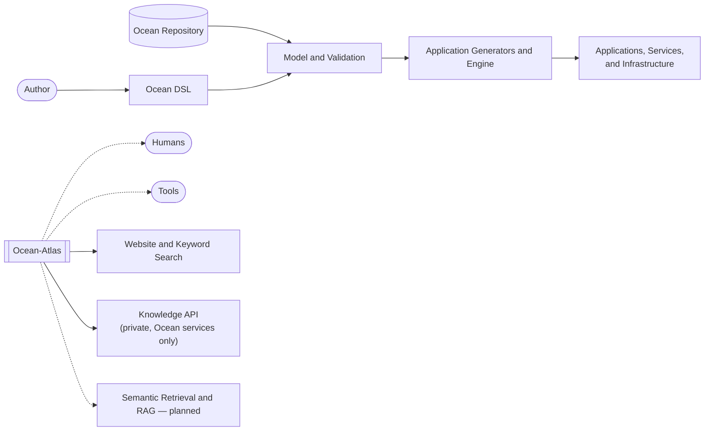

# Architecture

> Generated from Ocean-Atlas v0.1.0 (content a0c57f8d). Canonical source: https://atlas.ocean-lab.ai/architecture/

**Contents**

- [Architecture](#architecture-1)
- [Ocean-Atlas Knowledge API](#ocean-atlas-knowledge-api)

## Architecture

Landing page for Ocean platform architecture — how its major layers relate, and where to continue for each architectural concern.

Source: https://atlas.ocean-lab.ai/architecture/

Status: Accepted · Authority: Informative

### 1. Overview

This section describes Ocean's platform architecture: its system boundaries,
major components, and how those components relate to one another.

It is a landing page, not a specification. It exists to help a reader:

- understand what belongs in Ocean architecture documentation;
- see how Ocean's major architectural layers relate;
- find where to continue for a specific concern;
- distinguish authoritative canonical knowledge from explanatory material.

Detailed, normative behavior is defined by the canonical documents this page
links to. Where a dedicated architecture document does not yet exist, this
page links to the closest current canonical source instead of restating it.

---

### 2. Architecture at a Glance

```text
Ocean Ecosystem
├── Ocean DSL                        (technology-independent system model)
├── Application Generators and Engine (turn validated models into runtime outputs)
├── Ocean Repository                 (versioned, reusable definitions)
├── Ocean-Atlas                      (canonical knowledge platform, this site)
├── Ocean-Lab                        (the broader Ocean application environment)
└── Generated applications and infrastructure
```

Ocean-Atlas documents the DSL, the reuse model, and the platform's knowledge
architecture. It does not implement the Ocean application generators,
execution engine, or generated runtimes. Ocean-Atlas has a separate publishing
pipeline that derives documentation views from canonical knowledge.

---

### 3. Architectural Principles

- **DSL-first system modeling** — a system is described through Ocean DSL constructs before any implementation exists.
- **Technology-independent canonical models** — the DSL models intent and structure, not frameworks, libraries, or language constructs.
- **Separation of model and generated implementation** — generators and engines translate validated models into concrete outputs; the technology-independent DSL model remains the design source of truth.
- **Stable identities and versioned reuse** — reusable definitions are identified and versioned through the Ocean Repository and local Pre-baked Registry.
- **Canonical knowledge as source, generated views as projections** — Ocean-Atlas publishes one canonical knowledge base; presentation-specific builders (such as the Astro/Starlight site) generate views from it rather than owning content.
- **Explicit boundaries between Atlas, repositories, tools, and runtimes** — each part of the ecosystem has a defined responsibility and does not silently absorb another's.

These principles are established in more detail by the documents linked in
[Section 4](#4-architecture-areas).

---

### 4. Architecture Areas

#### 4.1 System Design

How Ocean DSL constructs combine to model a system.

- [Ocean Bundle](concepts.md#ocean-bundle) — the complete, identifiable Ocean DSL project.
- [Ocean System Design Model](concepts.md#ocean-system-design-model) — how DSL constructs combine into a system.
- [Control Structure](concepts.md#control-structure) — how services, components, FSMs, and expressions form behavior.

#### 4.2 Knowledge Architecture

How Ocean knowledge is structured, governed, and published.

- [Ocean-Atlas Knowledge Architecture](https://atlas.ocean-lab.ai/atlas/001-knowledge-architecture/) — the foundational architecture and long-term knowledge model.
- [Ocean-Atlas Metadata Schema](https://atlas.ocean-lab.ai/atlas/010-metadata-schema/) — the metadata model for knowledge items.
- [Ocean-Atlas Identity and Relationship Standards](https://atlas.ocean-lab.ai/atlas/020-identity-and-relationships/) — stable identities and typed relationships.
- [Atlas Builder Boundary](decisions.md#atlas-builder-boundary) — the boundary between canonical knowledge and presentation-specific builders.

#### 4.3 Reuse and Distribution

How definitions are published, versioned, resolved, and consumed.

- [Ocean Repository](concepts.md#ocean-repository) — the Ocean Repository and local Pre-baked Registry, and the `O.`/`P.` reference formats.
- [Import DSL Reference](dsl/import.md) — resolving a reusable definition into a local alias.
- [Include DSL Reference](dsl/include.md) — statically composing a same-section definition.

#### 4.4 Runtime and Generation

How validated models become applications, services, infrastructure,
documentation, and other generated outputs.

A dedicated runtime and generation architecture document does not yet exist.
Until it does, the closest canonical sources are:

- [Ocean DSL](dsl/overview.md) — the source-file structure the model and generation pipeline consumes.
- [Service DSL Reference](dsl/service.md) — how domain behavior and infrastructure compose into deployable units.
- [Deploy DSL Reference](dsl/deploy.md) — how services, UIs, and brokers are materialized into runtime environments.

#### 4.5 Decisions

Architectural decisions and open proposals.

- [Decisions](https://atlas.ocean-lab.ai/decisions/) — entry point for architecture decisions and requests for comment.
- [Architecture Decision Records](https://atlas.ocean-lab.ai/decisions/adrs/) — accepted and proposed ADRs.
- [Requests for Comment](https://atlas.ocean-lab.ai/decisions/rfcs/) — open and completed RFCs.

#### 4.6 Knowledge APIs

How Ocean components and external tools read Ocean-Atlas knowledge
programmatically, without depending on the website.

- [Ocean-Atlas Knowledge API](#ocean-atlas-knowledge-api) — the runtime
  HTTP API's route table, response envelope, and network stance.
- [Knowledge API Service](decisions.md#knowledge-api-service) — the
  architectural decision behind it.

---

### 5. System Context



An author writes Ocean DSL, optionally reusing definitions resolved from the
Ocean Repository. The model is validated and then translated by generators and
the engine into applications, services, and infrastructure.

Ocean-Atlas is a separate, parallel system: the canonical knowledge platform
that documents the DSL, the reuse model, and the platform architecture itself,
consumed today through the website, keyword search, build tooling, and the
[Knowledge API](#ocean-atlas-knowledge-api) (reachable only from other
Ocean services over Fly's private network, not the public internet).
Semantic retrieval and RAG integration remain documented future capabilities
(see [`atlas.knowledge-architecture`](/atlas/001-knowledge-architecture/)).

---

### 6. Reading Paths

- **Newcomer:** [Ocean Bundle](concepts.md#ocean-bundle) → [Ocean System Design Model](concepts.md#ocean-system-design-model) → [Control Structure](concepts.md#control-structure)
- **DSL implementer:** [Ocean DSL](dsl/overview.md) → [Import](dsl/import.md) / [Include](dsl/include.md) → [Service](dsl/service.md) → [Deploy](dsl/deploy.md)
- **Platform architect:** [Ocean-Atlas Knowledge Architecture](https://atlas.ocean-lab.ai/atlas/001-knowledge-architecture/) → [Ocean Repository](concepts.md#ocean-repository) → [Architecture Decision Records](https://atlas.ocean-lab.ai/decisions/adrs/)
- **Tool builder:** [Atlas Builder Boundary](decisions.md#atlas-builder-boundary) → [Ocean-Atlas Metadata Schema](https://atlas.ocean-lab.ai/atlas/010-metadata-schema/) → [Ocean-Atlas Identity and Relationship Standards](https://atlas.ocean-lab.ai/atlas/020-identity-and-relationships/)

## Ocean-Atlas Knowledge API

Reference for the Ocean-Atlas Knowledge API — a private, read-only runtime HTTP service exposing navigation, documents, examples, keyword and semantic search, taxonomy, relationships, and version information from builders/core's normalized AtlasModel and a Postgres/pgvector knowledge index.

Source: https://atlas.ocean-lab.ai/architecture/knowledge-api/

Status: Accepted · Authority: Authoritative

### 1. Overview

The Knowledge API lets Ocean components and external tools — Ocean Studio,
Ocean CLI, Ocean Assistant, generators, compiler diagnostics — read
Ocean-Atlas knowledge programmatically, without depending on the website.

It is implemented by `services/knowledge-api`, a small `node:http` service
with no HTTP framework dependency. It depends only on
`@ocean-atlas/builder-core`'s `buildAtlasModel`, never on canonical
Markdown directly and never on generated presentation output. The
architectural decision behind it, including alternatives considered, is
recorded in [`adr.knowledge-api-service`](/decisions/adrs/adr-knowledge-api-service/).

### 2. Network Access

**The Knowledge API is not public.** It is reachable only from other Ocean
services over Fly's private network (6PN), at:

```text
http://ocean-atlas.internal:8080/v1
```

This matches the convention originally used by sibling Ocean services (for
example `ocean-audit.internal:8080/v1`, `ocean-bundle.internal:8080/v1`).
It is never declared as a public Fly service, and the public website's
nginx process does not proxy to it — the two are independent processes in
the same container, sharing nothing but the Machine they run on.

Sibling backend services have since moved from `.internal` to Fly
`.flycast` addressing (proxy-side load balancing and concurrency limits).
The Knowledge API deliberately stays on `.internal`: `.flycast` routing
requires the target port to be a declared `[[services]]`/`[http_service]`
block, and on this app — which also serves the public website from public
IPs — declaring port 8080 would expose it on those public IPs too. Keeping
port 8080 undeclared is exactly what `adr.knowledge-api-service` relies on
for privacy, so `.internal` remains the correct addressing here until a new
ADR revisits that boundary.

There is no application-level authentication for v1. The trust boundary is
"any Machine on the Ocean Fly organization's private network." Every route
is `GET`-only and read-only.

### 3. Snapshot Semantics

`buildAtlasModel({ repositoryRoot })` runs once at process startup. There
is no live filesystem watching in production — a knowledge change requires
a redeploy, the same deterministic, snapshot-per-build model Ocean-Atlas
already uses for its static site.

### 4. Response Envelope

```jsonc
// single resource
{ "data": { /* ... */ }, "meta": { "schemaVersion": 1, "apiVersion": "v1" } }

// collection
{
  "data": [ /* ... */ ],
  "meta": { "schemaVersion": 1, "apiVersion": "v1", "total": 74, "limit": 50, "offset": 0 }
}

// error (alongside a real HTTP status code)
{ "error": { "status": 404, "code": "not_found", "message": "..." } }
```

`GET /v1/openapi.json` and `GET /v1/docs` are the two exceptions: the
former returns the OpenAPI document itself, unwrapped, since external
tooling expects a plain OpenAPI file at that path; the latter returns an
HTML page (Swagger UI), not JSON at all.

### 5. Routes

All routes are under `/v1`.

| Route | Description |
| --- | --- |
| `GET /navigation` | The knowledge navigation hierarchy. |
| `GET /documents` | List documents. Filters: `type`, `area`, `status`, `authority`. Paginated: `limit` (default 50, max 200), `offset`. Returns summaries only — no `content`. |
| `GET /documents/:id` | One document by stable ID, including `content`. |
| `GET /documents/:id/metadata` | Just the document's metadata — no `content`. |
| `GET /documents/:id/relationships` | `{ outgoing, incoming }` — resolved, typed edges in both directions. |
| `GET /documents/:id/related` | Deduped, resolved union of outgoing and incoming relationships. |
| `GET /examples` | List examples. Paginated. |
| `GET /examples/:id` | One example by stable ID (usage, explanation, implementation facets). |
| `GET /knowledge/:id` | Resolves a stable ID to either a document or an example: `{ kind, data }`. |
| `GET /search` | Ranked keyword search across documents and examples. Query: `q`, plus the same filters as `/documents`. Filters work standalone without `q`. |
| `GET /semantic-search` | Ranked semantic (meaning-based) search over knowledge chunks — see §7. `q` is required; same structured filters. Returns `503` if not configured or not yet usable (§7). |
| `GET /taxonomy` | Facet counts by type, area, status, and authority. |
| `GET /version` | Schema and API version, document/example counts, build timestamp. |
| `GET /health` | Process liveness — distinct from the site's static `/healthz`. |
| `GET /openapi.json` | This API's OpenAPI specification. |
| `GET /docs` | Interactive Swagger UI for exploring and trying routes. Serves an HTML page whose Swagger UI assets load from a CDN — not bundled, to keep this service dependency-free — so opening it requires internet access. |

Documents and examples are kept as separate resources rather than folded
together: `NormalizedExample`'s shape (usage, explanation, and
implementation facets) is materially different from a flat document.
`GET /knowledge/:id` exists specifically for callers that don't already
know which kind an ID resolves to — relationship targets can point at
either.

### 6. Keyword Search

A small, hand-rolled inverted index — no external search dependency.
Indexed fields, weighted: `title` (5), `summary` (3), metadata's free-form
`additional` values and, for examples, `usage.tags` (2), and full
document/example content (1). A query matching the exact stable ID of a
record ranks first. `authority: Authoritative` records get a small
ranking boost; `deprecated`/`superseded` records get a small penalty.
Deliberately the simplest keyword search that could work for a corpus
this size.

### 7. Semantic Search

`GET /v1/semantic-search` ranks by meaning, not keyword overlap, over
**chunks** rather than whole documents/examples — see
`adr.knowledge-chunking-and-indexing` for the full design. Summary:

- **Chunking**: canonical content is split along `## `/`### ` heading
  boundaries (falling back to paragraphs only when a section is still too
  large), with a stable, ID-derived chunk identity
  (`<document-stable-id>#<heading-slug>`) — never a route or file path.
- **Storage**: chunk text and a 1024-dimension Voyage AI (`voyage-4`)
  embedding live in Postgres/pgvector, in a dedicated `ocean_atlas`
  database on the shared Fly Postgres cluster — see
  `adr.vector-storage-and-embedding-provider`. Every row is a rebuildable
  cache, reconstructable from canonical Markdown at any time.
- **Indexing lifecycle**: one reconciliation pass per process start, not
  a live watcher and not re-embedding the whole corpus every time — only
  new or changed chunks are embedded, removed chunks are deleted, and the
  result is published atomically (all writes commit together, or a
  failure leaves the previous completed index fully untouched).
- **Availability**: `503` only when no index generation has *ever*
  completed. A routine restart, or a background refresh already in
  progress, never blocks semantic search from serving the last completed
  ("usable") index — even if that generation isn't yet "current" (doesn't
  yet reflect today's content or embedding model). `GET /v1/health`
  reports both `semanticSearchReady` (usable) and `semanticSearchCurrent`
  separately.
- **Results** carry the same source attribution as everything else in
  this API — `documentId`, `heading`, `route`, `type`/`area`/`status`/`authority`
  — plus the matched chunk's own text, so a caller (or an LLM) can cite
  precisely what justified the result.

Deliberately a separate endpoint from keyword `/v1/search`, not merged
with it — hybrid ranking is an explicitly deferred future decision, not
built here.

### 8. Known Gap: Version-Aware Retrieval

[`atlas.knowledge-architecture`](/atlas/001-knowledge-architecture/)
§20–21 describe "version-aware retrieval" as retrieving knowledge
applicable to a specific Ocean version (an `appliesTo`-style field).
`DocumentMetadata` does not carry that field yet — only a generic
`additional` catch-all — and the reference describing it
(`atlas.metadata-schema`) is itself still `Status: Draft`. The Knowledge
API's `/version` route reports API/schema/build version only. Full
per-document Ocean-version-aware retrieval would require a prior
`builders/core` metadata change; it is not something this service can
fabricate on its own.

### 9. Related Knowledge

- [`adr.knowledge-api-service`](/decisions/adrs/adr-knowledge-api-service/) — the architectural decision, alternatives considered, and the RFC it supersedes.
- [`adr.vector-storage-and-embedding-provider`](/decisions/adrs/adr-vector-storage-and-embedding-provider/) — why Postgres/pgvector and Voyage AI, behind a provider-independent interface.
- [`adr.knowledge-chunking-and-indexing`](/decisions/adrs/adr-knowledge-chunking-and-indexing/) — the chunking algorithm and the versioned, lock-safe, atomically-published indexing lifecycle behind §7.
- [`adr.atlas-builder-boundary`](/decisions/adrs/adr-atlas-builder-boundary/) — the Core/adapter dependency boundary this service extends to a runtime consumer.
- [`adr.search-today-structured-retrieval-tomorrow`](/decisions/adrs/adr-search-today-structured-retrieval-tomorrow/) — the constraint this service is the first concrete implementation of.
- [`adr.stable-knowledge-identity`](/decisions/adrs/adr-stable-knowledge-identity/) — the stable IDs this API's lookups, relationships, and search results depend on.

These semantic relationships are declared in the document metadata.
