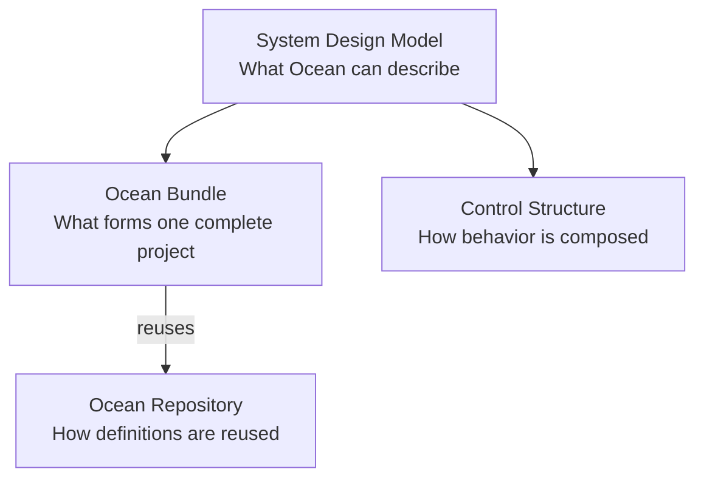

# Concepts

> Generated from Ocean-Atlas v0.1.0 (content 8776e975). Canonical source: https://atlas.ocean-lab.ai/concepts/

**Contents**

- [Concepts](#concepts-1)
- [Control Structure](#control-structure)
- [Ocean Bundle](#ocean-bundle)
- [Ocean Repository](#ocean-repository)
- [Ocean System Design Model](#ocean-system-design-model)

## Concepts

Curated entry point to Ocean's foundational system model, project boundary, behavioral composition, and reusable-definition concepts.

Source: https://atlas.ocean-lab.ai/concepts/

Status: Approved · Authority: Informative

### 1. Overview

Concepts explain the foundational ideas behind Ocean: what the platform models,
how a complete project is bounded, how behavior is composed, and how definitions
are reused. They provide the mental model needed before consulting precise DSL
syntax or selecting a modeling pattern.

Start with the [Ocean System Design Model](#ocean-system-design-model) for the broad
view, then follow the concept that matches the question you are trying to
answer.

### 2. Concept Map



The relationships are complementary:

- the **System Design Model** describes the complete technology-independent
  modeling space;
- a **Bundle** is one identifiable Ocean DSL project within that model;
- the **Control Structure** explains the behavioral layers inside a system;
- the **Ocean Repository** supplies versioned definitions a Bundle can reuse.

### 3. Concept Catalogue

| Concept | Question it answers | Continue to |
| --- | --- | --- |
| [Ocean System Design Model](#ocean-system-design-model) | How do Ocean's data, behavior, interfaces, persistence, messaging, configuration, and deployment constructs form one system model? | [DSL overview](dsl/overview.md) |
| [Ocean Bundle](#ocean-bundle) | What belongs to one complete Ocean DSL project, and how is that project identified? | [`@info`](/dsl/info/), [`@import`](/dsl/import/), [`@include`](/dsl/include/) |
| [Control Structure](#control-structure) | How do services, components, FSMs, and expressions divide and compose behavior? | [Service](dsl/service.md), [Component](dsl/component.md), [FSM](dsl/fsm.md), [Expression](dsl/expression.md) |
| [Ocean Repository](#ocean-repository) | How does a project identify and reuse versioned Ocean or local pre-baked definitions? | [`@import`](/dsl/import/), [`@include`](/dsl/include/) |

### 4. Suggested Reading Paths

#### New to Ocean

1. Read the [System Design Model](#ocean-system-design-model).
2. Understand the [Bundle](#ocean-bundle) as the complete project boundary.
3. Open a [working example](https://atlas.ocean-lab.ai/examples/) and use its Horizon to see those ideas
   in a concrete system.

#### Modeling behavior

1. Read [Control Structure](#control-structure).
2. Choose a reusable solution from [Patterns](patterns.md#patterns-1).
3. Confirm the precise constructs in the linked DSL references.

#### Reusing definitions

1. Read [Ocean Repository](#ocean-repository).
2. Review the canonical [`@import`](/dsl/import/) and
   [`@include`](/dsl/include/) semantics.
3. Apply those rules within the [Bundle](#ocean-bundle) that consumes the reusable
   definitions.

### 5. Knowledge Boundaries

| Knowledge area | Purpose |
| --- | --- |
| **Concepts** | Explain the foundational model and why its parts relate. |
| [**DSL Reference**](dsl/overview.md) | Defines exact syntax, semantics, and constraints. |
| [**Architecture**](architecture.md#architecture-1) | Explains major platform components and their boundaries. |
| [**Patterns**](patterns.md#patterns-1) | Recommends reusable solutions to recurring modeling problems. |
| [**Examples**](https://atlas.ocean-lab.ai/examples/) | Demonstrates the model in validated, runnable projects. |
| [**Glossary**](glossary.md#glossary-1) | Provides concise canonical definitions and aliases. |

Concept pages should link to authoritative DSL references instead of
redefining syntax, and examples should demonstrate concepts without becoming
their normative source.

## Control Structure

Explains how Ocean services, components, FSMs, and expressions form a layered behavioral composition model.

Source: https://atlas.ocean-lab.ai/concepts/control-structure/

Status: Approved · Authority: Authoritative

### 1. Overview

Ocean separates system behavior into complementary control structures:

- **services** define deployable orchestration boundaries;
- **components** compose related behavior into reusable domain units;
- **FSMs** own state and state transitions;
- **expressions** provide stateless calculations, conditions, validation, mapping, and transformation.

These structures form a composition model rather than a rigid implementation stack.

Conceptually:

```text
Service
   │
   ├── external contracts and infrastructure
   ├── Components
   │      ├── FSMs
   │      ├── Expressions
   │      └── nested Components
   ├── FSMs
   └── Expressions
```

The exact elements permitted in each scope are defined by the corresponding DSL references.

---

### 2. Core Principle

Each control structure has a distinct responsibility.

```text
Service     → deployment and orchestration boundary
Component   → stateless behavioral composition
FSM         → stateful behavior
Expression  → stateless logic
```

This separation keeps deployment concerns, composition, state management, and pure logic explicit in the Ocean model.

Larger systems are assembled by connecting these responsibilities rather than concentrating them in one construct.

---

### 3. Composition Model

The main composition flow is:

```text
External input
      │
      ▼
Service boundary
      │
      ▼
Component composition
      │
      ▼
FSM behavior
      │
      ▼
State transitions and outputs
```

Expressions may participate wherever the receiving DSL construct explicitly permits stateless logic.

```text
                  ┌──────────────┐
                  │  Expression  │
                  └──────┬───────┘
                         │
               conditions, mapping,
             validation, transformation
                         │
        ┌────────────────┼────────────────┐
        ▼                ▼                ▼
     Service          Component          FSM
```

This diagram describes semantic roles. It does not imply that every DSL construct can invoke every other construct directly.

---

### 4. Services

A service defines a deployable orchestration boundary.

It brings domain behavior together with the contracts and infrastructure required to expose that behavior as a runnable system unit.

A service may be responsible for:

- exposing APIs;
- receiving or publishing broker messages;
- connecting external inputs to domain behavior;
- composing components;
- coordinating supported FSMs and expressions;
- connecting databases and persistence concerns;
- defining configuration and deployment-facing behavior;
- establishing the boundary of generated output.

A service is not limited to one implementation technology or deployment style. “Microservice” may describe one generated form, but it is not the semantic definition of the Ocean construct.

The exact syntax and permitted service elements are defined by `dsl.service`.

---

### 5. Service Responsibilities

The service layer connects external system concerns to the internal behavioral model.

Conceptually:

```text
API ───────────┐
Broker ────────┤
Database ──────┼── Service ── Components / FSMs / Expressions
Configuration ─┤
Artifacts ─────┘
```

Typical service responsibilities include:

- translating external interactions into internal actions;
- routing internal outputs to external contracts;
- providing infrastructure connections;
- selecting and configuring domain components;
- defining a coherent generation and deployment boundary.

Domain state should remain in stateful behavioral elements rather than becoming implicit service-level state.

---

### 6. Components

A component is a reusable, stateless unit of behavioral composition.

It can bring together:

- FSMs;
- expressions;
- nested components;
- typed inputs and outputs;
- explicit connections between those elements.

Conceptually:

```text
Component
    ├── inputs
    ├── FSMs
    ├── Expressions
    ├── nested Components
    ├── connections
    └── outputs
```

A component owns composition, not persistent behavioral state.

The exact syntax and permitted connections are defined by `dsl.component`.

---

### 7. Component Responsibilities

Components organize related behavior into meaningful domain modules.

Typical responsibilities include:

- grouping related behavioral elements;
- defining typed entry and exit points;
- connecting component inputs to internal behavior;
- connecting internal outputs to other internal elements;
- exposing selected internal results as component outputs;
- applying explicit transformations where connected types differ;
- hiding internal composition behind a reusable domain boundary.

For example, an order component may compose separate FSMs for ordering, payment, and fulfillment without owning their state itself.

---

### 8. Component Statelessness

A component does not directly own behavioral state.

State belongs to the stateful elements inside the composition, primarily FSMs.

```text
Component
    │
    ├── connection topology   ← owned by Component
    ├── input/output contract ← owned by Component
    │
    ├── OrderFSM              ← owns order state
    └── PaymentFSM            ← owns payment state
```

This distinction supports:

- explicit state ownership;
- reusable composition;
- independent FSM validation;
- clearer lifecycle management;
- predictable generation.

---

### 9. Finite State Machines

An FSM is an atomic stateful unit of behavior.

It defines:

- states;
- events or accepted inputs;
- transitions;
- transition conditions;
- actions and outputs;
- timers or delays where supported;
- the rules governing movement from one state to another.

Conceptually:

```text
Input or event
      │
      ▼
Current state
      │
      ├── evaluate transition condition
      ├── perform transition behavior
      ▼
New state + output
```

FSMs make state changes explicit and validate them as part of the Ocean model.

The exact syntax and semantics are defined by `dsl.fsm`.

---

### 10. FSM Responsibilities

An FSM is responsible for behavior whose result depends on state over time.

Typical responsibilities include:

- accepting typed events or commands;
- evaluating whether a transition is allowed;
- changing state;
- emitting typed outputs;
- reacting to timers or delays;
- enforcing valid behavioral paths;
- making invalid transitions detectable.

An FSM should not absorb deployment, infrastructure, or broad composition concerns that belong to services or components.

---

### 11. Expressions

An expression is a stateless, side-effect-free unit of logic.

Expressions may provide:

- conditions;
- calculations;
- validation;
- mapping;
- projection;
- transformation;
- reusable decision logic.

Conceptually:

```text
Typed inputs
     │
     ▼
Expression
     │
     ▼
Typed outputs
```

For the same inputs, an expression should produce the same outputs without relying on mutable internal state or direct external I/O.

The exact syntax and semantics are defined by `dsl.expression`.

---

### 12. Expression Usage

Expressions are supporting logic units rather than a layer positioned above or below the other control structures.

They may be used where a receiving DSL construct explicitly permits them.

Common uses include:

- FSM transition conditions;
- FSM calculations or output construction;
- component connection mapping;
- component validation or transformation;
- service-level routing or mapping where supported.

The statement that an expression “can be used anywhere” is intentionally avoided. Each receiving DSL reference defines its valid expression integration points.

---

### 13. State Ownership

State ownership is a central distinction in the control model.

| Construct  | Owns behavioral state    | Primary responsibility                |
| ---------- | ------------------------ | ------------------------------------- |
| Service    | No implicit domain state | Deployment and orchestration boundary |
| Component  | No                       | Stateless behavioral composition      |
| FSM        | Yes                      | Stateful behavior and transitions     |
| Expression | No                       | Stateless logic and transformation    |

Infrastructure connected through a service, such as a database or broker, may store or transport state externally. That does not make the service itself the owner of implicit behavioral state.

---

### 14. Boundaries and Encapsulation

Each structure establishes a different boundary:

```text
Service boundary
    └── what is deployed and externally connected

Component boundary
    └── what behavior is composed and reused together

FSM boundary
    └── what state and transitions form one behavioral lifecycle

Expression boundary
    └── what logic forms one stateless reusable operation
```

These boundaries allow each structure to evolve independently while retaining explicit typed connections.

---

### 15. Data and Control Flow

Ocean models flow through typed inputs, outputs, events, and connections.

A typical flow may be:

```text
API request
    │
    ▼
Service input mapping
    │
    ▼
Component input
    │
    ▼
FSM event
    │
    ├── Expression evaluates condition
    │
    ▼
FSM transition
    │
    ▼
Component output
    │
    ▼
Service response mapping
    │
    ▼
API response
```

Other flows may begin or end through brokers, databases, timers, or other supported service connections.

---

### 16. Typed Connections

Connections between control structures are typed.

This allows Ocean to validate:

- whether a source can provide the data expected by a target;
- whether a mapper or transformation is required;
- whether referenced inputs and outputs exist;
- whether a behavioral flow is internally coherent.

Implicit, untyped communication weakens the model and should not replace declared contracts.

The detailed connection grammar belongs to the DSL reference for the construct that owns the connection.

---

### 17. Reuse and Composition

Each control structure provides reuse at a different level.

| Construct  | Reusable concern                                      |
| ---------- | ----------------------------------------------------- |
| Expression | Calculation, condition, validation, or transformation |
| FSM        | Stateful behavioral lifecycle                         |
| Component  | Coordinated domain behavior                           |
| Service    | Deployable system capability                          |

Conceptually:

```text
Expressions
     ↓
FSMs
     ↓
Components
     ↓
Services
```

This is a common composition direction, not a rule that every intermediate level must always be present.

---

### 18. Direct and Nested Composition

The model allows direct or nested composition where the relevant DSL contracts support it.

For example:

- a component may contain nested components;
- a component may compose FSMs directly;
- a service may compose components;
- a service may use other supported behavioral elements directly;
- FSMs and components may use expressions at defined integration points.

The control structure should be chosen according to semantic responsibility, not merely to satisfy a fixed hierarchy.

---

### 19. Example: Order Processing

An order-processing capability may be modeled as:

```text
OrderService
    │
    ├── Order API
    ├── Order database
    ├── Event broker
    │
    └── OrderComponent
            │
            ├── OrderFSM
            ├── PaymentFSM
            ├── FulfillmentComponent
            └── Expressions
                    ├── ValidateOrder
                    ├── CalculateTotal
                    └── MapOrderResponse
```

In this model:

- `OrderService` owns the deployable boundary and external connections;
- `OrderComponent` owns the composition of order behavior;
- `OrderFSM` and `PaymentFSM` own their respective states and transitions;
- `FulfillmentComponent` encapsulates a reusable nested behavior module;
- the expressions provide stateless validation, calculation, and mapping.

---

### 20. Choosing a Control Structure

Use an expression when the behavior:

- is stateless;
- is side-effect-free;
- maps typed inputs to typed outputs;
- represents a calculation, condition, validation, or transformation.

Use an FSM when the behavior:

- depends on current state;
- changes over time;
- reacts to events;
- has explicit valid and invalid transitions.

Use a component when the model:

- composes multiple behavioral elements;
- needs a reusable domain boundary;
- exposes typed inputs and outputs;
- coordinates behavior without directly owning state.

Use a service when the model:

- requires a deployment or generation boundary;
- exposes external contracts;
- connects infrastructure;
- orchestrates domain components as a runnable system capability.

---

### 21. What This Model Avoids

The control structure model avoids:

- hiding state inside generic components;
- mixing pure logic with external I/O;
- coupling domain behavior directly to deployment technology;
- turning services into unstructured containers of business logic;
- treating every behavior as an FSM when no state exists;
- duplicating composition logic across generated implementations;
- relying on implicit or untyped connections.

The goal is not to maximize the number of layers. It is to make each semantic responsibility explicit.

---

### 22. Architectural View vs DSL Contracts

This document explains how the control structures relate conceptually.

It does not define their complete grammar.

The normative syntax and detailed semantics are defined by:

- `dsl.service`;
- `dsl.component`;
- `dsl.fsm`;
- `dsl.expression`.

If this conceptual overview and a normative DSL reference differ on a syntax or validation rule, the normative DSL reference governs that construct.

---

### 23. Rules and Principles

The following principles apply:

- Services define deployable orchestration boundaries.
- Services connect external contracts and infrastructure to domain behavior.
- Components are reusable, stateless composition units.
- Components may compose FSMs, expressions, and nested components where supported.
- FSMs own behavioral state and explicit transitions.
- Expressions provide stateless, side-effect-free logic.
- Expressions may be used only at integration points supported by the receiving DSL construct.
- Control structures communicate through explicit typed contracts.
- State ownership should remain explicit.
- Deployment concerns should remain separate from domain behavior where possible.
- The model permits direct and nested composition; it is not a mandatory four-layer stack.
- Detailed syntax and validation rules belong to the corresponding DSL references.

---

### 24. Related Knowledge

The control structure concept is related to:

- `dsl.service` — defines deployable orchestration boundaries and their external connections.
- `dsl.component` — defines stateless composition of behavioral elements.
- `dsl.fsm` — defines stateful behavior through states and transitions.
- `dsl.expression` — defines reusable stateless logic.
- `dsl.api` — defines external API contracts that may be exposed through services.
- `dsl.database` — defines persistence infrastructure connected through services.
- `dsl.broker` — defines message-based external communication connected through services.

These semantic relationships are declared in the document metadata.

## Ocean Bundle

Defines the Ocean Bundle — the complete, identifiable Ocean DSL project that groups a system's DSL definitions under one project-level identity.

Source: https://atlas.ocean-lab.ai/concepts/bundle/

Status: Approved · Authority: Authoritative

### 1. Overview

A **Bundle** is the complete, identifiable Ocean DSL project: the full set of DSL definitions — datatypes, APIs, databases, brokers, behavior, services, configuration, and deployment — along with non-DSL files, that together describe one system.

"Bundle" and "Ocean DSL project" refer to the same thing. Bundle is Ocean's canonical term for a complete DSL project and the unit that carries its project-level identity.

A Bundle is identified by its `@info` section, defined by [`dsl.info`](/dsl/info/).

---

### 2. Core Principle

Every Ocean system is organized as one Bundle.

```text
Bundle
  ├── @info                  (project identity)
  ├── @datatype definitions
  ├── @api / @broker / @database definitions
  ├── @expression / @fsm / @component definitions
  ├── @service definitions
  ├── @config / @vault definitions
  ├── @dashboard / @ui definitions
  └── @deploy definitions
```

A Bundle does not need to use every DSL construct. The DSL areas a Bundle may contain, and how they combine into a system, are defined by [`concept.system-design-model`](/concepts/system-design-model/).

---

### 3. Bundle Identity

A Bundle's identity comes from its `@info` section: name, version, and an optional description.

```text
Bundle
    └── @info
          ├── name
          ├── version
          └── description
```

A complete Bundle should contain one effective `@info` section and therefore one project-level identity. Incomplete or fragmentary DSL input may temporarily omit `@info`, as defined by `dsl.info`. The complete field syntax, cardinality, and validation rules for `@info` are defined by `dsl.info` and are not repeated here.

The Bundle's `@info` version identifies the Bundle's own definition. It is distinct from the version of any individual reusable item the Bundle publishes or consumes — see Section 5.

---

### 4. Bundle Composition

A Bundle contains the local DSL definitions that make up its system: datatypes, APIs, databases, brokers, expressions, FSMs, components, services, configuration, vaults, dashboards, UI, and deployment definitions, as applicable.

A Bundle may also reuse definitions it does not own, through:

```text
@import   — bring in a selected reusable definition from the Ocean Repository or local Pre-baked Registry
@include  — statically compose a compatible same-section definition into the current file
```

These reuse mechanisms, and the `O.`/`P.` reference formats they resolve, are defined by [`concept.ocean-repository`](/concepts/ocean-repository/).

```text
Bundle
  ├── local definitions
  └── reused definitions
        ├── O.<namespace>.<name>@<version>   (Ocean Repository)
        └── P.<namespace>.<name>@<version>   (local Pre-baked Registry)
```

---

### 5. Bundle vs Reusable Repository Items

A Bundle is a project. The definitions inside it are not automatically reusable outside it.

A definition authored inside a Bundle — a datatype, an expression, a service, and so on — may independently be published to the Ocean Repository as its own reusable item, with its own namespace, name, and version. That published identity is distinct from the Bundle's own `@info` identity:

```text
Bundle                              Published item
  @info: "Billing" @ 2.1.0            O.billing.InvoiceLogic@2.0.0
```

Changing the Bundle's version does not change the version of an item it publishes, and vice versa, unless the project's own release policy links them.

---

### 6. Bundle vs Service

A Bundle may contain multiple services. `@info` identifies the Bundle as a whole; it does not identify, rename, or version any one service inside it.

```text
Bundle: "Order Platform" @ 1.0.0
  ├── OrderService
  ├── PaymentService
  └── NotificationService
```

Service-specific contracts, configuration, and deployment behavior belong to [`dsl.service`](/dsl/service/) and related references.

---

### 7. Example

A minimal Bundle for an inventory system, identified by its `@info` section:

```ocean-dsl
@info

name: "Inventory Management"
version: 1.0.0
description: "Manages inventory and stock movements."
```

The same Bundle typically contains further DSL definitions alongside `@info`:

```text
Bundle: "Inventory Management" @ 1.0.0
  ├── @info
  ├── @datatype   Product, StockMovement
  ├── @database   InventoryDb
  ├── @api        InventoryApi
  ├── @service    InventoryService
  └── @deploy     InventoryDeploy
```

---

### 8. Related Knowledge

The Ocean Bundle concept is related to:

- `dsl.info` — defines the `@info` section that identifies a Bundle.
- `concept.system-design-model` — defines how the DSL constructs a Bundle contains model a system.
- `concept.ocean-repository` — defines how individual definitions within a Bundle may be published and reused independently of the Bundle's own identity.
- `dsl.import` — imports a selected reusable definition into a Bundle.
- `dsl.include` — statically composes a compatible same-section definition into a Bundle's current file.
- `dsl.service` — defines the deployable service boundaries a Bundle may contain.

These semantic relationships are declared in the document metadata.

## Ocean Repository

Defines the Ocean Repository and local Pre-baked Registry as versioned sources of reusable definitions, together with the canonical `O.` and `P.` reference formats used to identify them.

Source: https://atlas.ocean-lab.ai/concepts/ocean-repository/

Status: Approved · Authority: Authoritative

### 1. Overview

The **Ocean Repository** is the source of reusable and versioned Ocean definitions. Ocean also recognizes a related local source, the **Pre-baked Registry**, for reusable items supplied by the local environment.

It allows system designers to reuse existing DSL definitions rather than redefining common models and capabilities for every system.

Repository items may include:

- datatypes;
- APIs;
- databases;
- brokers;
- expressions;
- FSMs;
- components;
- services;
- other reusable Ocean definitions.

Local pre-baked items may include ready-made capabilities or technology selections that a project can resolve locally, such as a particular PostgreSQL distribution. They use the same identity structure as Ocean Repository items but belong to a different source.

Definitions may be provided by:

- Ocean itself;
- organizations;
- teams;
- projects;
- other authorized publishers.

The repository provides the foundation for reuse, composition, discovery, versioning, and sharing across the Ocean ecosystem.

---

### 2. Core Principle

Reusable Ocean definitions should remain **DSL definitions**, not opaque implementation artifacts.

Conceptually:

```text
Ocean Repository
       │
       ├── Datatypes
       ├── APIs
       ├── Expressions
       ├── FSMs
       ├── Components
       ├── Services
       └── ...
              │
              ▼
       Ocean DSL Project
```

A repository item retains its DSL identity and semantics when reused.

This allows Ocean to:

- parse it;
- validate it;
- inspect it;
- compose it;
- generate implementations from it;
- understand its relationships with other definitions.

---

### 3. Repository References

Every reusable item can be identified through a repository reference. The prefix identifies its source.

Canonical formats:

```text
O.<namespace>.<name>@<version>
P.<namespace>.<name>@<version>
```

Example:

```text
O.auth.loginFlow@1.2.0
```

Another example:

```text
O.std.tax.nl.CalculateVAT@2.0.0
```

Local pre-baked example:

```text
P.docker.postgresql@15.1.23-stable
```

`O.` identifies an item in the Ocean Repository. `P.` identifies an item in the local Pre-baked Registry. In both cases, the reference provides a stable identity for a specific reusable item.

---

### 4. Reference Structure

An Ocean or pre-baked reference consists of:

| Part        | Meaning                                      | Example                              |
| ----------- | -------------------------------------------- | ------------------------------------ |
| `O.`        | Identifies an Ocean Repository item          | `O.auth.loginFlow@1.2.0`             |
| `P.`        | Identifies a local Pre-baked Registry item   | `P.docker.postgresql@15.1.23-stable` |
| `namespace` | Logical hierarchy containing the item        | `auth`, `std.tax.nl`, `docker`       |
| `name`      | Name of the reusable item                    | `loginFlow`, `CalculateVAT`, `postgresql` |
| `version`   | Item version                                 | `1.2.0`, `15.1.23-stable`, `latest` |

Conceptually:

```text
O.<namespace>.<name>@<version>
│      │          │       │
│      │          │       └── version
│      │          └────────── item name
│      └───────────────────── namespace
└──────────────────────────── Ocean Repository
```

The equivalent local form is:

```text
P.<namespace>.<name>@<version>
└──────────────────────────── local Pre-baked Registry
```

---

### 5. Namespaces

Namespaces organize reusable definitions into logical groups.

A namespace may contain multiple hierarchical segments.

Examples:

```text
auth
```

```text
billing
```

```text
std.tax.nl
```

```text
domain.payment
```

This allows related definitions to be grouped while maintaining globally meaningful references.

For example:

```text
O.domain.payment.CardInfo@1.2.0
```

identifies:

```text
Repository : Ocean
Namespace  : domain.payment
Name       : CardInfo
Version    : 1.2.0
```

---

### 6. Versioning

Ocean Repository definitions are versioned.

Example:

```text
O.auth.loginFlow@1.2.0
```

A version allows systems to depend on a known definition rather than automatically consuming incompatible changes.

Where supported, `latest` may identify the latest applicable version:

```text
O.auth.loginFlow@latest
```

If the version is omitted, the repository may resolve it to `latest` according to repository resolution rules.

The same version rules apply to `P.` references unless the local registry defines a more specific contract. A pre-baked version may contain a release channel or variant suffix:

```text
P.docker.postgresql@15.1.23-stable
```

Version-resolution behavior should remain explicit and deterministic.

---

### 7. Using Repository Definitions

Repository definitions are consumed through Ocean reuse mechanisms.

The primary mechanisms include:

```text
@import
@include
```

These mechanisms serve different purposes. `O.` references resolve through the Ocean Repository. Whether a construct accepts a `P.` reference is defined by that construct's contract, because a local pre-baked item is not necessarily a DSL definition.

Conceptually:

```text
             Ocean Repository
             or Pre-baked Registry
                    │
           Repository Reference
                    │
          ┌─────────┴─────────┐
          │                   │
       @import             @include
          │                   │
          └─────────┬─────────┘
                    │
                    ▼
             Local DSL Model
```

Their exact syntax and semantics are defined by their corresponding DSL references.

---

### 8. Importing Definitions

`@import` allows a DSL file to explicitly import a selected repository definition and expose it through a local alias.

Conceptually:

```ocean-dsl
@import <type> <OceanRef> as <Alias>
```

Example:

```ocean-dsl
@import datatype O.std.auth.UserToken@1.0.0 as Token
```

The alias may then be used as if the imported definition were available locally:

```ocean-dsl
@datatype

@import datatype O.std.auth.UserToken@1.0.0 as Token

Session
    user    : Token
    expires : Int
```

The exact import contract is defined by:

```text
dsl.import
```

---

### 9. Import Types

Different kinds of Ocean definitions may be imported.

Examples include:

```ocean-dsl
@import datatype O.domain.payment.CardInfo@1.2.0 as CardInfo
```

```ocean-dsl
@import expression O.common.logic.DotProduct@2.1.0 as Dot
```

```ocean-dsl
@import fsm O.auth.loginFlow@1.2.0 as login
```

```ocean-dsl
@import component O.billing.InvoiceLogic@2.0.0 as invoice
```

The receiving DSL construct determines which imported definition types are valid in its scope.

---

### 10. Local Aliases

Imported definitions are accessed through local aliases.

Example:

```ocean-dsl
@import datatype O.std.auth.UserToken@1.0.0 as Token
```

The full repository identity is:

```text
O.std.auth.UserToken@1.0.0
```

while its local DSL identity is:

```text
Token
```

This separates:

- global repository identity;
- local model naming.

Aliases also prevent repository namespace details from leaking unnecessarily throughout the local DSL.

---

### 11. Resolution

When Ocean encounters a repository reference, the referenced item must be resolved before it can be used. Resolution first selects the source from the prefix: `O.` selects the Ocean Repository and `P.` selects the local Pre-baked Registry.

Conceptually:

```text
Repository Reference
      ↓
Source Selection (`O.` or `P.`)
      ↓
Version Resolution
      ↓
Reusable Item
      ↓
Validation
      ↓
Local Model
```

For Ocean Repository items, resolution must produce an unambiguous DSL definition. A pre-baked item must produce an unambiguous locally usable item that satisfies the contract of the construct consuming it.

An unresolved or ambiguous reference is invalid.

---

### 12. Repository Item Requirements

A reusable Ocean item should be backed by a valid Ocean definition.

This ensures that repository content remains understandable to the Ocean toolchain.

A reusable item should therefore be:

- identifiable;
- versioned;
- parseable;
- validatable;
- deterministic;
- discoverable;
- compatible with the Ocean DSL model.

The repository should preserve the DSL definition as the authoritative representation of the reusable capability.

---

### 13. Reuse and Composition

The Ocean Repository enables systems to be assembled from existing definitions.

For example:

```text
Application
│
├── local definitions
│
├── O.std.auth.UserToken
├── O.common.audit.AuditService
├── O.domain.payment.CardInfo
└── O.common.validation.IsEmail
```

These definitions may originate from different namespaces while participating in the same system model.

This enables composition without copying DSL definitions between projects.

---

### 14. Discovery

Repository items should be discoverable through their metadata and identity.

Discovery may support criteria such as:

- name;
- namespace;
- DSL type;
- version;
- tags;
- domain;
- publisher;
- lifecycle status.

Discovery allows designers and tooling to find reusable definitions before creating new ones.

The concrete search and discovery implementation is outside the scope of this concept.

---

### 15. Publishing

Reusable definitions may be published to the Ocean Repository.

Conceptually:

```text
DSL Definition
      ↓
Validation
      ↓
Metadata
      ↓
Version
      ↓
Publish
      ↓
Ocean Repository
```

Publishing should preserve:

- identity;
- version;
- DSL type;
- metadata;
- dependencies;
- relationships.

The detailed publishing lifecycle and governance are defined separately from this concept.

---

### 16. Access and Visibility

Repository definitions may have different visibility scopes.

Possible models include:

- public definitions;
- organization-internal definitions;
- private project or team definitions;
- licensed or restricted definitions.

Access control is a repository concern and does not change the semantic meaning of the underlying DSL definition.

The exact access model may evolve with the Ocean Repository implementation.

---

### 17. Repository vs Implementation Technology

The Ocean Repository stores reusable **Ocean definitions**, not technology-specific implementations as its primary abstraction.

For example:

```text
O.common.audit.AuditService@1.0.0
```

represents an Ocean service definition.

Generation may later produce:

```text
Go
Java
Kubernetes
NATS
PostgreSQL
...
```

depending on the target configuration and selected generators.

This preserves technology independence at the repository level.

The local Pre-baked Registry has a different role. A `P.` item may intentionally select a prepared, technology-specific capability, for example:

```text
P.docker.postgresql@15.1.23-stable
```

This distinction keeps reusable Ocean semantics under `O.` while making local prepared capabilities explicitly recognizable under `P.`.

---

### 18. Repository vs Ocean-Atlas

The Ocean Repository and Ocean-Atlas serve different purposes.

#### Ocean Repository

Contains reusable **machine-consumable Ocean definitions** used to build systems.

#### Ocean-Atlas

Contains **knowledge about Ocean** used to understand, document, govern, and evolve the platform.

Conceptually:

```text
Ocean-Atlas
    │
    └── Knowledge about Ocean
        ├── DSL references
        ├── concepts
        ├── guides
        ├── architecture
        └── decisions

Ocean Repository
    │
    └── Reusable Ocean definitions
        ├── datatypes
        ├── expressions
        ├── FSMs
        ├── services
        └── ...
```

Ocean-Atlas may document the repository, but it is not itself the repository.

---

### 19. Ecosystem

The Ocean Repository provides the foundation for an ecosystem centered around reusable system definitions.

Important capabilities include:

- **Reuse** — use existing definitions across systems.
- **Composition** — build larger systems from smaller definitions.
- **Versioning** — depend on known versions.
- **Discovery** — find available definitions.
- **Publishing** — make definitions available for reuse.
- **Validation** — ensure repository items conform to Ocean rules.
- **Governance** — control lifecycle, ownership, and visibility.

These capabilities can evolve independently while retaining the same repository identity model.

---

### 20. Future Evolution

The repository model may evolve to support additional capabilities such as:

- richer dependency resolution;
- compatibility rules;
- version ranges;
- organization-specific namespaces;
- publishing workflows;
- trust and verification;
- licensing;
- caching and mirrors;
- repository federation;
- dependency graphs.

These capabilities should build on the stable foundation of:

```text
identity + type + namespace + version + DSL definition
```

For local pre-baked items, the corresponding foundation is:

```text
source + namespace + name + version + consumable contract
```

---

### 21. Related Knowledge

The Ocean Repository concept is related to:

- `dsl.import` — imports selected definitions from the Ocean Repository into a local DSL scope.
- `dsl.include` — includes reusable definitions from the Ocean Repository.
- `dsl.datatype` — reusable datatype definitions may be stored in the repository.
- `dsl.api` — reusable API definitions may be stored in the repository.
- `dsl.database` — reusable database definitions may be stored in the repository.
- `dsl.broker` — reusable broker definitions may be stored in the repository.
- `dsl.expression` — reusable expressions may be stored in the repository.
- `dsl.fsm` — reusable FSM definitions may be stored in the repository.
- `dsl.component` — reusable component definitions may be stored in the repository.
- `dsl.service` — reusable service definitions may be stored in the repository.

These semantic relationships are declared in the document metadata.

## Ocean System Design Model

Explains how Ocean models software systems through technology-independent DSL constructs for data, behavior, interfaces, persistence, messaging, orchestration, configuration, and deployment.

Source: https://atlas.ocean-lab.ai/concepts/system-design-model/

Status: Approved · Authority: Authoritative

### 1. Overview

Ocean is a DSL-first system design platform.

Its DSL describes the **intent and structure of a software system independently from the technologies used to implement it**.

Rather than directly describing frameworks, libraries, infrastructure, or programming-language constructs, Ocean models concerns such as:

- data;
- public interfaces;
- persistence;
- messaging;
- shared execution context;
- reusable logic;
- stateful behavior;
- behavioral composition;
- service orchestration;
- configuration;
- deployment.

Generators and engines translate these technology-independent definitions into concrete implementations.

Conceptually:

```text
Ocean DSL
    ↓
System Model
    ↓
Validation and Resolution
    ↓
Technology-Specific Generation
    ↓
Applications, Services, Infrastructure, Documentation
```

---

### 2. Core Design Principle

Ocean separates **what a system means** from **how it is implemented**.

For example, an API may be modeled as:

```text
API
    style: REST
```

without coupling the system model to a particular REST framework.

The same principle applies to databases, brokers, deployment technologies, and other implementation concerns.

This allows the DSL model to remain stable while implementation technologies evolve.

---

### 3. System Model

Ocean systems are composed from multiple complementary DSL concerns.

They should not be understood as a strict inheritance hierarchy.

Instead, each DSL area contributes a specific responsibility to the complete system model.

```text
                    Service
                       │
        ┌──────────────┼──────────────┐
        │              │              │
       API         Behavior        Messaging
                                    / Integration
        │              │              │
        │        ┌─────┼─────┐       │
        │        │     │     │       │
        │   Expression FSM Component  Broker
        │              │
        │           Context
        │
     Datatypes
        │
     Database

          + Configuration
          + Deployment
          + Other supporting DSL concerns
```

The exact composition depends on the system being modeled.

A service does not need to use every DSL construct.

---

### 4. Datatypes

`@datatype` defines the technology-independent data model used throughout Ocean.

Datatypes provide shared contracts for:

- API inputs and outputs;
- database entities;
- broker messages;
- expression inputs and outputs;
- context fields;
- FSM events;
- service interactions.

Example conceptually:

```ocean-dsl
@datatype

TodoItem
    id       : String
    title    : String
    priority : Priority
```

Datatypes establish a common type system across otherwise independent DSL areas.

Canonical reference:

```text
dsl.datatype
```

---

### 5. APIs

`@api` defines externally accessible service interfaces.

An API describes:

- operations;
- typed inputs;
- typed outputs;
- interaction style;
- transport-related configuration.

Ocean APIs are technology-independent at the model level.

Different API styles may define different operation syntax, including:

- REST;
- gRPC;
- GraphQL;
- WebSocket;
- SOAP.

The selected style describes the interaction model, while generators determine the concrete implementation technology.

Canonical reference:

```text
dsl.api
```

---

### 6. Databases

`@database` defines persistence behavior for Ocean datatypes.

It describes concerns such as:

- database type;
- database engine;
- entity mappings;
- relationships;
- keys;
- indexes;
- encryption;
- queries;
- commands.

The datatype remains responsible for defining data structure.

The database definition adds persistence semantics to that structure.

Conceptually:

```text
Datatype
    ↓
Database Entity
    ↓
Persistence Implementation
```

Canonical reference:

```text
dsl.database
```

---

### 7. Brokers

`@broker` defines asynchronous messaging boundaries.

A broker contains topics with typed message payloads and may describe messaging behavior such as:

- events;
- requests;
- responses;
- request-response interactions;
- delivery configuration;
- timeout behavior.

Broker topics use Ocean datatypes as their message contracts.

Conceptually:

```text
Publisher
    ↓
Broker Topic
    ↓
Consumer
```

The broker DSL describes messaging intent independently from technologies such as NATS, Kafka, or other messaging engines.

Canonical reference:

```text
dsl.broker
```

---

### 8. Context

`@context` defines volatile shared execution state.

Contexts provide typed data that can be shared explicitly between cooperating parts of service logic.

Unlike database state, context data is not persistent.

Typical uses include:

- request state;
- temporary workflow data;
- orchestration state;
- execution metadata.

Conceptually:

```text
Service Logic
    ↕
Context
```

Access remains explicit through DSL connections and orchestration.

Canonical reference:

```text
dsl.context
```

---

### 9. Expressions

`@expression` defines reusable stateless logic.

Expressions may represent:

- conditions;
- calculations;
- validation;
- mapping;
- transformations;
- derived values;
- decision logic.

Expressions operate on typed inputs and produce typed outputs.

They are designed to remain:

- stateless;
- side-effect-free;
- reusable;
- composable.

Conceptually:

```text
Input
   ↓
Expression
   ↓
Output
```

Expressions may be used by higher-level behavioral constructs such as FSMs, Components, and Services.

Canonical reference:

```text
dsl.expression
```

---

### 10. Finite-State Machines

`@fsm` models behavior that evolves over time through states and transitions.

FSMs define:

- states;
- events;
- triggers;
- transitions;
- actions;
- reusable logic.

Ocean supports both:

- entity-controlled FSMs, where state is represented by persisted entity data;
- in-memory FSMs, where state exists temporarily during execution.

Conceptually:

```text
Current State
     +
    Event
     ↓
    FSM
     ↓
Actions + Next State
```

FSMs provide explicit and deterministic modeling of lifecycle-oriented behavior.

Canonical reference:

```text
dsl.fsm
```

---

### 11. Components

`@component` is intended to provide reusable behavioral composition.

A Component groups and connects behavioral elements such as:

- FSMs;
- nested Components;
- expressions;
- typed inputs and outputs.

Conceptually:

```text
Component Input
      ↓
  ┌─────────────┐
  │ FSM         │
  │ Expression  │
  │ Component   │
  └─────────────┘
      ↓
Component Output
```

Components themselves are intended to remain stateless. State belongs to the stateful elements they contain.

`@component` is currently a work-in-progress capability and may evolve during implementation.

Canonical reference:

```text
dsl.component
```

---

### 12. Services

`@service` represents an independently orchestrated service boundary.

A service brings together the DSL capabilities required to implement a deployable system capability.

Depending on its responsibilities, a service may use:

- APIs;
- databases;
- brokers;
- contexts;
- expressions;
- FSMs;
- Components;
- configuration;
- other services or reusable Ocean definitions.

A service is responsible for connecting these capabilities into an executable model.

Conceptually:

```text
                 Service
                    │
       ┌────────────┼────────────┐
       │            │            │
      API        Behavior      Broker
       │            │            │
       └──────── Connections ─────┘
                    │
                Database
                    │
                Context
```

Not every service requires every capability.

Canonical reference:

```text
dsl.service
```

---

### 13. Explicit Composition

A key Ocean principle is that relationships between system elements should be explicit.

Rather than hiding orchestration inside generated or handwritten code, Ocean models connections directly.

Conceptually:

```text
API operation
      ↓
Expression
      ↓
FSM
      ↓
Database command
      ↓
Broker topic
```

The actual flow may vary significantly between services.

The important principle is:

> System behavior should be visible in the system model rather than reconstructed from implementation code.

---

### 14. Technology Independence

Ocean DSL constructs describe logical capabilities rather than concrete implementation technologies.

For example:

```text
API
    ↓
REST
    ↓
Gin / Spring / another implementation
```

```text
Broker
    ↓
Messaging semantics
    ↓
NATS / Kafka / another engine
```

```text
Database
    ↓
Persistence model
    ↓
PostgreSQL / MongoDB / another engine
```

The DSL may expose technology-selection fields such as `engine`, but technology-specific behavior belongs to the corresponding generator or engine implementation.

This separation enables the same logical system design to target different technology stacks.

---

### 15. Declarative System Design

Ocean favors declarative definitions.

The DSL primarily describes:

- structures;
- contracts;
- relationships;
- state transitions;
- orchestration;
- policies;
- implementation intent.

Generators then produce the required implementation artifacts.

This reduces the amount of infrastructure and integration behavior that must be expressed repeatedly in handwritten code.

---

### 16. Reuse and Composition

Ocean encourages reusable system definitions.

Reusable knowledge and DSL definitions may be:

- imported from the Ocean Repository;
- included from reusable Ocean definitions;
- composed into larger services and systems.

This enables common capabilities to be modeled once and reused across multiple systems.

Reuse is based on explicit contracts and dependencies rather than copying implementation code.

---

### 17. Example System Model

A simplified order-processing system may conceptually contain:

```text
OrderService
│
├── OrderAPI
│      └── createOrder
│
├── OrderDatabase
│      ├── Order
│      └── createOrder command
│
├── OrderBroker
│      └── orderCreated
│
├── OrderLifecycleFSM
│      ├── Created
│      ├── Processing
│      ├── Confirmed
│      └── Cancelled
│
└── Expressions
       ├── ValidateOrder
       └── CalculateOrderTotal
```

The service connects these elements into an executable behavior.

A request might conceptually flow as:

```text
OrderAPI.createOrder
        ↓
ValidateOrder
        ↓
OrderDatabase.createOrder
        ↓
OrderLifecycleFSM
        ↓
OrderBroker.orderCreated
```

The exact orchestration is defined through the relevant Ocean DSL constructs.

---

### 18. Benefits

The Ocean system model provides several architectural benefits.

| Capability                      | Benefit                                                                             |
| ------------------------------- | ----------------------------------------------------------------------------------- |
| Technology-independent modeling | System intent survives changes in implementation technology.                        |
| Explicit contracts              | Interfaces and data dependencies are visible and typed.                             |
| Explicit behavior               | State transitions and orchestration can be inspected directly.                      |
| Reuse                           | Common definitions can be shared through the Ocean Repository.                      |
| Code generation                 | Repetitive implementation and infrastructure code can be generated.                 |
| Consistency                     | Shared DSL semantics produce consistent implementations.                            |
| Validation                      | System-design errors can be detected before generation or deployment.               |
| Multiple targets                | The same logical model can support different implementation technologies.           |
| Machine-readable design         | Ocean models can be consumed by tooling, documentation, validation, and AI systems. |

---

### 19. Evolving Model

Ocean is designed to evolve through additional DSL capabilities without changing its foundational model.

New capabilities may introduce concerns such as:

- integration;
- packaging and reuse;
- security;
- deployment;
- UI;
- dashboards;
- observability;
- additional API styles;
- additional persistence and messaging technologies.

These capabilities should remain aligned with the core principle:

> Ocean describes system intent independently from the technologies used to realize it.

---

### 20. Related Knowledge

This concept is related to:

- `dsl.datatype` — defines shared data contracts.
- `dsl.api` — defines external service interfaces.
- `dsl.database` — defines persistence behavior.
- `dsl.broker` — defines messaging capabilities.
- `dsl.context` — defines volatile shared execution state.
- `dsl.expression` — defines reusable stateless logic.
- `dsl.fsm` — defines stateful behavior.
- `dsl.component` — defines behavioral composition.
- `dsl.service` — defines service orchestration and service boundaries.

These semantic relationships are declared in the document metadata.
