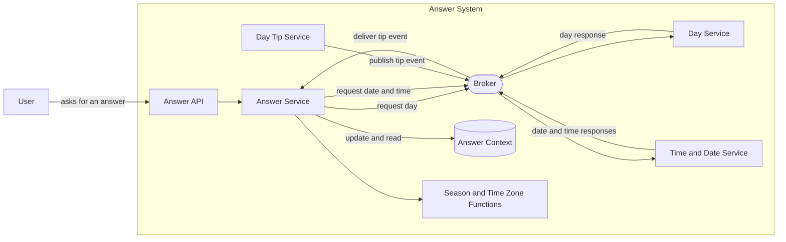
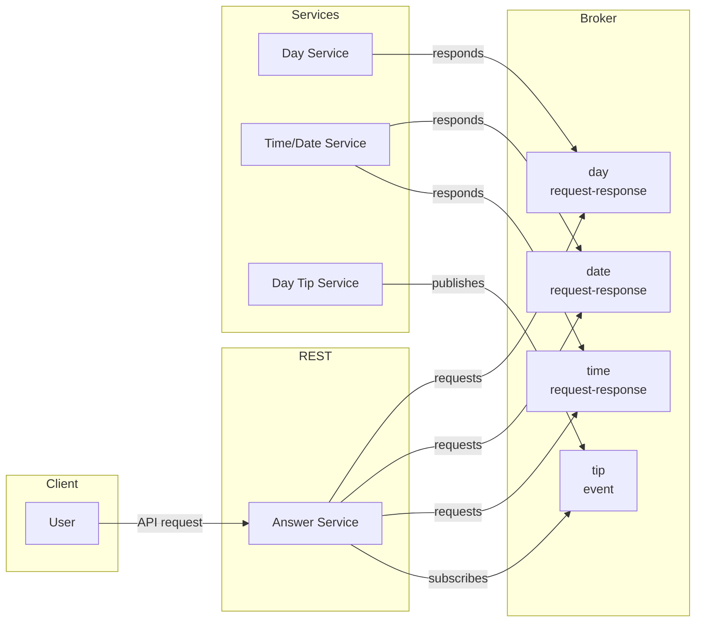
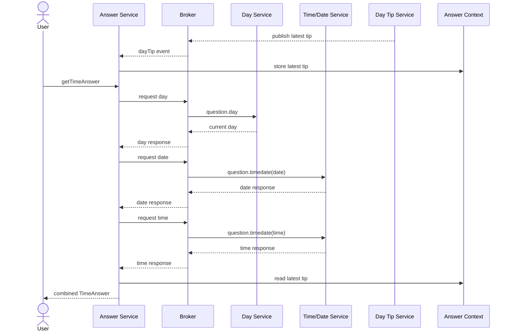

# Answer Aggregation (async): Walkthrough

> Generated from Ocean-Atlas v0.1.0 (content 8776e975). Canonical source: https://atlas.ocean-lab.ai/examples/answer-async/

**Contents**

- [Horizon](#horizon)
- [Voyage](#voyage)

Horizon and Voyage explanation for the Answer Aggregation (async) example.

Source: https://atlas.ocean-lab.ai/examples/answer-async/

## Horizon

### Asynchronous Answers at a Glance

#### Learning Scenario

This example starts with a deliberately simple question: “What is the current time?” The answer is made richer by combining the current day, date, time, daily tip, season, and time zone.

The business problem is intentionally small. The real purpose is to demonstrate how Ocean models asynchronous collaboration: one service asks questions through a broker, independent services answer them, an event updates context, and an expression gathers everything into one response.

#### Architecture



Day and time/date use request-response channels. Day tips arrive as events and are kept in context. Season and time zone come from external functions before the answer is returned.

#### Core Concepts

- **Request-response:** a service sends a request through a broker channel and waits for a typed response.
- **Event:** a producer publishes information without waiting for a response.
- **Context:** service-owned state keeps the latest tip available for future API calls.
- **Aggregation:** one expression combines values from broker calls, context, and external functions.
- **External expression sources:** typed Ocean expressions can delegate selected logic to functions implemented in an external source file.

#### Expected Result

One `TimeAnswer` containing day, date, time, tip, season, and time zone, even though those values come from different parts of the system.

## Voyage

### 1. Follow the Message Flow

You will build the example from the messages outward. First you will define what travels through the broker, then create the APIs and broker channels, add context and expressions, and finally connect four services into one asynchronous flow.



This flowchart shows the topology: who requests, responds, publishes, and subscribes.

#### Runtime Sequence

The same design can be viewed over time. A tip event may update context before a user request arrives. The answer request then gathers day, date, and time before reading the stored tip and returning the result.



“Asynchronous” refers to broker-mediated collaboration. Inside the aggregation expression, day, date, and time are requested in sequence; each call waits for its response or timeout.

### 2. Model Broker Messages and the Final Answer

#### Choose between date and time

One broker channel will handle both date and time requests. You will use an enum so the request can state which value it needs.

```ocean-dsl
@datatype

enum RequestType
    date
    time
```

#### Correlate requests and responses

The request carries a unique ID and the requested type. The response echoes the type and supplies its text result. Together they form the typed contract of the time/date broker channel.

```text
TimeDateRequest
    reqId: String
    reqType: RequestType

TimeDateResponse
    resType: RequestType
    resContent: String
```

#### Define the aggregated answer

The public API returns more than any single service produces, so you will define a datatype that collects all contributions.

```text
TimeAnswer
    day: String
    date: String
    time: String
    tip: String
    zone: String
    season: String
```

Afterwards, both broker messages and the final API result will have clear typed contracts.

### 3. Give Each Service an API

#### Expose the combined answer

`AnswerApi` is the entry point used by the UI and external callers. Its single method returns the aggregated `TimeAnswer`.

```ocean-dsl
@api

AnswerApi style:rest
    engine = gin
    configType = ApiConfig
    basePath = /answer
    generateSwagger = true

    get /time getTimeAnswer() : TimeAnswer
```

#### Expose the contributing capabilities

The other APIs let each domain service remain independently usable and testable. The broker connections you add later will reuse the same expressions behind these endpoints.

```text
DayApi style:rest
    basePath = /day
    get / getDay() : String

TimeDateApi style:rest
    basePath = /
    get /time getTime() : String
    get /date getDate() : String

DayTipApi style:rest
    basePath = /day-tip
    get / getDayTip() : String
```

### 4. Define the Broker Contract

#### Select the broker realization

Voyage is where technology choices appear. This example realizes `AnswerBroker` with NATS and links it to a broker configuration type.

```ocean-dsl
@broker

AnswerBroker
    engine = nats
    configType = AnswerBrokerConfig
    tags = primary, shared
```

#### Publish tips as events

A tip does not need a reply. The producer can publish a `String` event, and interested consumers can react whenever a new value arrives.

```text
dayTip : String as event
```

#### Request the current day

Request-response channels declare input and output as `Request-Response`. An underscore means the day request has no payload; the response is a string. The channel also declares a timeout.

```text
question.day : _-String as request-response with timeout:1s
```

#### Request date or time with typed messages

The second channel uses the datatypes defined earlier. The same responder can inspect `reqType` and return either value.

```text
question.timedate : TimeDateRequest-TimeDateResponse as request-response with timeout:1s
```

The broker contract now demonstrates both one-way events and two-way request-response messaging in one small example.

### 5. Keep the Latest Event in Context

#### Define service-owned state

Broker events arrive independently of API requests. To make the latest tip available later, you will define a context with a useful default.

```ocean-dsl
@context

AnswerContext
    tip: String (default=enjoy your day!)
```

#### Update context when an event arrives

A pointer input (`*AnswerContext`) allows the expression to change the context. Every new `dayTip` event replaces the stored value.

```text
HandleDayTip
    input: ctx:*AnswerContext & dayTip:String
    output: _
    logic
        ctx.tip = dayTip
```

This is the key context lesson: an event can update state now, and a separate request can read that state later.

### 6. Build the Answer Logic

#### Handle a typed time/date request

The responder inspects `reqType`, calls the matching helper, and wraps the result in `TimeDateResponse`.

```text
HandleDateTimeRequest
    input: req:TimeDateRequest
    output: result:TimeDateResponse
    logic
        res.resType = req.reqType
        if req.reqType == RequestType.time then
            res.resContent = GetTimeString()
        end
        if req.reqType == RequestType.date then
            res.resContent = GetDateString()
        end
        result = res
```

#### Use functions as expression inputs

`HandleTimeQuestion` does not know how day, date, and time are transported. It receives callable functions, which the service will later connect to broker channels.

```text
HandleTimeQuestion
    input: ctx:*AnswerContext
         & getDay:Supplier<String>
         & getTimeDate:Func<TimeDateRequest,TimeDateResponse>
    output: result:TimeAnswer
```

#### Request and gather the contributions

You will create separate correlated requests for date and time, call the day supplier, read the current tip, and assemble one result.

```text
req.reqId = getUUID()
req.reqType = RequestType.date
dateRes = getTimeDate(req)

req.reqId = getUUID()
req.reqType = RequestType.time
timeRes = getTimeDate(req)

temp.tip = ctx.tip
temp.day = getDay()
temp.date = dateRes.resContent
temp.time = timeRes.resContent
```

### 7. Extend Expressions with External Functions

#### Why use an external source?

Most logic in this example is expressed directly in Ocean. Season and time-zone calculation, however, use date, location, and formatting libraries from Go. External expressions let you keep the Ocean contract while implementing specialized logic in a source file.

#### Declare a typed Ocean boundary

An external expression still has ordinary typed inputs and outputs. Instead of a `logic` block, its `external` block identifies the source file and method that implement it.

```text
GetSeason
    input: _
    output: season:String
    external
        source: my-funcs.go
        method: GetCurrentSeason

GetTimezone
    input: _
    output: season:String
    external
        source: my-funcs.go
        method: GetCurrentTimezone
```

#### Implement the matching Go functions

The methods live in `expression/my-funcs.go`. Their return signature includes the declared string value and an error, allowing the generated integration to propagate failures.

```text
func GetCurrentTimezone() (string, error) {
    _, offset := time.Now().Zone()
    hours := offset / 3600
    minutes := (offset % 3600) / 60

    sign := "+"
    if hours < 0 || minutes < 0 {
        sign = "-"
        hours = -hours
        minutes = -minutes
    }

    return time.Now().Location().String() +
        fmt.Sprintf(" (UTC%s%02d:%02d)", sign, hours, minutes), nil
}
```

This is the actual time-zone implementation. The same file implements `GetCurrentSeason` by mapping the current month to a season.

#### Call external expressions like normal expressions

The caller does not need to know that the implementation is external. `HandleTimeQuestion` invokes both functions exactly like Ocean-native expressions and assigns their typed results.

```text
temp.season = GetSeason()
temp.zone = GetTimezone()
```

#### Keep the boundary intentional

Use Ocean logic for portable domain behavior and external sources when you genuinely need a host-language library or existing implementation. Keep the external function small, deterministic where possible, and fully described by its Ocean input/output contract.

### 8. Connect Four Services Through the Broker

#### Prepare the answer service

The coordinating service uses the API, broker, context, expressions, and two function aliases. Those aliases will become broker clients.

```text
AnswerService
    use broker AnswerBroker as svcBroker
    use context AnswerContext as svcCtx
    use expression HandleTimeQuestion
    use expression HandleDayTip
    use function Supplier<String> as GetDay
    use function Func<TimeDateRequest,TimeDateResponse> as GetTimeDate
```

#### Connect broker clients and the API

Function calls become requests on broker channels. The time/date call overrides the channel timeout with three seconds. The API method then receives those functions and the context.

```text
connect GetDay -> svcBroker.question.day
connect GetTimeDate -> svcBroker.question.timedate & timeout(3:s)
connect api.getTimeAnswer -> HandleTimeQuestion(
    ctx:svcCtx,
    getday:GetDay,
    getTimeDate:GetTimeDate
)
```

#### Consume events into context

The answer service subscribes to `dayTip` and passes each event to the context-updating expression.

```text
connect svcBroker.dayTip -> HandleDayTip(ctx:svcCtx)
```

#### Provide the request-response handlers

The day and time/date services listen on the matching broker channels. They can also expose their calculations through their own APIs.

```text
connect svcBroker.question.day -> GetDayString
connect svcBroker.question.timedate -> HandleDateTimeRequest
```

#### Publish a recurring event

`each(10:s)` turns `GetDayTip` into a recurring producer. Every ten seconds its output is published as a new event.

```text
connect GetDayTip -> svcBroker.dayTip & each(10:s)
```

### 9. Configure the Runtime Components

Services reuse common API, logging, and NATS configuration. The broker and UI receive their own grouped contracts.

```ocean-dsl
@config

@import config O.log.config@1.0.0 as LogConfig
@import config O.broker.nats.config@1.0.0 as BrokerConfig

CommonServiceConfig
    apiConfig: ApiConfig
    logConfig: LogConfig
    brokerConfig: BrokerConfig

AnswerBrokerConfig
    brokerConfig: BrokerConfig
    logConfig: LogConfig
```

Afterwards, runtime settings can vary without changing broker contracts or aggregation logic.

### 10. Add a Small User Interface

The UI intentionally stays simple: one dashboard button calls the aggregate API method, making it easy to focus on the broker flow behind the response.

```ocean-dsl
@dashboard

AnswerDashboard
    title: Ask your question!
    Widget TimeButton of type Button
        label = Ask 'Time' Question

connect answer.TimeButton.click -> AnswerApi.getTimeAnswer
```

The concrete UI uses HTMX, Bootstrap, Go HTML templates, and Gin, with an additional About dashboard explaining the pattern.

### 11. Deploy Services and Broker

#### Provide the broker runtime

Deployment realizes the logical broker with Ocean's packaged NATS service.

```ocean-dsl
@deploy

@import service P.broker.nats.docker@1.0.0 as NATS

Broker
    service NATS
```

#### Deploy the collaborating services

Each service is deployed independently and depends on the broker. The answer API is exposed on 9093; the contributing APIs use 9094–9096.

```text
AnswerDeploy
    service AnswerService
    export 9093:AnswerService.api
    dependsOn Broker

DayTipDeploy
    service DayTipService
    export 9094:DayTipService.api
    dependsOn Broker

TimeDateDeploy
    service TimeDateService
    export 9095:TimeDateService.api
    dependsOn Broker

DayDeploy
    service DayService
    export 9096:DayService.api
    dependsOn Broker
```

#### Deploy the UI

The UI is exposed on port 8083 and starts after the answer service.

```text
AnswerUiDeploy
    service AnswerUi
    export 8083:AnswerUi.config
    dependsOn AnswerDeploy
```

### 12. Validate and Observe the Flow

1. Open the `Asynchronous Answer Aggregation` example.
2. Validate and generate the complete model.
3. Follow the generated `Readme.md` to start the system.
4. Wait at least ten seconds for a day-tip event to update context.
5. Open the UI at `localhost:8083` and ask the time question.
6. Inspect the answer API at `localhost:9093/swagger/index.html`.
7. Observe broker requests, responses, the event, and timeout behavior in the logs.

### 13. Conclusion and Experiments

By the end of this example, you will have used both broker interaction styles and combined them with context. Afterwards, you should understand how to:

- design typed request-response channels;
- publish and consume one-way events;
- turn broker calls into function inputs for expressions;
- use timeouts at channel and connection level;
- update context from an event and read it during a later request;
- aggregate broker, context, and external-function results.

Try adding another contributing service, reducing a timeout to observe failure behavior, or adding a correlation map to context for several concurrent questions. Those experiments make the advanced broker concepts more visible without changing the simple learning scenario.
