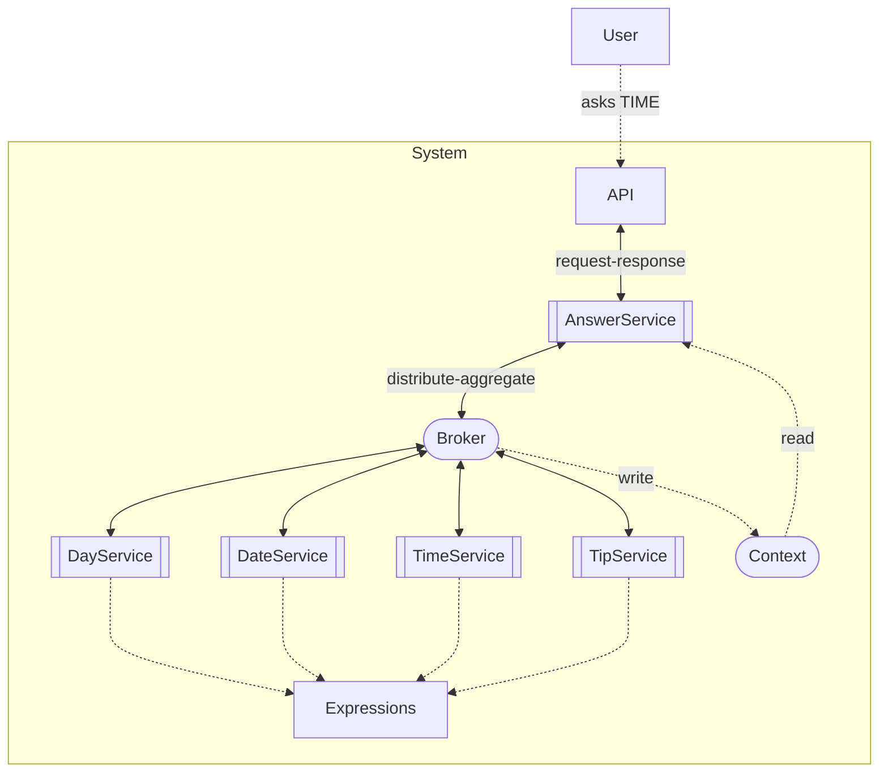
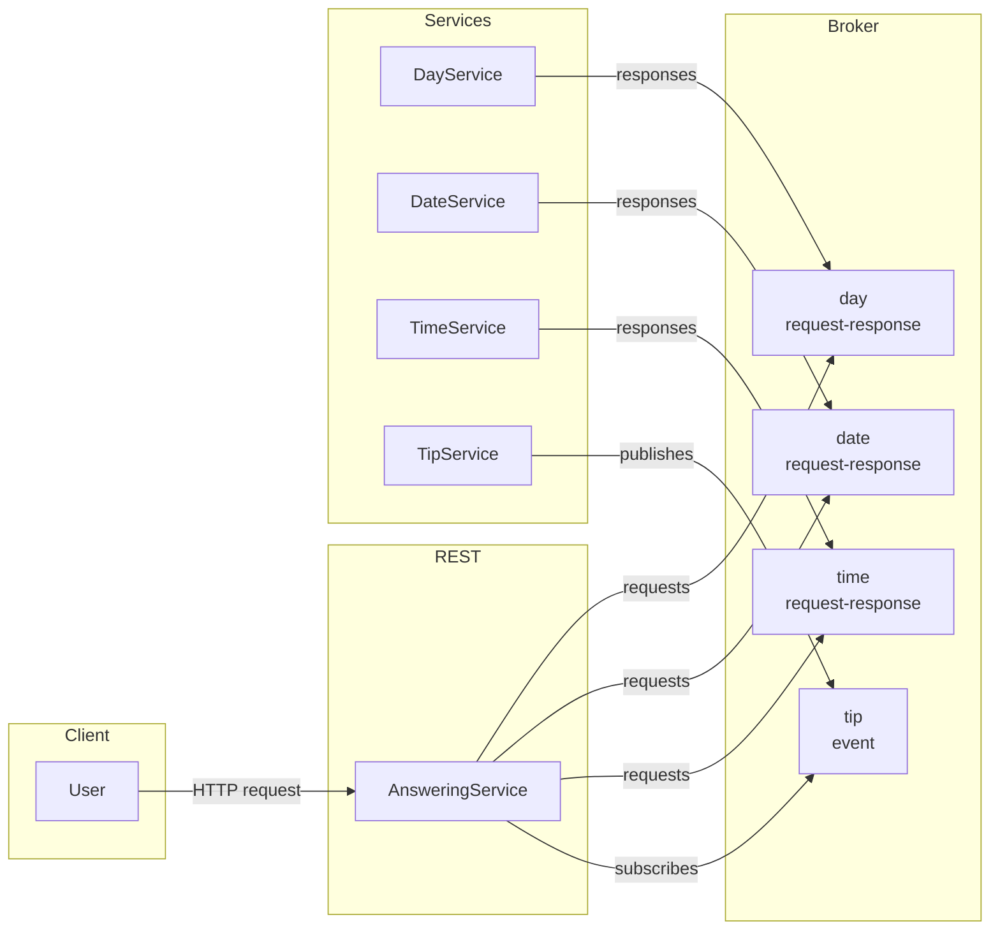

# Answer Aggregation (async)

> Generated from Ocean-Atlas v0.1.0 (content 8776e975). Canonical source: https://atlas.ocean-lab.ai/examples/answer-async/

**Contents**

- [Overview](#overview)
- [Files](#files)
- [DSL source files](#dsl-source-files)
- [Diagrams](#diagrams)
- [Walkthrough](#walkthrough)
- [Other files in the example (not inlined)](#other-files-in-the-example-not-inlined)

Learn broker request-response, events, timeouts, context, and multi-service aggregation through one simple answer application.

Source: https://atlas.ocean-lab.ai/examples/answer-async/

Level: advanced · Estimated time: 20 minutes · Version: 1.0.0 · Onboarding example: no

Components: 4 services, 1 brokers, 0 databases

Tags: aggregation, api, async, broker, context, events, external-expressions, go, microservices, request-response, rest, ui

## Overview

This example shows how independent services collaborate asynchronously to assemble one answer through typed broker interactions, events, shared context, and expressions. Its executable DSL and its Horizon and Voyage explanation are maintained together in this example directory.

## Files

DSL source comes first, then diagrams; the long Horizon and Voyage walkthroughs are at the end. You can stop after the source files.

| File | Section | Lines |
| --- | --- | --- |
| `00-ans-datatype.ocn` | `@datatype` | 32 |
| `00-ans-info.ocn` | `@info` | 39 |
| `01-ans-context.ocn` | `@context` | 15 |
| `10-ans-api-answer.ocn` | `@api` | 21 |
| `10-ans-api-day-tip.ocn` | `@api` | 21 |
| `10-ans-api-day.ocn` | `@api` | 21 |
| `10-ans-api-time-date.ocn` | `@api` | 22 |
| `20-ans-broker.ocn` | `@broker` | 23 |
| `30-ans-config.ocn` | `@config` | 30 |
| `40-ans-expression.ocn` | `@expression` | 102 |
| `50-answer-service.ocn` | `@service` | 31 |
| `50-day-service.ocn` | `@service` | 24 |
| `50-daytip-service.ocn` | `@service` | 24 |
| `50-timedate-service.ocn` | `@service` | 27 |
| `55-ans-dashboard.ocn` | `@dashboard` | 28 |
| `56-ans-ui.ocn` | `@ui` | 41 |
| `60-ans-deploy.ocn` | `@deploy` | 53 |

## DSL source files

### `00-ans-datatype.ocn`

```ocean-dsl
# @ocean-meta-start
# tags:
#   - datatype
# perspective:
#   feature: answer-async
#   boundedContext: answer-aggregation
# @ocean-meta-end

@datatype

@include O.datatype.error.standard@1.0.0

TimeDateRequest
    reqId      : String
    reqType    : RequestType

TimeDateResponse
    resType    : RequestType
    resContent : String

enum RequestType
    date
    time

TimeAnswer
    day    : String
    date   : String
    time   : String
    tip    : String
    zone   : String
    season : String
```

### `00-ans-info.ocn`

```ocean-dsl
# @ocean-meta-start
# tags:
#   - documentation
# perspective:
#   feature: answer-async
#   boundedContext: answer-aggregation
# @ocean-meta-end

@info

name: Answering App
version: 1.0.0
title: AnsweringApp
subtitle: To answer your questions
shortDescription: Answers all your questions

description:

Overview
The Answer Service implements an asynchronous fan-out/gather pattern that distributes a user request to multiple domain services via a broker and aggregates their responses into one unified answer.

Request Flow
The user calls the API, which forwards the request to AnswerService, which publishes a distributed query to the broker for all subscribed services to process in parallel.

Parallel Processing
DayService, DateService, TimeService, and TipService each compute their part independently, optionally using shared expressions, and publish their results back to the broker.

Aggregation
AnswerService listens for all expected responses, aggregates them into a single result, and optionally uses shared context for correlation or caching.

Response
After collecting all contributions (or timing out), AnswerService returns a unified, coherent response to the user via the API.

Key Benefits
Asynchronous execution reduces latency, domain services remain decoupled, the system becomes easily extensible, and aggregation enables rich composite answers without cross-service dependencies.

Summary
One request is fanned out to multiple domain services via a broker, each returns its part asynchronously, and AnswerService gathers everything into a single answer for the user.
```

### `01-ans-context.ocn`

```ocean-dsl
# @ocean-meta-start
# tags:
#   - answer-aggregation
#   - context
# perspective:
#   feature: answer-async
#   boundedContext: answer-aggregation
#   service: answer-service
# @ocean-meta-end

@context

AnswerContext
    tip : String (default=enjoy your day!)
```

### `10-ans-api-answer.ocn`

```ocean-dsl
# @ocean-meta-start
# tags:
#   - answer-api
#   - rest-api
# perspective:
#   feature: answer-async
#   boundedContext: answer-aggregation
#   service: answer-service
# @ocean-meta-end

@api

AnswerApi style:rest
    engine = gin
    configType = ApiConfig
    version = 1.0.0
    basePath = /answer
    generateSwagger = true

    get /time getTimeAnswer() : TimeAnswer
```

### `10-ans-api-day-tip.ocn`

```ocean-dsl
# @ocean-meta-start
# tags:
#   - day-tip-api
#   - rest-api
# perspective:
#   feature: answer-async
#   boundedContext: answer-aggregation
#   service: day-tip-service
# @ocean-meta-end

@api

DayTipApi style:rest
    engine = gin
    configType = ApiConfig
    version = 1.0.0
    basePath = /day-tip
    generateSwagger = true

    get / getDayTip() : String
```

### `10-ans-api-day.ocn`

```ocean-dsl
# @ocean-meta-start
# tags:
#   - day-api
#   - rest-api
# perspective:
#   feature: answer-async
#   boundedContext: answer-aggregation
#   service: day-service
# @ocean-meta-end

@api

DayApi style:rest
    engine = gin
    configType = ApiConfig
    version = 1.0.0
    basePath = /day
    generateSwagger = true

    get / getDay() : String
```

### `10-ans-api-time-date.ocn`

```ocean-dsl
# @ocean-meta-start
# tags:
#   - time-date-api
#   - rest-api
# perspective:
#   feature: answer-async
#   boundedContext: answer-aggregation
#   service: time-date-service
# @ocean-meta-end

@api

TimeDateApi style:rest
    engine = gin
    configType = ApiConfig
    version = 1.0.0
    basePath = /
    generateSwagger = true

    get /time getTime() : String
    get /date getDate() : String
```

### `20-ans-broker.ocn`

```ocean-dsl
# @ocean-meta-start
# tags:
#   - answer-aggregation
#   - async-request-response
#   - broker
#   - nats
# perspective:
#   feature: answer-async
#   boundedContext: answer-aggregation
# @ocean-meta-end

@broker

AnswerBroker
    @perspectives: version:0.1.0, lifestyle:stable
    engine = nats
    configType = AnswerBrokerConfig
    tags = primary, shared
    
    dayTip            : String                           as event
    question.day      : _-String                         as request-response with timeout:1s
    question.timedate : TimeDateRequest-TimeDateResponse as request-response with timeout:1s
```

### `30-ans-config.ocn`

```ocean-dsl
# @ocean-meta-start
# tags:
#   - configuration
# perspective:
#   feature: answer-async
#   boundedContext: answer-aggregation
#   service: all
# @ocean-meta-end

@config

@import config O.log.config@1.0.0 as LogConfig
@import config O.broker.nats.config@1.0.0 as BrokerConfig

CommonServiceConfig
    apiConfig    : ApiConfig
    logConfig    : LogConfig
    brokerConfig : BrokerConfig

ApiConfig
    port : Int (default=8080)

AnswerBrokerConfig
    brokerConfig : BrokerConfig
    logConfig    : LogConfig

UiConfig
    port: Int (default=8080)
    logConfig : LogConfig
```

### `40-ans-expression.ocn`

```ocean-dsl
# @ocean-meta-start
# tags:
#   - answer-aggregation
#   - expression
# perspective:
#   feature: answer-async
#   boundedContext: answer-aggregation
#   service: backend
# @ocean-meta-end

@expression

GetSeason
    input: _
    output: season:String
    external
        source: my-funcs.go
        method: GetCurrentSeason

GetTimezone
    input: _
    output: season:String
    external
        source: my-funcs.go
        method: GetCurrentTimezone


HandleDayTip
    input  : ctx:*AnswerContext & dayTip:String
    output : _
    logic
        ctx.tip = dayTip

HandleTimeQuestion
    input  : ctx:*AnswerContext & getDay:Supplier<String> & getTimeDate:Func<TimeDateRequest,TimeDateResponse>
    output : result:TimeAnswer
    logic
        var req TimeDateRequest
        # get date
        var id String
        id = getUUID()
        req.reqId = id
        req.reqType = RequestType.date
        dateRes = getTimeDate(req)

        # get time
        req.reqId = getUUID()
        req.reqType = RequestType.time
        timeRes = getTimeDate(req)

        # generate full response
        var temp TimeAnswer
        temp.tip = ctx.tip
        temp.day = getDay()
        temp.date = dateRes.resContent
        temp.time = timeRes.resContent
        temp.season = GetSeason()
        temp.zone = GetTimezone()
        result = temp

HandleDateTimeRequest
    input:  req:TimeDateRequest
    output: result:TimeDateResponse
    logic
        var res TimeDateResponse
        res.resType = req.reqType
        if req.reqType == RequestType.time then
            res.resContent = GetTimeString()
        end
        if req.reqType == RequestType.date then
            res.resContent = GetDateString()
        end
        result = res

GetTimeString
    input: _
    output: result:String
    logic
        nowTime = nowTimeString()
        result = nowTime

GetDateString
    input: _
    output: result:String
    logic
        nowDate = nowDateString()
        result = nowDate

GetDayString
    input: _
    output: result:String
    logic
        today = today()
        result = today

GetDayTip
    input: _
    output: result:String
    logic
        dayTip = tipOfTheDay()
        result = dayTip
```

### `50-answer-service.ocn`

```ocean-dsl
# @ocean-meta-start
# tags:
#   - coordinator
#   - aggregator
#   - gateway
# perspective:
#   feature: answer-async
#   service: answer-service
#   broker: subscriber-requester
# @ocean-meta-end

@service

AnswerService

    @perspectives: version:1.0.0, lifestyle:dev

    use config CommonServiceConfig as svcCfg
    impl api AnswerApi as api on svcCfg.apiConfig.port
    use broker AnswerBroker as svcBroker
    use context AnswerContext as svcCtx
    use expression HandleTimeQuestion
    use expression HandleDayTip
    use function Supplier<String> as GetDay
    use function Func<TimeDateRequest,TimeDateResponse> as GetTimeDate

    connect svcBroker.dayTip  -> HandleDayTip(ctx:svcCtx)
    connect GetDay            -> svcBroker.question.day
    connect GetTimeDate       -> svcBroker.question.timedate & timeout(3:s)
    connect api.getTimeAnswer -> HandleTimeQuestion(ctx:svcCtx, getday:GetDay, getTimeDate:GetTimeDate)
```

### `50-day-service.ocn`

```ocean-dsl
# @ocean-meta-start
# tags:
#   - provider
#   - day-data
# perspective:
#   feature: answer-async
#   service: day-service
#   broker: responder
# @ocean-meta-end

@service

DayService

    @perspectives: version:1.0.0, lifestyle:dev

    use config CommonServiceConfig as svcCfg
    impl api DayApi as api on svcCfg.apiConfig.port
    use broker AnswerBroker as svcBroker
    use expression GetDayString

    connect api.getDay             -> GetDayString
    connect svcBroker.question.day -> GetDayString
```

### `50-daytip-service.ocn`

```ocean-dsl
# @ocean-meta-start
# tags:
#   - provider
#   - day-tip-data
# perspective:
#   feature: answer-async
#   service: day-tip-service
#   broker: publisher
# @ocean-meta-end

@service

DayTipService

    @perspectives: version:1.0.0, lifestyle:dev

    use config CommonServiceConfig as svcCfg
    impl api DayTipApi as api on svcCfg.apiConfig.port
    use broker AnswerBroker as svcBroker
    use expression GetDayTip

    connect api.getDayTip -> GetDayTip
    connect GetDayTip     -> svcBroker.dayTip & each(10:s)
```

### `50-timedate-service.ocn`

```ocean-dsl
# @ocean-meta-start
# tags:
#   - provider
#   - time-date-data
# perspective:
#   feature: answer-async
#   service: time-date-service
#   broker: responder
# @ocean-meta-end

@service

TimeDateService

    @perspectives: version:1.0.0, lifestyle:dev

    use config CommonServiceConfig as svcCfg
    impl api TimeDateApi as api on svcCfg.apiConfig.port
    use broker AnswerBroker as svcBroker
    use expression GetTimeString
    use expression GetDateString
    use expression HandleDateTimeRequest

    connect api.getTime                 -> GetTimeString
    connect api.getDate                 -> GetDateString
    connect svcBroker.question.timedate -> HandleDateTimeRequest
```

### `55-ans-dashboard.ocn`

```ocean-dsl
# @ocean-meta-start
# tags:
#   - ui
#   - dashboard
# perspective:
#   feature: answer-async
#   boundedContext: answer-aggregation
#   service: ui-service
# @ocean-meta-end

@dashboard

AnswerDashboard
    title: Ask your question!
    layout: SingleColumnLayout

    Widget TimeButton of type Button
        label = Ask 'Time' Question

AboutDashboard
    title: About
    layout: SingleColumnLayout

    Widget AboutText of type Text
        title = About Answer! App
        subtitle = To answer your questions! 💬
        content = <p>This is a simple yet comprehensive example for <i>Aggregation of Microservices via Broker</i></p><br><br><b>Overview</b><br><p>The Answer Service implements an asynchronous fan-out/gather pattern that distributes a user request to multiple domain services via a broker and aggregates their responses into one unified answer.</p><br><b>Request Flow</b><br><p>The user calls the API, which forwards the request to AnswerService, which publishes a distributed query to the broker for all subscribed services to process in parallel.</p><br><b>Parallel Processing</b><br><p>DayService, DateService, TimeService, and TipService each compute their part independently, optionally using shared expressions, and publish their results back to the broker.</p><br><b>Aggregation</b><br>AnswerService listens for all expected responses, aggregates them into a single result, and optionally uses shared context for correlation or caching.</p><br><b>Response</b><br><p>After collecting all contributions (or timing out), AnswerService returns a unified, coherent response to the user via the API.</p><br><b>Key Benefits</b><br><p>Asynchronous execution reduces latency, domain services remain decoupled, the system becomes easily extensible, and aggregation enables rich composite answers without cross-service dependencies.</p><br><b>Summary</b><br><p>One request is fanned out to multiple domain services via a broker, each returns its part asynchronously, and AnswerService gathers everything into a single answer for the user.</p>
```

### `56-ans-ui.ocn`

```ocean-dsl
# @ocean-meta-start
# tags:
#   - ui
#   - dashboard
# perspective:
#   feature: answer-async
#   boundedContext: answer-aggregation
#   service: ui-service
# @ocean-meta-end

@ui

AnswerUi

    @perspectives: version:0.1.0, lifestyle:stable

    framework: htmx
    styling: bootstrap
    template: go-html-template
    backend: go-gin
    static: static
    configType: UiConfig

    nav Ask me! 🙋 dashboard = AnswerDashboard
    nav About dashboard = AboutDashboard

    header title = 💬 Answer! App
    header subtitle = To answer all your questions! 
    header align = center

    footer title = ⚡ Built with Ocean-lab
    footer subtitle = Version 1.0.0
    footer align = center

    use dashboard AnswerDashboard as answer
    use dashboard AboutDashboard as about

    use api AnswerApi

    connect answer.TimeButton.click -> AnswerApi.getTimeAnswer
```

### `60-ans-deploy.ocn`

```ocean-dsl
# @ocean-meta-start
# tags:
#   - deployment
# perspective:
#   feature: answer-async
#   boundedContext: answer-aggregation
#   service: all
# @ocean-meta-end

@deploy

Name: AnswerService-PRD-deploy

@import service P.broker.nats.docker@1.0.0 as NATS

AnswerDeploy
    service     AnswerService
    replica     1
    export      9093:AnswerService.api
    dependsOn   Broker

DayTipDeploy
    service     DayTipService
    replica     1
    export      9094:DayTipService.api
    dependsOn   Broker
    
TimeDateDeploy
    service     TimeDateService
    replica     1
    export      9095:TimeDateService.api
    dependsOn   Broker

DayDeploy
    service     DayService
    replica     1
    export      9096:DayService.api
    dependsOn   Broker

AnswerBrokerDeploy
    service     AnswerBroker
    replica     1
    dependsOn   Broker

Broker
    service NATS

AnswerUiDeploy
    service     AnswerUi
    replica     1
    export      8083:AnswerUi.config
    dependsOn   AnswerDeploy
```

## Diagrams

### `architecture.mmd`



### `broker-communication.mmd`



## Walkthrough

A long, step-by-step explanation (Horizon and Voyage) is in [Answer Aggregation (async) walkthrough](answer-async-walkthrough.md). Read it only if you need the reasoning behind the design.

## Other files in the example (not inlined)

Fixtures, scripts and supporting artifacts. See the example on the Atlas site for their purpose.

- `expression/my-funcs.go` (artifact)

- `info/async-answer-info.md` (artifact)
