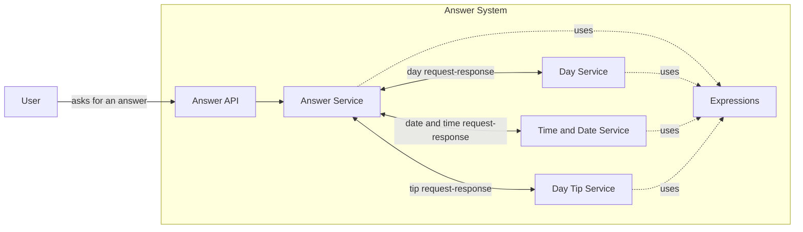
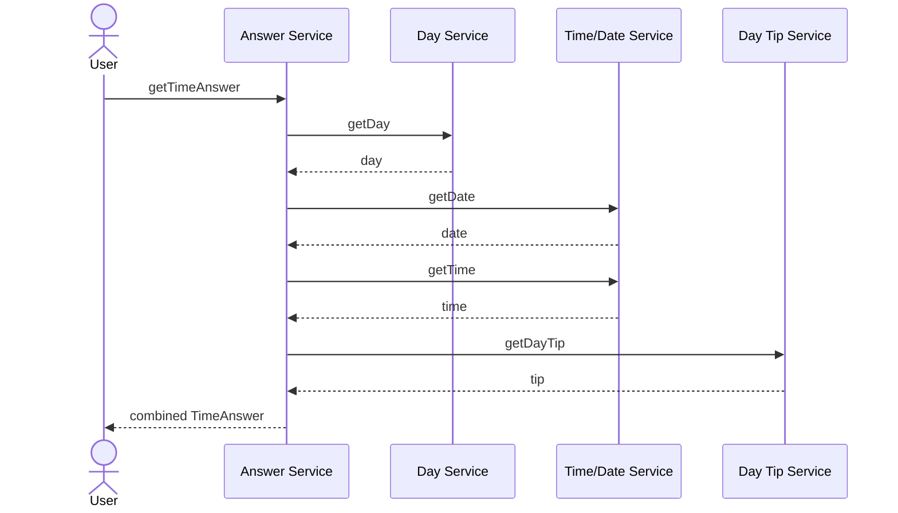
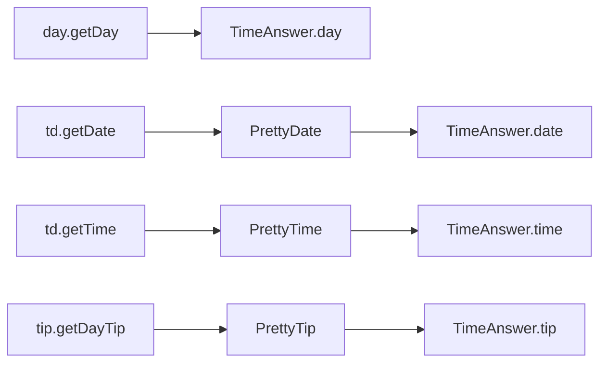

# Answer Aggregation (sync): Walkthrough

> Generated from Ocean-Atlas v0.1.0 (content 8776e975). Canonical source: https://atlas.ocean-lab.ai/examples/answer-sync/

**Contents**

- [Horizon](#horizon)
- [Voyage](#voyage)

Horizon and Voyage explanation for the Answer Aggregation (sync) example.

Source: https://atlas.ocean-lab.ai/examples/answer-sync/

## Horizon

### Synchronous Aggregation at a Glance

#### Learning Scenario

As in the asynchronous companion example, the system answers a simple time question using day, date, time, and tip contributions. This version intentionally removes the broker and context so you can focus on direct service-to-service API composition.

The answer service calls three domain services, collects four results, and returns either a structured `TimeAnswer` or a formatted string. The key concept is Ocean's service-level `aggregate` statement.

#### Architecture



The answer service talks directly to domain APIs. There is no broker and no shared context in this version.

#### Core Concepts

- **Synchronous composition:** the caller waits for direct API responses before the final answer can be returned.
- **Aggregate:** several API methods contribute fields to one result from a single service declaration.
- **Branch transformation:** `using` applies an expression to an individual contribution.
- **Final transformation:** an aggregate result can be converted into another output type before it is returned.

#### Expected Result

One endpoint returns a `TimeAnswer`; another returns the same combined information as a formatted string. Direct pass-through endpoints let you inspect each contributing service separately.

## Voyage

### 1. Follow the Synchronous Flow

You will define a shared result, create one public API and three domain APIs, prepare calculation and transformation expressions, and then use `aggregate` to compose the calls at service level.



The diagram presents the calls in sequence for learning clarity. The service declaration expresses the composition as aggregate branches; the generated runtime owns their execution and timeout behavior.

### 2. Define the Aggregate Result

#### Collect four contributions

Each contributing API returns a string, but the combined endpoint needs a meaningful structure. You will define one field for every aggregate branch, in the same order used later by the service.

```ocean-dsl
@datatype

TimeAnswer
    day: String
    date: String
    time: String
    tip: String
```

This order matters for understanding the aggregate: day contributes to `day`, date to `date`, time to `time`, and tip to `tip`.

#### Notice the unused message types

The source also contains `TimeDateRequest` and `TimeDateResponse`, inherited from the asynchronous version. The active synchronous aggregation does not use them because it calls the date and time API methods directly.

### 3. Define Public and Domain APIs

#### Expose two aggregate results

`AnswerApi` offers two views of the same composition. One returns the structured datatype; the other returns a formatted string.

```ocean-dsl
@api

AnswerApi style:rest
    engine = gin
    configType = ApiConfig
    basePath = /answer
    generateSwagger = true

    get /answer/time getTimeAnswer() : TimeAnswer
    get /answer/time-string getTimeStringAnswer() : String
```

#### Expose direct comparison endpoints

The `/back/*` methods will connect directly to the domain APIs. They make it easy to compare a simple pass-through `connect` with a multi-branch `aggregate`.

```text
get /back/day getDay() : String
get /back/time getTime() : String
get /back/date getDate() : String
get /back/tip getDayTip() : String
```

#### Give each domain service a small API

Day, time/date, and tip stay independently callable. The answer service will use these APIs as dependencies rather than reimplementing their logic.

```text
DayApi
    get /day getDay() : String

TimeDateApi
    get /time getTime() : String
    get /date getDate() : String

DayTipApi
    get /tip getDayTip() : String
```

### 4. Prepare Values and Transformations

#### Produce the domain values

Small expressions calculate the day, date, time, and tip. Their common `String` output makes them easy to expose through the domain APIs.

```text
GetDayString
    input: _
    output: result:String
    logic
        result = today()

GetTimeString
    input: _
    output: result:String
    logic
        result = nowTimeString()
```

#### Transform individual contributions

The aggregate can pass a branch result through an expression before it enters `TimeAnswer`. These transformers add small visual labels to date, time, and tip.

```text
PrettyDate
    input: i:String
    output: o:String
    logic
        o = StringConcat2("📅 ", i)

PrettyTime
    input: i:String
    output: o:String
    logic
        o = StringConcat2("⏰ ", i)

PrettyTip
    input: i:String
    output: o:String
    logic
        o = StringConcat2("💡 ", i)
```

#### Transform the complete result

`TimeAnswerToString` accepts the fully populated aggregate datatype and turns it into the output required by `getTimeStringAnswer`.

```text
TimeAnswerToString
    input: i:TimeAnswer
    output: o:String
    logic
        o = "Today is "
        o = StringConcat2(o, i.day)
        o = StringConcat2(o, "! ")
        o = StringConcat2(o, i.date)
        o = StringConcat2(o, " ")
        o = StringConcat2(o, i.time)
        o = StringConcat2(o, " ")
        o = StringConcat2(o, i.tip)
```

### 5. Assemble the Four Services

#### Implement the domain services

Each domain service owns a small API and connects its methods to the matching calculation expressions.

```text
TimeDateService
    impl api TimeDateApi as api on svcCfg.apiConfig.port
    connect api.getTime -> GetTimeString
    connect api.getDate -> GetDateString

DayService
    impl api DayApi as api on svcCfg.apiConfig.port
    connect api.getDay -> GetDayString

DayTipService
    impl api DayTipApi as api on svcCfg.apiConfig.port
    connect api.getDayTip -> GetDayTip
```

#### Import their APIs into the answer service

`use api` declares the synchronous dependencies. Their aliases become the branch targets in the aggregate statement.

```text
AnswerService
    impl api AnswerApi as api on svcCfg.apiConfig.port
    use api DayApi as day
    use api TimeDateApi as td
    use api DayTipApi as tip
    use expression PrettyDate
    use expression PrettyTime
    use expression PrettyTip
    use expression TimeAnswerToString
```

### 6. Aggregate Several APIs into One Result

#### Read the aggregate shape

The basic service-level syntax is:

```text
aggregate <target-method> -> <branch-1> | <branch-2> | ...
```

The target is the method being implemented. Each pipe-separated branch calls another API. For a structured result, branch values populate the output fields in their declared order.

#### Build a structured TimeAnswer

The first branch fills `day`, the second fills `date`, the third fills `time`, and the fourth fills `tip`. `using` transforms a branch before its value is assigned.

```text
aggregate api.getTimeAnswer ->
    day.getDay
  | td.getDate using PrettyDate
  | td.getTime using PrettyTime
  | tip.getDayTip using PrettyTip
```



#### Transform the complete aggregate

A transformer placed between the target method and arrow receives the completed `TimeAnswer`. Here it converts the aggregate into a string, matching the target method's output.

```text
-TimeAnswerToString->
```

This is the same aggregate arrow as `->`, with the `TimeAnswerToString` mapper inserted into it. The mapper receives the original aggregate response and converts it to a `String` before the target method returns.

```text
aggregate api.getTimeStringAnswer -TimeAnswerToString->
    day.getDay
  | td.getDate using PrettyDate
  | td.getTime using PrettyTime
  | tip.getDayTip using PrettyTip
  - timeout 2s
```

#### Bound the aggregate with a timeout

The final `timeout 2s` gives the aggregate a clear time boundary instead of allowing it to wait indefinitely for a dependency.

### 7. Compare Aggregate with Direct Connect

The answer API also exposes individual backend calls. A normal `connect` forwards one method to one dependency, optionally transforming the response along the arrow.

```text
connect api.getDay -> day.getDay
connect api.getTime -PrettyTime-> td.getTime
connect api.getDate -PrettyDate-> td.getDate
connect api.getDayTip -PrettyTip-> tip.getDayTip
```

Use `connect` for one source and one result. Use `aggregate` when several calls jointly implement one target method.

### 8. Configure the Services

All services reuse an API port and logging configuration. The current source also carries a broker configuration field inherited from the asynchronous variant, although this synchronous model does not declare or use a broker.

```ocean-dsl
@config

@import config O.log.config@1.0.0 as LogConfig

CommonServiceConfig
    apiConfig: ApiConfig
    logConfig: LogConfig

ApiConfig
    port: Int (default=8080)
```

The snippet shows only the settings needed by this design. Removing the unused broker configuration from the executable source would make the sync/async distinction even clearer.

### 9. Give the Example a Small Dashboard

The dashboard gives each learning path its own button: two buttons call the aggregate methods, while four buttons expose the individual calls. This will let you compare their results side by side.

```ocean-dsl
@dashboard

AnswerDashboard
    title: Ask your question!
    layout: SingleColumnLayout

    Widget TimeFullButton of type Button
        label = Ask 'Time' Question

    Widget TimeStringButton of type Button
        label = Ask 'Time-String' Question

    Widget DayButton of type Button
        label = Day
        color = secondary
```

The time, date, and tip buttons follow the same secondary-button pattern. Keeping the widgets simple leaves the focus on service composition.

### 10. Connect the Dashboard to the APIs

The dashboard contains buttons for both aggregate endpoints and for the four direct endpoints, making the comparison visible without another client.

```text
connect answer.TimeFullButton.click -> AnswerApi.getTimeAnswer
connect answer.TimeStringButton.click -> AnswerApi.getTimeStringAnswer
connect answer.DayButton.click -> AnswerApi.getDay
connect answer.TimeButton.click -> AnswerApi.getTime
connect answer.DateButton.click -> AnswerApi.getDate
connect answer.TipButton.click -> AnswerApi.getDayTip
```

The generated UI uses HTMX, Bootstrap, Go HTML templates, and Gin.

### 11. Deploy the Directly Connected Services

No broker runtime is needed. The answer service and its three domain services are deployed directly, with the UI depending on the answer service.

```text
AnswerDeploy
    service AnswerService
    export 9094:AnswerService.api

DayTipDeploy
    service DayTipService
    export 4001:DayTipService.api

TimeDateDeploy
    service TimeDateService
    export 4002:TimeDateService.api

DayDeploy
    service DayService
    export 4003:DayService.api

AnswerUiDeploy
    service AnswerUi
    export 8084:AnswerUi.config
    dependsOn AnswerDeploy
```

### 12. Validate and Compare the Results

1. Open the `Synchronous Answer Aggregation` example.
2. Validate and generate the complete model.
3. Follow the generated `Readme.md` to start all services.
4. Open the UI at `localhost:8084`.
5. Call the structured aggregate and inspect its four fields.
6. Call the string aggregate and inspect the final transformation.
7. Call the direct day, date, time, and tip buttons for comparison.
8. Stop a domain service and observe aggregate timeout behavior.

### 13. Conclusion and Comparison

By the end of this example, you will have composed several APIs without a broker. Afterwards, you should understand how to:

- declare synchronous API dependencies with `use api`;
- map aggregate branches into a structured result;
- transform individual contributions with `using`;
- transform the complete aggregate into another output type;
- bound a multi-call operation with a timeout;
- choose between direct `connect` and `aggregate`.

Compared with `answer-async`, this design is smaller and more direct: there is no broker, event, context, or external source. The tradeoff is tighter runtime coupling—the aggregate answer depends on direct availability of every contributing API.
