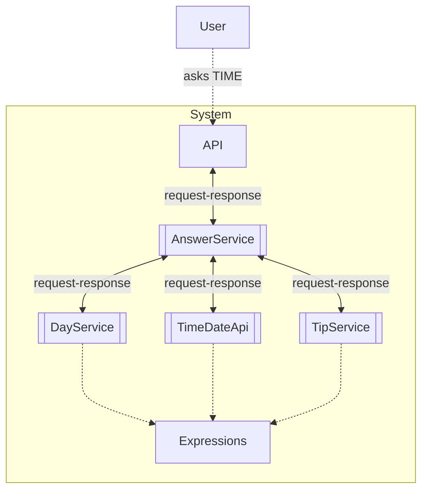

# Answer Aggregation (sync)

> Generated from Ocean-Atlas v0.1.0 (content 8776e975). Canonical source: https://atlas.ocean-lab.ai/examples/answer-sync/

**Contents**

- [Overview](#overview)
- [Files](#files)
- [DSL source files](#dsl-source-files)
- [Diagrams](#diagrams)
- [Walkthrough](#walkthrough)

Learn service-level aggregate by combining several synchronous API calls into one structured or transformed answer.

Source: https://atlas.ocean-lab.ai/examples/answer-sync/

Level: advanced · Estimated time: 10 minutes · Version: 1.0.0 · Onboarding example: no

Components: 4 services, 0 brokers, 0 databases

Tags: aggregate, aggregation, api-composition, dashboard, expressions, microservices, rest, synchronous, ui

## Overview

This example shows how a coordinating service composes several synchronous API calls and returns their results as a single answer. Its executable DSL and its Horizon and Voyage explanation are maintained together in this example directory.

## Files

DSL source comes first, then diagrams; the long Horizon and Voyage walkthroughs are at the end. You can stop after the source files.

| File | Section | Lines |
| --- | --- | --- |
| `00-ans-datatype.ocn` | `@datatype` | 28 |
| `00-ans-info.ocn` | `@info` | 17 |
| `10-ans-api-answer.ocn` | `@api` | 25 |
| `10-ans-api-day-tip.ocn` | `@api` | 20 |
| `10-ans-api-day.ocn` | `@api` | 20 |
| `10-ans-api-time-date.ocn` | `@api` | 21 |
| `30-ans-config.ocn` | `@config` | 30 |
| `40-ans-expression.ocn` | `@expression` | 84 |
| `50-ans-service-answer.ocn` | `@service` | 34 |
| `50-ans-service-day-tip.ocn` | `@service` | 21 |
| `50-ans-service-day.ocn` | `@service` | 21 |
| `50-ans-service-time-date.ocn` | `@service` | 24 |
| `55-ans-dashboard.ocn` | `@dashboard` | 50 |
| `56-ans-ui.ocn` | `@ui` | 44 |
| `60-ans-deploy.ocn` | `@deploy` | 38 |

## DSL source files

### `00-ans-datatype.ocn`

```ocean-dsl
# @ocean-meta-start
# tags:
#   - datatype
# perspective:
#   feature: answer-sync
#   service: all
# @ocean-meta-end

@datatype

TimeDateRequest
    reqId      : String
    reqType    : RequestType

TimeDateResponse
    resType    : RequestType
    resContent : String

enum RequestType
    date
    time

TimeAnswer
    day    : String
    date   : String
    time   : String
    tip    : String
```

### `00-ans-info.ocn`

```ocean-dsl
# @ocean-meta-start
# tags:
#   - documentation
# perspective:
#   feature: answer-sync
# @ocean-meta-end

@info

name: Answering App
version: 1.0.0
title: AnsweringApp
subtitle: To answer your questions
shortDescription: Answers all your questions

description: This app answers your questions
```

### `10-ans-api-answer.ocn`

```ocean-dsl
# @ocean-meta-start
# tags:
#   - answer-api
#   - rest-api
# perspective:
#   feature: answer-sync
#   service: answer-service
# @ocean-meta-end

@api

AnswerApi style:rest
    engine = gin
    configType = ApiConfig
    version = 1.0.0
    basePath = /answer
    generateSwagger = true

    get  /answer/time        getTimeAnswer()       : TimeAnswer
    get  /answer/time-string getTimeStringAnswer() : String
    get  /back/day           getDay()              : String
    get  /back/time          getTime()             : String
    get  /back/date          getDate()             : String
    get  /back/tip           getDayTip()           : String
```

### `10-ans-api-day-tip.ocn`

```ocean-dsl
# @ocean-meta-start
# tags:
#   - day-tip-api
#   - rest-api
# perspective:
#   feature: answer-sync
#   service: day-tip-service
# @ocean-meta-end

@api

DayTipApi style:rest
    engine = gin
    configType = ApiConfig
    version = 1.0.0
    basePath = /day-tip
    generateSwagger = true

    get /tip getDayTip() : String
```

### `10-ans-api-day.ocn`

```ocean-dsl
# @ocean-meta-start
# tags:
#   - day-api
#   - rest-api
# perspective:
#   feature: answer-sync
#   service: day-service
# @ocean-meta-end

@api

DayApi style:rest
    engine = gin
    configType = ApiConfig
    version = 1.0.0
    basePath = /day
    generateSwagger = true

    get /day getDay() : String
```

### `10-ans-api-time-date.ocn`

```ocean-dsl
# @ocean-meta-start
# tags:
#   - time-date-api
#   - rest-api
# perspective:
#   feature: answer-sync
#   service: time-date-service
# @ocean-meta-end

@api

TimeDateApi style:rest
    engine = gin
    configType = ApiConfig
    version = 1.0.0
    basePath = /
    generateSwagger = true

    get /time getTime() : String
    get /date getDate() : String
```

### `30-ans-config.ocn`

```ocean-dsl
# @ocean-meta-start
# tags:
#   - configuration
# perspective:
#   feature: answer-sync
#   service: all
# @ocean-meta-end

@config

@import config O.log.config@1.0.0 as LogConfig
@import config O.broker.nats.config@1.0.0 as BrokerConfig

CommonServiceConfig
    apiConfig    : ApiConfig
    logConfig    : LogConfig
    brokerConfig : BrokerConfig

DayTipServiceConfig
    apiConfig    : ApiConfig
    logConfig    : LogConfig
    brokerConfig : BrokerConfig

ApiConfig
    port : Int (default=8080)

UiConfig
    port: Int (default=8080)
    logConfig : LogConfig
```

### `40-ans-expression.ocn`

```ocean-dsl
# @ocean-meta-start
# tags:
#   - expression
# perspective:
#   feature: answer-sync
#   service: backend
# @ocean-meta-end

@expression

HandleDateTimeRequest
    input:  req:TimeDateRequest
    output: result:TimeDateResponse
    logic
        var res TimeDateResponse
        res.resType = req.reqType
        if req.reqType == RequestType.time then
            res.resContent = GetTimeString()
        end
        if req.reqType == RequestType.date then
            res.resContent = GetDateString()
        end
        result = res

GetTimeString
    input: _
    output: result:String
    logic
        nowTime = nowTimeString()
        result = nowTime

GetDateString
    input: _
    output: result:String
    logic
        nowDate = nowDateString()
        result = nowDate

GetDayString
    input: _
    output: result:String
    logic
        today = today()
        result = today

GetDayTip
    input: _
    output: result:String
    logic
        dayTip = tipOfTheDay()
        result = dayTip

PrettyTime
    input: i:String
    output: o:String
    logic
        o = StringConcat2("⏰ ", i)

PrettyDate
    input: i:String
    output: o:String
    logic
        o = StringConcat2("📅 ", i)

PrettyTip
    input: i:String
    output: o:String
    logic
        o = StringConcat2("💡 ", i)

TimeAnswerToString
    input: i:TimeAnswer
    output: o:String
    logic
        o = "Today is "
        o = StringConcat2(o, i.day)
        o = StringConcat2(o, "! ")
        o = StringConcat2(o, i.date)
        o = StringConcat2(o, " ")
        o = StringConcat2(o, i.time)
        o = StringConcat2(o, " ")
        o = StringConcat2(o, i.tip)
        
```

### `50-ans-service-answer.ocn`

```ocean-dsl
# @ocean-meta-start
# tags:
#   - orchestrator
#   - connector
#   - aggregator
# perspective:
#   feature: answer-sync
#   service: answer-service
# @ocean-meta-end

@service

AnswerService

    @perspectives: version:1.0.0, lifestyle:dev

    use config CommonServiceConfig as svcCfg
    impl api AnswerApi as api on svcCfg.apiConfig.port
    use api DayApi as day
    use api TimeDateApi as td
    use api DayTipApi as tip
    use expression PrettyDate
    use expression PrettyTime
    use expression PrettyTip
    use expression TimeAnswerToString

    aggregate api.getTimeAnswer -> day.getDay | td.getDate using PrettyDate | td.getTime using PrettyTime | tip.getDayTip using PrettyTip
    aggregate api.getTimeStringAnswer -TimeAnswerToString-> day.getDay | td.getDate using PrettyDate | td.getTime using PrettyTime | tip.getDayTip using PrettyTip - timeout 2s

    connect api.getDay -> day.getDay
    connect api.getTime -PrettyTime-> td.getTime
    connect api.getDate -PrettyDate-> td.getDate
    connect api.getDayTip -PrettyTip-> tip.getDayTip
```

### `50-ans-service-day-tip.ocn`

```ocean-dsl
# @ocean-meta-start
# tags:
#   - orchestrator
#   - connector
# perspective:
#   feature: answer-sync
#   service: day-tip-service
# @ocean-meta-end

@service

DayTipService

    @perspectives: version:1.0.0, lifestyle:dev

    use config DayTipServiceConfig as svcCfg
    impl api DayTipApi as api on svcCfg.apiConfig.port
    use expression GetDayTip

    connect api.getDayTip -> GetDayTip
```

### `50-ans-service-day.ocn`

```ocean-dsl
# @ocean-meta-start
# tags:
#   - orchestrator
#   - connector
# perspective:
#   feature: answer-sync
#   service: day-service
# @ocean-meta-end

@service

DayService

    @perspectives: version:1.0.0, lifestyle:dev

    use config CommonServiceConfig as svcCfg
    impl api DayApi as api on svcCfg.apiConfig.port
    use expression GetDayString

    connect api.getDay -> GetDayString
```

### `50-ans-service-time-date.ocn`

```ocean-dsl
# @ocean-meta-start
# tags:
#   - orchestrator
#   - connector
# perspective:
#   feature: answer-sync
#   service: time-date-service
# @ocean-meta-end

@service

TimeDateService

    @perspectives: version:1.0.0, lifestyle:dev

    use config CommonServiceConfig as svcCfg
    impl api TimeDateApi as api on svcCfg.apiConfig.port
    use expression GetTimeString
    use expression GetDateString
    use expression HandleDateTimeRequest

    connect api.getTime -> GetTimeString
    connect api.getDate -> GetDateString
```

### `55-ans-dashboard.ocn`

```ocean-dsl
# @ocean-meta-start
# tags:
#   - ui
#   - dashboard
# perspective:
#   feature: answer-sync
#   service: ui-service
# @ocean-meta-end

@dashboard

AnswerDashboard
    title: Ask your question!
    layout: SingleColumnLayout

    Widget TimeFullButton of type Button
        label = Ask 'Time' Question

    Widget TimeStringButton of type Button
        label = Ask 'Time-String' Question

    Widget MidText of type Text
        title = Indirect Calls!
        subtitle = backend services

    Widget DayButton of type Button
        label = Day
        color = secondary

    Widget TimeButton of type Button
        label = Time
        color = secondary

    Widget DateButton of type Button
        label = Date
        color = secondary

    Widget TipButton of type Button
        label = Tip
        color = secondary

AboutDashboard
    title: About
    layout: SingleColumnLayout

    Widget AboutText of type Text
        title = About Answer! App
        subtitle = To answer your questions! 💬
        content = <p>This is a simple yet comprehensive example for <i>Aggregation of Microservices, by combining their APIs</i></p><br><br><b>Overview</b><br><br><p>This example demonstrates a synchronous API fan-in pattern, where the AnswerService receives a user request and sequentially aggregates data from multiple domain APIs to produce a unified response.</p><br><br><b>Request Flow</b><br><br><p>The user calls the main API, which forwards the request to AnswerService. Instead of using a broker, AnswerService directly issues request-response calls to each participating API.</p><br><br><b>Synchronous Aggregation</b><br><br><p>AnswerService calls DayService, TimeDateApi, and TipService one by one, each returning its portion of data. All these services may rely on shared expressions to compute their results consistently.</p><br><br><b>Composition</b><br><br><p>As each dependency responds, AnswerService merges the returned values into a single composite payload, ensuring the final output is complete and consistent.</p><br><br><b>Response</b><br><br><p>Once all API calls are completed, AnswerService synthesizes the results and returns a unified answer to the user via the main API.</p><br><br><b>Key Benefits</b><br><br><p>This synchronous aggregation pattern is simple, predictable, and easy to debug. It avoids broker complexity and ensures deterministic response ordering while still enabling separation of concerns across domain APIs.</p><br><br><b>Summary</b><br><br><p>AnswerService receives a request, queries several domain APIs synchronously, aggregates their results, and returns one coherent answer — a clean and understandable fan-in composition pattern.</p>
```

### `56-ans-ui.ocn`

```ocean-dsl
# @ocean-meta-start
# tags:
#   - ui
# perspective:
#   feature: answer-sync
#   service: ui-service
# @ocean-meta-end

@ui

AnswerUi

    @perspectives: version:0.1.0, lifestyle:stable

    framework: htmx
    styling: bootstrap
    template: go-html-template
    backend: go-gin
    static: static
    configType: UiConfig

    nav Ask me! 🙋 dashboard = AnswerDashboard
    nav About dashboard = AboutDashboard

    header title = 💬 Answer! App
    header subtitle = To answer all your questions! 
    header align = center

    footer title = ⚡ Built with Ocean-lab
    footer subtitle = Version 1.0.0
    footer align = center

    use dashboard AnswerDashboard as answer
    use dashboard AboutDashboard as about

    use api AnswerApi

    connect answer.TimeFullButton.click -> AnswerApi.getTimeAnswer
    connect answer.TimeStringButton.click -> AnswerApi.getTimeStringAnswer
    connect answer.TimeButton.click -> AnswerApi.getTime
    connect answer.DateButton.click -> AnswerApi.getDate
    connect answer.TipButton.click -> AnswerApi.getDayTip
    connect answer.DayButton.click -> AnswerApi.getDay
```

### `60-ans-deploy.ocn`

```ocean-dsl
# @ocean-meta-start
# tags:
#   - deployment
# perspective:
#   feature: answer-sync
#   service: all
# @ocean-meta-end

@deploy

Name: AnswerService-PRD-deploy

AnswerDeploy
    service     AnswerService
    replica     1
    export      9094:AnswerService.api

DayTipDeploy
    service     DayTipService
    replica     1
    export      4001:DayTipService.api
    
TimeDateDeploy
    service     TimeDateService
    replica     1
    export      4002:TimeDateService.api

DayDeploy
    service     DayService
    replica     1
    export      4003:DayService.api

AnswerUiDeploy
    service     AnswerUi
    replica     1
    export      8084:AnswerUi.config
    dependsOn   AnswerDeploy
```

## Diagrams

### `spec-answer-sync.mmd`



## Walkthrough

A long, step-by-step explanation (Horizon and Voyage) is in [Answer Aggregation (sync) walkthrough](answer-sync-walkthrough.md). Read it only if you need the reasoning behind the design.
