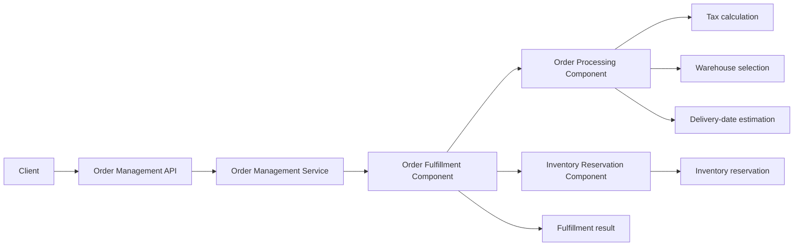
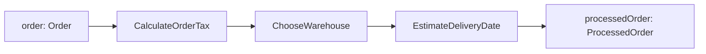
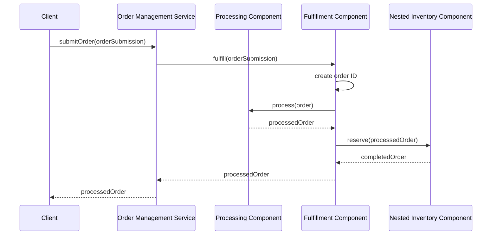

# Component Order Fulfillment: Walkthrough

> Generated from Ocean-Atlas v0.1.0 (content 8776e975). Canonical source: https://atlas.ocean-lab.ai/examples/component-order-fulfillment/

**Contents**

- [Horizon](#horizon)
- [Voyage](#voyage)

Horizon and Voyage explanation for the Component Order Fulfillment example.

Source: https://atlas.ocean-lab.ai/examples/component-order-fulfillment/

## Horizon

### Example at a Glance

#### Overview

An order-management boundary must turn an incoming order into a fulfillment result without making its API handler own every business decision. This example separates that work into reusable components: order processing, inventory reservation, and fulfillment. Each component declares a small public contract and composes its internal expressions or nested components explicitly.

#### Architecture



The service coordinates public use cases; components own reusable business capabilities and reveal only their declared input and output ports.

#### What It Demonstrates

- `@component` — public typed input/output ports and explicit internal wiring.
- Component composition — `OrderFulfillmentComponent` uses nested processing and inventory-reservation components.
- Inter-component wiring — fulfillment connects nested public ports into one typed business flow.
- `@expression` — tax calculation, warehouse selection, delivery estimation, and result assembly remain independently testable.
- `@service` and `@api` — the public order endpoints delegate to components rather than duplicating business logic.

#### Expected Result

A submission receives a server-generated order ID, becomes a `ProcessedOrder`, and reserves inventory through nested components. The UI renders the complete response: the original order, enrichment values, reservation, and final status.

## Voyage

### 1. Problem and Constraints

The system receives commercial order details: item name, source, destination, quantity, unit price, and currency. It must generate an ID, calculate tax for its route, choose a warehouse, estimate a delivery date, reserve stock, and report the fulfillment outcome. The API and service must not duplicate the internal pipeline.

- Components expose only business-level input and output ports.
- Nested components cannot leak their private aliases or dependencies.
- Expressions implement focused calculations, not orchestration.
- The example deliberately uses one service so component boundaries remain the central lesson.

### 2. Domain Contracts

`OrderSubmission` is the inbound business request. The fulfillment boundary generates its canonical `Order` ID. Its source and destination determine tax and delivery behavior; its quantity and unit price determine inventory and total calculations. Currency remains part of the commercial order contract throughout the processing pipeline. The processing component produces `ProcessedOrder`, preserving the original order while adding tax, selected warehouse, estimated delivery date, and total amount. Fulfillment returns the complete `ProcessedOrder`, including reservation and status.

```text
OrderSubmission
    name: String
    source: String
    destination: String
    quantity: Float
    unitPrice: Float
    currency: String

Order
    id: String
    name: String
    source: String
    destination: String
    quantity: Float
    unitPrice: Float
    currency: String

ProcessedOrder
    order: Order
    tax: Float
    warehouseId: String
    deliveryDate: DateTime
    totalAmount: Float
    reservation: InventoryReservation
    status: String
```

### 3. Component Design

The model uses three components. Order fulfillment is the service-facing capability; processing and reservation are nested within it because they are implementation details of one fulfillment use case, not separate service APIs.

| Component | Public contract | Responsibility |
| --- | --- | --- |
| `OrderProcessingComponent` | `Order → ProcessedOrder` | Chains tax, warehouse, and delivery expressions, then assembles the enriched order. |
| `OrderFulfillmentComponent` | `OrderSubmission → ProcessedOrder` | Generates the order ID, then composes processing and reservation. |
| `InventoryReservationComponent` | `ProcessedOrder → ProcessedOrder` | Nested capability that adds reservation details and final status. |

### 4. Build the Reusable Processing Pipeline

`OrderProcessingComponent` is the main data-enrichment example. It accepts one `Order`, calls the three focused expressions, and exposes a single `ProcessedOrder` output. Its connection graph documents the dependency order without forcing the service to know individual calculation aliases.



### 5. Nest Reservation Within Fulfillment

`OrderFulfillmentComponent` uses both `OrderProcessingComponent` and `InventoryReservationComponent` through their declared public ports. The outer component may connect to those ports, but cannot connect to either nested component's private expressions. This demonstrates composition with encapsulation.

```text
OrderFulfillmentComponent
    input submission: OrderSubmission
    output processedOrder: ProcessedOrder

    use expression CreateOrder as create
    use component OrderProcessingComponent as processing
    use component InventoryReservationComponent as inventory

    connect submission -> create
    connect create -> processing.order
    connect processing.processedOrder -> inventory.processedOrder
    connect inventory.completedOrder -> processedOrder
```

### 6. Compose Components at the Service Boundary

`OrderManagementService` implements the public API and uses `OrderFulfillmentComponent`. Its `submitOrder` endpoint delegates to that single public port. The component owns the inter-component wiring, so processing and reservation remain reusable while the service declares one clear application use case.



### 7. Example Structure

```text
0020-component-order-fulfillment/
├── 00-cof-info.ocn
├── 10-cof-datatype.ocn
├── 20-cof-api.ocn
├── 30-cof-config.ocn
├── 40-cof-expression.ocn
├── 46-cof-component.ocn
├── 50-cof-service.ocn
├── example.md
└── example-info/
    └── example-info.html
```

### 8. What to Inspect

1. Open the component graph and follow `Order → ProcessedOrder` through the three processing expressions.
2. Verify that the fulfillment component owns the edge to the nested inventory component.
3. Inspect the service graph to see the API endpoint connect to a component port rather than individual expressions.
4. Inspect the Flow view to confirm the API, service-owned component calls, and typed ports form one traceable path.

### 9. Validate, Generate, and Run

1. Open the `0020-component-order-fulfillment` folder as one Ocean bundle and run **Validate**. The bundle should report no diagnostics.
2. Run **Generate** with the Go backend target. The generated service contains one file for each of the three components.
3. In the generated project root, run `./bootstrap.sh build`. It formats the project, generates REST documentation, resolves dependencies, and builds `order-management-service`.

### 10. Experiments and Extensions

- Add a second warehouse-selection policy and route it through a mapper expression.
- Add a failed-reservation branch that releases a provisional shipment.
- Move inventory reservation behind a broker request-response contract while preserving the fulfillment component's public ports.
- Reuse `OrderProcessingComponent` from a batch-import service to show that components are not tied to one API.
