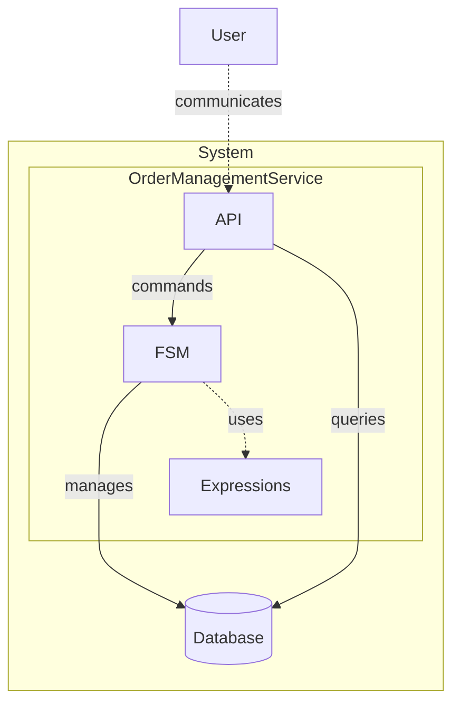

# Order Management: Entity-Based FSM

> Generated from Ocean-Atlas v0.1.0 (content 8776e975). Canonical source: https://atlas.ocean-lab.ai/examples/entity-order-fsm/

**Contents**

- [Overview](#overview)
- [Files](#files)
- [DSL source files](#dsl-source-files)
- [Diagrams](#diagrams)
- [Walkthrough](#walkthrough)

Persist orders and let a finite state machine enforce their approval, shipment, delivery, and cancellation lifecycle.

Source: https://atlas.ocean-lab.ai/examples/entity-order-fsm/

Level: medium · Estimated time: 20 minutes · Version: 1.0.0 · Onboarding example: no

Components: 1 services, 0 brokers, 1 databases

Tags: api, database, entity, entity-based, expressions, finite-state-machine, fsm, orders, state, transition, ui, workflow

## Overview

This example shows how an entity-based FSM constrains each persisted order to valid approval, shipment, delivery, and cancellation transitions. Its executable DSL and its Horizon and Voyage explanation are maintained together in this example directory.

## Files

DSL source comes first, then diagrams; the long Horizon and Voyage walkthroughs are at the end. You can stop after the source files.

| File | Section | Lines |
| --- | --- | --- |
| `00-info.ocn` | `@info` | 29 |
| `10-datatype.ocn` | `@datatype` | 27 |
| `20-config.ocn` | `@config` | 25 |
| `30-database.ocn` | `@database` | 36 |
| `40-api.ocn` | `@api` | 38 |
| `50-expression.ocn` | `@expression` | 22 |
| `60-fsm.ocn` | `@fsm` | 49 |
| `70-service.ocn` | `@service` | 54 |
| `75-dashborad.ocn` | `@dashboard` | 143 |
| `76-ui.ocn` | `@ui` | 57 |
| `80-deploy.ocn` | `@deploy` | 29 |

## DSL source files

### `00-info.ocn`

```ocean-dsl
# @ocean-meta-start
# tags:
#   - documentation
# perspective:
#   feature: entity-order-fsm
# @ocean-meta-end

@info

name: OrderManagementService  
version: 1.0.0  

description: OrderManagementService is a simple example service demonstrating  
the use of entity-based finite state machines (FSMs) in the Ocean-lab DSL  
platform.  

It manages the lifecycle of customer orders, modeled with a dedicated  
`Order` datatype and an `OrderStatus` enum. The FSM governs allowed state  
transitions (e.g. New → Approved → Shipped → Delivered) and ensures that  
business rules are enforced consistently.  

The service exposes an API for creating, updating, and querying orders.  
Internally, it combines DSL concepts such as typed datatypes, lifecycle  
management through FSMs, and clean persistence via entity-based design.  

OrderManagementService is a foundational example for exploring how Ocean-lab  
DSL can express domain logic, enforce valid state transitions, and integrate  
APIs, FSMs, and databases in a cohesive manner.
```

### `10-datatype.ocn`

```ocean-dsl
# @ocean-meta-start
# tags:
#   - order-management
#   - datatype
# perspective:
#   feature: entity-order-fsm
#   service: order-mgt-service
# @ocean-meta-end

@datatype

enum OrderStatus
    new
    approved
    shipped
    delivered
    cancelled

Order
    id        pattern O-UUID
    name      : String
    status    : OrderStatus
    customerId: String
    total     : Float
    createdAt : DateTime
    updatedAt : DateTime
```

### `20-config.ocn`

```ocean-dsl
# @ocean-meta-start
# tags:
#   - configuration
# perspective:
#   feature: entity-order-fsm
#   service: all
# @ocean-meta-end

@config

@import config O.database.postgres.config@1.0.0 as DatabaseConfig
@import config O.log.config@1.0.0 as LogConfig

OrderMgtConfig
    apiConfig : ApiConfig
    dbConfig  : DatabaseConfig
    logConfig : LogConfig

ApiConfig
    port: Int (default=8080)

UiConfig
    port: Int (default=8080)
    logConfig : LogConfig
```

### `30-database.ocn`

```ocean-dsl
# @ocean-meta-start
# tags:
#   - order-management
#   - database
# perspective:
#   feature: entity-order-fsm
#   service: order-mgt-service
# @ocean-meta-end

@database

Database OrderDb
    engine = postgres
    configType = DatabaseConfig
    tags = primary

    # ---------------------------------------------------
    # Order Entity
    # ---------------------------------------------------
    Entity Order
        key(id)
        indexes: index(status), index(customerId), index(createdAt)

        # Queries
        query findById(id: String)                 : Order
        query listAllOrders()                      : List<Order>
        query listOrders(offset: Int, limit: Int)  : List<Order>
        query findByName(name: String)             : List<Order>
        query findByStatus(status: OrderStatus)    : List<Order>
        query findByCustomerId(customerId: String) : List<Order>

        # Commands
        command T createOrder(order: Order) : Order
        command T updateOrder(order: Order) : Order
        command deleteOrder(id: String)     : _
```

### `40-api.ocn`

```ocean-dsl
# @ocean-meta-start
# tags:
#   - order-management
#   - order-mgt-api
#   - rest-api
# perspective:
#   feature: entity-order-fsm
#   service: order-mgt-service
# @ocean-meta-end

@api

OrderApi style:rest
    engine = gin
    configType = ApiConfig
    version = 1.0.0
    generateSwagger = true

    # -------------------------
    # Queries
    # -------------------------
    get  /orders                        listAllOrders()                   : List<Order>
    get  /orders/{offset}/{limit}       listOrders(offset:Int, limit:Int) : List<Order>
    get  /order/{id}                    getOrder(id:String)               : Order
    get  /order/find/by-name/{name}     findByName(name:String)           : List<Order>
    get  /order/find/by-status/{status} findByStatus(status:OrderStatus)  : List<Order>
    get  /order/find/by-customer-Id/{customerId}       findByCustomerId(customerId:String)      : List<Order>
    
    # -------------------------
    # Commands
    # -------------------------
    post /order                 createOrder(order:Order) : Order
    post /order/{id}/approve    approveOrder(id:String)  : Order
    post /order/{id}/ship       shipOrder(id:String)     : Order
    post /order/{id}/deliver    deliverOrder(id:String)  : Order
    post /order/{id}/cancel     cancelOrder(id:String)   : Order
    post /order/{id}/delete     deleteOrder(id:String)   : _
```

### `50-expression.ocn`

```ocean-dsl
# @ocean-meta-start
# tags:
#   - order-management
#   - expression
# perspective:
#   feature: entity-order-fsm
#   service: order-mgt-service
# @ocean-meta-end

@expression

AddNewOrderWithTimestamp
    input  : order:Order
    output : result:Order
    logic
        var ts DateTime
        ts = nowUTC()
        order.createdAt = ts
        order.updatedAt = ts
        order.status = OrderStatus.new
        result = Order.createOrder(order)
```

### `60-fsm.ocn`

```ocean-dsl
# @ocean-meta-start
# tags:
#   - order-management
#   - entity-fsm
#   - fsm
# perspective:
#   feature: entity-order-fsm
#   service: order-mgt-service
# @ocean-meta-end

@fsm

OrderFSM controls Order.status
    key: id
    #database: OrderDb

    # ---------------------------------------------------
    # Events (id is implicit input)
    # ---------------------------------------------------
    event approve in(_) out(order:Order)
    event ship    in(_) out(order:Order)
    event deliver in(_) out(order:Order)
    event cancel  in(_) out(order:Order)

    # ---------------------------------------------------
    # States
    # ---------------------------------------------------
    state New
        on event approve:
            next Approved : this.updatedAt = nowUTC()

        on event cancel:
            next Cancelled : this.updatedAt = nowUTC()

    state Approved
        on event ship:
            next Shipped : this.updatedAt = nowUTC()

        on event cancel:
            next Cancelled : this.updatedAt = nowUTC()

    state Shipped
        on event deliver:
            next Delivered : this.updatedAt = nowUTC()

    state Delivered

    state Cancelled
```

### `70-service.ocn`

```ocean-dsl
# @ocean-meta-start
# tags:
#   - order-management
#   - entity-fsm
#   - order-mgt-api
#   - service
# perspective:
#   feature: entity-order-fsm
#   service: order-mgt-service
# @ocean-meta-end

@service

OrderMgtService

    @perspectives: version:0.1.0, lifestyle:stable

    use config OrderMgtConfig as myCfg
    impl api OrderApi as api on myCfg.apiConfig.port
    use database OrderDb as odb
    use fsm OrderFSM as oFsm
    use expression AddNewOrderWithTimestamp as addOrder

    # -------------------------
    # Config binding
    # -------------------------
    connect myCfg.dbConfig -> odb

    # -------------------------
    # Expressions
    # -------------------------
    # (future expressions like CalculateTotal, ValidateOrder, etc.)
    # use expression CalculateTotalExpression
    # use expression ValidateOrderExpression

    # -------------------------
    # Order Operations
    # -------------------------
    connect api.listAllOrders  -> Order.listAllOrders
    connect api.listOrders     -> Order.listOrders
    connect api.getOrder       -> Order.findById
 
    connect api.createOrder    -> addOrder
    connect api.deleteOrder    -> Order.deleteOrder
 
    connect api.approveOrder   -> oFsm.approve
    connect api.shipOrder      -> oFsm.ship
    connect api.deliverOrder   -> oFsm.deliver
    connect api.cancelOrder    -> oFsm.cancel

    connect api.findByName     -> Order.findByName
    connect api.findByStatus   -> Order.findByStatus
    connect api.findByCustomerId -> Order.findByCustomerId
```

### `75-dashborad.ocn`

```ocean-dsl
# @ocean-meta-start
# tags:
#   - ui
#   - dashboard
# perspective:
#   feature: entity-order-fsm
#   service: ui-service
# @ocean-meta-end

@dashboard

ViewDashboard
    title: Orders
    subtitle: See all your orders here!
    layout: SingleColumnLayout

    Widget OrderTable of type Table
        title = Orders Table
        limit = 5
        columns:
            - id         String
            - name       String
            - status     OrderStatus
            - customerId String
            - total      Float
            - createdAt  DateTime
            - updatedAt  DateTime

OrderDashboard
    title: Create or Delete Orders!
    layout: SingleColumnLayout

    Widget CreateForm of type Form
        title = Create Order
        fields:
            - name       String
            - customerId String
            - total      Float
        buttons:
            submit : 📥 Create
            cancel : Reset

    Widget S1 of type Separator
        label = DELETE
        size = lg
        style = solid

    Widget DeleteForm of type Form
        title = Delete Order
        fields:
            - id String
        buttons:
            submit : ❌ Delete
            cancel : Reset

SearchDashboard
    title: Find Orders!
    layout: SingleColumnLayout

    Widget FindByNameForm of type Form
        title = Find Order By Name
        fields:
            - name String
        buttons:
            submit : 🔍 Find by Name

    Widget S2 of type Separator
        size = lg
        style = solid

    Widget FindByStatusForm of type Form
        title = Find Order By Status
        fields:
            - status OrderStatus
        buttons:
            submit : 🔍 Find by Status

    Widget S3 of type Separator
        size = lg
        style = solid

    Widget FindByCustomerIdForm of type Form
        title = Find Order By Customer-ID
        fields:
            - customerId String
        buttons:
            submit : 🔍 Find by Customer-ID

ManageDashboard
    title: Manage Orders!
    subtitle: Manage your orders like a boss!
    layout: SingleColumnLayout

    Widget ApproveForm of type Form
        title = Approve Order
        fields:
            - id String
        buttons:
            submit : 🟢 Approve

    Widget S3 of type Separator
        size = lg
        style = solid

    Widget ShipForm of type Form
        title = Ship Order
        fields:
            - id String
        buttons:
            submit : 🚚 Ship

    Widget S5 of type Separator
        size = lg
        style = solid

    Widget DeliverForm of type Form
        title = Deliver Order
        fields:
            - id String
        buttons:
            submit : 📭 Deliver

    Widget S6 of type Separator
        size = lg
        style = solid

    Widget CancelForm of type Form
        title = Cancer Order
        fields:
            - id String
        buttons:
            submit : 🛑 Cancel

AboutDashboard
    title: About
    subtitle: App information!
    layout: SingleColumnLayout

    Widget AboutText of type Text
        title = About Order Management App
        subtitle = This app helps you to manage your orders 📦
        content = Order Management App is a simple example service demonstrating the use of entity-based finite state machines (FSMs) in the Ocean-lab DSL platform. <br><br> It manages the lifecycle of customer orders, modeled with a dedicated `Order` datatype and an `OrderStatus` enum. The FSM governs allowed state transitions (e.g. New → Approved → Shipped → Delivered) and ensures that business rules are enforced consistently.<br><br> The backend service exposes an API for creating, updating, and querying orders. Internally, it combines DSL concepts such as typed datatypes, lifecycle management through FSMs, and clean persistence via entity-based design. <br><br> Order Management App is a foundational example for exploring how Ocean-lab DSL can express domain logic, enforce valid state transitions, and integrate APIs, FSMs, and databases in a cohesive manner.  
```

### `76-ui.ocn`

```ocean-dsl
# @ocean-meta-start
# tags:
#   - ui
# perspective:
#   feature: entity-order-fsm
#   service: ui-service
# @ocean-meta-end

@ui

OrderMgtUi

    @perspectives: version:0.1.0, lifestyle:stable

    framework: htmx
    styling: bootstrap
    template: go-html-template
    backend: go-gin
    static: static
    configType: UiConfig

    nav View dashboard = ViewDashboard
    nav Order dashboard = OrderDashboard
    nav Search dashboard = SearchDashboard
    nav Manage dashboard = ManageDashboard
    nav About dashboard = AboutDashboard

    header title = 📦 Order Management App!
    header subtitle = Managing orders made simple 😊
    header align = center

    footer title = ⚡ Built with Ocean-lab
    footer subtitle = Version 1.0.0
    footer align = center

    use dashboard ViewDashboard as view
    use dashboard OrderDashboard as order
    use dashboard SearchDashboard as search
    use dashboard ManageDashboard as manage
    use dashboard AboutDashboard as about

    use api OrderApi

    connect view.OrderTable.listRows -> OrderApi.listOrders

    connect order.CreateForm.submit -> OrderApi.createOrder
    connect order.DeleteForm.submit -> OrderApi.deleteOrder

    connect manage.ApproveForm.submit -> OrderApi.approveOrder
    connect manage.ShipForm.submit -> OrderApi.shipOrder
    connect manage.DeliverForm.submit -> OrderApi.deliverOrder
    connect manage.CancelForm.submit -> OrderApi.cancelOrder

    connect search.FindByNameForm.submit -> OrderApi.findByName
    connect search.FindByStatusForm.submit -> OrderApi.findByStatus
    connect search.FindByCustomerIdForm.submit -> OrderApi.findByCustomerId
```

### `80-deploy.ocn`

```ocean-dsl
# @ocean-meta-start
# tags:
#   - deployment
# perspective:
#   feature: entity-order-fsm
#   service: all
# @ocean-meta-end

@deploy

Name: OrderMgt-deploy

@import service P.db.postgres.docker@1.0.0 as PostgresqlDB

OrderMgtDeploy
    service     OrderMgtService
    replica     1
    export      9097:OrderMgtService.api
    dependsOn   OrderMgtDatabase

OrderMgtDatabase
    service     PostgresqlDB

OrderMgtUiDeploy
    service     OrderMgtUi
    replica     1
    export      8087:OrderMgtUi.config
    dependsOn   OrderMgtDeploy
```

## Diagrams

### `spec-entity-based-fsm.mmd`



## Walkthrough

A long, step-by-step explanation (Horizon and Voyage) is in [Order Management: Entity-Based FSM walkthrough](entity-order-fsm-walkthrough.md). Read it only if you need the reasoning behind the design.
