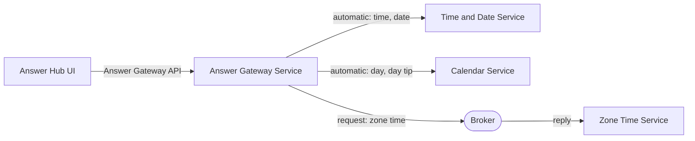

# Gateway Answer Hub: Walkthrough

> Generated from Ocean-Atlas v0.1.0 (content a0c57f8d). Canonical source: https://atlas.ocean-lab.ai/examples/gateway-answer-hub/

**Contents**

- [Horizon](#horizon)
- [Voyage](#voyage)

Horizon and Voyage explanation for the Gateway Answer Hub example.

Source: https://atlas.ocean-lab.ai/examples/gateway-answer-hub/

## Horizon

### Example at a Glance

#### Overview

Clients should not need to know which service answers which question. This example gives them one public Answer API for the current time, date, day, day tip, and Amsterdam zone time. A gateway service owns that boundary: it forwards most operations to the provider APIs that already offer them, and routes the one operation without a provider API through a broker request-response topic.

#### Architecture



The UI calls only the gateway. Four operations are forwarded automatically to included APIs; zone time is routed explicitly to a broker responder.

#### What It Demonstrates

- `@api` — `include` composes two provider APIs into one public gateway API that adds its own operation.
- `@service` — `impl gateway api ... including` forwards matching operations automatically, and an explicit `connect` routes the rest.
- `@broker` — a request-response topic answered by a service that exposes no API.
- `@expression` — small provider expressions that produce each answer.
- `@dashboard` and `@ui` — a generated interface whose buttons call only the gateway API.
- `@config` and `@deploy` — shared service configuration and deployment of the gateway, providers, broker, and UI.

#### Expected Result

Each dashboard button calls one operation of the public gateway API and displays its answer. Time, date, day, and day tip come from their provider services through automatic forwarding; zone time comes from the broker responder through the explicit route.

## Voyage

### 1. Problem and Constraints

A public API should be declared once and routed without repeating a `connect` for every operation that a provider already implements. Operations that no provider API offers must still be routable, and an explicit route must be visible in the model. Gateway policies such as authentication, CORS, and rate limiting are out of scope; they are a planned extension of the gateway model.

### 2. Prerequisites

- Ocean UI with the gateway capability of `@service` and API composition in `@api`.
- A container runtime for the generated deployment.
- Recommended: `answer-sync` and `answer-async`, which use the same answer providers with aggregation.

### 3. Example Structure

```text
0015-gateway-answer-hub/
├── 00-gah-info.ocn
├── 10-gah-api.ocn
├── 20-gah-broker.ocn
├── 30-gah-config.ocn
├── 40-gah-expression.ocn
├── 50-gah-service-calendar.ocn
├── 50-gah-service-gateway.ocn
├── 50-gah-service-time-date.ocn
├── 50-gah-service-zone-time.ocn
├── 55-gah-dashboard.ocn
├── 56-gah-ui.ocn
├── 60-gah-deploy.ocn
├── architecture.mmd
├── broker-communication.mmd
└── example-info/example-info.html
```

### 4. Compose the Public API

`10-gah-api.ocn` defines the two provider APIs and the public `AnswerGatewayApi`. `include` reuses the provider operations without repeating them; the gateway API owns the transport settings, so every operation is exposed under `/answers`.

```text
AnswerGatewayApi style:rest
    engine = gin
    configType = ApiConfig
    version = 1.0.0
    basePath = /answers
    generateSwagger = true

    include TimeDateApi, CalendarApi

    get /zone-time getZoneTime() : String
```

The effective public API is `GET /answers/time`, `/answers/date`, `/answers/day`, `/answers/day-tip`, and `/answers/zone-time`.

### 5. Implement the Gateway Service

`50-gah-service-gateway.ocn` implements the public API as a gateway. Every name after `including` is a local `use api` alias. `getTime`, `getDate`, `getDay`, and `getDayTip` match included operations and are forwarded automatically. `getZoneTime` has no included counterpart, so it is connected explicitly to the broker topic.

```text
use api TimeDateApi as timeDate
use api CalendarApi as calendar
use broker AnswerHubBroker as broker

impl gateway api AnswerGatewayApi as api on gwCfg.apiConfig.port
    including timeDate, calendar

connect api.getZoneTime -> broker.answers.zoneTime
```

An explicit `connect` on a gateway operation also takes precedence over automatic forwarding, so the same form can override a forwarded route.

### 6. Provide the Answers

`TimeDateService` and `CalendarService` implement their provider APIs with ordinary `connect` statements to expressions. `ZoneTimeService` implements no API: it answers the request-response topic declared in `20-gah-broker.ocn`.

```text
AnswerHubBroker
    engine = nats
    configType = AnswerHubBrokerConfig

    answers.zoneTime : _-String as request-response with timeout:2s

ZoneTimeService
    use broker AnswerHubBroker as broker
    use expression GetAmsterdamTime as zoneTime

    connect broker.answers.zoneTime -> zoneTime
```

`GetAmsterdamTime` calls `GetZoneTimeString("Europe/Amsterdam")`.

### 7. Call Only the Gateway from the UI

`AnswerHubUi` uses `AnswerGatewayApi` and nothing else. Each button on `AnswerHubDashboard` calls one public operation, so the UI does not depend on where each answer is produced.

```text
use api AnswerGatewayApi as gateway

connect answers.TimeButton.click -> gateway.getTime
connect answers.ZoneTimeButton.click -> gateway.getZoneTime
```

### 8. Select Technologies and Deploy

The APIs use the `gin` REST engine, the broker uses `nats`, and the UI is generated with HTMX, Bootstrap, and Go templates. `60-gah-deploy.ocn` imports a NATS container and starts the gateway after its providers and the broker.

```text
GatewayDeploy
    service AnswerGatewayService
    replica 1
    export 9100:AnswerGatewayService.api
    dependsOn TimeDateDeploy, CalendarDeploy, ZoneTimeDeploy, Broker

AnswerHubUiDeploy
    service AnswerHubUi
    replica 1
    export 8085:AnswerHubUi.config
    dependsOn GatewayDeploy
```

The provider APIs are also exported on ports `9101` and `9102` for direct inspection. The UI does not use them.

### 9. Validate, Generate, and Run

1. Open the `Gateway Answer Hub` example in Ocean UI.
2. Validate and generate the complete model.
3. Follow the generated `Readme.md` to start the broker, services, and UI.
4. Open the UI at `localhost:8085`.

### 10. Verify the Result

1. Use the time, date, day, and day tip buttons; each answer is forwarded by the gateway to its provider service.
2. Use the Amsterdam zone time button; the answer is returned by `ZoneTimeService` through the broker.
3. Call `GET localhost:9100/answers/time` directly and compare it with `GET localhost:9101/time-date/time`.
4. Stop `ZoneTimeService` and call `/answers/zone-time`; the request fails after its two-second timeout while the forwarded operations still answer.

### 11. Experiments

- Add `connect api.getTime -> broker.answers.zoneTime` and observe that the explicit route overrides automatic forwarding.
- Remove `calendar` from `including` and validate; `getDay` and `getDayTip` become unresolved public operations.
- Remove the `9101` and `9102` exports so that the gateway is the only reachable API.

### 12. Related Knowledge

- `dsl.api` — API composition with `include`.
- `dsl.service` — gateway implementations.
- `dsl.broker` — request-response topics.
- `examples.answer-sync` and `examples.answer-async` — the same answers combined through aggregation.
