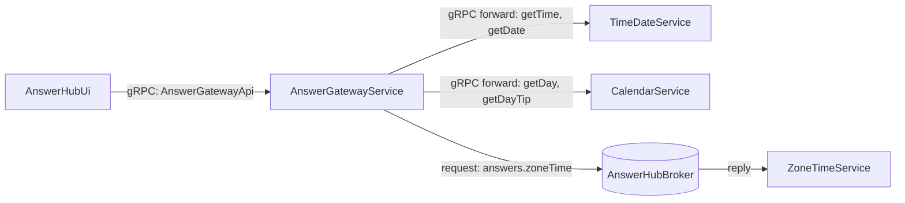
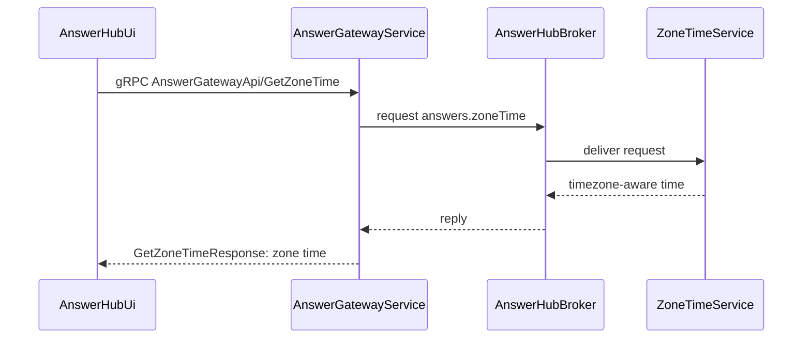

# gRPC Gateway Answer Hub

> Generated from Ocean-Atlas v0.1.0 (content 8776e975). Canonical source: https://atlas.ocean-lab.ai/examples/grpc-gateway-answer-hub/

**Contents**

- [Status](#status)
- [Overview](#overview)
- [gRPC contracts](#grpc-contracts)
- [API composition](#api-composition)
- [Routing model](#routing-model)
- [Public boundary](#public-boundary)
- [Files](#files)
- [DSL source files](#dsl-source-files)
- [Diagrams](#diagrams)
- [Walkthrough](#walkthrough)

Expose one public gRPC API over independent answer providers, forwarding matching methods to provider gRPC APIs automatically and routing one explicitly through broker request-response.

Source: https://atlas.ocean-lab.ai/examples/grpc-gateway-answer-hub/

Level: medium · Estimated time: 15 minutes · Version: 1.0.0 · Onboarding example: no

Components: 4 services, 1 brokers, 0 databases

Tags: api, api-composition, api-facade, broker, dashboard, gateway, grpc, protobuf, request-response, ui

## Status

This example is a draft. The gRPC style is specified in `dsl.api` (section 5),
but its code generation is not implemented yet, so the model cannot be
generated or run until gRPC support lands. The DSL follows the specified
syntax and is kept here as the reference example for that work.

## Overview

This example is the reference for Ocean's gRPC API style. It is the gRPC
counterpart of `examples.gateway-answer-hub` (REST) and
`examples.soap-gateway-answer-hub` (SOAP): the services, broker, expressions,
UI, and deployment are the same, and every API is declared with `style:grpc`.
Comparing the three examples shows that the gateway and routing model is
independent of the API style.

`AnswerGatewayService` exposes one public gRPC API, `AnswerGatewayApi`, while
the answers themselves are produced by independent provider services behind
it. Its executable DSL and its Horizon and Voyage explanation are maintained
together in this example directory.

## gRPC contracts

Each gRPC API declares the `connect` engine, which serves gRPC, gRPC-Web, and
the Connect protocol, and its own protobuf package. Ocean generates a proto3
contract, a typed server, and a typed client for each API. Server reflection is
enabled, so tools such as `grpcurl` can discover the services at runtime.

| API | Protobuf package | Contract |
| --- | --- | --- |
| `TimeDateApi` | `oceanlab.examples.answerhub.timedate.v1` | `time-date.proto` |
| `CalendarApi` | `oceanlab.examples.answerhub.calendar.v1` | `calendar.proto` |
| `AnswerGatewayApi` | `oceanlab.examples.answerhub.answers.v1` | `answer-gateway.proto` |

Each API has its own package. The gateway's contract repeats the providers'
methods, together with their generated request and response messages, so
sharing one package would declare those messages twice.

Every method takes no input and returns a `String`. On the wire, the request is
`google.protobuf.Empty` and the response is a generated message with a single
`value` field, for example `GetTimeResponse`. Services still see the Ocean
form: no input and a `String` output.

## API composition

`AnswerGatewayApi` composes the operations of `TimeDateApi` and `CalendarApi`
with `include`, and declares one operation of its own, `getZoneTime`. The
gateway API owns the transport configuration: every included operation becomes
a method of its protobuf service, in its package, and in its `.proto`
contract.

| Public method | gRPC path | Source |
| --- | --- | --- |
| `GetTime` | `/oceanlab.examples.answerhub.answers.v1.AnswerGatewayApi/GetTime` | included from `TimeDateApi` |
| `GetDate` | `/oceanlab.examples.answerhub.answers.v1.AnswerGatewayApi/GetDate` | included from `TimeDateApi` |
| `GetDay` | `/oceanlab.examples.answerhub.answers.v1.AnswerGatewayApi/GetDay` | included from `CalendarApi` |
| `GetDayTip` | `/oceanlab.examples.answerhub.answers.v1.AnswerGatewayApi/GetDayTip` | included from `CalendarApi` |
| `GetZoneTime` | `/oceanlab.examples.answerhub.answers.v1.AnswerGatewayApi/GetZoneTime` | declared locally |

Method names are the Ocean operation names with their first letter uppercased.

## Routing model

`AnswerGatewayService` implements `AnswerGatewayApi` with
`impl gateway api ... including timeDate, calendar`. Public methods with a
matching, contract-compatible operation in an included API are forwarded
automatically, from the gateway's gRPC service to the provider's gRPC service:

- `getTime`, `getDate` → `TimeDateService`
- `getDay`, `getDayTip` → `CalendarService`

`getZoneTime` has no provider API counterpart. The gateway connects it
explicitly to the `answers.zoneTime` request-response topic of
`AnswerHubBroker`, which `ZoneTimeService` serves. Its responder expression
calls `GetZoneTimeString("Europe/Amsterdam")`.



`architecture.mmd` and `broker-communication.mmd` contain the same topology
and the zone-time request-response sequence.

## Public boundary

`AnswerHubUi` uses only `AnswerGatewayApi`, through its generated gRPC client;
it has no dependency on the provider APIs. The deployment exports the gateway
on port `9100` and the UI on port `8085`. It also exports `TimeDateService`
and `CalendarService` on ports `9101` and `9102` so that their services can be
inspected directly; remove those exports to make the gateway the only
externally reachable API.

Streaming methods, `@from-context` metadata, deadlines, and explicit field
numbers are outside this routing-focused example; streaming and metadata
bindings are not supported yet. Gateway-wide policies such as authentication,
authorization, rate limiting, tracing, and error normalization are a planned
extension of the gateway model and will be introduced separately.

## Files

DSL source comes first, then diagrams; the long Horizon and Voyage walkthroughs are at the end. You can stop after the source files.

| File | Section | Lines |
| --- | --- | --- |
| `00-ggah-info.ocn` | `@info` | 36 |
| `10-ggah-api.ocn` | `@api` | 42 |
| `20-ggah-broker.ocn` | `@broker` | 20 |
| `30-ggah-config.ocn` | `@config` | 30 |
| `40-ggah-expression.ocn` | `@expression` | 42 |
| `50-ggah-service-calendar.ocn` | `@service` | 23 |
| `50-ggah-service-gateway.ocn` | `@service` | 30 |
| `50-ggah-service-time-date.ocn` | `@service` | 23 |
| `50-ggah-service-zone-time.ocn` | `@service` | 21 |
| `55-ggah-dashboard.ocn` | `@dashboard` | 45 |
| `56-ggah-ui.ocn` | `@ui` | 43 |
| `60-ggah-deploy.ocn` | `@deploy` | 46 |

## DSL source files

### `00-ggah-info.ocn`

```ocean-dsl
# @ocean-meta-start
# tags:
#   - grpc
#   - gateway
#   - api-facade
#   - broker-request-response
# perspective:
#   feature: grpc-gateway-answer-hub
#   boundedContext: answer-hub
# @ocean-meta-end

@info

name: gRPC Gateway Answer Hub
version: 1.0.0
title: gRPC Gateway Answer Hub
subtitle: One public gRPC API for independent answer providers
shortDescription: A focused gRPC API gateway example with protobuf-backed API composition, automatic forwarding, and an explicit broker-backed operation.

description:

Overview
gRPC Gateway Answer Hub exposes one public gRPC API for time, date, day, day tip, and zone time. It is the gRPC counterpart of Gateway Answer Hub (REST) and SOAP Gateway Answer Hub: the same gateway and routing model, with every API declared as style:grpc.

gRPC contracts
Each API declares its own protobuf package and serves gRPC reflection. Ocean generates a proto3 contract, a typed server, and a typed client for every API from the same definition. The connect engine serves the gRPC, gRPC-Web, and Connect protocols.

Automatic forwarding
The gateway includes the TimeDateApi and CalendarApi. Their operations become methods of the gateway's own protobuf service, package, and .proto contract. Operations with the same name and compatible contracts are forwarded automatically to their owning services.

Explicit routing
Zone time is intentionally not exposed by an internal API. The gateway routes getZoneTime explicitly through a NATS request-response topic to ZoneTimeService.

UI
AnswerHubUi calls only AnswerGatewayApi. Each dashboard action independently invokes one public gRPC method, so users see the gateway as the sole public boundary.
```

### `10-ggah-api.ocn`

```ocean-dsl
# @ocean-meta-start
# tags:
#   - grpc-api
#   - gateway-contract
# perspective:
#   feature: grpc-gateway-answer-hub
#   boundedContext: answer-hub
# @ocean-meta-end

@api

TimeDateApi style:grpc
    engine       = connect
    configType   = ApiConfig
    version      = 1.0.0
    protoPackage = oceanlab.examples.answerhub.timedate.v1
    reflection   = true

    rpc getTime() : String
    rpc getDate() : String

CalendarApi style:grpc
    engine       = connect
    configType   = ApiConfig
    version      = 1.0.0
    protoPackage = oceanlab.examples.answerhub.calendar.v1
    reflection   = true

    rpc getDay() : String
    rpc getDayTip() : String

AnswerGatewayApi style:grpc
    engine       = connect
    configType   = ApiConfig
    version      = 1.0.0
    protoPackage = oceanlab.examples.answerhub.answers.v1
    reflection   = true

    include TimeDateApi, CalendarApi

    rpc getZoneTime() : String
```

### `20-ggah-broker.ocn`

```ocean-dsl
# @ocean-meta-start
# tags:
#   - broker
#   - nats
#   - request-response
# perspective:
#   feature: grpc-gateway-answer-hub
#   boundedContext: answer-hub
# @ocean-meta-end

@broker

AnswerHubBroker
    @perspectives: version:1.0.0, lifestyle:stable
    engine = nats
    configType = AnswerHubBrokerConfig
    tags = primary, shared

    answers.zoneTime : _-String as request-response with timeout:2s
```

### `30-ggah-config.ocn`

```ocean-dsl
# @ocean-meta-start
# tags:
#   - configuration
# perspective:
#   feature: grpc-gateway-answer-hub
#   boundedContext: answer-hub
#   service: shared
# @ocean-meta-end

@config

@import config O.broker.nats.config@1.0.0 as BrokerConfig
@import config O.log.config@1.0.0 as LogConfig

ApiConfig
    port : Int (default=8080)

CommonServiceConfig
    apiConfig    : ApiConfig
    brokerConfig : BrokerConfig
    logConfig    : LogConfig

AnswerHubBrokerConfig
    brokerConfig : BrokerConfig
    logConfig    : LogConfig

UiConfig
    port      : Int (default=8080)
    logConfig : LogConfig
```

### `40-ggah-expression.ocn`

```ocean-dsl
# @ocean-meta-start
# tags:
#   - expression
#   - answer-provider
# perspective:
#   feature: grpc-gateway-answer-hub
#   boundedContext: answer-hub
#   service: shared
# @ocean-meta-end

@expression

GetTimeString
    input: _
    output: result:String
    logic
        result = nowTimeString()

GetDateString
    input: _
    output: result:String
    logic
        result = nowDateString()

GetDayString
    input: _
    output: result:String
    logic
        result = today()

GetDayTip
    input: _
    output: result:String
    logic
        result = tipOfTheDay()

GetAmsterdamTime
    input: _
    output: result:String
    logic
        result = GetZoneTimeString("Europe/Amsterdam")
```

### `50-ggah-service-calendar.ocn`

```ocean-dsl
# @ocean-meta-start
# tags:
#   - service
#   - provider
# perspective:
#   feature: grpc-gateway-answer-hub
#   boundedContext: answer-hub
#   service: calendar-service
# @ocean-meta-end

@service

CalendarService
    @perspectives: version:1.0.0, lifestyle:stable

    use config CommonServiceConfig as svcCfg
    impl api CalendarApi as api on svcCfg.apiConfig.port
    use expression GetDayString as day
    use expression GetDayTip as tip

    connect api.getDay -> day
    connect api.getDayTip -> tip
```

### `50-ggah-service-gateway.ocn`

```ocean-dsl
# @ocean-meta-start
# tags:
#   - service
#   - gateway
#   - api-facade
#   - grpc
# perspective:
#   feature: grpc-gateway-answer-hub
#   boundedContext: answer-hub
#   service: answer-gateway-service
# @ocean-meta-end

@service

AnswerGatewayService
    @perspectives: version:1.0.0, lifestyle:stable

    use config CommonServiceConfig as gwCfg
    use api TimeDateApi as timeDate
    use api CalendarApi as calendar
    use broker AnswerHubBroker as broker

    impl gateway api AnswerGatewayApi as gw on gwCfg.apiConfig.port
        including timeDate, calendar

    # getTime, getDate, getDay, and getDayTip are automatically forwarded
    # from the gateway's gRPC service to the providers' gRPC services.
    # Zone time is intentionally broker-backed and therefore routed explicitly.
    connect gw.getZoneTime -> broker.answers.zoneTime
```

### `50-ggah-service-time-date.ocn`

```ocean-dsl
# @ocean-meta-start
# tags:
#   - service
#   - provider
# perspective:
#   feature: grpc-gateway-answer-hub
#   boundedContext: answer-hub
#   service: time-date-service
# @ocean-meta-end

@service

TimeDateService
    @perspectives: version:1.0.0, lifestyle:stable

    use config CommonServiceConfig as svcCfg
    impl api TimeDateApi as api on svcCfg.apiConfig.port
    use expression GetTimeString as time
    use expression GetDateString as date

    connect api.getTime -> time
    connect api.getDate -> date
```

### `50-ggah-service-zone-time.ocn`

```ocean-dsl
# @ocean-meta-start
# tags:
#   - service
#   - broker-responder
# perspective:
#   feature: grpc-gateway-answer-hub
#   boundedContext: answer-hub
#   service: zone-time-service
# @ocean-meta-end

@service

ZoneTimeService
    @perspectives: version:1.0.0, lifestyle:stable

    use config CommonServiceConfig as svcCfg
    use broker AnswerHubBroker as broker
    use expression GetAmsterdamTime as zoneTime

    connect broker.answers.zoneTime -> zoneTime
```

### `55-ggah-dashboard.ocn`

```ocean-dsl
# @ocean-meta-start
# tags:
#   - dashboard
#   - gateway
# perspective:
#   feature: grpc-gateway-answer-hub
#   boundedContext: answer-hub
#   service: answer-hub-ui
# @ocean-meta-end

@dashboard

AnswerHubDashboard
    title: gRPC Gateway Answer Hub
    layout: SingleColumnLayout

    Widget GatewayGuide of type Text
        title = One public gRPC API, three provider services
        subtitle = gRPC forwarding for time, date, day, and day tip; broker request-response for zone time
        content = <p>Each action calls a gRPC method of <b>AnswerGatewayApi</b>. The gateway automatically forwards matching methods to the provider gRPC APIs and explicitly delegates zone time to a broker responder.</p>

    Widget TimeButton of type Button
        label = Current time

    Widget DateButton of type Button
        label = Current date

    Widget DayButton of type Button
        label = Current day

    Widget DayTipButton of type Button
        label = Day tip

    Widget ZoneTimeButton of type Button
        label = Amsterdam zone time

AboutDashboard
    title: About this example
    layout: SingleColumnLayout

    Widget AboutText of type Text
        title = gRPC gateway routing patterns
        subtitle = Automatic forwarding and explicit routing in one service
        content = <p>This example demonstrates an Ocean service that implements a gRPC gateway API. Matching methods are forwarded to included gRPC APIs automatically. A distinct method is explicitly connected to a broker request-response topic.</p>
```

### `56-ggah-ui.ocn`

```ocean-dsl
# @ocean-meta-start
# tags:
#   - ui
#   - gateway
# perspective:
#   feature: grpc-gateway-answer-hub
#   boundedContext: answer-hub
#   service: answer-hub-ui
# @ocean-meta-end

@ui

AnswerHubUi
    @perspectives: version:1.0.0, lifestyle:stable

    framework: htmx
    styling: bootstrap
    template: go-html-template
    backend: go-gin
    static: static
    configType: UiConfig

    nav Answers dashboard = AnswerHubDashboard
    nav About dashboard = AboutDashboard

    header title = gRPC Gateway Answer Hub
    header subtitle = One public gRPC API for independent answer providers
    header align = center

    footer title = Built with Ocean-lab
    footer subtitle = gRPC gateway feature example
    footer align = center

    use dashboard AnswerHubDashboard as answers
    use dashboard AboutDashboard as about
    use api AnswerGatewayApi as gateway

    connect answers.TimeButton.click -> gateway.getTime
    connect answers.DateButton.click -> gateway.getDate
    connect answers.DayButton.click -> gateway.getDay
    connect answers.DayTipButton.click -> gateway.getDayTip
    connect answers.ZoneTimeButton.click -> gateway.getZoneTime
```

### `60-ggah-deploy.ocn`

```ocean-dsl
# @ocean-meta-start
# tags:
#   - deployment
#   - gateway
# perspective:
#   feature: grpc-gateway-answer-hub
#   boundedContext: answer-hub
#   service: shared
# @ocean-meta-end

@deploy

Name: GrpcGatewayAnswerHubDeploy

@import service P.broker.nats.docker@1.0.0 as NATS

TimeDateDeploy
    service TimeDateService
    replica 1
    export 9101:TimeDateService.api

CalendarDeploy
    service CalendarService
    replica 1
    export 9102:CalendarService.api

ZoneTimeDeploy
    service ZoneTimeService
    replica 1
    dependsOn Broker

GatewayDeploy
    service AnswerGatewayService
    replica 1
    export 9100:AnswerGatewayService.gw
    dependsOn TimeDateDeploy, CalendarDeploy, ZoneTimeDeploy, Broker

Broker
    service NATS

AnswerHubUiDeploy
    service AnswerHubUi
    replica 1
    export 8085:AnswerHubUi.config
    dependsOn GatewayDeploy
```

## Diagrams

### `architecture.mmd`


### `broker-communication.mmd`



## Walkthrough

A long, step-by-step explanation (Horizon and Voyage) is in [gRPC Gateway Answer Hub walkthrough](grpc-gateway-answer-hub-walkthrough.md). Read it only if you need the reasoning behind the design.
