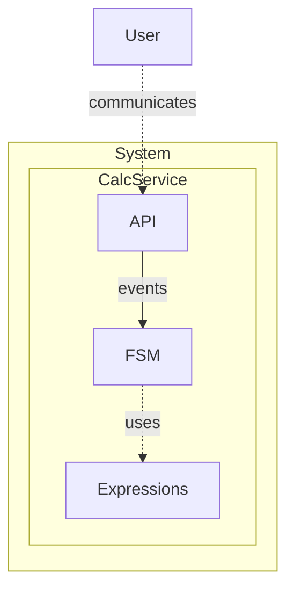

# Calculator: In-Memory FSM

> Generated from Ocean-Atlas v0.1.0 (content 8776e975). Canonical source: https://atlas.ocean-lab.ai/examples/in-memory-calculator-fsm/

**Contents**

- [Overview](#overview)
- [Files](#files)
- [DSL source files](#dsl-source-files)
- [Diagrams](#diagrams)
- [Walkthrough](#walkthrough)

Learn how to define and use an in-memory finite state machine through a calculator whose current state selects its behavior.

Source: https://atlas.ocean-lab.ai/examples/in-memory-calculator-fsm/

Level: easy · Estimated time: 15 minutes · Version: 1.0.0 · Onboarding example: no

Components: 1 services, 0 brokers, 0 databases

Tags: api, calculator, context, expressions, finite-state-machine, fsm, in-memory, rest, state, transition, ui

## Overview

This example shows how an in-memory FSM retains a calculator mode, updates context during transitions, and dispatches calculations according to the active state. Its executable DSL and its Horizon and Voyage explanation are maintained together in this example directory.

## Files

DSL source comes first, then diagrams; the long Horizon and Voyage walkthroughs are at the end. You can stop after the source files.

| File | Section | Lines |
| --- | --- | --- |
| `00-info.ocn` | `@info` | 27 |
| `01-datatype.ocn` | `@datatype` | 14 |
| `02-api.ocn` | `@api` | 25 |
| `03-expression.ocn` | `@expression` | 93 |
| `04-context.ocn` | `@context` | 13 |
| `05-config.ocn` | `@config` | 23 |
| `06-fsm.ocn` | `@fsm` | 105 |
| `07-dashboard.ocn` | `@dashboard` | 70 |
| `08-ui.ocn` | `@ui` | 43 |
| `09-service.ocn` | `@service` | 25 |
| `10-deploy.ocn` | `@deploy` | 23 |

## DSL source files

### `00-info.ocn`

```ocean-dsl
# @ocean-meta-start
# tags:
#   - documentation
# perspective:
#   feature: in-memory-calculator-fsm
# @ocean-meta-end

@info

name: CalcService  
version: 1.0.0  

description: CalcService is a minimal example service demonstrating the use of  
finite state machines (FSMs) and expressions in the Ocean-lab DSL platform.  

It exposes a simple API with two operations: one to set the current arithmetic  
operation (`add`, `sub`, `mul`, `div`) and another to calculate the result of  
two input values (`a`, `b`). Internally, the service uses a state machine to  
track the selected operation and apply the appropriate expression accordingly.  

This example showcases key DSL concepts including typed inputs/outputs, reusable  
expressions, FSM-driven behavior, and clean API-service integration.  

CalcService is a useful learning artifact and foundation for experimenting with  
domain logic encapsulation using FSMs and stateless function design via DSL  
expressions.  
```

### `01-datatype.ocn`

```ocean-dsl
# @ocean-meta-start
# tags:
#   - datatype
# perspective:
#   feature: in-memory-calculator-fsm
#   service: calc-service
# @ocean-meta-end

@datatype

CalcResult
    result  : Float
    isValid : Boolean
```

### `02-api.ocn`

```ocean-dsl
# @ocean-meta-start
# tags:
#   - calc-api
#   - rest-api
# perspective:
#   feature: in-memory-calculator-fsm
#   service: calc-service
# @ocean-meta-end

@api

CalcApi style: rest
    engine = gin
    configType = ApiConfig
    tags = external
    version = 1.0.0
    description = Calculator API
    basePath = /
    generateSwagger = true

    get  /mode               getMode(_) : String
    post /set-op/{op}        setOperation(op:String) : String
    post /calc/{a}/{b}       calculate(a:Float, b:Float) : Float
    post /calc-valid/{a}/{b} calculateWithValidation(a:Float, b:Float) : CalcResult
```

### `03-expression.ocn`

```ocean-dsl
# @ocean-meta-start
# tags:
#   - expression
# perspective:
#   feature: in-memory-calculator-fsm
#   service: calc-service
# @ocean-meta-end

@expression

CalcAdd
    input  : a:Float & b:Float
    output : r:Float
    logic 
        r = a + b

CalcSub
    input  : a:Float & b:Float
    output : r:Float
    logic
        r = a - b

CalcMul
    input  : a:Float & b:Float
    output : r:Float
    logic
        r = a * b

CalcDiv
    input  : a:Float & b:Float
    output : r:Float
    logic
        if b==0 then
            r = 0
        else
            r = a / b
        end


CalcWithValidationAdd
    input  : a:Float & b:Float
    output : r:CalcResult
    logic 
        r.result = a + b
        r.isValid = true

CalcWithValidationSub
    input  : a:Float & b:Float
    output : r:CalcResult
    logic
        r.result = a - b
        r.isValid = true

CalcWithValidationMul
    input  : a:Float & b:Float
    output : r:CalcResult
    logic
        r.result = a * b
        r.isValid = true

CalcWithValidationDiv
    input  : a:Float & b:Float
    output : r:CalcResult
    logic
        if b==0 then
            r.result = 0
            r.isValid = false
        else
            r.result = a / b
            r.isValid = true
        end

GenerateInvalidCalcResult
    input  : _
    output : r:CalcResult
    logic
        r.result = 0
        r.isValid = false


Echo
    input  : s:String
    output : e:String
    logic
        e = s

GetMode
    input  : _
    output : mode:String
    logic
        mode = nowString()
```

### `04-context.ocn`

```ocean-dsl
# @ocean-meta-start
# tags:
#   - context
# perspective:
#   feature: in-memory-calculator-fsm
#   service: calc-service
# @ocean-meta-end

@context

CalcFsmContext
    mode : String (default=no operation)
```

### `05-config.ocn`

```ocean-dsl
# @ocean-meta-start
# tags:
#   - configuration
# perspective:
#   feature: in-memory-calculator-fsm
#   service: all
# @ocean-meta-end

@config

@import config O.log.config@1.0.0 as LogConfig

CalcConfig
    apiConfig : ApiConfig
    logConfig : LogConfig

ApiConfig
    port: Int (default=8080)

UiConfig
    port: Int (default=8080)
    logConfig : LogConfig
```

### `06-fsm.ocn`

```ocean-dsl
# @ocean-meta-start
# tags:
#   - in-memory-fsm
#   - fsm
# perspective:
#   feature: in-memory-calculator-fsm
#   service: calc-service
# @ocean-meta-end

@fsm

CalcFSM in-memory
    states     : NoOp, Adding, Subtracting, Multiplying, Dividing
    default    : NoOp

    event getMode in(_) out(mode:String)
    event setOperation in(op:String) out(result:String)  
    event calculate in(a:Float & b:Float) out(r:Float)
    event calculateWithValidation in(a:Float & b:Float) out(r:CalcResult)

    use context CalcFsmContext as fsmCtx

    use expression CalcAdd  as add
    use expression CalcSub  as sub
    use expression CalcMul  as mul
    use expression CalcDiv  as div
    use expression CalcWithValidationAdd  as addV
    use expression CalcWithValidationSub  as subV
    use expression CalcWithValidationMul  as mulV
    use expression CalcWithValidationDiv  as divV
    use expression GenerateInvalidCalcResult

    state Every
        on event setOperation : logic
            if op == "add" then
                next Adding : result = "ADD"
            end
            if op == "sub" then
                next Subtracting : result = "SUB"
            end
            if op == "mul" then
                next Multiplying : result = "MUL"
            end
            if op == "div" then
                next Dividing : result = "DIV"
            end
            #next NoOp : result="NOP"
            next NoOp

        on event getMode : logic
            emit mode = fsmCtx.mode
    
    state NoOp
        on enter : logic
            update fsmCtx.mode = "No-operation mode. Returns zero"
        on event calculate : logic
            emit r = 0
        on event calculateWithValidation : logic
            emit r = GenerateInvalidCalcResult()
        on exit : empty

    state Adding
        on enter:
            update fsmCtx.mode = "Adding mode."
        on event calculate:
            emit r = add(a, b)
        on event calculateWithValidation : logic
            emit r = addV(a, b)
        on exit : placeholder

    state Subtracting
        on enter:
            update fsmCtx.mode = "Subtracting mode"
        on event calculate:
            var res Float
            res = sub(a, b)
            emit r = res
        on event calculateWithValidation:
            var res CalcResult
            res = subV(a, b)
            emit r = res
        on exit : external
            source: my-funcs.go
            method: MyFunc

    state Multiplying
        on enter:
            update fsmCtx.mode = "Multiplying mode"
        on event calculate:
            emit r = CalcMul(a, b)
        on event calculateWithValidation:
            emit r = CalcWithValidationMul(a, b)

    state Dividing
        on enter:
            update fsmCtx.mode = "Dividing mode"
        on event calculate:
            var res Float
            res = CalcDiv(a, b)
            emit r = res
        on event calculateWithValidation:
            var res CalcResult
            res = CalcWithValidationDiv(a, b)
            emit r = res
```

### `07-dashboard.ocn`

```ocean-dsl
# @ocean-meta-start
# tags:
#   - ui
#   - dashboard
# perspective:
#   feature: in-memory-calculator-fsm
#   service: ui-service
# @ocean-meta-end

@dashboard

CalcDashboard
    title: Calculate
    subtitle: Choose an operation and calculate!
    layout: SingleColumnLayout

    Widget S2 of type Separator
        size = sm
        style = solid
        label = No Validation!

    Widget CalcForm of type Form
        title = 🧮 Calculate!
        fields:
            - a Float
            - b Float
        buttons:
            submit : 🧮 Calculate!
            cancel : Reset

    Widget S3 of type Separator
        size = sm
        style = solid
        label = With Validation
        
    Widget CalcValForm of type Form
        title = 🧮 Calculate!
        fields:
            - a Float
            - b Float
        buttons:
            submit : 🧮 Calculate!
            cancel : Reset

    Widget S5 of type Separator
        size = md
        style = solid
        label = OPERATION

    Widget ModeButton of type Button
        label = Which Operation?
        color = secondary

    Widget OpForm of type Form
        title = ⚙️ Choose Operation!
        fields:
            - operation String
        buttons:
            submit : Choose

AboutDashboard
    title: About
    subtitle: Calculate App! 🧮
    layout: SingleColumnLayout

    Widget AboutText of type Text
        title = A simple yet comprehensive example for In-memory FSM applications
        subtitle = This app uses an In-memory FSM with a Context.
        content = <br><b>description:</b><br><p>CalcService is a minimal example service demonstrating the use of finite state machines (FSMs) and expressions in the Ocean-lab DSL platform.</p><p>It exposes a simple API with two operations: one to set the current arithmetic operation (`add`, `sub`, `mul`, `div`) and another to calculate the result of two input values (`a`, `b`). Internally, the service uses a state machine to track the selected operation and apply the appropriate expression accordingly.</p><p>This example showcases key DSL concepts including typed inputs/outputs, reusable expressions, FSM-driven behavior, and clean API-service integration.</p><p>CalcService is a useful learning artifact and foundation for experimenting with domain logic encapsulation using FSMs and stateless function design via DSL expressions.</p>
```

### `08-ui.ocn`

```ocean-dsl
# @ocean-meta-start
# tags:
#   - ui
#   - dashboard
# perspective:
#   feature: in-memory-calculator-fsm
#   service: ui-service
# @ocean-meta-end

@ui

CalcUi

    @perspectives: version:0.1.0, lifestyle:stable

    framework: htmx
    styling: bootstrap
    template: go-html-template
    backend: go-gin
    static: static
    configType: UiConfig

    nav Calculate dashboard = CalcDashboard
    nav About dashboard = AboutDashboard

    header title = 🧮 Calculate App!
    header subtitle = Calculation made simple 😊
    header align = center

    footer title = ⚡ Built with Ocean-lab
    footer subtitle = Version 1.0.0
    footer align = center

    use dashboard CalcDashboard as cal
    use dashboard AboutDashboard as about

    use api CalcApi

    connect cal.CalcForm.submit -> CalcApi.calculate
    connect cal.CalcValForm.submit -> CalcApi.calculateWithValidation
    connect cal.ModeButton.click -> CalcApi.getMode
    connect cal.OpForm.submit -> CalcApi.setOperation
```

### `09-service.ocn`

```ocean-dsl
# @ocean-meta-start
# tags:
#   - calc-api
#   - service
# perspective:
#   feature: in-memory-calculator-fsm
#   service: calc-service
# @ocean-meta-end

@service

CalcService

    @perspectives: version:0.1.0, lifestyle:stable

    use config CalcConfig as myCfg
    impl api CalcApi as api on myCfg.apiConfig.port

    use fsm CalcFSM as fsm

    connect api.getMode                 -> fsm.getMode
    connect api.setOperation            -> fsm.setOperation
    connect api.calculate               -> fsm.calculate
    connect api.calculateWithValidation -> fsm.calculateWithValidation
```

### `10-deploy.ocn`

```ocean-dsl
# @ocean-meta-start
# tags:
#   - deployment
# perspective:
#   feature: in-memory-calculator-fsm
#   service: all
# @ocean-meta-end

@deploy

Name: calc-deploy

CalcDeploy
    service     CalcService
    replica     1
    export      9096:CalcService.api

CalcUiDeploy
    service     CalcUi
    replica     1
    export      8086:CalcUi.config
    dependsOn   CalcDeploy
```

## Diagrams

### `spec-in-memory-fsm.mmd`



## Walkthrough

A long, step-by-step explanation (Horizon and Voyage) is in [Calculator: In-Memory FSM walkthrough](in-memory-calculator-fsm-walkthrough.md). Read it only if you need the reasoning behind the design.
