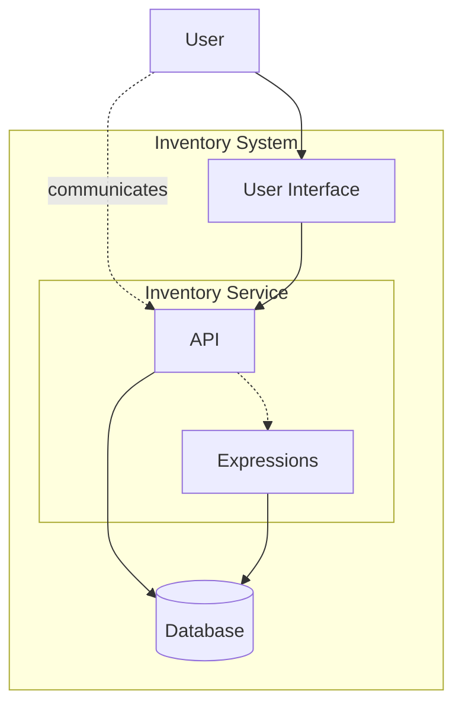
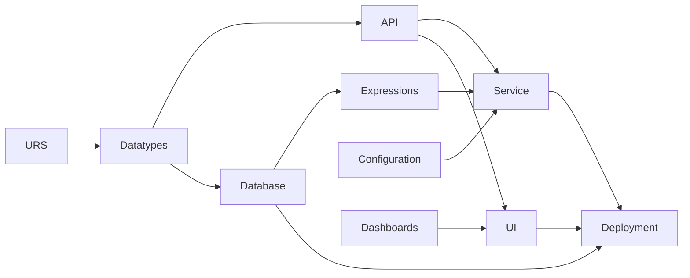

# Inventory Management: Walkthrough

> Generated from Ocean-Atlas v0.1.0 (content 8776e975). Canonical source: https://atlas.ocean-lab.ai/examples/inventory-management/

**Contents**

- [Horizon](#horizon)
- [Voyage](#voyage)

Horizon and Voyage explanation for the Inventory Management example.

Source: https://atlas.ocean-lab.ai/examples/inventory-management/

## Horizon

### Inventory Management at a Glance

#### Business Need

The source specification contains 16 user requirements for inventory visibility and control. The system must distinguish stock statuses and material types, show stock across locations, support material movements, and retain batch, expiry, quantity, and replenishment data.

#### User Requirements Specification

The table below is the source specification for this example. **M** means mandatory and **D** means desirable. The URS IDs are referenced throughout Voyage so you can see how each requirement influences the model.

| URS ID | Requirement | Type |
| --- | --- | --- |
| 1 | Display inventory in statuses such as available, quarantine, restricted, quality hold, in transit, rejected, lost, damaged, blocked, and expired. | M |
| 2 | Show inventory levels and statuses across the network, including central and local depots, sites, and external organizations. | M |
| 3 | Show inventory for raw, semi-finished, intermediate, finished, packaging, and labelling materials. | M |
| 4 | Generate inventory reports by storage location. | M |
| 5 | Manage material movements, including issuing, receiving, storage, dispensing, and returns. | M |
| 6 | Track the end-to-end status of materials through their stages. | M |
| 7 | Define multiple storage locations. | D |
| 8 | Receive and issue inventory into the desired location. | M |
| 9 | Perform periodic counting. | D |
| 10 | Perform cycle counting and produce cycle-count reports. | D |
| 11 | Differentiate available stock from quarantine, blocked, and returned stock. | M |
| 12 | Store minimum, replenishment, and maximum quantities by material and storage type. | M |
| 13 | Alert users about low inventory levels and upcoming expiry events. | D |
| 14 | Allow only available stock to be shipped or moved. | M |
| 15 | Show the status of a material or batch at a given location. | M |
| 16 | Manage expiry dates and batch numbers for every product or material. | M |

#### Architecture



Users manage inventory through an API or user interface. Expressions apply inventory rules, while the database preserves locations, stock, and history information.

#### What It Demonstrates

- Turning numbered requirements into traceable Ocean models.
- Sharing domain types across APIs, persistence, rules, and UI.
- Modeling CRUD, searches, stock operations, and reporting views.
- Separating the system model from its implementation choices.

#### Expected Result

An inventory application that can manage locations and inventory items, search stock by status, location, material type, batch, or expiry date, and perform move, receive, issue, and return operations.

Counting, automatic alerts, enforced shippability, and automatic history creation are modeled as foundations or extension points, but are not all active end-to-end in this version.

## Voyage

### 1. Start from the Requirements

You will use the URS as the starting point and gradually turn its business language into Ocean DSL. Mandatory requirements are marked **M**; desirable requirements are marked **D**.

The model will grow in the following order:



The example uses Gin for the REST API, PostgreSQL for persistence, HTMX and Bootstrap for the UI, and a Docker-oriented PostgreSQL service in deployment. These are realization choices introduced in Voyage; the requirements and Horizon remain technology-independent.

### 2. Model the Inventory Domain

#### Represent the allowed stock statuses

URS 1 and 11 list specific states that users must be able to distinguish. Because those values are fixed, you will model them as an enum rather than unrestricted text.

```ocean-dsl
@datatype

enum ItemStatus
    available
    inQuarantine
    restricted
    qualityHold
    inTransit
    rejected
    lost
    damaged
    blocked
    expired
```

#### Represent the supported material types

URS 3 gives another fixed vocabulary. `MaterialType` ensures that inventory searches, forms, and stored items all use the same six categories.

```text
enum MaterialType
    rawMaterial
    semiFinished
    intermediate
    finishedProduct
    packagingMaterial
    labellingMaterial
```

#### Define a storage location

URS 2 and 7 require inventory across multiple sites and storage locations. A location therefore has its own generated ID, name, site, and warehouse.

```text
Location
    id pattern LOC-UUID
    name: String
    site: String
    warehouse: String
```

#### Define an inventory item

`InvItem` brings the core requirements together. It records material identity and location, expected and counted quantities, replenishment levels, counting information, alerts, batch number, and expiry date.

```text
InvItem
    id pattern II-UUID
    batchId: String
    name: String
    materialType: MaterialType
    location: Location
    status: ItemStatus
    expectedQuantity: Int
    countedQuantity: Int
    lastCountingDate: DateTime
    minLevel: Int
    maxLevel: Int
    replenishmentQuantity: Int
    alertsEnabled: Boolean
    expiryDate: DateTime
```

This type gives URS 12 and 16 a concrete home and provides the data needed for counting and alert extensions in URS 9, 10, and 13.

#### Describe stock operations

Moving, receiving, issuing, and returning stock need different inputs. Small input types make each operation explicit without overloading `InvItem` itself.

```text
MoveItemInput
    itemId: String
    targetLocationId: String
    quantity: Int

ReceiveItemInput
    itemId: String
    quantity: Int

IssueItemInput
    itemId: String
    quantity: Int
    reason: String
    code: String

ReturnItemInput
    itemId: String
    quantity: Int
    reason: String
```

#### Prepare history and counting records

URS 6, 9, and 10 need traceability and counting information. The model defines event types, history records, count inputs, and count summaries so those capabilities can be connected incrementally.

```text
enum ItemEventType
    created
    received
    issued
    returned
    moved
    counted
    statusChanged
    updated
    deleted

ItemHistoryRecord
    id pattern HIST-UUID
    itemId: String
    timestamp: DateTime
    eventType: ItemEventType
    fromLocationId: String
    toLocationId: String
    quantity: Int
    comment: String
```

Afterwards, the domain vocabulary will be ready for API and persistence modeling.

### 3. Define the Inventory API

#### Create the REST API

You will expose the inventory capabilities through `InvMgtApi`. Its metadata selects Gin, connects an API configuration type, uses `/inventory` as the common path, and enables Swagger generation.

```ocean-dsl
@api

InvMgtApi style: rest
    engine = gin
    configType = ApiConfig
    version = 1.0.0
    description = Inventory Management API
    basePath = /inventory
    generateSwagger = true
```

#### Manage locations

URS 7 needs more than a location datatype: users must be able to create, find, update, and remove locations. Searches by site and warehouse also support network-wide visibility from URS 2.

```text
get /location/{id} getLocation(_) : Location
get /locations/{offset}/{limit} listLocations(offset: Int, limit: Int) : List<Location>
get /locations/site/{site} findLocationBySite(site: String) : List<Location>
get /locations/warehouse/{warehouse} findLocationByWarehouse(warehouse: String) : List<Location>

post /location createLocation(loc: Location) : Location
put /location updateLocation(loc: Location) : Location
delete /location/{id} deleteLocation(_) : _
```

#### Manage inventory items

The next endpoints provide the basic CRUD contract for inventory. The same `InvItem` datatype is used as input, output, and later as the stored entity.

```text
get /item/{id} getInvItem(_) : InvItem
get /items/{offset}/{limit} listInvItems(offset: Int, limit: Int) : List<InvItem>
post /item createInvItem(item: InvItem) : InvItem
put /item updateInvItem(item: InvItem) : InvItem
delete /item/{id} deleteInvItem(_) : _
```

#### Search inventory from the URS

URS 1–4, 15, and 16 become typed searches. Users will be able to filter by status, location, material type, expiry date, or batch, and combine a location with a material name or batch ID.

```text
get /items/status/{status} findInvItemsByStatus(status: ItemStatus) : List<InvItem>
get /items/location/{locationId} findInvItemsByLocation(locationId: String) : List<InvItem>
get /items/material-type/{materialType} findInvItemsByMaterialType(materialType: MaterialType) : List<InvItem>
get /items/expiring-before/{expiryDate} findItemsExpiringBefore(expiryDate: DateTime) : List<InvItem>
get /items/batch/{batchId} findItemsByBatchId(batchId: String) : List<InvItem>
```

#### Expose stock movements

URS 5 and 8 describe business actions rather than generic CRUD. Each action gets a dedicated endpoint and the matching input type defined on the previous page.

```text
post /item/move moveItem(input: MoveItemInput) : InvItem
post /item/receive receiveItem(input: ReceiveItemInput) : InvItem
post /item/issue issueItem(input: IssueItemInput) : InvItem
post /item/return returnItem(input: ReturnItemInput) : InvItem
```

#### Expose history

The API also provides history lookups for URS 6. These endpoints can return all records, records for one item, or one event type.

```text
get /item/{id}/history getItemHistory(id: String) : List<ItemHistoryRecord>
get /item/{id}/history/type/{eventType} getItemHistoryByType(id: String, eventType: ItemEventType) : List<ItemHistoryRecord>
get /items/history/{offset}/{limit} listAllItemHistory(offset: Int, limit: Int) : List<ItemHistoryRecord>
```

#### Keep counting as the next increment

Counting endpoints already exist as commented designs. They make the intended URS 9 and 10 contract visible, but they will not be generated until the comments are removed and the remaining flow is completed.

```text
#post /item/count countItem(input: CountItemInput) : InvItem
#get /item/{id}/count-history listItemCountHistory(id: String) : List<CountItemInput>
#get /items/count-summary getCountSummary(_) : List<CountSummary>
```

### 4. Preserve Inventory Data

#### Declare the database

You will use PostgreSQL for this realization. The database declaration selects its engine and the configuration type that will provide the connection details.

```ocean-dsl
@database

Database InvDb
    engine = postgres
    configType = InvMgtDatabaseConfig
    tags = primary
```

#### Store inventory and connect it to locations

`InvItem` becomes an entity keyed by ID. Indexes support the main URS searches, and the many-to-one relationship connects many stock items to one location.

```text
Entity InvItem
    key(id)
    indexes: index(status), index(locationId), index(batchId), index(expiryDate)
    location -m2o-> Location
```

#### Add inventory queries and commands

Queries mirror the API searches, while transactional commands create, update, and delete inventory items.

```text
query findByStatus(status: ItemStatus) : List<InvItem>
query findByLocationId(locationId: String) : List<InvItem>
query findByMaterialType(materialType: MaterialType) : List<InvItem>
query findByBatchId(batchId: String) : List<InvItem>
query findByExpiryDateBefore(expiryDate: DateTime) : List<InvItem>

command T createInvItem(item: InvItem) : InvItem
command T updateInvItem(item: InvItem) : InvItem
command deleteInvItem(id: String) : _
```

#### Store locations

`Location` becomes a second entity. Its unique name and site and warehouse indexes support location management and network searches.

```text
Entity Location
    key(id)
    indexes: unique(name), index(site), index(warehouse)

    query findByName(name: String): List<Location>
    query findBySite(site: String): List<Location>
    query findByWarehouse(warehouse: String): List<Location>

    command T createLocation(item: Location) : Location
    command T updateLocation(item: Location) : Location
    command deleteLocation(id: String) : _
```

#### Store history records

The third entity prepares end-to-end traceability. It can store events for each item and query them by item, type, or time.

```text
Entity ItemHistoryRecord
    key(id)
    indexes: index(itemId), index(eventType), index(timestamp)

    query findByItemId(itemId: String) : List<ItemHistoryRecord>
    query findByItemIdAndEventType(itemId: String, eventType: ItemEventType) : List<ItemHistoryRecord>
    command T createItemHistoryRecord(record: ItemHistoryRecord) : ItemHistoryRecord
```

Afterwards, the example will have persistent operations for stock, locations, and history. Expressions can now coordinate those operations into inventory behavior.

### 5. Express Inventory Rules

#### Capture reusable requirement checks

Several URS statements translate naturally into small Boolean expressions. These helpers describe low stock, shippable status, approaching expiry, count eligibility, and quantity discrepancy.

```text
IsBelowMinLevel
    input: item: InvItem
    output: result: Boolean
    logic
        result = item.countedQuantity < item.minLevel

IsShippable
    input: item: InvItem
    output: result: Boolean
    logic
        result = item.status == ItemStatus.available

IsExpiringBefore
    input: item: InvItem & refDate: DateTime
    output: result: Boolean
    logic
        result = item.expiryDate <= refDate
```

These expressions model parts of URS 13 and 14. In this version they are not yet connected to automatic alerts or the issue operation, so they are foundations rather than enforced end-to-end behavior.

#### Move stock between locations

A movement first validates the quantity, subtracts it from the source, and creates a destination item with the moved quantity and shared batch and material details.

```text
MoveItemExpression
    input: movementItem: MoveItemInput
    output: updatedItem: InvItem
    logic
        src = InvItem.findById(movementItem.itemId)
        if movementItem.quantity <= 0 then
            error "quantity must be a positive number"
        end
        if movementItem.quantity > src.countedQuantity then
            error "quantity exceeds available stock"
        end
        src.countedQuantity = src.countedQuantity - movementItem.quantity
        InvItem.updateInvItem(src)
        # A destination InvItem is then created for targetLocationId.
```

#### Receive, issue, and return quantities

The remaining stock operations follow the same teaching pattern: load the item, validate a positive quantity, update physical and expected quantities where appropriate, then persist the result.

```text
IssueItemExpression
    input: issueItem: IssueItemInput
    output: invItem: InvItem
    logic
        invItem = InvItem.findById(issueItem.itemId)
        if issueItem.quantity > invItem.countedQuantity then
            error "not enough physical stock available"
        end
        invItem.countedQuantity = invItem.countedQuantity - issueItem.quantity
        invItem.expectedQuantity = invItem.expectedQuantity - issueItem.quantity
        InvItem.updateInvItem(invItem)
```

#### Read inventory history

History expressions wrap the generated queries and provide methods the service can connect to API operations.

```text
GetItemHistoryExpression
    input: itemId: String
    output: history: List<ItemHistoryRecord>
    logic
        history = ItemHistoryRecord.findByItemId(itemId)
```

The current movement expressions do not yet create `ItemHistoryRecord` entries. Adding those writes is the next step needed for complete URS 6 traceability.

#### Prepare cycle counting

A counting expression already updates the physical quantity and last count date. It remains disconnected while the commented API and service definitions are completed.

```text
CountItemExpression
    input: countInput: CountItemInput
    output: invItem: InvItem
    logic
        invItem = InvItem.findById(countInput.itemId)
        invItem.countedQuantity = countInput.countedQuantity
        invItem.lastCountingDate = countInput.lastCountingDate
        InvItem.updateInvItem(invItem)
```

### 6. Configure the Components

#### Collect service configuration

The inventory service will need API, database, and logging settings. You will group them into one configuration contract.

```ocean-dsl
@config

@import config O.log.config@1.0.0 as LogConfig

InvMgtConfig
    apiConfig : ApiConfig
    dbConfig  : InvMgtDatabaseConfig
    logConfig : LogConfig
```

#### Configure API and UI ports

Small configuration types make both exposed components portable across environments while keeping useful local defaults.

```text
ApiConfig
    port: Int (default=8080)

UiConfig
    port: Int (default=8080)
    logConfig : LogConfig
```

#### Configure PostgreSQL

Database settings include the connection URL, credentials, SSL choice, and retry behavior used while the runtime starts.

```text
InvMgtDatabaseConfig
    url: String (default=jdbc:postgresql://localhost:5432)
    user: String (default=inv_mgt_user)
    pass: String (default=inv_mgt_pass)
    sslMode: Boolean (default=false)
    retriesNo: Int (default=10)
    retriesDelaySec: Int (default=30)
```

### 7. Wire the Inventory Service

#### Assemble the service

`InvMgtService` will combine the configuration, API, database, and stock-operation expressions into one backend boundary.

```ocean-dsl
@service

InvMgtService
    use config InvMgtConfig as myCfg
    impl api InvMgtApi as api on myCfg.apiConfig.port
    use database InvDb as invDb

    use expression MoveItemExpression
    use expression ReceiveItemExpression
    use expression IssueItemExpression
    use expression ReturnItemExpression
```

#### Connect straightforward CRUD and searches

Operations that need no extra business rule can connect directly to generated entity queries and commands.

```text
connect api.getLocation -> Location.findById
connect api.createLocation -> Location.createLocation

connect api.getInvItem -> InvItem.findById
connect api.findInvItemsByStatus -> InvItem.findByStatus
connect api.findInvItemsByLocation -> InvItem.findByLocationId
connect api.findInvItemsByMaterialType -> InvItem.findByMaterialType
connect api.createInvItem -> InvItem.createInvItem
```

#### Connect stock operations through expressions

Movement endpoints need validation and multiple persistence steps, so they are routed through the expressions defined earlier.

```text
connect api.moveItem -> MoveItemExpression
connect api.receiveItem -> ReceiveItemExpression
connect api.issueItem -> IssueItemExpression
connect api.returnItem -> ReturnItemExpression
```

#### Connect history reads

History endpoints are routed through their query expressions. Counting connections remain commented until that extension is completed.

```text
connect api.getItemHistory -> GetItemHistoryExpression
connect api.getItemHistoryByType -> GetItemHistoryByTypeExpression
connect api.listAllItemHistory -> ListAllItemHistoryExpression

#connect api.countItem -> CountItemExpression
```

Afterwards, API calls will have a clear route either directly to persistence or through inventory business logic.

### 8. Build Inventory Dashboards and UI

#### Organize the main workflows

The example provides separate dashboards for inventory, locations, history, and application information. The inventory dashboard combines a table with forms for searching, CRUD, and stock movements.

```ocean-dsl
@dashboard

InventoryDashboard
    title: 📦 Inventory
    layout: SingleColumnLayout

    Widget InvTable of type Table
        title = Inventory Items
        limit = 5
```

#### Describe a movement form

Dashboard fields reuse the operation input types conceptually. For a movement, users provide an item, target location, and quantity.

```text
Widget MoveInvItemForm of type Form
    title = Move Inventory Item
    fields:
        - itemId String
        - targetLocationId String
        - quantity Int
    buttons:
        submit : 🔁 Move Inventory Item
```

#### Select the UI technology

The UI realization uses HTMX, Bootstrap, Go HTML templates, and a Gin backend. It receives its port and logging settings through `UiConfig`.

```ocean-dsl
@ui

InvMgtUi
    framework: htmx
    styling: bootstrap
    template: go-html-template
    backend: go-gin
    configType: UiConfig
```

#### Add dashboard navigation

Each major workflow becomes a navigation entry, giving users focused spaces for stock, history, and location management.

```text
nav Inventory dashboard = InventoryDashboard
nav History dashboard = HistoryDashboard
nav Location dashboard = LocationDashboard
nav About dashboard = AboutDashboard
```

#### Connect UI actions to the API

Tables and forms reuse the API contract. The UI therefore adds no second set of inventory operations.

```text
connect inv.InvTable.listRows -> InvMgtApi.listInvItems
connect inv.MoveInvItemForm.submit -> InvMgtApi.moveItem
connect inv.ReceiveInvItemForm.submit -> InvMgtApi.receiveItem
connect inv.IssueInvItemForm.submit -> InvMgtApi.issueItem
connect inv.ReturnInvItemForm.submit -> InvMgtApi.returnItem
connect his.HisTable.listRows -> InvMgtApi.listAllItemHistory
```

### 9. Define Deployment

#### Provide the database runtime

You will import Ocean's packaged PostgreSQL service and expose it as the inventory database runtime.

```ocean-dsl
@deploy

@import service P.db.postgres.docker@1.0.0 as PostgresqlDB

InvMgtDatabase
    service PostgresqlDB
```

#### Deploy the inventory service

The backend runs with two replicas, exports its API on port 9092, and waits for the database dependency.

```text
InvMgtDeploy
    service     InvMgtService
    replica     2
    export      9092:InvMgtService.api
    dependsOn   InvMgtDatabase
```

#### Deploy the UI

The UI runs separately on port 8082 and depends on the inventory backend.

```text
InvMgtUiDeploy
    service     InvMgtUi
    replica     1
    export      8082:InvMgtUi.config
    dependsOn   InvMgtDeploy
```

Afterwards, the concrete topology will be ready: UI → inventory service → database.

### 10. Validate and Explore

After reviewing the model, you can add the example to your workspace and explore the generated application.

1. Open the `Inventory Management` example in Ocean-lab.
2. Validate the complete model and inspect any reported references.
3. Generate the API, persistence, UI, and deployment artifacts.
4. Follow the generated `Readme.md` to start the system.
5. Open the API documentation at `localhost:9092/swagger/index.html`.
6. Open the user interface at `localhost:8082`.
7. Create locations, then create inventory items assigned to them.
8. Search by status, material type, location, batch, and expiry.
9. Try receive, issue, return, and move operations.

### 11. Conclusion and Next Steps

By the end of this example, you will have seen how numbered user requirements can become one connected Ocean model. Afterwards, you should understand how to:

- translate requirement vocabularies into datatypes and enums;
- turn business searches and actions into typed API operations;
- design related entities, indexes, queries, and commands;
- use expressions for multi-step inventory operations;
- connect backend capabilities to dashboards and deployment;
- identify the difference between modeled and fully wired behavior.

Useful next steps are to create history records during every stock operation, activate cycle counting and count summaries, connect low stock and expiry alerts, and call `IsShippable` before issuing or moving stock. Those changes would close the remaining URS gaps without changing the foundation of the model.
