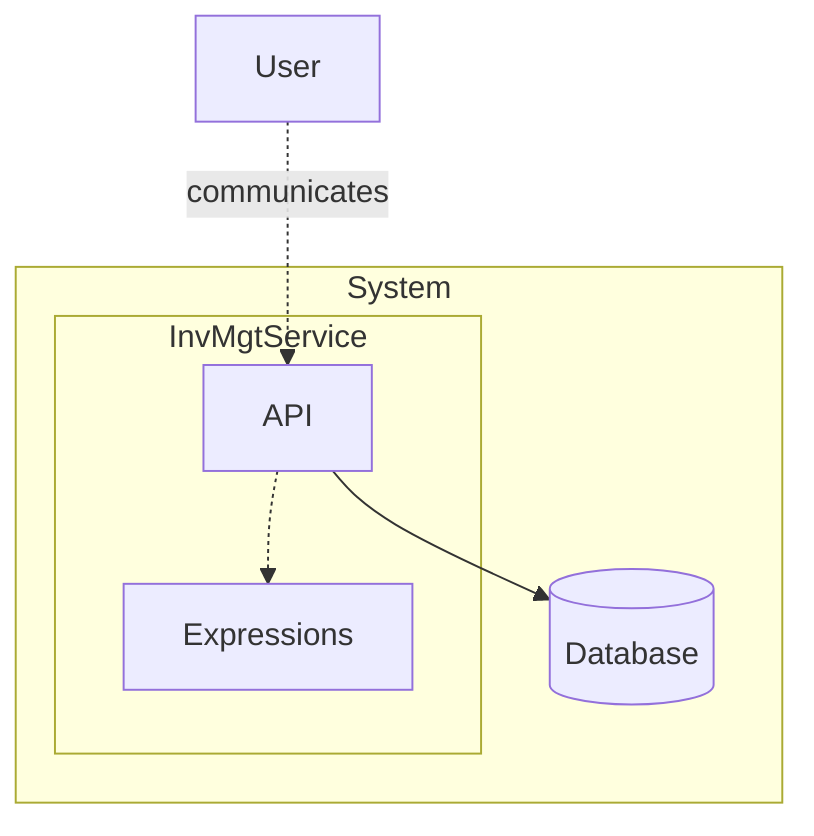

# Inventory Management

> Generated from Ocean-Atlas v0.1.0 (content a0c57f8d). Canonical source: https://atlas.ocean-lab.ai/examples/inventory-management/

**Contents**

- [Overview](#overview)
- [Files](#files)
- [DSL source files](#dsl-source-files)
- [Diagrams](#diagrams)
- [Walkthrough](#walkthrough)
- [Other files in the example (not inlined)](#other-files-in-the-example-not-inlined)

Model inventory visibility, locations, material types, stock movements, batch tracking, expiry, and replenishment levels.

Source: https://atlas.ocean-lab.ai/examples/inventory-management/

Level: medium · Estimated time: 15 minutes · Version: 1.0.0 · Onboarding example: no

Components: 1 services, 0 brokers, 1 databases

Tags: api, crud, database, expressions, inventory, management, requirements, rest, ui

## Overview

This example shows how a set of inventory requirements becomes a connected Ocean model covering domain types, persistence, APIs, expressions, services, and user-facing views. Its executable DSL and its Horizon and Voyage explanation are maintained together in this example directory.

## Files

DSL source comes first, then diagrams; the long Horizon and Voyage walkthroughs are at the end. You can stop after the source files.

| File | Section | Lines |
| --- | --- | --- |
| `00-inv-info.ocn` | `@info` | 13 |
| `10-inv-dt.ocn` | `@datatype` | 110 |
| `100-inv-deploy.ocn` | `@deploy` | 29 |
| `20-inv-db.ocn` | `@database` | 76 |
| `30-inv-exp.ocn` | `@expression` | 54 |
| `31-inv-exp-2.ocn` | `@expression` | 144 |
| `40-inv-config.ocn` | `@config` | 32 |
| `50-inv-api.ocn` | `@api` | 72 |
| `75-dashborad.ocn` | `@dashboard` | 422 |
| `76-ui.ocn` | `@ui` | 71 |
| `90-inv-service.ocn` | `@service` | 92 |

## DSL source files

### `00-inv-info.ocn`

```ocean-dsl
# @ocean-meta-start
# tags:
#   - documentation
# perspective:
#   feature: inventory-management
# @ocean-meta-end

@info

name: Inventory Management
version: 1.0.0
description: The Inventory Management application enables complete visibility and control of materials across the supply network, supporting multiple inventory statuses such as unrestricted, quarantine, blocked, and in-transit.<br><br>It provides multi-location management, material movements, periodic and cycle counting, batch and expiry tracking, threshold-based alerts, and reporting by storage location and material type.
```

### `10-inv-dt.ocn`

```ocean-dsl
# @ocean-meta-start
# tags:
#   - inventory-management
#   - datatype
# perspective:
#   feature: inventory-management
# @ocean-meta-end

@datatype

enum ItemStatus
    available
    inQuarantine
    restricted
    qualityHold
    inTransit
    rejected
    lost
    damaged
    blocked
    expired

enum MaterialType
    rawMaterial
    semiFinished
    intermediate
    finishedProduct
    packagingMaterial
    labellingMaterial

InvItem
    id pattern II-UUID
    batchId: String
    name: String
    materialType: MaterialType
    location: Location
    status: ItemStatus
    expectedQuantity: Int
    countedQuantity: Int
    lastCountingDate: DateTime
    minLevel: Int
    maxLevel: Int
    replenishmentQuantity: Int
    alertsEnabled: Boolean
    expiryDate: DateTime

Location
    id pattern LOC-UUID
    name: String
    site: String
    warehouse: String

CountItemInput
    itemId: String
    countedQuantity: Int
    lastCountingDate: DateTime

MoveItemInput
    itemId: String
    targetLocationId: String
    quantity: Int

ReceiveItemInput
    itemId: String
    quantity: Int

ReturnItemInput
    itemId: String
    quantity: Int
    reason: String

IssueItemInput
    itemId: String
    quantity: Int
    reason: String
    code: String

ItemHistoryRecord
    id pattern HIST-UUID
    itemId: String
    timestamp: DateTime
    eventType: ItemEventType
    fromLocationId: String
    toLocationId: String
    fromStatus: ItemStatus
    toStatus: ItemStatus
    quantity: Int
    comment: String

enum ItemEventType
    created
    received
    issued
    returned
    moved
    counted
    statusChanged
    updated
    deleted

CountSummary
    id pattern CNT-UUID
    itemId: String
    name: String
    locationId: String
    expectedQuantity: Int
    countedQuantity: Int
    lastCountingDate: DateTime
    discrepancy: Int
```

### `100-inv-deploy.ocn`

```ocean-dsl
# @ocean-meta-start
# tags:
#   - deployment
# perspective:
#   feature: inventory-management
#   service: all
# @ocean-meta-end

@deploy

Name: InvMgt-deploy

@import service P.db.postgres.docker@1.0.0 as PostgresqlDB

InvMgtDeploy
    service     InvMgtService
    replica     2
    export      9092:InvMgtService.api
    dependsOn   InvMgtDatabase

InvMgtDatabase
    service     PostgresqlDB

InvMgtUiDeploy
    service     InvMgtUi
    replica     1
    export      8082:InvMgtUi.config
    dependsOn   InvMgtDeploy
```

### `20-inv-db.ocn`

```ocean-dsl
# @ocean-meta-start
# tags:
#   - database
#   - postgres
# perspective:
#   feature: inventory-management
#   service: inv-mgt-service
# @ocean-meta-end

@database

Database InvDb
    engine = postgres
    configType = InvMgtDatabaseConfig
    tags = primary

    # ---------------------------------------------------
    # InvItem Entity
    # ---------------------------------------------------
    Entity InvItem
        key(id)
        indexes: index(status), index(locationId), index(batchId), index(expiryDate)

        # Relations
        location -m2o-> Location

        # Queries
        query listInvItems(offset:Int, limit:Int) : List<InvItem>
        query findById(id: String) : InvItem
        query findByStatus(status: ItemStatus) : List<InvItem>
        query findByLocationId(locationId: String) : List<InvItem>
        query findByMaterialType(materialType: MaterialType) : List<InvItem>
        query findByBatchId(batchId: String) : List<InvItem>
        query findByExpiryDateBefore(expiryDate: DateTime) : List<InvItem>
        query findByLocationAndName(locationId: String, name: String) : List<InvItem>
        query findByLocationAndBatchId(locationId: String, batchId: String) : List<InvItem>

        # Commands
        command T createInvItem(item: InvItem) : InvItem
        command T updateInvItem(item: InvItem) : InvItem
        command deleteInvItem(id: String) : _

    # ---------------------------------------------------
    # Location Entity
    # ---------------------------------------------------
    Entity Location
        key(id)
        indexes: unique(name), index(site), index(warehouse)

        # Queries
        query listLocations(offset:Int, limit:Int) : List<Location>
        query findById(id: String) : Location
        query findByName(name: String): List<Location>
        query findBySite(site: String): List<Location>
        query findByWarehouse(warehouse: String): List<Location>

        # Commands
        command T createLocation(item: Location) : Location
        command T updateLocation(item: Location) : Location
        command deleteLocation(id: String) : _

    # ---------------------------------------------------
    # ItemHistoryRecord Entity
    # ---------------------------------------------------
    Entity ItemHistoryRecord
        key(id)
        indexes: index(itemId), index(eventType), index(timestamp)

        # Queries
        query findByItemId(itemId: String) : List<ItemHistoryRecord>
        query findByItemIdAndEventType(itemId: String, eventType: ItemEventType) : List<ItemHistoryRecord>
        query listAll(offset:Int, limit:Int) : List<ItemHistoryRecord>

        # Commands
        command T createItemHistoryRecord(record: ItemHistoryRecord) : ItemHistoryRecord
```

### `30-inv-exp.ocn`

```ocean-dsl
# @ocean-meta-start
# tags:
#   - expression
# perspective:
#   feature: inventory-management
#   target: generic check
#   service: inv-mgt-service
# @ocean-meta-end

@expression

# Check if the item's stock is below minimum threshold
IsBelowMinLevel
    input: item: InvItem
    output: result: Boolean
    logic
        result = item.countedQuantity < item.minLevel

# Check if the item can be shipped (e.g., only from unrestricted/available stock)
IsShippable
    input: item: InvItem
    output: result: Boolean
    logic
        result = item.status == ItemStatus.available


# Check if the item is approaching its expiry date (based on a reference date)
IsExpiringBefore
    input: item: InvItem & refDate: DateTime
    output: result: Boolean
    logic
        result = item.expiryDate <= refDate

# Check if the item is currently available for counting (e.g., based on status)
IsCountable
    input: item: InvItem
    output: result: Boolean
    logic
        result = item.status != ItemStatus.blocked AND item.status != ItemStatus.restricted

# Check if a stock movement is allowed (status, location, and quantity > 0)
CanMoveItem
    input: item: InvItem & targetLocation: Location & quantity: Int
    output: result: Boolean
    logic
        result = quantity > 0 AND item.location.id != targetLocation.id

# Determine if item has any discrepancy between expected and counted
HasDiscrepancy
    input: item: InvItem
    output: result: Boolean
    logic
        result = item.countedQuantity != item.expectedQuantity
```

### `31-inv-exp-2.ocn`

```ocean-dsl
# @ocean-meta-start
# tags:
#   - expression
# perspective:
#   feature: inventory-management
#   target: service specific
#   service: inv-mgt-service
# @ocean-meta-end

@expression

# -------------------------
# Inventory Item Movement / Stock Operations
# -------------------------

MoveItemOldExpression
    input: movementItem: MoveItemInput
    output: updatedItem: InvItem
    logic
        invItem = InvItem.findById(movementItem.itemId)
        invItem.locationId = movementItem.targetLocationId
        InvItem.updateInvItem(invItem)
        updatedItem = InvItem.findById(movementItem.itemId)

MoveItemExpression
    input: movementItem: MoveItemInput
    output: updatedItem: InvItem
    logic
        src = InvItem.findById(movementItem.itemId)

        if movementItem.quantity <= 0 then
            error "quantity must be a positive number"
        end

        if movementItem.quantity > src.countedQuantity then
            error "quantity exceeds available stock"
        end

        src.countedQuantity = src.countedQuantity - movementItem.quantity
        src.expectedQuantity = src.expectedQuantity - movementItem.quantity
        InvItem.updateInvItem(src)

        var dest InvItem
        dest.batchId = src.batchId
        dest.name = src.name
        dest.materialType = src.materialType
        dest.locationId = movementItem.targetLocationId
        dest.status = src.status
        dest.expectedQuantity = movementItem.quantity
        dest.countedQuantity = 0
        dest.minLevel = src.minLevel
        dest.maxLevel = src.maxLevel
        dest.replenishmentQuantity = src.replenishmentQuantity
        dest.alertsEnabled = src.alertsEnabled
        dest.expiryDate = src.expiryDate

        InvItem.createInvItem(dest)

        updatedItem = InvItem.findById(movementItem.itemId)


ReceiveItemExpression
    input: receiveItem: ReceiveItemInput
    output: invItem: InvItem
    logic
        invItem = InvItem.findById(receiveItem.itemId)
        if receiveItem.quantity <= 0 then
            error "quantity must be a positive number"
        end
        invItem.countedQuantity = invItem.countedQuantity + receiveItem.quantity
        InvItem.updateInvItem(invItem)
        invItem = InvItem.findById(receiveItem.itemId)

IssueItemExpression
    input: issueItem: IssueItemInput
    output: invItem: InvItem
    logic
        invItem = InvItem.findById(issueItem.itemId)
        if issueItem.quantity <= 0 then
            error "quantity must be a positive number"
        end
        if issueItem.quantity > invItem.countedQuantity then
            error "not enough physical stock available"
        end
        invItem.countedQuantity = invItem.countedQuantity - issueItem.quantity
        invItem.expectedQuantity = invItem.expectedQuantity - issueItem.quantity
        InvItem.updateInvItem(invItem)
        invItem = InvItem.findById(issueItem.itemId)

ReturnItemExpression
    input: returnItem: ReturnItemInput
    output: invItem: InvItem
    logic
        invItem = InvItem.findById(returnItem.itemId)
        if returnItem.quantity <= 0 then
            error "quantity must be a positive number"
        end
        invItem.countedQuantity = invItem.countedQuantity + returnItem.quantity
        invItem.expectedQuantity = invItem.expectedQuantity + returnItem.quantity
        InvItem.updateInvItem(invItem)
        invItem = InvItem.findById(returnItem.itemId)

# -------------------------
# Inventory Item History
# -------------------------

GetItemHistoryExpression
    input: itemId: String
    output: history: List<ItemHistoryRecord>
    logic
        history = ItemHistoryRecord.findByItemId(itemId)

GetItemHistoryByTypeExpression
    input: itemId: String & eventType: ItemEventType
    output: history: List<ItemHistoryRecord>
    logic
        history = ItemHistoryRecord.findByItemIdAndEventType(itemId, eventType)

ListAllItemHistoryExpression
    input: offset: Int & limit: Int
    output: history: List<ItemHistoryRecord>
    logic
        history = ItemHistoryRecord.listAll(offset, limit)

# -------------------------
# Inventory Counting / Cycle Counting
# -------------------------

CountItemExpression
    input: countInput: CountItemInput
    output: invItem: InvItem
    logic
        invItem = InvItem.findById(countInput.itemId)
        invItem.countedQuantity = countInput.countedQuantity
        invItem.lastCountingDate = countInput.lastCountingDate
        InvItem.updateInvItem(invItem)

ListItemCountHistoryExpression
    input: itemId: String
    output: history: List<ItemHistoryRecord>
    logic
        history = ItemHistoryRecord.findByItemId(itemId)
```

### `40-inv-config.ocn`

```ocean-dsl
# @ocean-meta-start
# tags:
#   - configuration
# perspective:
#   feature: inventory-management
#   service: all
# @ocean-meta-end

@config

@import config O.log.config@1.0.0 as LogConfig

InvMgtConfig
    apiConfig : ApiConfig
    dbConfig  : InvMgtDatabaseConfig
    logConfig : LogConfig

ApiConfig
    port: Int (default=8080)

UiConfig
    port: Int (default=8080)
    logConfig : LogConfig

InvMgtDatabaseConfig
    url: String (default=jdbc:postgresql://localhost:5432)
    user: String (default=inv_mgt_user)
    pass: String (default=inv_mgt_pass)
    sslMode: Boolean (default=false)
    retriesNo: Int (default=10)
    retriesDelaySec: Int (default=30)
```

### `50-inv-api.ocn`

```ocean-dsl
# @ocean-meta-start
# tags:
#   - inv-mgt-api
#   - rest-api
# perspective:
#   feature: inventory-management
#   service: inv-mgt-service
# @ocean-meta-end

@api

InvMgtApi style: rest
    engine = gin
    configType = ApiConfig
    tags = external
    version = 1.0.0
    description = Inventory Management API
    basePath = /inventory
    generateSwagger = true

    # -------------------------
    # Location Endpoints
    # -------------------------
    get    /location/{id}                      getLocation(_) : Location
    get    /locations/{offset}/{limit}         listLocations(offset: Int, limit: Int) : List<Location>
    get    /locations/name/{name}              findLocationByName(name: String) : List<Location>
    get    /locations/site/{site}              findLocationBySite(site: String) : List<Location>
    get    /locations/warehouse/{warehouse}    findLocationByWarehouse(warehouse: String) : List<Location>

    post   /location                           createLocation(loc: Location) : Location
    put    /location                           updateLocation(loc: Location) : Location
    delete /location/{id}                      deleteLocation(_) : _

    # -------------------------
    # Inventory Item Endpoints
    # -------------------------
    get    /item/{id}                          getInvItem(_) : InvItem
    get    /items/{offset}/{limit}             listInvItems(offset: Int, limit: Int) : List<InvItem>

    get    /items/status/{status}              findInvItemsByStatus(status: ItemStatus) : List<InvItem>
    get    /items/location/{locationId}        findInvItemsByLocation(locationId: String) : List<InvItem>
    get    /items/material-type/{materialType} findInvItemsByMaterialType(materialType: MaterialType) : List<InvItem>
    get    /items/expiring-before/{expiryDate} findItemsExpiringBefore(expiryDate: DateTime) : List<InvItem>
    get    /items/batch/{batchId}              findItemsByBatchId(batchId: String) : List<InvItem>

    post   /item                               createInvItem(item: InvItem) : InvItem
    put    /item                               updateInvItem(item: InvItem) : InvItem
    delete /item/{id}                          deleteInvItem(_) : _

    post   /item/move                          moveItem(input: MoveItemInput) : InvItem
    post   /item/receive                       receiveItem(input: ReceiveItemInput) : InvItem
    post   /item/issue                         issueItem(input: IssueItemInput) : InvItem
    post   /item/return                        returnItem(input: ReturnItemInput) : InvItem

    get /items/location/{locationId}/name/{name}     findInvItemsByLocationAndName(locationId: String, name: String) : List<InvItem>
    get /items/location/{locationId}/batch/{batchId} findInvItemsByLocationAndBatch(locationId: String, batchId: String) : List<InvItem>

    # -------------------------
    # Inventory Item History Endpoints
    # -------------------------
    get    /item/{id}/history                  getItemHistory(id: String) : List<ItemHistoryRecord>
    get    /item/{id}/history/type/{eventType} getItemHistoryByType(id: String, eventType: ItemEventType) : List<ItemHistoryRecord>
    get    /items/history/{offset}/{limit}     listAllItemHistory(offset: Int, limit: Int) : List<ItemHistoryRecord>

    # -------------------------
    # Counting / Cycle Count Endpoints
    # -------------------------

    #post   /item/count                         countItem(input: CountItemInput) : InvItem
    #get    /item/{id}/count-history            listItemCountHistory(id: String) : List<CountItemInput>
    #get    /items/count-summary                getCountSummary(_) : List<CountSummary>
```

### `75-dashborad.ocn`

```ocean-dsl
# @ocean-meta-start
# tags:
#   - dashboard
#   - ui
# perspective:
#   service: ui-service
# @ocean-meta-end

@dashboard

InventoryDashboard
    title: 📦 Inventory
    subtitle: Manage your inventory items!
    layout: SingleColumnLayout

    Widget InvTable of type Table
        title = Inventory Items
        limit = 5
        columns:
            - id                    String
            - batchId               String
            - name                  String
            - materialType          MaterialType
            - location              Location
            - status                ItemStatus
            - expectedQuantity      Int
            - countedQuantity       Int
            - lastCountingDate      DateTime
            - minLevel              Int
            - maxLevel              Int
            - replenishmentQuantity Int
            - alertsEnabled         Boolean
            - expiryDate            DateTime

    Widget S50 of type Separator
        size = lg
        style = solid
        label = MANAGE

    Widget ManageInvItemText of type Text
        subtitle = To manage the inventory items!
        content = Here you can manage inventory items via <b>move</b>, <b>receive</b>, <b>issue</b>, or <b>return</b> actions.

    Widget S51 of type Separator
        size = md
        style = solid
        
    Widget MoveInvItemForm of type Form
        title = Move Inventory Item
        fields:
            - itemId String
            - targetLocationId String
            - quantity Int
        buttons:
            submit : 🔁 Move Inventory Item

    Widget S52 of type Separator
        size = md
        style = solid
        
    Widget ReceiveInvItemForm of type Form
        title = Receive Inventory Item
        fields:
            - itemId String
            - quantity Int
        buttons:
            submit : 📥 Receive Inventory Item

    Widget S53 of type Separator
        size = md
        style = solid
        
    Widget IssueInvItemForm of type Form
        title = Issue Inventory Item
        fields:
            - itemId String
            - quantity Int
            - reason String
            - code String

        buttons:
            submit : ➡️ Issue Inventory Item

    Widget S54 of type Separator
        size = md
        style = solid
        
    Widget ReturnInvItemForm of type Form
        title = Return Inventory Item
        fields:
            - itemId String
            - quantity Int
            - reason String

        buttons:
            submit : ↩️ Return Inventory Item

    Widget S30 of type Separator
        size = lg
        style = solid
        label = SEARCH

    Widget SearchText of type Text
        subtitle = To find the inventory items!
        content = Here you can search based on <b>ID</b>, <b>Status</b>, <b>Location ID</b>, <b>Material Type</b>, or <b>Batch ID</b>.

    Widget S31 of type Separator
        size = md
        style = solid
        
    Widget FindInvByIdForm of type Form
        title = Find Inventory Item By ID
        fields:
            - id String
        buttons:
            submit : 🔍 Find by ID

    Widget S32 of type Separator
        size = md
        style = solid
        
    Widget FindInvByStatusForm of type Form
        title = Find Inventory Item By Status
        fields:
            - status ItemStatus
        buttons:
            submit : 🔍 Find by Status

    Widget S33 of type Separator
        size = md
        style = solid
        
    Widget FindInvByLocIdForm of type Form
        title = Find Inventory Item By Location-ID
        fields:
            - locationId String
        buttons:
            submit : 🔍 Find by Location-ID

    Widget S34 of type Separator
        size = md
        style = solid
        
    Widget FindInvByMatTypeForm of type Form
        title = Find Inventory Item By Material Type
        fields:
            - materialType MaterialType
        buttons:
            submit : 🔍 Find by Material Type

    Widget S35 of type Separator
        size = md
        style = solid
        
    Widget FindInvByExpiringDateForm of type Form
        title = Find Inventory Item By Expiring Date
        fields:
            - expiryDate DateTime
        buttons:
            submit : 🔍 Find by Expiring Date

    Widget S36 of type Separator
        size = md
        style = solid
        
    Widget FindInvByBatchIdForm of type Form
        title = Find Inventory Item By Batch-ID
        fields:
            - batchId String
        buttons:
            submit : 🔍 Find by Batch-ID


    Widget S37 of type Separator
        size = lg
        style = solid
        label = CRUD

    Widget CrudInvText of type Text
        subtitle = To Create/Update/Delete inventory items!
        content = Here you can <b>Create</b>, <b>Update</b>, or <b>Delete</b> inventory items.

    Widget S38 of type Separator
        size = md
        style = solid
        label = CREATE

    Widget CreateInvItemForm of type Form
        title = Create New Inventory Item
        fields:
            - batchId               String
            - name                  String
            - materialType          MaterialType
            - locationId            String
            - status                ItemStatus
            - expectedQuantity      Int
            - countedQuantity       Int
            - lastCountingDate      DateTime
            - minLevel              Int
            - maxLevel              Int
            - replenishmentQuantity Int
            - alertsEnabled         Boolean
            - expiryDate            DateTime
        buttons:
            submit : ➕ Create Inventory Item

    Widget S39 of type Separator
        size = md
        style = solid
        label = UPDATE

    Widget UpdateInvItemForm of type Form
        title = Update Inventory Item
        fields:
            - id                    String
            - batchId               String
            - name                  String
            - materialType          MaterialType
            - locationId            String
            - status                ItemStatus
            - expectedQuantity      Int
            - countedQuantity       Int
            - lastCountingDate      DateTime
            - minLevel              Int
            - maxLevel              Int
            - replenishmentQuantity Int
            - alertsEnabled         Boolean
            - expiryDate            DateTime
        buttons:
            submit : ✏️ Update Inventory Item
            fetch : 🔄 Fetch Item by ID
            cancel : 🧹 Clear

    Widget S40 of type Separator
        size = md
        style = solid
        label = DELETE

    Widget DeleteInvItemForm of type Form
        title = Delete Inventory Item
        fields:
            - id        String
        buttons:
            submit : ❌ Delete Inventory Item


LocationDashboard
    title: 📍 Locations
    subtitle: Manage all your inventory locations!
    layout: SingleColumnLayout

    Widget LocTable of type Table
        title = Locations
        limit = 5
        columns:
            - id        String
            - name      String
            - site      String
            - warehouse String

    Widget S1 of type Separator
        size = lg
        style = solid
        label = SEARCH

    Widget SearchText of type Text
        subtitle = To find the desired locations!
        content = Here you can search based on <b>Name</b>, <b>Site</b>, or <b>Warehouse</b>.


    Widget S2 of type Separator
        size = md
        style = solid
        
    Widget FindLocByNameForm of type Form
        title = Find Location By Name
        fields:
            - name String
        buttons:
            submit : 🔍 Find by Name

    Widget S2_1 of type Separator
        size = md
        style = solid

    Widget FindLocationBySiteForm of type Form
        title = Find Location By Site
        fields:
            - site String
        buttons:
            submit : 🔍 Find by Site

    Widget S3 of type Separator
        size = md
        style = solid

    Widget FindLocationByWarehouseForm of type Form
        title = Find Location By Warehouse
        fields:
            - warehouse String
        buttons:
            submit : 🔍 Find by Warehouse

    Widget S4 of type Separator
        size = lg
        style = solid
        label = CRUD

    Widget CrudLocationText of type Text
        subtitle = To Create/Update/Delete your locations!
        content = Here you can <b>Create</b>, <b>Update</b>, or <b>Delete</b> locations.

    Widget S5 of type Separator
        size = md
        style = solid
        label = CREATE

    Widget CreateLocationForm of type Form
        title = Create New Locations
        fields:
            - name      String
            - site      String
            - warehouse String
        buttons:
            submit : ➕ Create Location

    Widget S6 of type Separator
        size = md
        style = solid
        label = UPDATE

    Widget UpdateLocationForm of type Form
        title = Update Locations
        fields:
            - id        String
            - name      String
            - site      String
            - warehouse String
        buttons:
            submit : ✏️ Update Location
            fetch : 🔄 Fetch Location by ID

    Widget S7 of type Separator
        size = md
        style = solid
        label = DELETE

    Widget DeleteLocationForm of type Form
        title = Delete Locations
        fields:
            - id        String
        buttons:
            submit : ❌ Delete Location


HistoryDashboard
    title: 📜 History
    subtitle: Inventory Items History
    layout: SingleColumnLayout

    Widget HisTable of type Table
        title = History
        limit = 5
        columns:
            - id             String
            - itemId         String
            - timestamp      DateTime
            - eventType      ItemEventType
            - fromLocationId String
            - toLocationId   String
            - fromStatus     ItemStatus
            - toStatus       ItemStatus
            - quantity       Int
            - comment        String

    Widget S20 of type Separator
        size = lg
        style = solid
        label = SEARCH

    Widget SearchHistText of type Text
        subtitle = To find inventory items history
        content = Here you can search based on <b>ID</b> and/or <b>Event Type</b>.


    Widget S21 of type Separator
        size = md
        style = solid
        
    Widget FindHisByIdForm of type Form
        title = Find History By ID
        fields:
            - id String
        buttons:
            submit : 🔍 Find by ID

    Widget S22 of type Separator
        size = md
        style = solid

    Widget FindHisByIdAndEventTypeForm of type Form
        title = Find History By Event Type
        fields:
            - id String
            - eventType ItemEventType
        buttons:
            submit : 🔍 Find by Event Type


AboutDashboard
    title: ℹ️ About
    subtitle: App information!
    layout: SingleColumnLayout

    Widget AboutText of type Text
        title = About Inventory Management App 📦
        subtitle = version 1.0.0
        content = The Inventory Management application enables complete visibility and control of materials across the supply network, supporting multiple inventory statuses such as unrestricted, quarantine, blocked, and in-transit.<br><br>It provides multi-location management, material movements, periodic and cycle counting, batch and expiry tracking, threshold-based alerts, and reporting by storage location and material type.
```

### `76-ui.ocn`

```ocean-dsl
# @ocean-meta-start
# tags:
#   - ui
# perspective:
#   feature: inventory-management
#   service: ui-service
# @ocean-meta-end

@ui

InvMgtUi

    @perspectives: version:0.1.0, lifestyle:stable

    framework: htmx
    styling: bootstrap
    template: go-html-template
    backend: go-gin
    static: static
    configType: UiConfig

    nav Inventory dashboard = InventoryDashboard
    nav History dashboard = HistoryDashboard
    nav Location dashboard = LocationDashboard
    nav About dashboard = AboutDashboard

    header title = 📦 Inventory Management App!
    header subtitle = Managing inventory made simple 😊
    header align = center

    footer title = ⚡ Built with Ocean-lab
    footer subtitle = Version 1.0.0
    footer align = center

    use dashboard InventoryDashboard as inv
    use dashboard HistoryDashboard as his
    use dashboard LocationDashboard as loc
    use dashboard AboutDashboard as about

    use api InvMgtApi

    connect loc.LocTable.listRows -> InvMgtApi.listLocations
    connect loc.FindLocByNameForm.submit -> InvMgtApi.findLocationByName
    connect loc.FindLocationBySiteForm.submit -> InvMgtApi.findLocationBySite
    connect loc.FindLocationByWarehouseForm.submit -> InvMgtApi.findLocationByWarehouse
    connect loc.CreateLocationForm.submit -> InvMgtApi.createLocation
    connect loc.UpdateLocationForm.submit -> InvMgtApi.updateLocation
    connect loc.UpdateLocationForm.fetch -> InvMgtApi.getLocation
    connect loc.DeleteLocationForm.submit -> InvMgtApi.deleteLocation

    connect his.HisTable.listRows -> InvMgtApi.listAllItemHistory

    connect inv.InvTable.listRows -> InvMgtApi.listInvItems

    connect inv.MoveInvItemForm.submit -> InvMgtApi.moveItem
    connect inv.ReceiveInvItemForm.submit -> InvMgtApi.receiveItem
    connect inv.IssueInvItemForm.submit -> InvMgtApi.issueItem
    connect inv.ReturnInvItemForm.submit -> InvMgtApi.returnItem

    connect inv.FindInvByIdForm.submit -> InvMgtApi.getInvItem
    connect inv.FindInvByStatusForm.submit -> InvMgtApi.findInvItemsByStatus
    connect inv.FindInvByLocIdForm.submit -> InvMgtApi.findInvItemsByLocation
    connect inv.FindInvByMatTypeForm.submit -> InvMgtApi.findInvItemsByMaterialType
    connect inv.FindInvByExpiringDateForm.submit -> InvMgtApi.findItemsExpiringBefore
    connect inv.FindInvByBatchIdForm.submit -> InvMgtApi.findItemsByBatchId
    connect inv.CreateInvItemForm.submit -> InvMgtApi.createInvItem
    connect inv.UpdateInvItemForm.submit -> InvMgtApi.updateInvItem
    connect loc.UpdateInvItemForm.fetch -> InvMgtApi.getInvItem
    connect inv.DeleteInvItemForm.submit -> InvMgtApi.deleteInvItem
```

### `90-inv-service.ocn`

```ocean-dsl
# @ocean-meta-start
# tags:
#   - coordinator
#   - orchestrator
#   - service
# perspective:
#   feature: inventory-management
#   service: inv-mgt-service
# @ocean-meta-end

@service

InvMgtService

    @perspectives: version:0.1.0, lifestyle:stable

    use config InvMgtConfig as myCfg
    impl api InvMgtApi as api on myCfg.apiConfig.port
    use database InvDb as invDb


    # -------------------------
    # Config binding
    # -------------------------
    connect myCfg.dbConfig -> invDb

    # -------------------------
    # Used Expressions
    # -------------------------
    use expression MoveItemExpression
    use expression ReceiveItemExpression
    use expression IssueItemExpression
    use expression ReturnItemExpression

    use expression GetItemHistoryExpression
    use expression GetItemHistoryByTypeExpression
    use expression ListAllItemHistoryExpression

    #use expression CountItemExpression
    #use expression ListItemCountHistoryExpression
  
    # -------------------------
    # Location Operations
    # -------------------------
    connect api.getLocation                     -> Location.findById
    connect api.listLocations                   -> Location.listLocations
    connect api.findLocationByName              -> Location.findByName
    connect api.findLocationBySite              -> Location.findBySite
    connect api.findLocationByWarehouse         -> Location.findByWarehouse
    connect api.createLocation                  -> Location.createLocation
    connect api.updateLocation                  -> Location.updateLocation
    connect api.deleteLocation                  -> Location.deleteLocation

    # -------------------------
    # Inventory Item Operations
    # -------------------------
    connect api.getInvItem                      -> InvItem.findById
    connect api.listInvItems                    -> InvItem.listInvItems
    connect api.findInvItemsByStatus            -> InvItem.findByStatus
    connect api.findInvItemsByLocation          -> InvItem.findByLocationId
    connect api.findInvItemsByMaterialType      -> InvItem.findByMaterialType
    connect api.findItemsExpiringBefore         -> InvItem.findByExpiryDateBefore
    connect api.findItemsByBatchId              -> InvItem.findByBatchId
    connect api.findInvItemsByLocationAndName   -> InvItem.findByLocationAndName
    connect api.findInvItemsByLocationAndBatch  -> InvItem.findByLocationAndBatchId

    connect api.createInvItem                   -> InvItem.createInvItem
    connect api.updateInvItem                   -> InvItem.updateInvItem
    connect api.deleteInvItem                   -> InvItem.deleteInvItem

    # -------------------------
    # Inventory Item Movement / Stock Operations
    # -------------------------
    connect api.moveItem                        -> MoveItemExpression
    connect api.receiveItem                     -> ReceiveItemExpression
    connect api.issueItem                       -> IssueItemExpression
    connect api.returnItem                      -> ReturnItemExpression

    # -------------------------
    # Inventory Item History
    # -------------------------
    connect api.getItemHistory                  -> GetItemHistoryExpression
    connect api.getItemHistoryByType            -> GetItemHistoryByTypeExpression
    connect api.listAllItemHistory              -> ListAllItemHistoryExpression

    # -------------------------
    # Inventory Counting / Cycle Counting
    # -------------------------
    #connect api.countItem                       -> CountItemExpression
    #connect api.listItemCountHistory            -> ListItemCountHistoryExpression
    #connect api.getCountSummary                 -> GetCountSummaryExpression
```

## Diagrams

### `spec-inventory-management.mmd`



## Walkthrough

A long, step-by-step explanation (Horizon and Voyage) is in [Inventory Management walkthrough](inventory-management-walkthrough.md). Read it only if you need the reasoning behind the design.

## Other files in the example (not inlined)

Fixtures, scripts and supporting artifacts. See the example on the Atlas site for their purpose.

- `info/0-spec.md` (artifact)
