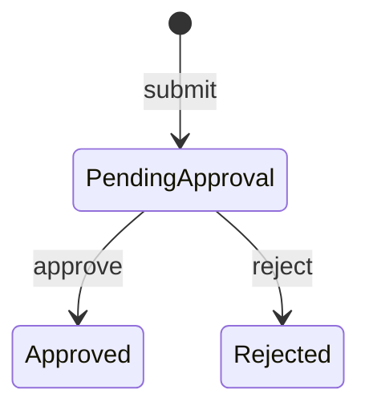
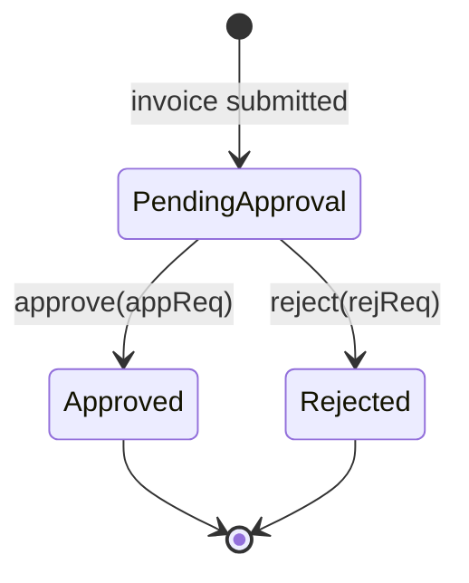

# Invoice Approval Workflow (FSM): Walkthrough

> Generated from Ocean-Atlas v0.1.0 (content a0c57f8d). Canonical source: https://atlas.ocean-lab.ai/examples/invoice-approval/

**Contents**

- [Horizon](#horizon)
- [Voyage](#voyage)

Horizon and Voyage explanation for the Invoice Approval Workflow (FSM) example.

Source: https://atlas.ocean-lab.ai/examples/invoice-approval/

## Horizon

### Invoice Approval at a Glance

#### Learning Scenario

A user submits an invoice for a customer. The invoice then waits for one decision: an approver may approve it, or a reviewer may reject it. The outcome, responsible user, remark, and decision time must remain part of the invoice record.

An entity-based FSM makes that flow explicit. Each invoice has its own persisted state, and only events declared for its current state can move it forward.

#### Lifecycle



#### What It Demonstrates

- An FSM controlling the status of each persisted invoice.
- Events carrying approval or rejection details.
- Looking up and recording related users during transitions.
- Related invoice, user, and customer entities.
- Submission logic and summary projections.

#### Expected Result

You will be able to create users and customers, submit invoices, approve or reject each invoice once, and inspect the persisted decision details afterwards.

## Voyage

### 1. Model the Approval Domain

Start with the three possible states. Every submitted invoice begins in `pendingApproval` and may finish in one terminal state.

```ocean-dsl
@datatype

enum InvoiceStatus
    pendingApproval
    approved
    rejected
```

An invoice stores its customer and creator, plus separate fields for the user and time associated with either decision.

```text
Invoice
    id          pattern INV-UUID
    title       : String
    customer    : *Customer
    totalAmount : Float
    submittedAt : DateTime
    approvedAt  : DateTime
    rejectedAt  : DateTime
    status      : InvoiceStatus
    createdBy   : *User
    approvedBy  : *User
    rejectedBy  : *User
    remark      : String
```

Decision requests carry data that is not part of the URL. Keeping approval and rejection separate makes each event contract clear.

```text
ApproveInvoiceReq
    approvedBy: String
    remark: String

RejectInvoiceReq
    rejectedBy: String
    reason: String
```

### 2. Persist Related Entities

`InvoiceDB` stores invoices, users, and customers as separate entities. Relations connect an invoice to the records it references.

```text
Entity Invoice
    key(id)
    indexes: index(status), index(customer), index(createdBy), index(approvedBy)

    customer   -m2o-> Customer
    createdBy  -m2o-> User
    approvedBy -m2o-> User
    rejectedBy -m2o-> User
```

The many-to-one relations mean many invoices may share one customer or user. Queries can then find invoices by lifecycle state and relations.

```text
query findById(id:String) : *Invoice
    query findByStatus(status:InvoiceStatus) : List<*Invoice>
query findByCustomerId(customerId:String) : List<*Invoice>
query findByCreatedBy(createdById:String) : List<*Invoice>
query findByApprovedBy(approvedById:String) : List<*Invoice>
```

User and Customer entities have their own keys, indexes, queries, and commands. They must exist before their IDs can be used during submission or a decision.

### 3. Expose Management and Decisions

The API separates ordinary entity management from workflow commands. Submission creates a pending invoice; approval and rejection enter the FSM through explicit business endpoints.

```text
post /invoice/submit submitInvoice(req:*SubmitInvoiceReq) : *Invoice
post /invoice/{id}/approve approveInvoice(req:ApproveInvoiceReq) : *Invoice
post /invoice/{id}/reject rejectInvoice(req:RejectInvoiceReq) : Invoice
```

The `id` in the decision path identifies the FSM entity. The request body supplies the acting user and the remark or reason. The same API also provides invoice searches and CRUD for users and customers.

### 4. Submit and Summarize Invoices

`SubmitInvoice` turns an external request into a controlled entity. It copies business fields, resolves relation IDs through the generated entity fields, sets the initial state, and timestamps it.

```text
SubmitInvoice
    input: req:*SubmitInvoiceReq
    output: result:*Invoice
    logic
        inv.status = InvoiceStatus.pendingApproval
        inv.submittedAt = nowUTC()
        result = Invoice.createInvoice(inv)
```

A second expression maps full invoices into `InvoiceSummary` values for the main table. `MapSlice` applies the projection to every stored invoice, so the UI does not need the full entity graph.

```text
GetInvoicesSummary
    input: _
    output: result:List<*InvoiceSummary>
    logic
        invoices = Invoice.listAllInvoices()
        result = MapSlice(invoices, SummarizeInvoice)
```

In the current source, `SummarizeInvoice` assigns `pendingApproval` instead of copying `invoice.status`. Copying the entity status would let the summary table reflect approval and rejection transitions accurately.

### 5. Govern Approval and Rejection

The declaration binds lifecycle state to a field on a particular invoice entity.

```ocean-dsl
@fsm

InvoiceApprovalFSM controls Invoice.status
    key: id
```

- `controls Invoice.status` makes status the state field.
- `key: id` identifies the invoice instance.
- Each invoice therefore advances independently and persistently.

#### Give events their decision payloads

The entity ID is implicit from the FSM key. The remaining event input is a typed request containing who acted and what they said.

```text
event approve in(appReq:ApproveInvoiceReq) out(appInvoice:*Invoice)
event reject in(rejReq:*RejectInvoiceReq) out(rejInvoice:Invoice)
```

#### See the complete state machine



Only PendingApproval handles decision events. Approved and Rejected are terminal, so an invoice cannot be decided twice in this model.

### 6. Update the Entity During Each Transition

#### Approve a pending invoice

The approval handler first copies the remark, records the current time, looks up the acting User, and stores that relation on the controlled entity. Only then does it move to Approved.

```text
state PendingApproval
    on event approve:
        this.remark = appReq.remark
        this.approvedAt = nowUTC()
        approver = User.findById(appReq.approvedBy)
        this.approvedBy = approver
        next Approved
```

`this` is the invoice selected by the implicit ID. `appReq` is the typed event input. The relation lookup turns a user ID into the User entity stored in `approvedBy`.

#### Reject through a parallel path

```text
on event reject:
    this.remark = rejReq.reason
    this.rejectedAt = nowUTC()
    rejector = User.findById(rejReq.rejectedBy)
    this.rejectedBy = rejector
    next Rejected
```

The rejection branch has the same shape but writes rejection-specific fields. Keeping separate timestamps and user relations preserves a clear audit record of whichever decision occurred.

#### Declare terminal states

```text
state Approved
    # no outgoing events

state Rejected
    # no outgoing events
```

Empty state bodies are meaningful: the statuses remain valid and persisted, but no further approval event is accepted there.

### 7. Wire the Workflow

CRUD and searches connect to entities or expressions; decisions connect to the FSM.

```text
connect api.submitInvoice -> SubmitInvoice
connect api.approveInvoice -> fsm.approve
connect api.rejectInvoice -> fsm.reject
connect api.getAllInvoices -> sumInv
```

Decision endpoints are deliberately routed through the FSM, where state rules and audit updates are applied. Although the source also exposes a generic update operation, workflow clients should not use it to bypass approval or rejection transitions.

### 8. Configure the API and Database

The service needs an API port, database connection, and logging. The UI has a smaller configuration with its own port and logging settings.

```ocean-dsl
@config

InvoiceConfig
    apiConfig: ApiConfig
    dbConfig: DatabaseConfig
    logConfig: LogConfig

UiConfig
    port: Int (default=8080)
    logConfig: LogConfig
```

### 9. Organize the Workflow into Dashboards

Three working dashboards separate invoices, users, and customers. The invoice dashboard combines a summary table with decision, search, submission, and deletion forms.

```text
Widget ApproveInvoiceByIdForm of type Form
    fields:
        - id String
        - req ApproveInvoiceReq
    buttons:
        submit: ✔️ Approve Invoice

Widget RejectInvoiceByIdForm of type Form
    fields:
        - id String
        - req RejectInvoiceReq
    buttons:
        submit: ✖️ Reject Invoice
```

The nested request fields mirror the FSM event payloads. User and Customer dashboards let readers create the related records needed before an invoice can be submitted and decided.

### 10. Connect UI Actions to the API

The UI routes each form to a typed API method. Approval and rejection remain ordinary UI actions even though the backend implements them as entity-based FSM events.

```text
connect inv.InvTable.listRows -> InvoiceApi.getInvoices
connect inv.CreateInvoiceForm.submit -> InvoiceApi.submitInvoice
connect inv.ApproveInvoiceByIdForm.submit -> InvoiceApi.approveInvoice
connect inv.RejectInvoiceByIdForm.submit -> InvoiceApi.rejectInvoice

connect user.CreateUserForm.submit -> InvoiceApi.createUser
connect cus.CreateCustomerForm.submit -> InvoiceApi.createCustomer
```

Search and management connections follow the same pattern. The UI knows the API contract, while the service hides persistence and transition details behind it.

### 11. Deploy the Persistent Approval System

The invoice service depends on the database and exposes its API on port `9098`. The UI is available on `8088` after the backend starts.

```text
InvoiceDeploy
    service InvoiceService
    replica 1
    export 9098:InvoiceService.api
    dependsOn InvoiceDatabase

InvoiceDatabase
    service PostgresqlDB

InvoiceUiDeploy
    service InvoiceUi
    replica 1
    export 8088:InvoiceUi.config
    dependsOn InvoiceDeploy
```

Each invoice’s status and decision details are entity data, so they remain available after the backend restarts.

### 12. Exercise the Complete Decision Flow

1. Validate, generate, and start the database, backend, and UI.
2. Open `localhost:8088`.
3. Create a customer, a submitting user, and two decision users.
4. Submit two invoices and retrieve them to verify their pending status.
5. Approve one invoice with an approver ID and remark.
6. Reject the other with a rejector ID and reason.
7. Inspect the decision timestamps, users, remarks, and statuses.
8. Try making a second decision on either terminal invoice.
9. Restart the backend and confirm that both outcomes remain stored.

The important observation is that decision data and state change happen together inside the FSM handler for the identified invoice.

### 13. Conclusion

You have built a persistent approval workflow where every invoice owns its state and can receive one valid decision. The FSM records not only the destination state, but also who acted, when they acted, and why.

Afterwards, you should understand how to:

- bind an FSM to a persisted entity field;
- use an entity key as implicit event identity;
- give FSM events typed business payloads;
- access the controlled entity through `this`;
- look up and assign related entities during a transition;
- record timestamps and remarks before calling `next`;
- use empty states to make decisions terminal;
- combine workflow commands with CRUD, relations, and projections.
