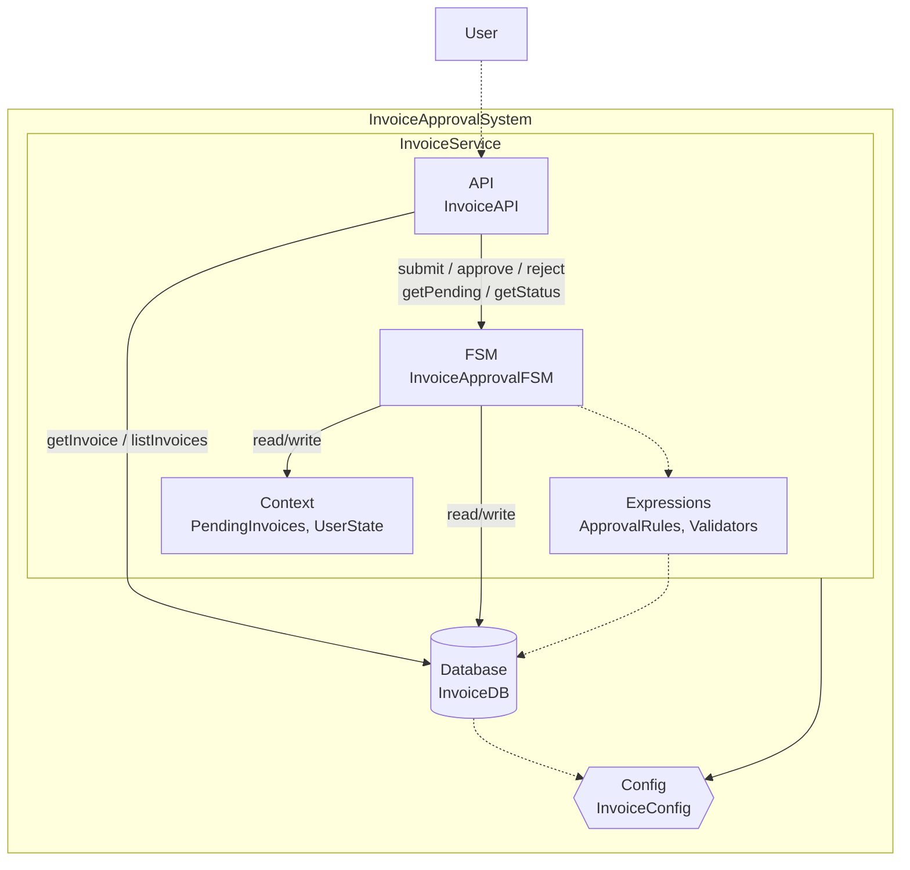

# Invoice Approval Workflow (FSM)

> Generated from Ocean-Atlas v0.1.0 (content 8776e975). Canonical source: https://atlas.ocean-lab.ai/examples/invoice-approval/

**Contents**

- [Overview](#overview)
- [Files](#files)
- [DSL source files](#dsl-source-files)
- [Diagrams](#diagrams)
- [Walkthrough](#walkthrough)

Submit persistent invoices and control approval or rejection with an entity-based finite state machine.

Source: https://atlas.ocean-lab.ai/examples/invoice-approval/

Level: advanced · Estimated time: 35 minutes · Version: 1.0.0 · Onboarding example: no

Components: 1 services, 0 brokers, 1 databases

Tags: api, approval, database, entity, entity-based, expressions, finite-state-machine, fsm, invoice, rejection, relations, rest, state, transition, ui, workflow

## Overview

This example shows how an entity-based FSM governs invoice approval and rejection while preserving the related customer, user, remark, and decision data. Its executable DSL and its Horizon and Voyage explanation are maintained together in this example directory.

## Files

DSL source comes first, then diagrams; the long Horizon and Voyage walkthroughs are at the end. You can stop after the source files.

| File | Section | Lines |
| --- | --- | --- |
| `00-info.ocn` | `@info` | 34 |
| `10-datatype.ocn` | `@datatype` | 62 |
| `20-database.ocn` | `@database` | 86 |
| `30-config.ocn` | `@config` | 25 |
| `40-api.ocn` | `@api` | 72 |
| `50-expression.ocn` | `@expression` | 42 |
| `60-fsm.ocn` | `@fsm` | 45 |
| `70-service.ocn` | `@service` | 61 |
| `75-dashboard.ocn` | `@dashboard` | 402 |
| `76-ui.ocn` | `@ui` | 70 |
| `80-deploy.ocn` | `@deploy` | 29 |

## DSL source files

### `00-info.ocn`

```ocean-dsl
# @ocean-meta-start
# tags:
#   - documentation
# perspective:
#   feature: invoice-approval
# @ocean-meta-end

@info

name: InvoiceService  
title: Invoice Approval System  
subtitle: Submit, approve, and manage invoices  
version: 1.0.0  

shortDescription: A complete workflow system for managing invoice approvals  

description: InvoiceService is a reference example showcasing the use of  
entity-based finite state machines (FSMs) in the Ocean-lab DSL platform.  

It manages the lifecycle of invoices submitted for approval, using a  
dedicated `Invoice` datatype and `InvoiceStatus` enum. The FSM governs  
state transitions (e.g., Draft → PendingApproval → Approved/Rejected → Paid)  
and encapsulates business logic and rule enforcement.  

The service exposes an API for submitting, approving, rejecting, and  
querying invoices. FSM transitions are driven by input events and  
validated using expressions like `CanApprove`. Runtime context (e.g.,  
user role, pending approvals) is kept internal to the FSM and isolated  
from external access.  

InvoiceService demonstrates how Ocean DSL can be used to declaratively  
define API-driven workflows, enforce domain constraints, and model  
business processes with clear, composable constructs.
```

### `10-datatype.ocn`

```ocean-dsl
# @ocean-meta-start
# tags:
#   - invoice-approval
#   - datatype
# perspective:
#   feature: invoice-approval
#   service: invoice-service
# @ocean-meta-end

@datatype

Invoice
    id pattern INV-UUID  # TODO: switch to INV-SEQ
    title        : String
    customer     : *Customer
    totalAmount  : Float
    submittedAt  : DateTime
    approvedAt   : DateTime
    rejectedAt   : DateTime
    status       : InvoiceStatus
    createdBy    : *User
    approvedBy   : *User
    rejectedBy   : *User
    remark       : String

enum InvoiceStatus
    pendingApproval
    approved
    rejected
    #paid

User
    id pattern USR-UUID
    name: String
    role: String

Customer
    id pattern CUS-UUID
    name       : String
    department : String

SubmitInvoiceReq
    title        : String
    customerId   : String
    totalAmount  : Float
    createdBy    : String  # userId

ApproveInvoiceReq
    approvedBy : String  # userId
    remark     : String

RejectInvoiceReq
    rejectedBy : String  # userId
    reason     : String

InvoiceSummary
    id           : String
    title        : String
    customerName : String
    totalAmount  : Float
    status       : InvoiceStatus
```

### `20-database.ocn`

```ocean-dsl
# @ocean-meta-start
# tags:
#   - invoice-approval
#   - database
# perspective:
#   feature: invoice-approval
#   service: invoice-service
# @ocean-meta-end

@database

Database InvoiceDB
    engine = postgres
    configType = DatabaseConfig
    tags = primary

    # ---------------------------------------------------
    # Invoice Entity
    # ---------------------------------------------------
    
    Entity Invoice
        key(id)
        indexes: index(status), index(customer), index(createdBy), index(approvedBy), index(submittedAt)

        # Relations
        customer   -m2o-> Customer
        createdBy  -m2o-> User
        approvedBy -m2o-> User
        rejectedBy -m2o-> User

        # Queries
        query findById(id: String) : *Invoice
        query findByStatus(status: InvoiceStatus) : List<*Invoice>
        query findByCustomerId(customerId: String) : List<*Invoice>
        query findByCreatedBy(createdById: String) : List<*Invoice>
        query findByApprovedBy(approvedById: String) : List<*Invoice>
        query findByStatusAndCustomer(status: InvoiceStatus, customerId: String) : List<*Invoice>
        query listInvoices(offset: Int, limit: Int) : List<*Invoice>
        query listAllInvoices() : List<Invoice>
        #query countInvoice() : Int

        # Commands
        command T createInvoice(item: Invoice) : *Invoice
        command T updateInvoice(item: *Invoice) : *Invoice
        command deleteInvoice(id: String) : _

    # ---------------------------------------------------
    # User Entity
    # ---------------------------------------------------
    
    Entity User
        key(id)
        indexes: index(role), index(name), unique(name)

        # Queries
        query findById(id: String) : *User
        query findByName(name: String) : *User
        query findByRole(role: String) : List<*User>
        query listUsers(offset: Int, limit: Int) : List<*User>
        query listAllUsers() : List<User>

        # Commands
        command T createUser(item: User) : *User
        command T updateUser(item: *User) : *User
        command deleteUser(id: String) : _

    # ---------------------------------------------------
    # Customer Entity
    # ---------------------------------------------------

    Entity Customer
        key(id)
        indexes: index(name), index(department), unique(name)

        # Queries
        query findById(id: String) : *Customer
        query findByName(name: String) : *Customer
        query findByDepartment(department: String) : List<*Customer>
        query listCustomers(offset: Int, limit: Int) : List<*Customer>
        query listAllCustomers() : List<Customer>

        # Commands
        command T createCustomer(item: Customer) : *Customer
        command T updateCustomer(item: *Customer) : *Customer
        command deleteCustomer(id: String) : _
```

### `30-config.ocn`

```ocean-dsl
# @ocean-meta-start
# tags:
#   - configuration
# perspective:
#   feature: invoice-approval
#   service: all
# @ocean-meta-end

@config

@import config O.database.postgres.config@1.0.0 as DatabaseConfig
@import config O.log.config@1.0.0 as LogConfig

InvoiceConfig
    apiConfig : ApiConfig
    dbConfig  : DatabaseConfig
    logConfig : LogConfig

ApiConfig
    port: Int (default=8080)

UiConfig
    port: Int (default=8080)
    logConfig : LogConfig
```

### `40-api.ocn`

```ocean-dsl
# @ocean-meta-start
# tags:
#   - invoice-api
#   - rest-api
# perspective:
#   feature: invoice-approval
#   service: invoice-service
# @ocean-meta-end

@api

InvoiceApi style:rest
    engine = gin
    configType = ApiConfig
    version = 1.0.0
    generateSwagger = true


    # -------------------------
    # Invoice
    # -------------------------

    get  /invoice/{id}               getInvoice(id:String)              : *Invoice
    get  /invoices                   getAllInvoices()                   : List<*InvoiceSummary>
    get  /invoices/{offset}/{limit}  getInvoices(offset:Int, limit:Int) : List<*Invoice>
    #get  /invoices/pending/{userId}  getPendingInvoices(userId:String)  : List<*Invoice>

    post   /invoice/submit        submitInvoice(req:*SubmitInvoiceReq)  : *Invoice
    post   /invoice/update        updateInvoice(item: *Invoice)         : *Invoice
    post   /invoice/{id}/approve  approveInvoice(req:ApproveInvoiceReq) : *Invoice
    post   /invoice/{id}/reject   rejectInvoice(req:RejectInvoiceReq)   : Invoice
    delete /invoice/{id}/delete   deleteInvoice(id:String)              : _

    get  /invoice/find-by-status/{status}             findInvoiceByStatus(status: InvoiceStatus)    : List<*Invoice>
    get  /invoice/find-by-customer/{customerId}       findInvoiceByCustomer(customerId: String)     : List<*Invoice>
    get  /invoice/find-by-created-by/{createdById}    findInvoiceByCreatedBy(createdById: String)   : List<*Invoice>
    get  /invoice/find-by-approved-by/{approvedById}  findInvoiceByApprovedBy(approvedById: String) : List<*Invoice>
    get  /invoice/find-by-status-and-customer/{status}/{id}  findInvoiceByStatusAndCustomer(status: InvoiceStatus, id : String) : List<*Invoice>


    # -------------------------
    # User
    # -------------------------

    get /user/{id}                getUser(id:String)              : *User
    get /users                    getAllUsers()                   : List<User>
    get /find-user-by-name/{name} findUserByName(name:String)     : *User
    get /find-user-by-role/{role} findUserByRole(role:String)     : List<*User>
    get /users/{offset}/{limit}   getUsers(offset:Int, limit:Int) : List<*User>

    post   /user/create       createUser(user:User) : *User
    post   /user/update       updateUser(user:User) : *User
    delete /user/{id}         deleteUser(id:String) : _


    # -------------------------
    # Customer
    # -------------------------

    get /customer/{id}                getCustomer(id:String)              : *Customer
    get /customers                    getAllCustomers()                   : List<Customer>
    get /find-customer-by-name/{name} findCustomerByName(name:String)     : *Customer
    get /find-customer-by-department/{department} findCustomerByDepartment(department:String)     : List<*Customer>
    get /customers/{offset}/{limit}   getCustomers(offset:Int, limit:Int) : List<*Customer>

    post   /customer/create       createCustomer(customer:Customer) : *Customer
    post   /customer/update       updateCustomer(customer:Customer) : *Customer
    delete /customer/{id}         deleteCustomer(id:String)         : _
```

### `50-expression.ocn`

```ocean-dsl
# @ocean-meta-start
# tags:
#   - expression
# perspective:
#   feature: invoice-approval
#   service: invoice-service
# @ocean-meta-end

@expression

SummarizeInvoice
    input  : invoice:Invoice
    output : summary:*InvoiceSummary
    logic
        summary.id = invoice.id
        summary.title = invoice.title
        summary.customerName = invoice.customer.name
        summary.totalAmount = invoice.totalAmount
        summary.status = InvoiceStatus.pendingApproval

GetInvoicesSummary
    input: _
    output: result:List<*InvoiceSummary>
    logic
        invoices = Invoice.listAllInvoices()
        result = MapSlice(invoices, SummarizeInvoice)

SubmitInvoice
    input: req:*SubmitInvoiceReq
    output: result:*Invoice
    logic
        #cus = Customer.findByName(req.customerName)
        #user = User.findById(req.createdBy)
        var inv Invoice
        inv.customerId = req.customerId
        inv.createdById = req.createdBy
        inv.totalAmount = req.totalAmount
        inv.title       = req.title
        inv.status      = InvoiceStatus.pendingApproval
        inv.submittedAt = nowUTC()
        result = Invoice.createInvoice(inv)
```

### `60-fsm.ocn`

```ocean-dsl
# @ocean-meta-start
# tags:
#   - invoice-approval
#   - approval-workflow
#   - fsm
# perspective:
#   feature: invoice-approval
#   service: invoice-service
# @ocean-meta-end

@fsm

InvoiceApprovalFSM controls Invoice.status
    key: id

    # ---------------------------------------------------
    # Events (id is implicit input)
    # ---------------------------------------------------
    event approve in(appReq:ApproveInvoiceReq)  out(appInvoice:*Invoice)
    event reject  in(rejReq:*RejectInvoiceReq)  out(rejInvoice:Invoice)

    # ---------------------------------------------------
    # States
    # ---------------------------------------------------
    state PendingApproval
        on event approve:
            this.remark = appReq.remark
            this.approvedAt = nowUTC()
            approver = User.findById(appReq.approvedBy)
            this.approvedBy = approver
            next Approved

        on event reject:
            this.remark = rejReq.reason
            this.rejectedAt = nowUTC()
            rejector = User.findById(rejReq.rejectedBy)
            this.rejectedBy = rejector
            next Rejected

    state Approved
        # nop 

    state Rejected
        # nop 
```

### `70-service.ocn`

```ocean-dsl
# @ocean-meta-start
# tags:
#   - invoice-api
#   - service
# perspective:
#   feature: invoice-approval
#   service: invoice-service
# @ocean-meta-end

@service

InvoiceService

    @perspectives: version:1.0.0, lifestyle:stable

    use config InvoiceConfig as myCfg
    impl api InvoiceApi as api on myCfg.apiConfig.port
    use database InvoiceDB as db
    use expression GetInvoicesSummary as sumInv
    use expression SubmitInvoice
    use fsm InvoiceApprovalFSM as fsm
    #use expression CanApprove
    #use expression CanReject

    # -------------------------
    # Config Binding
    # -------------------------
    connect myCfg.dbConfig -> db


    connect api.getInvoice          ->  Invoice.findById
    connect api.getAllInvoices      ->  sumInv
    connect api.getInvoices         ->  Invoice.listInvoices
    #connect api.getPendingInvoices  ->  
    connect api.submitInvoice       ->  SubmitInvoice
    connect api.updateInvoice       ->  Invoice.updateInvoice
    connect api.approveInvoice      ->  fsm.approve
    connect api.rejectInvoice       ->  fsm.reject
    connect api.deleteInvoice       ->  Invoice.deleteInvoice
    connect api.findInvoiceByStatus     -> Invoice.findByStatus
    connect api.findInvoiceByCustomer   -> Invoice.findByCustomerId
    connect api.findInvoiceByCreatedBy  -> Invoice.findByCreatedBy
    connect api.findInvoiceByApprovedBy -> Invoice.findByApprovedBy
    connect api.findInvoiceByStatusAndCustomer -> Invoice.findByStatusAndCustomer
    connect api.getUser             ->  User.findById
    connect api.getAllUsers         ->  User.listAllUsers
    connect api.getUsers            ->  User.listUsers
    connect api.createUser          ->  User.createUser
    connect api.updateUser          ->  User.updateUser
    connect api.deleteUser          ->  User.deleteUser
    connect api.findUserByName      ->  User.findByName
    connect api.findUserByRole      ->  User.findByRole
    connect api.getCustomer         ->  Customer.findById
    connect api.getAllCustomers     ->  Customer.listAllCustomers
    connect api.getCustomers        ->  Customer.listCustomers
    connect api.createCustomer      ->  Customer.createCustomer
    connect api.updateCustomer      ->  Customer.updateCustomer
    connect api.findCustomerByName  ->  Customer.findByName
    connect api.findCustomerByDepartment ->  Customer.findByDepartment
    connect api.deleteCustomer      ->  Customer.deleteCustomer
```

### `75-dashboard.ocn`

```ocean-dsl
# @ocean-meta-start
# tags:
#   - ui
#   - dashboard
# perspective:
#   feature: invoice-approval
#   service: ui-service
# @ocean-meta-end

@dashboard

InvoiceDashboard

    Widget InvTable of type Table
        title = Invoices 🧾
        limit = 8
        datatype = Invoice


    Widget S51 of type Separator
        size = lg
        style = solid
        label = Manage

    Widget ManageInvoiceText of type Text
        subtitle = To manage Invoices!
        content = Here you can <b>approve</b> or <b>reject</b> invoices.

    Widget S52 of type Separator
        size = sm
        style = solid
        label = Approve!

    Widget ApproveInvoiceByIdForm of type Form
        title = Approve by ID
        fields:
            - id      String
            - req     ApproveInvoiceReq
        buttons:
            submit : ✔️ Approve Invoice

    Widget S53 of type Separator
        size = sm
        style = solid
        label = Reject!

    Widget RejectInvoiceByIdForm of type Form
        title = Reject by ID
        fields:
            - id      String
            - req     RejectInvoiceReq
        buttons:
            submit : ✖️ Reject Invoice


    Widget S31 of type Separator
        size = lg
        style = solid
        label = Search

    Widget SearchInvoiceText of type Text
        subtitle = To find Invoices!
        content = Here you can find invoices by <b>ID</b>, <b>Status</b>, <b>Customer</b>, <b>CreatedBy</b>, <b>ApprovedBy</b>, or <b>Status and Customer</b>.

    Widget S32 of type Separator
        size = sm
        style = solid
        label = Find by ID

    Widget FindInvoiceByIdForm of type Form
        title = Find by ID
        fields:
            - id      String
        buttons:
            submit : 🔍 Find Invoice by ID

    Widget S33 of type Separator
        size = sm
        style = solid
        label = Find by Status

    Widget FindInvoiceByStatusForm of type Form
        title = Find by Status
        fields:
            - status InvoiceStatus
        buttons:
            submit : 🔍 Find Invoice by Status

    Widget S34 of type Separator
        size = sm
        style = solid
        label = Find by Customer

    Widget FindInvoiceByCustomerForm of type Form
        title = Find by Customer
        fields:
            - customerId      String
        buttons:
            submit : 🔍 Find Invoice by Customer

    Widget S35 of type Separator
        size = sm
        style = solid
        label = Find by CreatedBy

    Widget FindInvoiceByCreatedByForm of type Form
        title = Find by CreatedBy
        fields:
            - createdById      String
        buttons:
            submit : 🔍 Find Invoice by CreatedBy

    Widget S36 of type Separator
        size = sm
        style = solid
        label = Find by ApprovedBy

    Widget FindInvoiceByApprovedByForm of type Form
        title = Find by ApprovedBy
        fields:
            - approvedById      String
        buttons:
            submit : 🔍 Find Invoice by ApprovedBy

    Widget S37 of type Separator
        size = sm
        style = solid
        label = Find by Status and Customer

    Widget FindInvoiceByStatusAndCustomerForm of type Form
        title = Find by Status And Customer
        fields:
            - status InvoiceStatus
            - id      String
        buttons:
            submit : 🔍 Find Invoice by Status And Customer

    Widget S38 of type Separator
        size = lg
        style = solid
        label = CRUD

    Widget CrudInvoiceText of type Text
        subtitle = To Create/Update/Delete Invoices!
        content = Here you can <b>Create</b> or <b>Delete</b> Invoices.

    Widget S39 of type Separator
        size = sm
        style = solid
        label = Create

    Widget CreateInvoiceForm of type Form
        title = Submit New Invoices
        fields:
            - title        String
            - customerId   String
            - totalAmount  Float
            - createdBy    String
        buttons:
            submit : ➕ Submit Invoice

#    Widget S40 of type Separator
#        size = sm
#        style = solid
#        label = Update

#    Widget UpdateInvoiceForm of type Form
#        title = Update Invoices
#        datatype = Invoice
#        buttons:
#            submit : ✏️ Update Invoice
#            fetch : 🔄 Fetch by ID

    Widget S41 of type Separator
        size = sm
        style = solid
        label = Delete

    Widget DeleteInvoiceForm of type Form
        title = Delete Invoices
        fields:
            - id        String
        buttons:
            submit : ❌ Delete Invoice

UserDashboard

    Widget UserTable of type Table
        title = Users 🙍
        limit = 8
        datatype = User

    Widget S9 of type Separator
        size = md
        style = solid
        label = Search

    Widget SearchUserText of type Text
        subtitle = To find Users!
        content = Here you can find users by <b>ID</b>, <b>Name</b>, or <b>Role</b>.

    Widget S10 of type Separator
        size = sm
        style = solid
        label = Find by ID

    Widget FindUserByIdForm of type Form
        title = Find by ID
        fields:
            - id      String
        buttons:
            submit : 🔍 Find User by ID

    Widget S11 of type Separator
        size = sm
        style = solid
        label = Find by Name

    Widget FindUserByNameForm of type Form
        title = Find by Name
        fields:
            - name      String
        buttons:
            submit : 🔍 Find User by Name

    Widget S12 of type Separator
        size = sm
        style = solid
        label = Find by Role

    Widget FindUserByRoleForm of type Form
        title = Find by Role
        fields:
            - role      String
        buttons:
            submit : 🔍 Find Users by Role


    Widget S4 of type Separator
        size = md
        style = solid
        label = CRUD

    Widget CrudUserText of type Text
        subtitle = To Create/Update/Delete Users!
        content = Here you can <b>Create</b>, <b>Update</b>, or <b>Delete</b> Users.

    Widget S5 of type Separator
        size = sm
        style = solid
        label = Create

    Widget CreateUserForm of type Form
        title = Create New Users
        fields:
            - name      String
            - role      String
        buttons:
            submit : ➕ Create User

    Widget S6 of type Separator
        size = sm
        style = solid
        label = Update

    Widget UpdateUserForm of type Form
        title = Update Users
        fields:
            - id        String
            - name      String
            - role      String
        buttons:
            submit : ✏️ Update User
            fetch : 🔄 Fetch by ID

    Widget S7 of type Separator
        size = sm
        style = solid
        label = Delete

    Widget DeleteUserForm of type Form
        title = Delete Users
        fields:
            - id        String
        buttons:
            submit : ❌ Delete User


CustomerDashboard

    Widget CustomerTable of type Table
        title = Customers 🛍️
        limit = 8
        datatype = Customer

    Widget S20 of type Separator
        size = md
        style = solid
        label = Search

    Widget SearchCustomerText of type Text
        subtitle = To find Customers!
        content = Here you can find customers by <b>ID</b>, <b>Name</b>, or <b>Department</b>.

    Widget S21 of type Separator
        size = sm
        style = solid
        label = Find by ID

    Widget FindCustomerByIdForm of type Form
        title = Find by ID
        fields:
            - id      String
        buttons:
            submit : 🔍 Find Customer by ID

    Widget S22 of type Separator
        size = sm
        style = solid
        label = Find by Name

    Widget FindCustomerByNameForm of type Form
        title = Find by Name
        fields:
            - name      String
        buttons:
            submit : 🔍 Find Customer by Name

    Widget S23 of type Separator
        size = sm
        style = solid
        label = Find by Department

    Widget FindCustomerByDepartmentForm of type Form
        title = Find by Department
        fields:
            - department      String
        buttons:
            submit : 🔍 Find Customers by Department


    Widget S4 of type Separator
        size = md
        style = solid
        label = CRUD

    Widget CrudCustomerText of type Text
        subtitle = To Create/Update/Delete Customers!
        content = Here you can <b>Create</b>, <b>Update</b>, or <b>Delete</b> Customers.

    Widget S5 of type Separator
        size = sm
        style = solid
        label = Create

    Widget CreateCustomerForm of type Form
        title = Create New Customers
        fields:
            - name       String
            - department String
        buttons:
            submit : ➕ Create Customer

    Widget S6 of type Separator
        size = sm
        style = solid
        label = Update

    Widget UpdateCustomerForm of type Form
        title = Update Customers
        fields:
            - id         String
            - name       String
            - department String
        buttons:
            submit : ✏️ Update Customer
            fetch : 🔄 Fetch by ID

    Widget S7 of type Separator
        size = sm
        style = solid
        label = Delete

    Widget DeleteCustomerForm of type Form
        title = Delete Customers
        fields:
            - id        String
        buttons:
            submit : ❌ Delete Customer


AboutDashboard
    title: 📣 About
    subtitle: Invoice Approval System!
    layout: SingleColumnLayout

    Widget AboutText of type Text
        title = About Invoice Approval App 🧾✓
        subtitle = version 1.0.0
        content = A complete workflow system for managing invoice approvals<br><b>Description:</b><br><p>InvoiceService is a reference example showcasing the use of entity-based finite state machines (FSMs) in the Ocean-lab DSL platform.</p><p>It manages the lifecycle of invoices submitted for approval, using a dedicated `Invoice` datatype and `InvoiceStatus` enum. The FSM governs state transitions (e.g., Draft → PendingApproval → Approved/Rejected → Paid) and encapsulates business logic and rule enforcement.</p><p>The service exposes an API for submitting, approving, rejecting, and querying invoices. FSM transitions are driven by input events and validated using expressions like `CanApprove`. Runtime context (e.g., user role, pending approvals) is kept internal to the FSM and isolated from external access.</p><p>InvoiceService demonstrates how Ocean DSL can be used to declaratively define API-driven workflows, enforce domain constraints, and model business processes with clear, composable constructs.</p>
```

### `76-ui.ocn`

```ocean-dsl
# @ocean-meta-start
# tags:
#   - ui
# perspective:
#   feature: invoice-approval
#   service: ui-service
# @ocean-meta-end
@ui

InvoiceUi

    @perspectives: version:0.1.0, lifestyle:stable

    framework: htmx
    styling: bootstrap
    template: go-html-template
    backend: go-gin
    static: static
    configType: UiConfig

    nav Invoices dashboard = InvoiceDashboard
    nav Users dashboard = UserDashboard
    nav Customers dashboard = CustomerDashboard
    nav About dashboard = AboutDashboard

    header title = 🧾✓ Invoice Approval App!
    header subtitle = Managing invoices made simple 😊
    header align = center

    footer title = ⚡ Built with Ocean-lab
    footer subtitle = Version 1.0.0
    footer align = center

    use dashboard InvoiceDashboard as inv
    use dashboard UserDashboard as user
    use dashboard CustomerDashboard as cus
    use dashboard AboutDashboard as about

    use api InvoiceApi

    connect inv.InvTable.listRows -> InvoiceApi.getInvoices
    connect inv.ApproveInvoiceByIdForm.submit -> InvoiceApi.approveInvoice
    connect inv.RejectInvoiceByIdForm.submit -> InvoiceApi.rejectInvoice
    connect inv.FindInvoiceByIdForm.submit -> InvoiceApi.getInvoice
    connect inv.FindInvoiceByStatusForm.submit -> InvoiceApi.findInvoiceByStatus
    connect inv.FindInvoiceByCustomerForm.submit -> InvoiceApi.findInvoiceByCustomer
    connect inv.FindInvoiceByCreatedByForm.submit -> InvoiceApi.findInvoiceByCreatedBy
    connect inv.FindInvoiceByApprovedByForm.submit -> InvoiceApi.findInvoiceByApprovedBy
    connect inv.FindInvoiceByStatusAndCustomerForm.submit -> InvoiceApi.findInvoiceByStatusAndCustomer
    connect inv.CreateInvoiceForm.submit -> InvoiceApi.submitInvoice
#    connect inv.UpdateInvoiceForm.submit -> InvoiceApi.updateInvoice
#    connect inv.UpdateInvoiceForm.fetch -> InvoiceApi.getInvoice
    connect inv.DeleteInvoiceForm.submit -> InvoiceApi.deleteInvoice

    connect user.UserTable.listRows -> InvoiceApi.getUsers
    connect user.CreateUserForm.submit -> InvoiceApi.createUser
    connect user.UpdateUserForm.submit -> InvoiceApi.updateUser
    connect user.UpdateUserForm.fetch -> InvoiceApi.getUser
    connect user.FindUserByIdForm.submit -> InvoiceApi.getUser
    connect user.FindUserByNameForm.submit -> InvoiceApi.findUserByName
    connect user.FindUserByRoleForm.submit -> InvoiceApi.findUserByRole

    connect cus.CustomerTable.listRows -> InvoiceApi.getCustomers
    connect cus.CreateCustomerForm.submit -> InvoiceApi.createCustomer
    connect cus.UpdateCustomerForm.submit -> InvoiceApi.updateCustomer
    connect cus.UpdateCustomerForm.fetch -> InvoiceApi.getCustomer
    connect cus.FindCustomerByIdForm.submit -> InvoiceApi.getCustomer
    connect cus.FindCustomerByNameForm.submit -> InvoiceApi.findCustomerByName
    connect cus.FindCustomerByDepartmentForm.submit -> InvoiceApi.findCustomerByDepartment
```

### `80-deploy.ocn`

```ocean-dsl
# @ocean-meta-start
# tags:
#   - deployment
# perspective:
#   feature: invoice-approval
#   service: all
# @ocean-meta-end

@deploy

Name: InvoiceApproval-deploy

@import service P.db.postgres.docker@1.0.0 as PostgresqlDB

InvoiceDeploy
    service     InvoiceService
    replica     1
    export      9098:InvoiceService.api
    dependsOn   InvoiceDatabase

InvoiceDatabase
    service     PostgresqlDB

InvoiceUiDeploy
    service     InvoiceUi
    replica     1
    export      8088:InvoiceUi.config
    dependsOn   InvoiceDeploy
```

## Diagrams

### `spec-invoice-approval-system.mmd`



## Walkthrough

A long, step-by-step explanation (Horizon and Voyage) is in [Invoice Approval Workflow (FSM) walkthrough](invoice-approval-walkthrough.md). Read it only if you need the reasoning behind the design.
