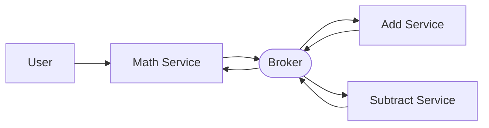

# Broker-Based Math Service: Walkthrough

> Generated from Ocean-Atlas v0.1.0 (content a0c57f8d). Canonical source: https://atlas.ocean-lab.ai/examples/math-service/

**Contents**

- [Horizon](#horizon)
- [Voyage](#voyage)

Horizon and Voyage explanation for the Broker-Based Math Service example.

Source: https://atlas.ocean-lab.ai/examples/math-service/

## Horizon

### Math Service at a Glance

#### Overview

The system accepts addition and subtraction requests. A coordinating service delegates each operation to a specialized service and returns the result.

#### Architecture



#### What It Demonstrates

- Typed request and response messages.
- Broker request-response functions.
- Choosing a channel from an operation value.

#### Expected Result

A calculator API and UI that return sums and differences produced by separate services.

## Voyage

### 1. Model the Broker Messages

Let’s start with the information that travels between services. Every calculation needs two numbers, so we will place them together in a `MathRequest`.

```ocean-dsl
@datatype

MathRequest
    num1: Int
    num2: Int
```

The worker sends one calculated number back. Wrapping it in `MathResponse` gives the response a clear type and leaves room to add more result information later.

```text
MathResponse
    resValue: Int
```

These two datatypes form a small contract: every math request contains two integers, and every successful response contains one integer.

### 2. Define the Calculator APIs

The public `MathApi` gives users three ways to calculate. The first two methods have a fixed operation, while the third receives the operation as an input.

```ocean-dsl
@api

MathApi style:rest
    engine = gin
    configType = ApiConfig
    version = 1.0.0
    generateSwagger = true

    post /math/add/{a}/{b} addNumbers(a:Int, b:Int) : Int
post /math/sub/{a}/{b} subNumbers(a:Int, b:Int) : Int
get /math/calc/{a}/{b}/{op} calculate(a:Int, b:Int, op:String) : Int
```

Read an endpoint as `verb path method(inputs) : output`. For example, `addNumbers` receives `a` and `b` from the path and returns an integer.

The add and subtract services also expose their own small APIs. Those direct endpoints are useful for testing each worker independently, even though the main flow will reach the workers through the broker.

```text
AddApi
    post /math/add/{a}/{b} addNumbers(a:Int, b:Int) : Int

SubApi
    post /math/sub/{a}/{b} subNumbers(a:Int, b:Int) : Int
```

### 3. Add Typed Broker Channels

A normal event is sent without waiting for a reply. A calculation is different: the caller needs the answer. That makes `request-response` a good fit for both math channels.

```ocean-dsl
@broker

MathBroker
    engine = nats
    configType = MathBrokerConfig

    math.add : MathRequest-MathResponse as request-response with timeout:1s
math.sub : MathRequest-MathResponse as request-response with timeout:1s
```

Each line describes one complete conversation:

- `math.add` or `math.sub` is the channel;
- `MathRequest-MathResponse` defines input and output types;
- `request-response` means the sender expects a reply;
- `timeout:1s` limits how long the broker waits.

### 4. Write the Math and Messaging Expressions

#### Calculate inside each worker

The responder receives the typed broker request, performs one operation, and places the answer in a typed response.

```text
AddResponser
    input: req:MathRequest
    output: result:MathResponse
    logic
        result.resValue = req.num1 + req.num2

SubResponser
    input: req:MathRequest
    output: result:MathResponse
    logic
        result.resValue = req.num1 - req.num2
```

#### Turn a broker channel into a function

`RequestHandler` does not need to know which channel it calls. It receives a requester function, creates `MathRequest`, calls that function, and returns the value from `MathResponse`.

```text
RequestHandler
    input: a:Int & b:Int & requester:Func<MathRequest,MathResponse>
    output: result:Int
    logic
        var req MathRequest
        var res MathResponse
        req.num1 = a
        req.num2 = b
        res = requester(req)
        result = res.resValue
```

#### Choose a requester dynamically

The generic calculate endpoint adds one more idea. It receives both requester functions and selects one from the `op` value.

```text
CalculateHandler
    input: a:Int & b:Int & op:String & addRequester:Func<MathRequest,MathResponse> & subRequester:Func<MathRequest,MathResponse>
```

When `op` is `add`, it calls `addRequester`; when it is `sub`, it calls `subRequester`. Both functions share the same signature, so the surrounding expression can treat them consistently.

### 5. Wire Three Services

#### Prepare requester functions in MathService

The coordinating service declares two function aliases with the same request and response types as the broker channels.

```text
MathService
    use broker MathBroker
    impl api MathApi as api on mathCfg.apiConfig.port
    use function Func<MathRequest,MathResponse> as AddRequester
    use function Func<MathRequest,MathResponse> as SubRequester

    connect AddRequester -> MathBroker.math.add & timeout(3:s)
    connect SubRequester -> MathBroker.math.sub & timeout(3:s)
```

These connections make the channels callable like regular functions. The service-level timeout gives each call its own three-second boundary.

#### Pass the functions into expressions

```text
connect api.addNumbers -> RequestHandler(requester:AddRequester)
connect api.subNumbers -> RequestHandler(requester:SubRequester)
connect api.calculate -> CalculateHandler(
    addRequester:AddRequester,
    subRequester:SubRequester
)
```

Addition and subtraction reuse `RequestHandler` with different requester functions. The calculate method receives both functions and decides which one to invoke.

#### Answer the channels in worker services

```text
AddService
    use broker MathBroker
    connect MathBroker.math.add -> AddResponser

SubService
    use broker MathBroker
    connect MathBroker.math.sub -> SubResponser
```

This completes the round trip: `MathService` sends a request, one worker responds, and the result returns to the original API call.

### 6. Configure APIs, Broker Access, and Logging

All three services need an API port, broker connection settings, and logging. A shared config datatype keeps that shape consistent.

```ocean-dsl
@config

@import config O.broker.nats.config@1.0.0 as BrokerConfig
@import config O.log.config@1.0.0 as LogConfig

ServiceConfig
    apiConfig: ApiConfig
    brokerConfig: BrokerConfig
    logConfig: LogConfig

ApiConfig
    port: Int (default=8080)
```

The broker itself uses `MathBrokerConfig`, while the UI uses a smaller `UiConfig`. Each component receives only the settings it needs.

### 7. Create a Simple Calculator Dashboard

The dashboard uses two forms: one for addition and one for subtraction. Each form collects the same two integer fields, `a` and `b`.

```ocean-dsl
@dashboard

MathDashboard
    title: Let's Calculate!
    layout: SingleColumnLayout

    Widget SumForm of type Form
        title = Sum
        fields:
            - a Int
            - b Int
        buttons:
            submit : Sum
            cancel : Cancel
```

`SubForm` follows the same structure with a Sub button. The matching field names allow the UI to pass both values directly to the selected API method.

### 8. Connect the Forms to the Public API

The UI brings the calculator and About dashboards together, then uses `MathApi` as its backend contract.

```ocean-dsl
@ui

MathUi
    framework: htmx
    styling: bootstrap
    template: go-html-template
    backend: go-gin
    configType: UiConfig

    use dashboard MathDashboard as m
    use dashboard AboutDashboard as a
    use api MathApi
```

Each submit event connects to the corresponding public method. The broker remains hidden behind `MathService`; the UI only needs to understand the API.

```text
connect m.SumForm.submit -> MathApi.addNumbers
connect m.SubForm.submit -> MathApi.subNumbers
```

### 9. Deploy the API, Workers, Broker, and UI

The deployment starts the broker first and makes the three services depend on it. Only the public math API needs to be exposed to clients.

```ocean-dsl
@deploy

@import service P.broker.nats.docker@1.0.0 as NATS

MathDeploy
    service MathService
    replica 1
    export 9096:MathService.api
    dependsOn Broker

Broker
    service NATS
```

Addition and subtraction each run with two replicas. Because workers consume broker requests, more than one instance can share the work without exposing extra public ports.

```text
AddDeploy
    service AddService
    replica 2
    dependsOn Broker

SubDeploy
    service SubService
    replica 2
    dependsOn Broker
```

Finally, the UI is exposed on port `8085` and depends on the public math service, whose API is available on port `9096`.

```text
MathUiDeploy
    service MathUi
    replica 1
    export 8085:MathUi.config
    dependsOn MathDeploy
```

### 10. Run and Follow a Calculation

1. Validate and generate the complete example.
2. Start the generated services by following their README.
3. Open the UI at `localhost:8085`.
4. Enter two numbers in the Sum form and submit it.
5. Repeat the test with the Sub form.
6. Call `/math/calc/{a}/{b}/add` and then use `sub`.

While testing, follow one request mentally: UI → Math API → requester expression → typed broker channel → worker responder → Math API → UI. That round trip is the central lesson of the example.

### 11. Conclusion

You have built a small calculator, but the pattern applies to much more than arithmetic. A coordinating service can turn a typed broker channel into a function, pass that function into reusable logic, and let a specialized worker produce the response.

Afterwards, you should understand how to:

- model typed request and response messages;
- declare request-response broker channels;
- connect a function alias to a broker channel;
- inject requester functions into expressions;
- implement a channel with a worker responder;
- scale worker services independently with replicas;
- keep the broker hidden behind a simple public API and UI.
