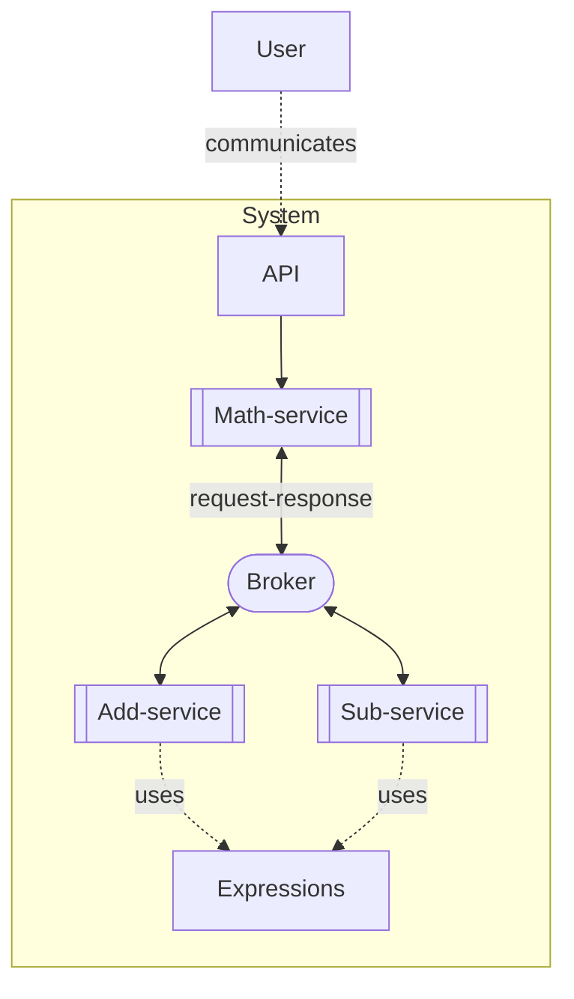

# Broker-Based Math Service

> Generated from Ocean-Atlas v0.1.0 (content a0c57f8d). Canonical source: https://atlas.ocean-lab.ai/examples/math-service/

**Contents**

- [Overview](#overview)
- [Files](#files)
- [DSL source files](#dsl-source-files)
- [Diagrams](#diagrams)
- [Walkthrough](#walkthrough)

Route addition and subtraction requests through typed broker channels to specialized services.

Source: https://atlas.ocean-lab.ai/examples/math-service/

Level: easy · Estimated time: 10 minutes · Version: 1.0.0 · Onboarding example: no

Components: 3 services, 1 brokers, 0 databases

Tags: api, broker, expressions, math, microservices, request-response, rest, ui

## Overview

This example shows how a coordinating calculator service routes typed addition and subtraction requests through a broker to specialized services. Its executable DSL and its Horizon and Voyage explanation are maintained together in this example directory.

## Files

DSL source comes first, then diagrams; the long Horizon and Voyage walkthroughs are at the end. You can stop after the source files.

| File | Section | Lines |
| --- | --- | --- |
| `00-info.ocn` | `@info` | 17 |
| `01-datatype.ocn` | `@datatype` | 18 |
| `02-api-add.ocn` | `@api` | 19 |
| `02-api-math.ocn` | `@api` | 21 |
| `02-api-sub.ocn` | `@api` | 19 |
| `03-config.ocn` | `@config` | 29 |
| `04-broker.ocn` | `@broker` | 20 |
| `05-expressions.ocn` | `@expression` | 61 |
| `07-service-add.ocn` | `@service` | 22 |
| `07-service-math.ocn` | `@service` | 27 |
| `07-service-sub.ocn` | `@service` | 22 |
| `08-deploy.ocn` | `@deploy` | 41 |
| `09-dashboard.ocn` | `@dashboard` | 42 |
| `10-ui.ocn` | `@ui` | 40 |

## DSL source files

### `00-info.ocn`

```ocean-dsl
# @ocean-meta-start
# tags:
#   - documentation
# perspective:
#   feature: math-service
# @ocean-meta-end

@info

name: Math App
version: 1.0.0
title: Math-app
subtitle: To perform your math
shortDescription: Answers all your math questions

description: This app answers your math questions
```

### `01-datatype.ocn`

```ocean-dsl
# @ocean-meta-start
# tags:
#   - broker-request-response
#   - datatype
# perspective:
#   feature: math-service
#   service: math-service
# @ocean-meta-end

@datatype

MathRequest
    num1: Int
    num2: Int

MathResponse
    resValue: Int
```

### `02-api-add.ocn`

```ocean-dsl
# @ocean-meta-start
# tags:
#   - add-api
#   - rest-api
# perspective:
#   feature: math-service
#   service: add-service
# @ocean-meta-end

@api

AddApi style:rest
    engine = gin
    configType = ApiConfig
    version = 1.0.0
    generateSwagger = true

    post /math/add/{a}/{b}       addNumbers(a:Int, b:Int) : Int
```

### `02-api-math.ocn`

```ocean-dsl
# @ocean-meta-start
# tags:
#   - math-api
#   - rest-api
# perspective:
#   feature: math-service
#   service: math-service
# @ocean-meta-end

@api

MathApi style:rest
    engine = gin
    configType = ApiConfig
    version = 1.0.0
    generateSwagger = true

    post /math/add/{a}/{b}        addNumbers(a:Int, b:Int) : Int
    post /math/sub/{a}/{b}        subNumbers(a:Int, b:Int) : Int
    get  /math/calc/{a}/{b}/{op}  calculate(a:Int, b:Int, op:String) : Int
```

### `02-api-sub.ocn`

```ocean-dsl
# @ocean-meta-start
# tags:
#   - sub-api
#   - rest-api
# perspective:
#   feature: math-service
#   service: sub-service
# @ocean-meta-end

@api

SubApi style:rest
    engine = gin
    configType = ApiConfig
    version = 1.0.0
    generateSwagger = true

    post /math/sub/{a}/{b}       subNumbers(a:Int, b:Int) : Int
```

### `03-config.ocn`

```ocean-dsl
# @ocean-meta-start
# tags:
#   - configuration
# perspective:
#   feature: math-service
#   service: all
# @ocean-meta-end

@config

@import config O.broker.nats.config@1.0.0 as BrokerConfig
@import config O.log.config@1.0.0 as LogConfig

ServiceConfig
    apiConfig: ApiConfig
    brokerConfig: BrokerConfig
    logConfig: LogConfig

ApiConfig
    port: Int (default=8080)

MathBrokerConfig
    brokerConfig : BrokerConfig
    logConfig    : LogConfig

UiConfig
    port: Int (default=8080)
    logConfig : LogConfig
```

### `04-broker.ocn`

```ocean-dsl
# @ocean-meta-start
# tags:
#   - broker-request-response
#   - broker
# perspective:
#   feature: math-service
#   service: all
# @ocean-meta-end

@broker

MathBroker
    @perspectives: version:0.1.0, lifestyle:stable
    tags = primary, shared
    engine = nats
    configType = MathBrokerConfig

    math.add : MathRequest-MathResponse as request-response with timeout:1s
    math.sub : MathRequest-MathResponse as request-response with timeout:1s
```

### `05-expressions.ocn`

```ocean-dsl
# @ocean-meta-start
# tags:
#   - expression
# perspective:
#   feature: math-service
#   service: all
# @ocean-meta-end

@expression

HandleAdd
    input: a:Int & b:Int
    output: result:Int
    logic
        result = a + b

AddResponser
    input: req:MathRequest
    output: result:MathResponse
    logic
        result.resValue = req.num1 + req.num2

HandleSub
    input: a:Int & b:Int
    output: result:Int
    logic
        result = a - b

SubResponser
    input: req:MathRequest
    output: result:MathResponse
    logic
        result.resValue = req.num1 - req.num2

RequestHandler
    input: a:Int & b:Int & requester:Func<MathRequest,MathResponse>
    output: result:Int
    logic
        var req MathRequest
        var res MathResponse
        req.num1 = a
        req.num2 = b
        res = requester(req)
        result = res.resValue

CalculateHandler
    input: a:Int & b:Int & op:String & addRequester:Func<MathRequest,MathResponse> & subRequester:Func<MathRequest,MathResponse>
    output: result:Int
    logic
        var req MathRequest
        var res MathResponse
        req.num1 = a
        req.num2 = b
        if op=="add" then
            res = addRequester(req)
        end
        if op=="sub" then
            res = subRequester(req)
        end
        result = res.resValue
```

### `07-service-add.ocn`

```ocean-dsl
# @ocean-meta-start
# tags:
#   - add-api
#   - service
# perspective:
#   feature: math-service
#   service: add-service
# @ocean-meta-end

@service

AddService

    use config ServiceConfig as addCfg
    use broker MathBroker as broker
    impl api AddApi as api on addCfg.apiConfig.port
    use expression HandleAdd
    use expression AddResponser

    connect api.addNumbers  -> HandleAdd
    connect broker.math.add -> AddResponser
```

### `07-service-math.ocn`

```ocean-dsl
# @ocean-meta-start
# tags:
#   - math-api
#   - service
# perspective:
#   feature: math-service
#   service: math-service
# @ocean-meta-end

@service

MathService

    use config ServiceConfig as mathCfg
    use broker MathBroker as broker
    impl api MathApi as api on mathCfg.apiConfig.port
    use expression RequestHandler
    use expression CalculateHandler
    use function Func<MathRequest,MathResponse> as AddRequester
    use function Func<MathRequest,MathResponse> as SubRequester

    connect api.addNumbers -> RequestHandler(requester:AddRequester)
    connect api.subNumbers -> RequestHandler(requester:SubRequester)
    connect AddRequester   -> broker.math.add & timeout(3:s)
    connect SubRequester   -> broker.math.sub & timeout(3:s)
    connect api.calculate  -> CalculateHandler(addRequester:AddRequester, subRequester:SubRequester)
```

### `07-service-sub.ocn`

```ocean-dsl
# @ocean-meta-start
# tags:
#   - sub-api
#   - service
# perspective:
#   feature: math-service
#   service: sub-service
# @ocean-meta-end

@service

SubService

    use config ServiceConfig as subCfg
    use broker MathBroker as broker
    impl api SubApi as api on subCfg.apiConfig.port
    use expression HandleSub
    use expression SubResponser

    connect api.subNumbers  -> HandleSub
    connect broker.math.sub -> SubResponser
```

### `08-deploy.ocn`

```ocean-dsl
# @ocean-meta-start
# tags:
#   - deployment
# perspective:
#   feature: math-service
#   service: all
# @ocean-meta-end

@deploy

Name: MathDeploy-PRD-2025-08

@import service P.broker.nats.docker@1.0.0 as NATS

MathDeploy
    service  MathService
    replica  1
    export   9096:MathService.api
    dependsOn   Broker

AddDeploy
    service  AddService
    replica  2
    #export   9097:AddService.api
    dependsOn   Broker

SubDeploy
    service  SubService
    replica  2
    #export   9098:SubService.api
    dependsOn   Broker

Broker
    service NATS

MathUiDeploy
    service     MathUi
    replica     1
    export      8085:MathUi.config
    dependsOn   MathDeploy
```

### `09-dashboard.ocn`

```ocean-dsl
# @ocean-meta-start
# tags:
#   - ui
#   - dashboard
# perspective:
#   feature: math-service
#   service: ui-service
# @ocean-meta-end

@dashboard

MathDashboard
    title: Let's Calculate!
    layout: SingleColumnLayout

    Widget SumForm of type Form
        title = Sum
        fields:
            - a Int
            - b Int
        buttons:
            submit : Sum
            cancel : Cancel

    Widget SubForm of type Form
        title = Sub
        fields:
            - a Int
            - b Int
        buttons:
            submit : Sub
            cancel : Cancel

AboutDashboard
    title: About
    layout: SingleColumnLayout

    Widget AboutText of type Text
        title = About Math App
        subtitle = This app helps you to solve your math problems!
        content = ver. 1.0.0
```

### `10-ui.ocn`

```ocean-dsl
# @ocean-meta-start
# tags:
#   - ui
# perspective:
#   feature: math-service
#   service: ui-service
# @ocean-meta-end

@ui

MathUi

    @perspectives: version:0.1.0, lifestyle:stable

    framework: htmx
    styling: bootstrap
    template: go-html-template
    backend: go-gin
    static: static
    configType: UiConfig

    nav Calculate dashboard = MathDashboard
    nav About dashboard = AboutDashboard

    header title = ∑ Math App
    header subtitle = To solve your math problems! 
    header align = center

    footer title = ⚡ Built with Ocean-lab
    footer subtitle = Version 1.0.0
    footer align = center

    use dashboard MathDashboard as m
    use dashboard AboutDashboard as a

    use api MathApi

    connect m.SumForm.submit -> MathApi.addNumbers
    connect m.SubForm.submit -> MathApi.subNumbers
```

## Diagrams

### `spec-math-service.mmd`



## Walkthrough

A long, step-by-step explanation (Horizon and Voyage) is in [Broker-Based Math Service walkthrough](math-service-walkthrough.md). Read it only if you need the reasoning behind the design.
