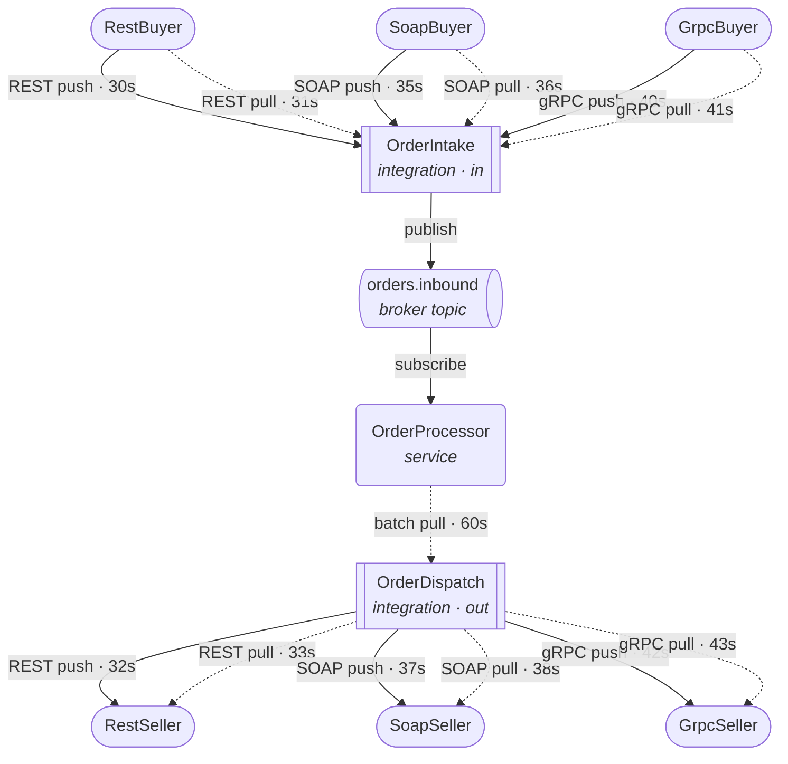
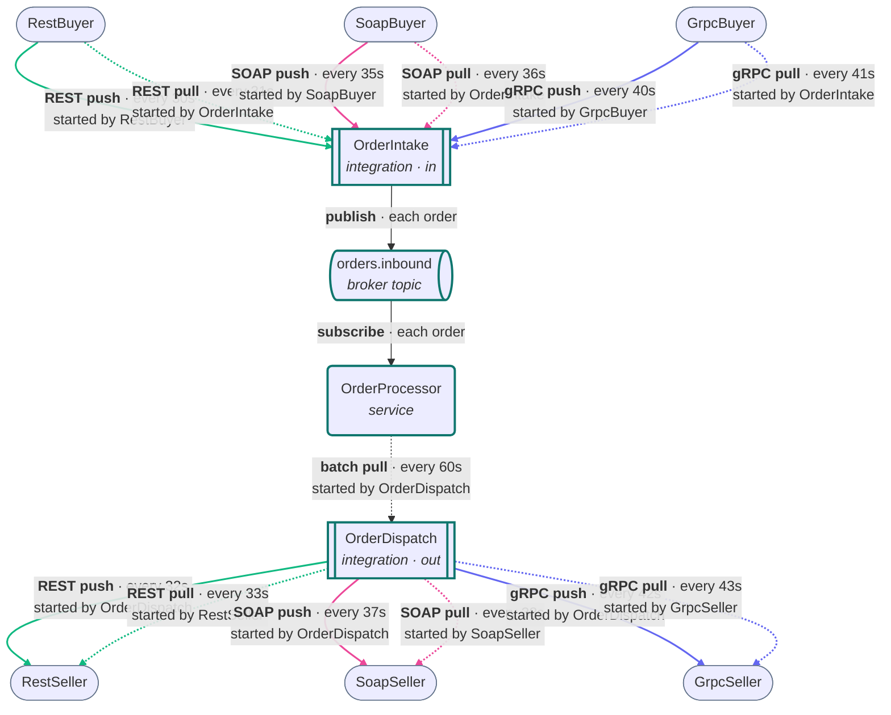
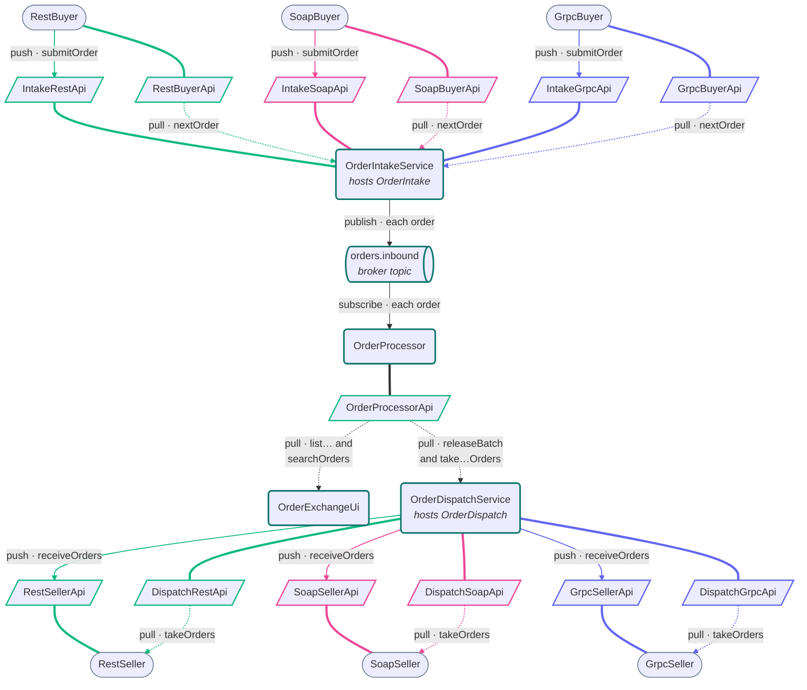

# Order Exchange

> Generated from Ocean-Atlas v0.1.0 (content a0c57f8d). Canonical source: https://atlas.ocean-lab.ai/examples/order-exchange/

**Contents**

- [Status](#status)
- [Overview](#overview)
- [Push and pull](#push-and-pull)
- [Partner formats and mappers](#partner-formats-and-mappers)
- [Processing and outboxes](#processing-and-outboxes)
- [Monitoring](#monitoring)
- [Deployment](#deployment)
- [Files](#files)
- [DSL source files](#dsl-source-files)
- [Diagrams](#diagrams)
- [Walkthrough](#walkthrough)
- [Other files in the example (not inlined)](#other-files-in-the-example-not-inlined)

Exchange orders with six partners over every combination of REST, SOAP, and gRPC, inbound and outbound, push and pull, mapping each partner's own format at the integration boundaries.

Source: https://atlas.ocean-lab.ai/examples/order-exchange/

Level: advanced · Estimated time: 45 minutes · Version: 1.0.0 · Onboarding example: no

Components: 11 services, 1 brokers, 0 databases

Tags: aggregation, broker, context, dashboard, grpc, integration, mapping, pull, push, rest, scheduling, soap, ui

## Status

This example is a draft. Its DSL follows the Ocean references, but the engine
cannot yet generate all twelve flows:

- aggregates resolve only REST endpoints, so the SOAP and gRPC outbound
  aggregates in `OrderDispatch` do not validate;
- a scheduled `connect` cannot yet generate a call to a used API as its source
  (the pull flows), or to a SOAP or gRPC API as its target.

With those lines left out, the rest of the model validates, generates, and
compiles: all eleven services, both integrations with their REST, SOAP, and
gRPC APIs, the broker, and the UI.

## Overview

Order Exchange is the reference for Ocean integrations. Three buyers send
orders and three sellers receive them. Each partner speaks one API style, and
each is reached both ways, so the exchange covers every combination of API
style, direction, and push or pull: twelve flows.

It builds on `examples.purchase-order-orchestration`: a thin service hosts each
reusable integration, partner-specific formats are mapped to one canonical
`Order`, and aggregates collect, deliver, and respond.



`architecture.mmd` holds the full diagram, with each label naming the party
whose timer starts the call.

## Push and pull

Ocean derives push or pull from the shape of an integration; neither is
declared. The schedule therefore lives with whoever starts the call:

| Flow | Who starts it | Ocean shape |
| --- | --- | --- |
| Inbound push | the buyer | the buyer's scheduled `connect` to an intake API that `OrderIntake` implements |
| Inbound pull | `OrderIntake` | a scheduled `connect` from the buyer's API in `OrderIntake` |
| Outbound push | `OrderDispatch` | a scheduled `aggregate` that delivers to the seller's API |
| Outbound pull | the seller | the seller's scheduled `connect` from a dispatch API that `OrderDispatch` implements, served by a triggered `aggregate` |

## Partner formats and mappers

Every partner has its own order format, with its own field names and, for
`GrpcBuyerOrder` and `SoapSellerOrder`, a nested line. `OrderIntake` maps each
buyer format to `Order` with `MapRestBuyerOrder`, `MapSoapBuyerOrder`, and
`MapGrpcBuyerOrder`; `OrderDispatch` maps `Order` to each seller format with
`MapToRestSellerOrders`, `MapToSoapSellerOrders`, and `MapToGrpcSellerOrders`.
Inside the exchange, only `Order` is used.

## Processing and outboxes

`OrderIntake` publishes every mapped order to the `orders.inbound` topic, the
queue between intake and processing. `OrderProcessor` consumes it and keeps
every order in its context with an outbound flow, assigned in turn across the
six seller flows, and a status: processed, released, or dispatched.

An integration keeps no state, so the outboxes live in `OrderProcessor`: the
released orders of each outbound flow. Every sixty seconds `OrderDispatch`
releases the processed batch. Each push aggregate then takes its flow's outbox
on its own schedule and delivers it to the seller; each pull aggregate takes
its flow's outbox when the seller polls and responds with it.

## Monitoring

`OrderExchangeUi` has four dashboards, all served by `OrderProcessorApi`:

- **Flow Monitor** lists the twelve flows, who starts each, its schedule, and
  how many orders it has carried.
- **Orders** lists every order, newest first, with its buyer and seller, its
  inbound and outbound flow, its status, and when it was received and
  dispatched.
- **Dispatched** lists the orders handed on to sellers, most recently
  dispatched first, with how long each waited in the exchange.
- **Search** finds orders by buyer, by seller, or both, through a form backed
  by `searchOrders`. An empty field matches any.

`OrderProcessor` stamps each order with `receivedAt` when it accepts it and
`dispatchedAt` when its outbox is taken, so every order can be followed from
buyer to seller.

## Deployment

| Service | Ports |
| --- | --- |
| RestBuyer, SoapBuyer, GrpcBuyer | 9181, 9182, 9183 |
| OrderIntakeService (REST, SOAP, gRPC intake) | 9101, 9102, 9103 |
| OrderProcessor | 9110 |
| OrderDispatchService (REST, SOAP, gRPC dispatch) | 9121, 9122, 9123 |
| RestSeller, SoapSeller, GrpcSeller | 9191, 9192, 9193 |
| OrderExchangeUi | 8086 |

A service that serves several API styles needs a distinct port per API. Each
style has its own port configuration type with its own default: `ApiConfig`
(8080), `SoapApiConfig` (8081), and `GrpcApiConfig` (8082).

## Files

DSL source comes first, then diagrams; the long Horizon and Voyage walkthroughs are at the end. You can stop after the source files.

| File | Section | Lines |
| --- | --- | --- |
| `00-oex-info.ocn` | `@info` | 37 |
| `01-oex-context.ocn` | `@context` | 17 |
| `10-oex-datatype.ocn` | `@datatype` | 170 |
| `20-oex-api-dispatch-grpc.ocn` | `@api` | 23 |
| `20-oex-api-dispatch-rest.ocn` | `@api` | 23 |
| `20-oex-api-dispatch-soap.ocn` | `@api` | 24 |
| `20-oex-api-grpc-buyer.ocn` | `@api` | 23 |
| `20-oex-api-grpc-seller.ocn` | `@api` | 23 |
| `20-oex-api-intake-grpc.ocn` | `@api` | 23 |
| `20-oex-api-intake-rest.ocn` | `@api` | 23 |
| `20-oex-api-intake-soap.ocn` | `@api` | 24 |
| `20-oex-api-order-processor.ocn` | `@api` | 41 |
| `20-oex-api-rest-buyer.ocn` | `@api` | 23 |
| `20-oex-api-rest-seller.ocn` | `@api` | 23 |
| `20-oex-api-soap-buyer.ocn` | `@api` | 24 |
| `20-oex-api-soap-seller.ocn` | `@api` | 24 |
| `20-oex-broker.ocn` | `@broker` | 21 |
| `30-oex-config.ocn` | `@config` | 40 |
| `40-oex-expression-buyers.ocn` | `@expression` | 73 |
| `40-oex-expression-dispatch-mappers.ocn` | `@expression` | 36 |
| `40-oex-expression-intake-mappers.ocn` | `@expression` | 36 |
| `40-oex-expression-processor.ocn` | `@expression` | 183 |
| `40-oex-expression-sellers.ocn` | `@expression` | 32 |
| `50-oex-integration-dispatch.ocn` | `@integration` | 104 |
| `50-oex-integration-intake.ocn` | `@integration` | 49 |
| `51-oex-service-grpc-buyer.ocn` | `@service` | 27 |
| `51-oex-service-rest-buyer.ocn` | `@service` | 27 |
| `51-oex-service-soap-buyer.ocn` | `@service` | 27 |
| `52-oex-service-order-dispatch.ocn` | `@service` | 17 |
| `52-oex-service-order-intake.ocn` | `@service` | 17 |
| `52-oex-service-order-processor.ocn` | `@service` | 50 |
| `53-oex-service-grpc-seller.ocn` | `@service` | 26 |
| `53-oex-service-rest-seller.ocn` | `@service` | 26 |
| `53-oex-service-soap-seller.ocn` | `@service` | 26 |
| `55-oex-dashboard-dispatched.ocn` | `@dashboard` | 39 |
| `55-oex-dashboard-flows.ocn` | `@dashboard` | 34 |
| `55-oex-dashboard-orders.ocn` | `@dashboard` | 39 |
| `55-oex-dashboard-search.ocn` | `@dashboard` | 29 |
| `56-oex-ui.ocn` | `@ui` | 46 |
| `60-oex-deploy.ocn` | `@deploy` | 89 |

## DSL source files

### `00-oex-info.ocn`

```ocean-dsl
# @ocean-meta-start
# tags:
#   - integration
#   - rest-api
#   - soap-api
#   - grpc-api
#   - broker
# perspective:
#   feature: order-exchange
#   boundedContext: order-exchange
# @ocean-meta-end

@info

name: Order Exchange
version: 1.0.0
title: Order Exchange
subtitle: REST, SOAP, and gRPC partners, inbound and outbound, push and pull
shortDescription: A complete integration example that exchanges orders with six partners over every combination of API style, direction, and push or pull.

description:

Overview
Order Exchange receives orders from three buyers and hands them on to three sellers. Each partner speaks one API style: REST, SOAP, or gRPC. Every partner is reached in both ways: it pushes to Ocean, and Ocean pulls from it. That gives twelve flows, one for each combination of style, direction, and push or pull.

Inbound
OrderIntake is an inbound integration. Buyers push orders to the three intake APIs it implements, and it polls each buyer's own API on a schedule. Every order is mapped from the buyer's own format to the canonical Order and published to the orders.inbound broker topic.

Processing
OrderProcessor consumes orders.inbound, keeps every order, and assigns each one an outbound flow, taking turns across the six seller flows.

Outbound
OrderDispatch is an outbound integration. Every sixty seconds it releases the processed batch. It then pushes released orders to each seller on a schedule, and serves them to sellers that poll the three dispatch APIs it implements. Every order is mapped to the seller's own format on the way out.

Monitoring
The Flow Monitor dashboard lists all twelve flows with the number of orders each has carried, and the Orders dashboard shows every order with its inbound and outbound flow.
```

### `01-oex-context.ocn`

```ocean-dsl
# @ocean-meta-start
# tags:
#   - context
#   - order
# perspective:
#   feature: order-exchange
#   boundedContext: order-exchange
#   service: order-processor
# @ocean-meta-end

@context

# Every order OrderProcessor has received, with its outbound flow and status.
# The outbound flows' outboxes are the released orders of each flow.
ProcessorContext
    orders : List<Order>
```

### `10-oex-datatype.ocn`

```ocean-dsl
# @ocean-meta-start
# tags:
#   - datatype
#   - order
#   - canonical
#   - partner-format
#   - dashboard
# perspective:
#   feature: order-exchange
#   boundedContext: order-exchange
#   service: shared
# @ocean-meta-end

@datatype

# The canonical order used inside the exchange. sourceId is the buyer's own
# order identifier (RestBuyerOrder.orderId, SoapBuyerOrder.reference, or
# GrpcBuyerOrder.code), kept so an order can be found by either identifier.
# inboundFlow and outboundFlow name one of the twelve flows, such as
# "REST push" or "gRPC pull"; status is processed, released, or dispatched.
# receivedAt is set when OrderProcessor accepts the order, dispatchedAt when
# its outbox is taken.

Order
    id pattern ORD-UUID
    sourceId     : String
    product      : String
    quantity     : Int
    buyer        : String
    inboundFlow  : String
    outboundFlow : String
    status       : String
    receivedAt   : DateTime
    dispatchedAt : *DateTime

# RestBuyer's own order format. OrderIntake maps it to Order.
# channel names the inbound flow, such as "REST push".

RestBuyerOrder
    orderId  : String
    product  : String
    quantity : Int
    buyer    : String
    channel  : String

# SoapBuyer's own order format. OrderIntake maps it to Order.
# channel names the inbound flow, such as "SOAP pull".

SoapBuyerOrder
    reference : String
    item      : String
    units     : Int
    party     : String
    channel   : String

# The line item nested in GrpcBuyerOrder.

GrpcBuyerLine
    sku   : String
    count : Int

# GrpcBuyer's own order format, with a nested line item. OrderIntake maps it
# to Order. channel names the inbound flow, such as "gRPC push".

GrpcBuyerOrder
    code    : String
    line    : GrpcBuyerLine
    account : String
    channel : String

# RestSeller's own order format. OrderDispatch maps Order to it.
# origin names the inbound flow the order arrived through.

RestSellerOrder
    saleId   : String
    article  : String
    amount   : Int
    customer : String
    origin   : String

# The line item nested in SoapSellerOrder.

SoapSellerLine
    goods  : String
    pieces : Int

# SoapSeller's own order format, with a nested line item. OrderDispatch maps
# Order to it. origin names the inbound flow the order arrived through.

SoapSellerOrder
    ticket : String
    line   : SoapSellerLine
    client : String
    origin : String

# GrpcSeller's own order format. OrderDispatch maps Order to it.
# origin names the inbound flow the order arrived through.

GrpcSellerOrder
    uid           : String
    catalogNumber : String
    qty           : Int
    purchaser     : String
    origin        : String

# One outbound flow's outbox, as OrderProcessor hands it to OrderDispatch's
# aggregates.

OrderBatch
    orders : List<Order>

# The size of a batch OrderProcessor released into the outboxes.

BatchRelease
    released : Int

# One row of the Flow Monitor: one of the twelve flows.

FlowRow
    id        : String
    flow      : String
    direction : String
    style     : String
    mode      : String
    startedBy : String
    schedule  : String
    orders    : Int

# One order and its journey through the exchange, as listed on the Orders
# dashboard and returned by an order search. seller is the seller its outbound
# flow leads to; dispatchedAt is empty until the order is dispatched.

OrderRow
    id           : String
    sourceId     : String
    product      : String
    quantity     : Int
    buyer        : String
    seller       : String
    inboundFlow  : String
    outboundFlow : String
    status       : String
    receivedAt   : String
    dispatchedAt : String

# One row of the Dispatched dashboard: a dispatched order, the seller that got
# it, and how long it waited in the exchange.

DispatchedRow
    id           : String
    sourceId     : String
    product      : String
    quantity     : Int
    buyer        : String
    seller       : String
    inboundFlow  : String
    outboundFlow : String
    receivedAt   : String
    dispatchedAt : String
    waited       : String

# The Search dashboard's form: find orders by their id, by buyer, by seller,
# or any combination. An empty field matches anything; matching ignores case.
# id matches either the exchange's own ORD- id or the buyer's own order id.

OrderQuery
    id     : String
    buyer  : String
    seller : String
```

### `20-oex-api-dispatch-grpc.ocn`

```ocean-dsl
# @ocean-meta-start
# tags:
#   - api
#   - grpc-api
#   - dispatch
# perspective:
#   feature: order-exchange
#   boundedContext: order-exchange
#   service: order-dispatch-service
# @ocean-meta-end

@api

DispatchGrpcApi style:grpc
    engine       = connect
    configType   = GrpcApiConfig
    version      = 1.0.0
    description  = Implemented by OrderDispatch; GrpcSeller polls it for its released orders.
    protoPackage = oceanlab.examples.orderexchange.dispatch.v1
    reflection   = true

    rpc takeOrders() : List<GrpcSellerOrder>
```

### `20-oex-api-dispatch-rest.ocn`

```ocean-dsl
# @ocean-meta-start
# tags:
#   - api
#   - rest-api
#   - dispatch
# perspective:
#   feature: order-exchange
#   boundedContext: order-exchange
#   service: order-dispatch-service
# @ocean-meta-end

@api

DispatchRestApi style:rest
    engine          = gin
    configType      = ApiConfig
    version         = 1.0.0
    description     = Implemented by OrderDispatch; RestSeller polls it for its released orders.
    basePath        = /dispatch
    generateSwagger = true

    get /orders takeOrders() : List<RestSellerOrder>
```

### `20-oex-api-dispatch-soap.ocn`

```ocean-dsl
# @ocean-meta-start
# tags:
#   - api
#   - soap-api
#   - dispatch
# perspective:
#   feature: order-exchange
#   boundedContext: order-exchange
#   service: order-dispatch-service
# @ocean-meta-end

@api

DispatchSoapApi style:soap
    engine       = soap
    configType   = SoapApiConfig
    version      = 1.0.0
    description  = Implemented by OrderDispatch; SoapSeller polls it for its released orders.
    namespace    = https://ocean-lab.ai/examples/order-exchange/dispatch/v1
    endpointPath = /dispatch
    soapVersion  = 1.2

    operation takeOrders() : List<SoapSellerOrder>
```

### `20-oex-api-grpc-buyer.ocn`

```ocean-dsl
# @ocean-meta-start
# tags:
#   - api
#   - grpc-api
#   - buyer
# perspective:
#   feature: order-exchange
#   boundedContext: order-exchange
#   service: grpc-buyer
# @ocean-meta-end

@api

GrpcBuyerApi style:grpc
    engine       = connect
    configType   = GrpcApiConfig
    version      = 1.0.0
    description  = Implemented by GrpcBuyer; OrderIntake polls it for the next order.
    protoPackage = oceanlab.examples.orderexchange.buyer.v1
    reflection   = true

    rpc nextOrder() : GrpcBuyerOrder
```

### `20-oex-api-grpc-seller.ocn`

```ocean-dsl
# @ocean-meta-start
# tags:
#   - api
#   - grpc-api
#   - seller
# perspective:
#   feature: order-exchange
#   boundedContext: order-exchange
#   service: grpc-seller
# @ocean-meta-end

@api

GrpcSellerApi style:grpc
    engine       = connect
    configType   = GrpcApiConfig
    version      = 1.0.0
    description  = Implemented by GrpcSeller; OrderDispatch pushes released orders to it.
    protoPackage = oceanlab.examples.orderexchange.seller.v1
    reflection   = true

    rpc receiveOrders(orders:List<GrpcSellerOrder>) : _
```

### `20-oex-api-intake-grpc.ocn`

```ocean-dsl
# @ocean-meta-start
# tags:
#   - api
#   - grpc-api
#   - intake
# perspective:
#   feature: order-exchange
#   boundedContext: order-exchange
#   service: order-intake-service
# @ocean-meta-end

@api

IntakeGrpcApi style:grpc
    engine       = connect
    configType   = GrpcApiConfig
    version      = 1.0.0
    description  = Implemented by OrderIntake; the gRPC buyer pushes its orders here.
    protoPackage = oceanlab.examples.orderexchange.intake.v1
    reflection   = true

    rpc submitOrder(order:GrpcBuyerOrder) : _
```

### `20-oex-api-intake-rest.ocn`

```ocean-dsl
# @ocean-meta-start
# tags:
#   - api
#   - rest-api
#   - intake
# perspective:
#   feature: order-exchange
#   boundedContext: order-exchange
#   service: order-intake-service
# @ocean-meta-end

@api

IntakeRestApi style:rest
    engine          = gin
    configType      = ApiConfig
    version         = 1.0.0
    description     = Implemented by OrderIntake; the REST buyer pushes its orders here.
    basePath        = /intake
    generateSwagger = true

    post /orders submitOrder(order:RestBuyerOrder) : _
```

### `20-oex-api-intake-soap.ocn`

```ocean-dsl
# @ocean-meta-start
# tags:
#   - api
#   - soap-api
#   - intake
# perspective:
#   feature: order-exchange
#   boundedContext: order-exchange
#   service: order-intake-service
# @ocean-meta-end

@api

IntakeSoapApi style:soap
    engine       = soap
    configType   = SoapApiConfig
    version      = 1.0.0
    description  = Implemented by OrderIntake; the SOAP buyer pushes its orders here.
    namespace    = https://ocean-lab.ai/examples/order-exchange/intake/v1
    endpointPath = /intake
    soapVersion  = 1.2

    operation submitOrder(order:SoapBuyerOrder) : _
```

### `20-oex-api-order-processor.ocn`

```ocean-dsl
# @ocean-meta-start
# tags:
#   - api
#   - rest-api
#   - processor
# perspective:
#   feature: order-exchange
#   boundedContext: order-exchange
#   service: order-processor
# @ocean-meta-end

@api

OrderProcessorApi style:rest
    engine          = gin
    configType      = ApiConfig
    version         = 1.0.0
    description     = Internal API of OrderProcessor, used by OrderDispatch and the UI.
    basePath        = /processor
    generateSwagger = true

    # Moves every processed order into its outbound flow's outbox.
    post /batches/release releaseBatch() : BatchRelease

    # Each take returns the released orders of one outbound flow and marks
    # them dispatched.
    post /outbox/rest-push/take takeRestPushOrders() : OrderBatch
    post /outbox/rest-pull/take takeRestPullOrders() : OrderBatch
    post /outbox/soap-push/take takeSoapPushOrders() : OrderBatch
    post /outbox/soap-pull/take takeSoapPullOrders() : OrderBatch
    post /outbox/grpc-push/take takeGrpcPushOrders() : OrderBatch
    post /outbox/grpc-pull/take takeGrpcPullOrders() : OrderBatch

    # Monitoring. Each list is paginated: Page<T> carries the true total
    # alongside its page of rows, so the UI knows when it has reached the
    # last page.
    get /flows/{offset}/{limit} listFlows(offset:Int, limit:Int) : Page<FlowRow>
    get /orders/{offset}/{limit} listOrderRows(offset:Int, limit:Int) : Page<OrderRow>
    get /dispatched/{offset}/{limit} listDispatchedRows(offset:Int, limit:Int) : Page<DispatchedRow>
    post /orders/search searchOrders(query:OrderQuery) : List<OrderRow>
```

### `20-oex-api-rest-buyer.ocn`

```ocean-dsl
# @ocean-meta-start
# tags:
#   - api
#   - rest-api
#   - buyer
# perspective:
#   feature: order-exchange
#   boundedContext: order-exchange
#   service: rest-buyer
# @ocean-meta-end

@api

RestBuyerApi style:rest
    engine          = gin
    configType      = ApiConfig
    version         = 1.0.0
    description     = Implemented by RestBuyer; OrderIntake polls it for the next order.
    basePath        = /buyer
    generateSwagger = true

    get /orders/next nextOrder() : RestBuyerOrder
```

### `20-oex-api-rest-seller.ocn`

```ocean-dsl
# @ocean-meta-start
# tags:
#   - api
#   - rest-api
#   - seller
# perspective:
#   feature: order-exchange
#   boundedContext: order-exchange
#   service: rest-seller
# @ocean-meta-end

@api

RestSellerApi style:rest
    engine          = gin
    configType      = ApiConfig
    version         = 1.0.0
    description     = Implemented by RestSeller; OrderDispatch pushes released orders to it.
    basePath        = /seller
    generateSwagger = true

    post /orders receiveOrders(orders:List<RestSellerOrder>) : _
```

### `20-oex-api-soap-buyer.ocn`

```ocean-dsl
# @ocean-meta-start
# tags:
#   - api
#   - soap-api
#   - buyer
# perspective:
#   feature: order-exchange
#   boundedContext: order-exchange
#   service: soap-buyer
# @ocean-meta-end

@api

SoapBuyerApi style:soap
    engine       = soap
    configType   = SoapApiConfig
    version      = 1.0.0
    description  = Implemented by SoapBuyer; OrderIntake polls it for the next order.
    namespace    = https://ocean-lab.ai/examples/order-exchange/buyer/v1
    endpointPath = /buyer
    soapVersion  = 1.2

    operation nextOrder() : SoapBuyerOrder
```

### `20-oex-api-soap-seller.ocn`

```ocean-dsl
# @ocean-meta-start
# tags:
#   - api
#   - soap-api
#   - seller
# perspective:
#   feature: order-exchange
#   boundedContext: order-exchange
#   service: soap-seller
# @ocean-meta-end

@api

SoapSellerApi style:soap
    engine       = soap
    configType   = SoapApiConfig
    version      = 1.0.0
    description  = Implemented by SoapSeller; OrderDispatch pushes released orders to it.
    namespace    = https://ocean-lab.ai/examples/order-exchange/seller/v1
    endpointPath = /seller
    soapVersion  = 1.2

    operation receiveOrders(orders:List<SoapSellerOrder>) : _
```

### `20-oex-broker.ocn`

```ocean-dsl
# @ocean-meta-start
# tags:
#   - broker
#   - nats
# perspective:
#   feature: order-exchange
#   boundedContext: order-exchange
#   service: order-exchange-broker
# @ocean-meta-end

@broker

OrderExchangeBroker
    @perspectives: version:1.0.0, lifestyle:stable
    engine = nats
    configType = OrderExchangeBrokerConfig
    tags = primary, shared

    # The queue between intake and processing: one event per order.
    orders.inbound : Order as event
```

### `30-oex-config.ocn`

```ocean-dsl
# @ocean-meta-start
# tags:
#   - configuration
# perspective:
#   feature: order-exchange
#   boundedContext: order-exchange
#   service: shared
# @ocean-meta-end

@config

@import config O.broker.nats.config@1.0.0 as BrokerConfig
@import config O.log.config@1.0.0 as LogConfig

# One port type per API style, so a service that serves all three styles, such
# as OrderIntakeService, gets three distinct default ports.
ApiConfig
    port : Int (default=8080)

SoapApiConfig
    port : Int (default=8081)

GrpcApiConfig
    port : Int (default=8082)

CommonServiceConfig
    apiConfig     : ApiConfig
    soapApiConfig : SoapApiConfig
    grpcApiConfig : GrpcApiConfig
    brokerConfig  : BrokerConfig
    logConfig     : LogConfig

OrderExchangeBrokerConfig
    brokerConfig : BrokerConfig
    logConfig    : LogConfig

UiConfig
    port      : Int (default=8080)
    logConfig : LogConfig
```

### `40-oex-expression-buyers.ocn`

```ocean-dsl
# @ocean-meta-start
# tags:
#   - expression
#   - buyer
#   - generator
# perspective:
#   feature: order-exchange
#   boundedContext: order-exchange
#   service: buyers
# @ocean-meta-end

@expression

# Buyers: a new order in each buyer's own format. The channel records which
# of the six inbound flows carries it.

NewRestBuyerOrder
    input: channel:String
    output: order:RestBuyerOrder
    external
        source: order-exchange.go
        method: NewRestBuyerOrder

NewSoapBuyerOrder
    input: channel:String
    output: order:SoapBuyerOrder
    external
        source: order-exchange.go
        method: NewSoapBuyerOrder

NewGrpcBuyerOrder
    input: channel:String
    output: order:GrpcBuyerOrder
    external
        source: order-exchange.go
        method: NewGrpcBuyerOrder

GenerateRestPushOrder
    input: _
    output: order:RestBuyerOrder
    logic
        order = NewRestBuyerOrder("REST push")

GenerateRestPullOrder
    input: _
    output: order:RestBuyerOrder
    logic
        order = NewRestBuyerOrder("REST pull")

GenerateSoapPushOrder
    input: _
    output: order:SoapBuyerOrder
    logic
        order = NewSoapBuyerOrder("SOAP push")

GenerateSoapPullOrder
    input: _
    output: order:SoapBuyerOrder
    logic
        order = NewSoapBuyerOrder("SOAP pull")

GenerateGrpcPushOrder
    input: _
    output: order:GrpcBuyerOrder
    logic
        order = NewGrpcBuyerOrder("gRPC push")

GenerateGrpcPullOrder
    input: _
    output: order:GrpcBuyerOrder
    logic
        order = NewGrpcBuyerOrder("gRPC pull")
```

### `40-oex-expression-dispatch-mappers.ocn`

```ocean-dsl
# @ocean-meta-start
# tags:
#   - expression
#   - mapping
#   - outbound
# perspective:
#   feature: order-exchange
#   boundedContext: order-exchange
#   service: order-dispatch-service
# @ocean-meta-end

@expression

# OrderDispatch mappers: the collected outbox batches to each seller's format.

MapToRestSellerOrders
    input: batches:List<OrderBatch>
    output: orders:List<RestSellerOrder>
    external
        source: order-exchange.go
        method: MapToRestSellerOrders

MapToSoapSellerOrders
    input: batches:List<OrderBatch>
    output: orders:List<SoapSellerOrder>
    external
        source: order-exchange.go
        method: MapToSoapSellerOrders

MapToGrpcSellerOrders
    input: batches:List<OrderBatch>
    output: orders:List<GrpcSellerOrder>
    external
        source: order-exchange.go
        method: MapToGrpcSellerOrders
```

### `40-oex-expression-intake-mappers.ocn`

```ocean-dsl
# @ocean-meta-start
# tags:
#   - expression
#   - mapping
#   - inbound
# perspective:
#   feature: order-exchange
#   boundedContext: order-exchange
#   service: order-intake-service
# @ocean-meta-end

@expression

# OrderIntake mappers: each buyer's format to the canonical Order.

MapRestBuyerOrder
    input: source:RestBuyerOrder
    output: order:Order
    external
        source: order-exchange.go
        method: MapRestBuyerOrder

MapSoapBuyerOrder
    input: source:SoapBuyerOrder
    output: order:Order
    external
        source: order-exchange.go
        method: MapSoapBuyerOrder

MapGrpcBuyerOrder
    input: source:GrpcBuyerOrder
    output: order:Order
    external
        source: order-exchange.go
        method: MapGrpcBuyerOrder
```

### `40-oex-expression-processor.ocn`

```ocean-dsl
# @ocean-meta-start
# tags:
#   - expression
#   - processor
#   - context
# perspective:
#   feature: order-exchange
#   boundedContext: order-exchange
#   service: order-processor
# @ocean-meta-end

@expression

# OrderProcessor: helpers over the list of orders it keeps, and the behavior
# behind its subscription and API.

AcceptOrder
    input: orders:List<Order> & order:Order
    output: result:List<Order>
    external
        source: order-exchange.go
        method: AcceptOrder

CountOrdersWithStatus
    input: orders:List<Order> & status:String
    output: count:Int
    external
        source: order-exchange.go
        method: CountOrdersWithStatus

ReleaseProcessedOrders
    input: orders:List<Order>
    output: result:List<Order>
    external
        source: order-exchange.go
        method: ReleaseProcessedOrders

ReleasedOrdersOf
    input: orders:List<Order> & flow:String
    output: result:List<Order>
    external
        source: order-exchange.go
        method: ReleasedOrdersOf

MarkDispatched
    input: orders:List<Order> & flow:String
    output: result:List<Order>
    external
        source: order-exchange.go
        method: MarkDispatched

ToFlowRows
    input: orders:List<Order> & offset:Int & limit:Int
    output: rows:Page<FlowRow>
    external
        source: order-exchange.go
        method: ToFlowRows

ToOrderRows
    input: orders:List<Order> & offset:Int & limit:Int
    output: rows:Page<OrderRow>
    external
        source: order-exchange.go
        method: ToOrderRows

ToDispatchedRows
    input: orders:List<Order> & offset:Int & limit:Int
    output: rows:Page<DispatchedRow>
    external
        source: order-exchange.go
        method: ToDispatchedRows

FindOrders
    input: orders:List<Order> & query:OrderQuery
    output: rows:List<OrderRow>
    external
        source: order-exchange.go
        method: FindOrders

ProcessOrder
    context: ctx:*ProcessorContext
    input: order:Order
    logic
        ctx.orders = AcceptOrder(ctx.orders, order)

ReleaseBatch
    context: ctx:*ProcessorContext
    input: _
    output: release:BatchRelease
    logic
        var released BatchRelease
        released.released = CountOrdersWithStatus(ctx.orders, "processed")
        ctx.orders = ReleaseProcessedOrders(ctx.orders)
        release = released

TakeRestPushOrders
    context: ctx:*ProcessorContext
    input: _
    output: batch:OrderBatch
    logic
        var outbox OrderBatch
        outbox.orders = ReleasedOrdersOf(ctx.orders, "REST push")
        ctx.orders = MarkDispatched(ctx.orders, "REST push")
        batch = outbox

TakeRestPullOrders
    context: ctx:*ProcessorContext
    input: _
    output: batch:OrderBatch
    logic
        var outbox OrderBatch
        outbox.orders = ReleasedOrdersOf(ctx.orders, "REST pull")
        ctx.orders = MarkDispatched(ctx.orders, "REST pull")
        batch = outbox

TakeSoapPushOrders
    context: ctx:*ProcessorContext
    input: _
    output: batch:OrderBatch
    logic
        var outbox OrderBatch
        outbox.orders = ReleasedOrdersOf(ctx.orders, "SOAP push")
        ctx.orders = MarkDispatched(ctx.orders, "SOAP push")
        batch = outbox

TakeSoapPullOrders
    context: ctx:*ProcessorContext
    input: _
    output: batch:OrderBatch
    logic
        var outbox OrderBatch
        outbox.orders = ReleasedOrdersOf(ctx.orders, "SOAP pull")
        ctx.orders = MarkDispatched(ctx.orders, "SOAP pull")
        batch = outbox

TakeGrpcPushOrders
    context: ctx:*ProcessorContext
    input: _
    output: batch:OrderBatch
    logic
        var outbox OrderBatch
        outbox.orders = ReleasedOrdersOf(ctx.orders, "gRPC push")
        ctx.orders = MarkDispatched(ctx.orders, "gRPC push")
        batch = outbox

TakeGrpcPullOrders
    context: ctx:*ProcessorContext
    input: _
    output: batch:OrderBatch
    logic
        var outbox OrderBatch
        outbox.orders = ReleasedOrdersOf(ctx.orders, "gRPC pull")
        ctx.orders = MarkDispatched(ctx.orders, "gRPC pull")
        batch = outbox

ListFlows
    context: ctx:*ProcessorContext
    input: offset:Int & limit:Int
    output: rows:Page<FlowRow>
    logic
        rows = ToFlowRows(ctx.orders, offset, limit)

ListOrderRows
    context: ctx:*ProcessorContext
    input: offset:Int & limit:Int
    output: rows:Page<OrderRow>
    logic
        rows = ToOrderRows(ctx.orders, offset, limit)

ListDispatchedRows
    context: ctx:*ProcessorContext
    input: offset:Int & limit:Int
    output: rows:Page<DispatchedRow>
    logic
        rows = ToDispatchedRows(ctx.orders, offset, limit)

SearchOrders
    context: ctx:*ProcessorContext
    input: query:OrderQuery
    output: rows:List<OrderRow>
    logic
        rows = FindOrders(ctx.orders, query)
```

### `40-oex-expression-sellers.ocn`

```ocean-dsl
# @ocean-meta-start
# tags:
#   - expression
#   - seller
# perspective:
#   feature: order-exchange
#   boundedContext: order-exchange
#   service: sellers
# @ocean-meta-end

@expression

# Sellers: acknowledge a delivery, pushed or pulled, in the log.

AcceptRestSellerOrders
    input: orders:List<RestSellerOrder>
    external
        source: order-exchange.go
        method: AcceptRestSellerOrders

AcceptSoapSellerOrders
    input: orders:List<SoapSellerOrder>
    external
        source: order-exchange.go
        method: AcceptSoapSellerOrders

AcceptGrpcSellerOrders
    input: orders:List<GrpcSellerOrder>
    external
        source: order-exchange.go
        method: AcceptGrpcSellerOrders
```

### `50-oex-integration-dispatch.ocn`

```ocean-dsl
# @ocean-meta-start
# tags:
#   - integration
#   - outbound
#   - push
#   - pull
#   - aggregation
# perspective:
#   feature: order-exchange
#   boundedContext: order-exchange
#   service: order-dispatch-service
# @ocean-meta-end

@integration

# Hands processed orders on to the sellers. Every sixty seconds it releases the
# processed batch into the six outboxes OrderProcessor keeps, one per outbound
# flow. It pushes each push flow's outbox to its seller on a schedule, and
# serves each pull flow's outbox to the seller that polls the dispatch API
# this integration implements. Orders are mapped to each seller's format.
OrderDispatch
    @perspectives: version:1.0.0, lifestyle:stable

    direction: out

    use config CommonServiceConfig as cfg

    impl api DispatchRestApi as restOut on cfg.apiConfig.port
    impl api DispatchSoapApi as soapOut on cfg.soapApiConfig.port
    impl api DispatchGrpcApi as grpcOut on cfg.grpcApiConfig.port

    use api OrderProcessorApi as processor
    use api RestSellerApi as restSeller
    use api SoapSellerApi as soapSeller
    use api GrpcSellerApi as grpcSeller

    use expression MapToRestSellerOrders as toRestSeller
    use expression MapToSoapSellerOrders as toSoapSeller
    use expression MapToGrpcSellerOrders as toGrpcSeller

    # Batch pull: release the processed batch into the outboxes.
    aggregate ReleaseBatch
        schedule every 60s

        result: List<BatchRelease>

        collect processor.releaseBatch

    # Push: this integration delivers each outbox to its seller on a timer.
    aggregate PushToRestSeller
        schedule every 32s

        result: List<OrderBatch>

        collect processor.takeRestPushOrders

        deliver restSeller.receiveOrders using toRestSeller

    aggregate PushToSoapSeller
        schedule every 37s

        result: List<OrderBatch>

        collect processor.takeSoapPushOrders

        deliver soapSeller.receiveOrders using toSoapSeller

    aggregate PushToGrpcSeller
        schedule every 42s

        result: List<OrderBatch>

        collect processor.takeGrpcPushOrders

        deliver grpcSeller.receiveOrders using toGrpcSeller

    # Pull: each seller polls its dispatch API on its own timer.
    aggregate ServeRestSeller
        trigger restOut.takeOrders

        result: List<OrderBatch>

        collect processor.takeRestPullOrders

        respond using toRestSeller

    aggregate ServeSoapSeller
        trigger soapOut.takeOrders

        result: List<OrderBatch>

        collect processor.takeSoapPullOrders

        respond using toSoapSeller

    aggregate ServeGrpcSeller
        trigger grpcOut.takeOrders

        result: List<OrderBatch>

        collect processor.takeGrpcPullOrders

        respond using toGrpcSeller
```

### `50-oex-integration-intake.ocn`

```ocean-dsl
# @ocean-meta-start
# tags:
#   - integration
#   - inbound
#   - push
#   - pull
# perspective:
#   feature: order-exchange
#   boundedContext: order-exchange
#   service: order-intake-service
# @ocean-meta-end

@integration

# Brings every buyer's orders into the exchange. Buyers push to the three
# intake APIs this integration implements; it pulls from the buyers' own APIs
# on a schedule. Each order is mapped from the buyer's format to Order and
# published to orders.inbound.
OrderIntake
    @perspectives: version:1.0.0, lifestyle:stable

    direction: in

    use config CommonServiceConfig as cfg

    impl api IntakeRestApi as restIn on cfg.apiConfig.port
    impl api IntakeSoapApi as soapIn on cfg.soapApiConfig.port
    impl api IntakeGrpcApi as grpcIn on cfg.grpcApiConfig.port

    use api RestBuyerApi as restBuyer
    use api SoapBuyerApi as soapBuyer
    use api GrpcBuyerApi as grpcBuyer

    use broker OrderExchangeBroker as broker

    use expression MapRestBuyerOrder as fromRestBuyer
    use expression MapSoapBuyerOrder as fromSoapBuyer
    use expression MapGrpcBuyerOrder as fromGrpcBuyer

    # Push: each buyer calls its intake API on its own timer.
    connect restIn.submitOrder -fromRestBuyer-> broker.orders.inbound
    connect soapIn.submitOrder -fromSoapBuyer-> broker.orders.inbound
    connect grpcIn.submitOrder -fromGrpcBuyer-> broker.orders.inbound

    # Pull: this integration polls each buyer on its own timer.
    connect restBuyer.nextOrder -fromRestBuyer-> broker.orders.inbound schedule every 31s
    connect soapBuyer.nextOrder -fromSoapBuyer-> broker.orders.inbound schedule every 36s
    connect grpcBuyer.nextOrder -fromGrpcBuyer-> broker.orders.inbound schedule every 41s
```

### `51-oex-service-grpc-buyer.ocn`

```ocean-dsl
# @ocean-meta-start
# tags:
#   - service
#   - buyer
#   - partner
#   - scheduling
# perspective:
#   feature: order-exchange
#   boundedContext: order-exchange
#   service: grpc-buyer
# @ocean-meta-end

@service

# Sends orders both ways: pushes to IntakeGrpcApi on its own timer, and serves
# its next order to OrderIntake when polled.

GrpcBuyer
    use config CommonServiceConfig as cfg
    impl api GrpcBuyerApi as api on cfg.grpcApiConfig.port
    use api IntakeGrpcApi as intake
    use expression GenerateGrpcPushOrder as push
    use expression GenerateGrpcPullOrder as pull

    connect push -> intake.submitOrder schedule every 40s
    connect api.nextOrder -> pull
```

### `51-oex-service-rest-buyer.ocn`

```ocean-dsl
# @ocean-meta-start
# tags:
#   - service
#   - buyer
#   - partner
#   - scheduling
# perspective:
#   feature: order-exchange
#   boundedContext: order-exchange
#   service: rest-buyer
# @ocean-meta-end

@service

# Sends orders both ways: pushes to IntakeRestApi on its own timer, and serves
# its next order to OrderIntake when polled.

RestBuyer
    use config CommonServiceConfig as cfg
    impl api RestBuyerApi as api on cfg.apiConfig.port
    use api IntakeRestApi as intake
    use expression GenerateRestPushOrder as push
    use expression GenerateRestPullOrder as pull

    connect push -> intake.submitOrder schedule every 30s
    connect api.nextOrder -> pull
```

### `51-oex-service-soap-buyer.ocn`

```ocean-dsl
# @ocean-meta-start
# tags:
#   - service
#   - buyer
#   - partner
#   - scheduling
# perspective:
#   feature: order-exchange
#   boundedContext: order-exchange
#   service: soap-buyer
# @ocean-meta-end

@service

# Sends orders both ways: pushes to IntakeSoapApi on its own timer, and serves
# its next order to OrderIntake when polled.

SoapBuyer
    use config CommonServiceConfig as cfg
    impl api SoapBuyerApi as api on cfg.soapApiConfig.port
    use api IntakeSoapApi as intake
    use expression GenerateSoapPushOrder as push
    use expression GenerateSoapPullOrder as pull

    connect push -> intake.submitOrder schedule every 35s
    connect api.nextOrder -> pull
```

### `52-oex-service-order-dispatch.ocn`

```ocean-dsl
# @ocean-meta-start
# tags:
#   - service
#   - integration-host
# perspective:
#   feature: order-exchange
#   boundedContext: order-exchange
#   service: order-dispatch-service
# @ocean-meta-end

@service

# A thin host: supplies the process and deployment boundary for OrderDispatch.

OrderDispatchService
    impl integration OrderDispatch as dispatch
```

### `52-oex-service-order-intake.ocn`

```ocean-dsl
# @ocean-meta-start
# tags:
#   - service
#   - integration-host
# perspective:
#   feature: order-exchange
#   boundedContext: order-exchange
#   service: order-intake-service
# @ocean-meta-end

@service

# A thin host: supplies the process and deployment boundary for OrderIntake.

OrderIntakeService
    impl integration OrderIntake as intake
```

### `52-oex-service-order-processor.ocn`

```ocean-dsl
# @ocean-meta-start
# tags:
#   - service
#   - processor
#   - broker
#   - context
# perspective:
#   feature: order-exchange
#   boundedContext: order-exchange
#   service: order-processor
# @ocean-meta-end

@service

# Consumes orders.inbound and keeps every order with its outbound flow and
# status. The outboxes OrderDispatch reads are its released orders.

OrderProcessor
    use config CommonServiceConfig as cfg
    impl api OrderProcessorApi as api on cfg.apiConfig.port
    use broker OrderExchangeBroker as broker
    use context ProcessorContext as processorCtx
    use expression ProcessOrder as process
    use expression ReleaseBatch as release
    use expression TakeRestPushOrders as takeRestPush
    use expression TakeRestPullOrders as takeRestPull
    use expression TakeSoapPushOrders as takeSoapPush
    use expression TakeSoapPullOrders as takeSoapPull
    use expression TakeGrpcPushOrders as takeGrpcPush
    use expression TakeGrpcPullOrders as takeGrpcPull
    use expression ListFlows as flows
    use expression ListOrderRows as rows
    use expression ListDispatchedRows as dispatchedRows
    use expression SearchOrders as search

    connect broker.orders.inbound -> process()

    connect api.releaseBatch -> release()
    connect api.takeRestPushOrders -> takeRestPush()
    connect api.takeRestPullOrders -> takeRestPull()
    connect api.takeSoapPushOrders -> takeSoapPush()
    connect api.takeSoapPullOrders -> takeSoapPull()
    connect api.takeGrpcPushOrders -> takeGrpcPush()
    connect api.takeGrpcPullOrders -> takeGrpcPull()

    connect api.listFlows -> flows
    connect api.listOrderRows -> rows
    connect api.listDispatchedRows -> dispatchedRows
    connect api.searchOrders -> search
```

### `53-oex-service-grpc-seller.ocn`

```ocean-dsl
# @ocean-meta-start
# tags:
#   - service
#   - seller
#   - partner
#   - scheduling
# perspective:
#   feature: order-exchange
#   boundedContext: order-exchange
#   service: grpc-seller
# @ocean-meta-end

@service

# Receives orders both ways: OrderDispatch pushes to its API on a timer, and it
# polls DispatchGrpcApi on its own timer.

GrpcSeller
    use config CommonServiceConfig as cfg
    impl api GrpcSellerApi as api on cfg.grpcApiConfig.port
    use api DispatchGrpcApi as dispatch
    use expression AcceptGrpcSellerOrders as accept

    connect api.receiveOrders -> accept()
    connect dispatch.takeOrders -> accept() schedule every 43s
```

### `53-oex-service-rest-seller.ocn`

```ocean-dsl
# @ocean-meta-start
# tags:
#   - service
#   - seller
#   - partner
#   - scheduling
# perspective:
#   feature: order-exchange
#   boundedContext: order-exchange
#   service: rest-seller
# @ocean-meta-end

@service

# Receives orders both ways: OrderDispatch pushes to its API on a timer, and it
# polls DispatchRestApi on its own timer.

RestSeller
    use config CommonServiceConfig as cfg
    impl api RestSellerApi as api on cfg.apiConfig.port
    use api DispatchRestApi as dispatch
    use expression AcceptRestSellerOrders as accept

    connect api.receiveOrders -> accept()
    connect dispatch.takeOrders -> accept() schedule every 33s
```

### `53-oex-service-soap-seller.ocn`

```ocean-dsl
# @ocean-meta-start
# tags:
#   - service
#   - seller
#   - partner
#   - scheduling
# perspective:
#   feature: order-exchange
#   boundedContext: order-exchange
#   service: soap-seller
# @ocean-meta-end

@service

# Receives orders both ways: OrderDispatch pushes to its API on a timer, and it
# polls DispatchSoapApi on its own timer.

SoapSeller
    use config CommonServiceConfig as cfg
    impl api SoapSellerApi as api on cfg.soapApiConfig.port
    use api DispatchSoapApi as dispatch
    use expression AcceptSoapSellerOrders as accept

    connect api.receiveOrders -> accept()
    connect dispatch.takeOrders -> accept() schedule every 38s
```

### `55-oex-dashboard-dispatched.ocn`

```ocean-dsl
# @ocean-meta-start
# tags:
#   - dashboard
#   - operations-monitoring
# perspective:
#   feature: order-exchange
#   boundedContext: order-exchange
#   service: order-exchange-ui
# @ocean-meta-end

@dashboard

DispatchedDashboard
    title: Dispatched
    layout: SingleColumnLayout

    Widget DispatchedGuide of type Text
        title = Orders handed on to sellers
        subtitle = Newest first, from the buyer that sent each order to the seller that got it
        content = <p>An order appears here once OrderDispatch has taken it from its outbox: pushed to its seller, or collected by a seller's poll. Waited is the time between OrderProcessor receiving the order and its dispatch; it includes the wait for the next batch release.</p>

    Widget DispatchedOrders of type Table
        title = Dispatched orders
        datatype = DispatchedRow
        columns:
            - id
            - sourceId
            - product
            - quantity
            - buyer
            - seller
            - inboundFlow
            - outboundFlow
            - receivedAt
            - dispatchedAt
            - waited
        sortable = true
        limit = 20
```

### `55-oex-dashboard-flows.ocn`

```ocean-dsl
# @ocean-meta-start
# tags:
#   - dashboard
#   - operations-monitoring
# perspective:
#   feature: order-exchange
#   boundedContext: order-exchange
#   service: order-exchange-ui
# @ocean-meta-end

@dashboard

FlowDashboard
    title: Flow Monitor
    layout: SingleColumnLayout

    Widget FlowGuide of type Text
        title = Twelve flows
        subtitle = Every API style, inbound and outbound, pushed and pulled
        content = <p>Each row is one flow. Inbound flows count the orders they brought in; outbound flows count the orders they have dispatched. Outbound counts grow once a minute, when OrderDispatch releases the processed batch.</p>

    Widget Flows of type Table
        title = Flows
        datatype = FlowRow
        columns:
            - flow
            - style
            - mode
            - startedBy
            - schedule
            - orders
        sortable = true
        limit = 12
```

### `55-oex-dashboard-orders.ocn`

```ocean-dsl
# @ocean-meta-start
# tags:
#   - dashboard
#   - operations-monitoring
# perspective:
#   feature: order-exchange
#   boundedContext: order-exchange
#   service: order-exchange-ui
# @ocean-meta-end

@dashboard

OrderDashboard
    title: Orders
    layout: SingleColumnLayout

    Widget OrderGuide of type Text
        title = Orders through the exchange
        subtitle = Newest first, with the flow each order came in and went out on
        content = <p>An order is processed when OrderProcessor receives it, released when OrderDispatch takes the batch, and dispatched once its seller has it.</p>

    Widget Orders of type Table
        title = Orders
        datatype = OrderRow
        columns:
            - id
            - sourceId
            - product
            - quantity
            - buyer
            - seller
            - inboundFlow
            - outboundFlow
            - status
            - receivedAt
            - dispatchedAt
        sortable = true
        limit = 20
```

### `55-oex-dashboard-search.ocn`

```ocean-dsl
# @ocean-meta-start
# tags:
#   - dashboard
#   - search
#   - operations-monitoring
# perspective:
#   feature: order-exchange
#   boundedContext: order-exchange
#   service: order-exchange-ui
# @ocean-meta-end

@dashboard

SearchDashboard
    title: Search
    layout: SingleColumnLayout

    Widget SearchGuide of type Text
        title = Find an order, or every order for a buyer or seller
        subtitle = Look an order up by either of its ids, or follow a buyer's or seller's orders
        content = <p>Enter an order id (the exchange's own ORD- id or the buyer's own order id), a buyer, a seller, or any combination: RestBuyer, SoapBuyer, or GrpcBuyer, and RestSeller, SoapSeller, or GrpcSeller. Leave a field empty to match anything; letter case does not matter. Each result shows both ids, the order's flows, its status, and when it was received and dispatched.</p>

    Widget OrderSearchForm of type Form
        title = Search orders
        datatype = OrderQuery
        buttons:
            submit : 🔍 Search orders
            cancel : Clear
```

### `56-oex-ui.ocn`

```ocean-dsl
# @ocean-meta-start
# tags:
#   - ui
#   - operations-monitoring
# perspective:
#   feature: order-exchange
#   boundedContext: order-exchange
#   service: order-exchange-ui
# @ocean-meta-end

@ui

OrderExchangeUi
    @perspectives: version:1.0.0, lifestyle:stable

    framework: htmx
    styling: bootstrap
    template: go-html-template
    backend: go-gin
    static: static
    configType: UiConfig

    nav Flows dashboard = FlowDashboard
    nav Orders dashboard = OrderDashboard
    nav Dispatched dashboard = DispatchedDashboard
    nav Search dashboard = SearchDashboard

    header title = Order Exchange
    header subtitle = REST, SOAP, and gRPC partners, inbound and outbound, push and pull
    header align = center

    footer title = Built with Ocean-lab
    footer subtitle = Integration example
    footer align = center

    use dashboard FlowDashboard as flows
    use dashboard OrderDashboard as orders
    use dashboard DispatchedDashboard as dispatched
    use dashboard SearchDashboard as search
    use api OrderProcessorApi

    connect flows.Flows.listRows -> OrderProcessorApi.listFlows
    connect orders.Orders.listRows -> OrderProcessorApi.listOrderRows
    connect dispatched.DispatchedOrders.listRows -> OrderProcessorApi.listDispatchedRows
    connect search.OrderSearchForm.submit -> OrderProcessorApi.searchOrders
```

### `60-oex-deploy.ocn`

```ocean-dsl
# @ocean-meta-start
# tags:
#   - deployment
# perspective:
#   feature: order-exchange
#   boundedContext: order-exchange
#   service: shared
# @ocean-meta-end

@deploy

Name: OrderExchangeDeploy

@import service P.broker.nats.docker@1.0.0 as NATS

# Buyers

RestBuyerDeploy
    service RestBuyer
    replica 1
    export 9181:RestBuyer.api

SoapBuyerDeploy
    service SoapBuyer
    replica 1
    export 9182:SoapBuyer.api

GrpcBuyerDeploy
    service GrpcBuyer
    replica 1
    export 9183:GrpcBuyer.api

# Exchange

OrderIntakeDeploy
    service OrderIntakeService
    replica 1
    export 9101:OrderIntakeService.restIn
    export 9102:OrderIntakeService.soapIn
    export 9103:OrderIntakeService.grpcIn
    dependsOn Broker, RestBuyerDeploy, SoapBuyerDeploy, GrpcBuyerDeploy

OrderProcessorDeploy
    service OrderProcessor
    replica 1
    export 9110:OrderProcessor.api
    dependsOn Broker

OrderDispatchDeploy
    service OrderDispatchService
    replica 1
    export 9121:OrderDispatchService.restOut
    export 9122:OrderDispatchService.soapOut
    export 9123:OrderDispatchService.grpcOut
    dependsOn OrderProcessorDeploy, RestSellerDeploy, SoapSellerDeploy, GrpcSellerDeploy

OrderExchangeBrokerDeploy
    service OrderExchangeBroker
    replica 1
    dependsOn Broker

Broker
    service NATS

# Sellers

RestSellerDeploy
    service RestSeller
    replica 1
    export 9191:RestSeller.api

SoapSellerDeploy
    service SoapSeller
    replica 1
    export 9192:SoapSeller.api

GrpcSellerDeploy
    service GrpcSeller
    replica 1
    export 9193:GrpcSeller.api

# Monitoring

OrderExchangeUiDeploy
    service OrderExchangeUi
    replica 1
    export 8086:OrderExchangeUi.config
    dependsOn OrderProcessorDeploy
```

## Diagrams

### `architecture.mmd`



### `services.mmd`



## Walkthrough

A long, step-by-step explanation (Horizon and Voyage) is in [Order Exchange walkthrough](order-exchange-walkthrough.md). Read it only if you need the reasoning behind the design.

## Other files in the example (not inlined)

Fixtures, scripts and supporting artifacts. See the example on the Atlas site for their purpose.

- `expression/order-exchange.go` (artifact)
