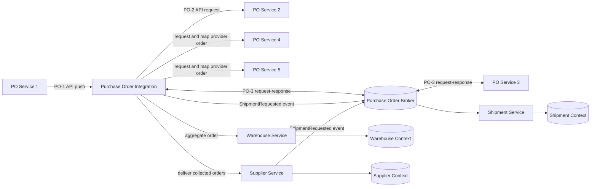
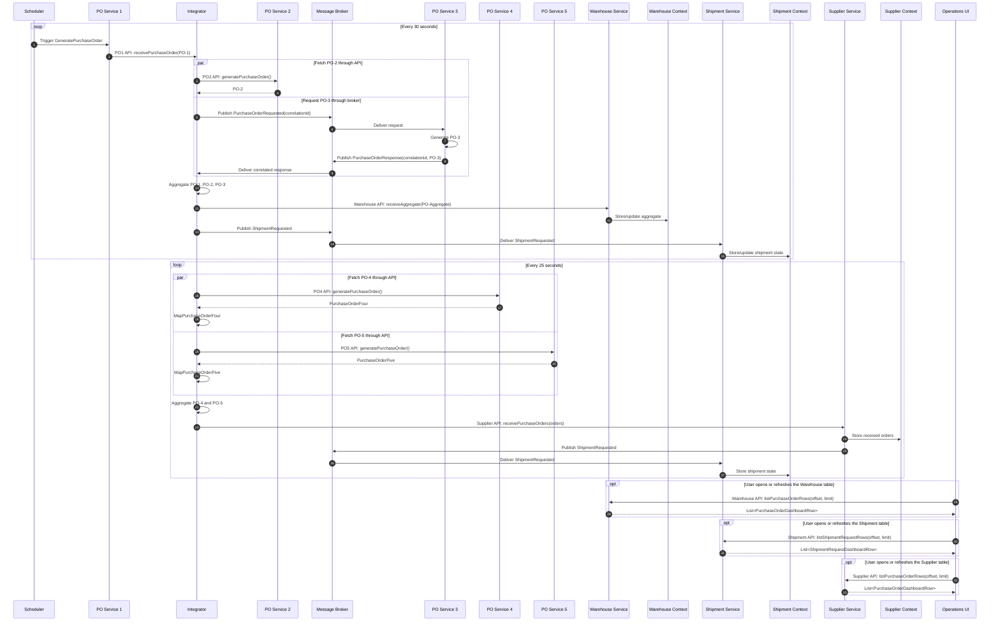

# Purchase Order Orchestration: Walkthrough

> Generated from Ocean-Atlas v0.1.0 (content 8776e975). Canonical source: https://atlas.ocean-lab.ai/examples/purchase-order-orchestration/

**Contents**

- [Horizon](#horizon)
- [Voyage](#voyage)

Horizon and Voyage explanation for the Purchase Order Orchestration example.

Source: https://atlas.ocean-lab.ai/examples/purchase-order-orchestration/

## Horizon

### Example at a Glance

#### Overview

Purchase orders often arrive through more than one interaction style. This example starts with a scheduled producer, gathers complementary orders through an API and a broker request-response topic, then routes the resulting business flow to Warehouse and Shipment independently. A second scheduled aggregate polls two purchase-order providers and delivers their collected orders to Supplier Service. Supplier records them, maps them to a shipment request, and publishes the request for Shipment Service through the broker. PO4 and PO5 use different provider contracts; the integration maps both into the canonical purchase-order model before aggregation.

#### Architecture



#### What It Demonstrates

- `@integration` — an explicit transport-independent orchestration boundary with `direction: in/out`.
- `@service` and a reusable schedule — PO Service 1 creates and pushes PO-1 every thirty seconds.
- `@api` — an inbound integration API, the PO-2 request-response API, and read APIs for monitoring.
- `@broker` — PO-3 broker request-response and the decoupled `ShipmentRequested` event.
- `aggregate` — logical gathering of PO-1, PO-2, and PO-3 before the Warehouse handoff.
- A scheduled `aggregate` — every twenty-five seconds, PO-4 and PO-5 are collected and delivered to Supplier Service without an API response.
- `using` mappers — the integration translates `PurchaseOrderFour` and `PurchaseOrderFive` into the canonical `PurchaseOrder` at its boundary.
- `@context`, `@dashboard`, and `@ui` — stateful operational views generated from DSL.

#### Expected Result

The model shows a clear orchestration contract: PO-1 is the trigger, PO-2 and PO-3 are gathered through different interaction styles, the aggregate reaches Warehouse, and Shipment receives only the dedicated shipment event. A separate scheduled aggregate maps provider-specific orders before it replenishes Supplier. The UI reads current state from each owning service.

## Voyage

### 1. End-to-End Sequence



The sequence intentionally contrasts API request-response, broker request-response, and one-way event publication.

### 2. Problem and Constraints

The scenario must preserve ownership: services define their contracts, the integration defines the cross-contract flow, Warehouse owns warehouse state, and Shipment owns shipment state. The DSL must not expose a particular HTTP client, broker client, correlation-id implementation, or scheduler library.

### 3. Example Structure

```text
0014-purchase-order-orchestration/
├── 00-poo-info.ocn
├── 01-poo-context-warehouse.ocn
├── 01-poo-context-shipment.ocn
├── 01-poo-context-supplier.ocn
├── 10-poo-datatype.ocn
├── 20-poo-api-ingress.ocn
├── 20-poo-api-purchase-order.ocn
├── 20-poo-api-purchase-order-4.ocn
├── 20-poo-api-purchase-order-5.ocn
├── 20-poo-api-warehouse.ocn
├── 20-poo-api-shipment-monitoring.ocn
├── 20-poo-api-supplier.ocn
├── 20-poo-broker.ocn
├── 30-poo-config.ocn
├── 40-poo-expression.ocn
├── expression/purchase-order-generator.go
├── 50-poo-service-1.ocn
├── 50-poo-service-2.ocn
├── 50-poo-service-3.ocn
├── 50-poo-service-4.ocn
├── 50-poo-service-5.ocn
├── 50-poo-service-warehouse.ocn
├── 50-poo-service-shipment.ocn
├── 50-poo-service-supplier.ocn
├── 50-poo-integration.ocn
├── 55-poo-dashboard.ocn
├── 56-poo-ui.ocn
├── 60-poo-deploy.ocn
├── example.md
└── example-info/example-info.html
```

### 4. Start with a Scheduled API Push

PO Service 1 owns the cadence. The integration starts when its host service receives PO-1 through the implemented ingress API.

```text
schedule EveryThirtySeconds every 30s overlap skip
connect generate -> ingress.receivePurchaseOrder schedule EveryThirtySeconds
```

### 5. Compose API and Broker Request-Response

The integration uses PO Service 2 through an API and PO Service 3 through the broker's request-response topic. Correlation, reply routing, timeout enforcement, and protocol-specific implementation are runtime concerns; the DSL expresses only the logical dependency.

```text
PurchaseOrderIntegration
    direction: in/out
    impl api PurchaseOrderIngressApi as ingress on cfg.apiConfig.port
    use api PurchaseOrderServiceApi as po2
    use broker PurchaseOrderBroker as orders

    aggregate ProcessPurchaseOrders
        trigger ingress.receivePurchaseOrder
        result: List<PurchaseOrder>
        collect trigger
        collect po2.generatePurchaseOrder
        collect orders.purchase.order.po3
        deliver warehouse.receivePurchaseOrders
```

```text
PurchaseOrderOrchestrator
    impl integration PurchaseOrderIntegration as orchestration
```

### 6. Run an Aggregate on a Schedule

The same integration also owns a flow with no inbound API trigger. Every twenty-five seconds it requests one order from each dedicated provider, gathers the results, maps each provider contract to the canonical purchase order, and delivers them to Supplier Service. Because the activation is a schedule, the aggregate deliberately has no `respond` clause. Supplier records the orders and then publishes the existing shipment event through the broker.

```text
schedule SupplierReplenishment every 25s

aggregate ReplenishSupplier
    schedule SupplierReplenishment
    result: List<PurchaseOrder>
    collect po4.generatePurchaseOrder using mapPo4
    collect po5.generatePurchaseOrder using mapPo5
    deliver supplier.receivePurchaseOrders
```

```text
SupplierService
    use broker PurchaseOrderBroker as orders
    use expression StoreSupplierPurchaseOrders as store
    use expression PurchaseOrdersToShipmentRequest as shipmentRequest

    connect api.receivePurchaseOrders -> store()
    connect api.receivePurchaseOrders -shipmentRequest-> orders.shipment.request
```

### 7. Publish the Shipment Event

Shipment receives the business event from the broker and writes its own state. It does not read Warehouse's context or depend on a Warehouse API. This isolates shipment processing from the warehouse implementation.

```text
connect orders.shipment.request -> record()
```

### 8. Monitor Each Owned State

The UI has three dashboards. Each table requests a paged, flat display record from the service that owns the state. This keeps nested purchase orders out of raw table cells while preserving service ownership.

```text
connect warehouse.WarehouseOrders.listRows -> WarehouseApi.listPurchaseOrderRows
connect shipment.ShipmentRequests.listRows -> ShipmentMonitoringApi.listShipmentRequestRows
connect supplier.SupplierOrders.listRows -> SupplierApi.listPurchaseOrderRows
```

### 9. Runtime Boundary

`PurchaseOrderIntegration` is not deployed independently. `PurchaseOrderOrchestrator` hosts the module and is deployed like any other service. The generated host owns the API listener, configuration, and process lifecycle, while the module owns the logical API, broker, and aggregation flows.

### 10. Experiments

- Change the PO-1 interval and compare its overlap policy.
- Turn PO-2 into another broker request-response dependency and compare the model.
- Add a timeout or retry policy when the integration runtime model introduces those logical capabilities.
- Add an aggregated-order dashboard while keeping Warehouse as the sole owner of warehouse state.
- Change the supplier schedule and observe the generated scheduler configuration.
