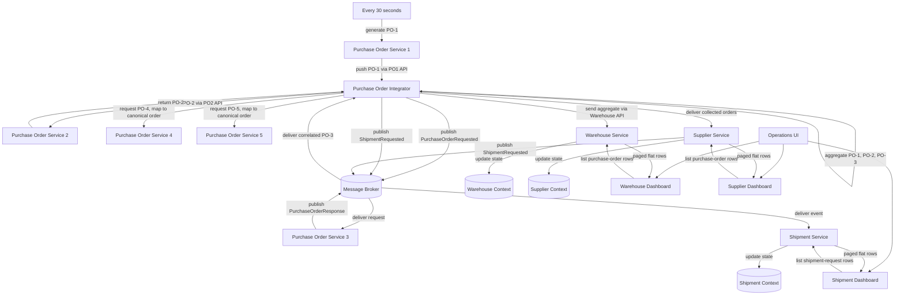

# Purchase Order Orchestration

> Generated from Ocean-Atlas v0.1.0 (content 8776e975). Canonical source: https://atlas.ocean-lab.ai/examples/purchase-order-orchestration/

**Contents**

- [Overview](#overview)
- [High-level flow](#high-level-flow)
- [Sequence flow](#sequence-flow)
- [Files](#files)
- [DSL source files](#dsl-source-files)
- [Walkthrough](#walkthrough)
- [Other files in the example (not inlined)](#other-files-in-the-example-not-inlined)

Compose scheduled API input, synchronous API calls, broker request-response, triggered and scheduled aggregation, shipment events, and generated operational views.

Source: https://atlas.ocean-lab.ai/examples/purchase-order-orchestration/

Level: advanced · Estimated time: 30 minutes · Version: 1.0.0 · Onboarding example: no

Components: 9 services, 1 brokers, 0 databases

Tags: aggregation, api, broker, context, dashboard, integration, orchestration, request-response, scheduling, ui

## Overview

This example demonstrates a complete purchase-order integration scenario. It
combines scheduled production, an inbound API, synchronous API composition,
broker request-response, aggregation, event publication, context-backed
services, dashboards, and a generated UI.

`PurchaseOrderService1` creates PO-1 every thirty seconds and sends it to the
`PurchaseOrderOrchestrator` service hosting the reusable
`PurchaseOrderIntegration` module. The integration obtains PO-2 through an
API call and PO-3 through the broker's request-response topic, then aggregates
the three orders and sends the result to Warehouse. It also publishes a
`ShipmentRequested` event consumed by Shipment Service.

Independently, a second aggregate runs every twenty-five seconds. It pulls
orders from Purchase Order Services 4 and 5 and delivers their collected list
to Supplier Service. Supplier retains the deliveries for operational viewing,
maps them to a shipment request, and publishes that request to Shipment Service
through the broker.

PO4 and PO5 deliberately expose different purchase-order contracts. The
integration maps each provider result into the canonical `PurchaseOrder` before
it forms the scheduled aggregate.

The integration is a reusable logical orchestration module. Its thin host
service supplies the generated process, API listener, configuration, and
deployment boundary; the integration remains independent of those details.

## High-level flow



## Sequence flow

```mermaid
sequenceDiagram
    autonumber
    participant S as Scheduler
    participant PO1 as PO Service 1
    participant I as Integrator
    participant PO2 as PO Service 2
    participant B as Message Broker
    participant PO3 as PO Service 3
    participant PO4 as PO Service 4
    participant PO5 as PO Service 5
    participant W as Warehouse Service
    participant WC as Warehouse Context
    participant SH as Shipment Service
    participant SC as Shipment Context
    participant SU as Supplier Service
    participant SPC as Supplier Context
    participant UI as Operations UI

    loop Every 30 seconds
        S->>PO1: Trigger GeneratePurchaseOrder
        PO1->>I: PO1 API: receivePurchaseOrder(PO-1)
        par Fetch PO-2 through API
            I->>PO2: PO2 API: generatePurchaseOrder()
            PO2-->>I: PO-2
        and Request PO-3 through broker
            I->>B: Publish PurchaseOrderRequested(correlationId)
            B->>PO3: Deliver request
            PO3->>PO3: Generate PO-3
            PO3->>B: Publish PurchaseOrderResponse(correlationId, PO-3)
            B->>I: Deliver correlated response
        end
        I->>I: Aggregate PO-1, PO-2, PO-3
        I->>W: Warehouse API: receiveAggregate(PO-Aggregate)
        W->>WC: Store/update aggregate
        I->>B: Publish ShipmentRequested
        B->>SH: Deliver ShipmentRequested
        SH->>SC: Store/update shipment state
    end

    loop Every 25 seconds
        par Fetch PO-4 through API
            I->>PO4: PO4 API: generatePurchaseOrder()
            PO4-->>I: PurchaseOrderFour
            I->>I: MapPurchaseOrderFour
        and Fetch PO-5 through API
            I->>PO5: PO5 API: generatePurchaseOrder()
            PO5-->>I: PurchaseOrderFive
            I->>I: MapPurchaseOrderFive
        end
        I->>I: Aggregate PO-4 and PO-5
        I->>SU: Supplier API: receivePurchaseOrders(orders)
        SU->>SPC: Store received orders
        SU->>B: Publish ShipmentRequested
        B->>SH: Deliver ShipmentRequested
        SH->>SC: Store shipment state
    end

    opt User opens or refreshes the Warehouse table
        UI->>W: Warehouse API: listPurchaseOrderRows(offset, limit)
        W-->>UI: List&lt;PurchaseOrderDashboardRow&gt;
    end
    opt User opens or refreshes the Shipment table
        UI->>SH: Shipment API: listShipmentRequestRows(offset, limit)
        SH-->>UI: List&lt;ShipmentRequestDashboardRow&gt;
    end
    opt User opens or refreshes the Supplier table
        UI->>SU: Supplier API: listPurchaseOrderRows(offset, limit)
        SU-->>UI: List&lt;PurchaseOrderDashboardRow&gt;
    end
```

## Files

DSL source comes first, then diagrams; the long Horizon and Voyage walkthroughs are at the end. You can stop after the source files.

| File | Section | Lines |
| --- | --- | --- |
| `00-poo-info.ocn` | `@info` | 19 |
| `01-poo-context-shipment.ocn` | `@context` | 14 |
| `01-poo-context-supplier.ocn` | `@context` | 14 |
| `01-poo-context-warehouse.ocn` | `@context` | 14 |
| `10-poo-datatype.ocn` | `@datatype` | 83 |
| `20-poo-api-ingress.ocn` | `@api` | 21 |
| `20-poo-api-purchase-order-4.ocn` | `@api` | 21 |
| `20-poo-api-purchase-order-5.ocn` | `@api` | 21 |
| `20-poo-api-purchase-order.ocn` | `@api` | 21 |
| `20-poo-api-shipment-monitoring.ocn` | `@api` | 22 |
| `20-poo-api-supplier.ocn` | `@api` | 23 |
| `20-poo-api-warehouse.ocn` | `@api` | 23 |
| `20-poo-broker.ocn` | `@broker` | 21 |
| `30-poo-config.ocn` | `@config` | 30 |
| `40-poo-expression.ocn` | `@expression` | 160 |
| `50-poo-integration.ocn` | `@integration` | 62 |
| `50-poo-service-1.ocn` | `@service` | 20 |
| `50-poo-service-2.ocn` | `@service` | 18 |
| `50-poo-service-3.ocn` | `@service` | 19 |
| `50-poo-service-4.ocn` | `@service` | 19 |
| `50-poo-service-5.ocn` | `@service` | 19 |
| `50-poo-service-orchestrator.ocn` | `@service` | 17 |
| `50-poo-service-shipment.ocn` | `@service` | 25 |
| `50-poo-service-supplier.ocn` | `@service` | 27 |
| `50-poo-service-warehouse.ocn` | `@service` | 24 |
| `55-poo-dashboard.ocn` | `@dashboard` | 73 |
| `56-poo-ui.ocn` | `@ui` | 44 |
| `60-poo-deploy.ocn` | `@deploy` | 75 |

## DSL source files

### `00-poo-info.ocn`

```ocean-dsl
# @ocean-meta-start
# tags:
#   - integration
#   - purchase-order
#   - orchestration
# perspective:
#   feature: purchase-order-orchestration
# @ocean-meta-end

@info

name: Purchase Order Orchestration
version: 1.0.0
title: PurchaseOrderOrchestration
subtitle: API, broker request-response, aggregation, and operational monitoring
shortDescription: A complete integration-oriented purchase-order scenario

description: PO Service 1 creates an order every thirty seconds. The integration gathers complementary orders from PO Service 2 through an API and PO Service 3 through a broker request-response topic, sends an aggregate to Warehouse, and publishes a shipment event. A second aggregate runs every twenty-five seconds, normalizes provider-specific orders from PO Services 4 and 5, and delivers them to Supplier Service.
```

### `01-poo-context-shipment.ocn`

```ocean-dsl
# @ocean-meta-start
# tags:
#   - context
#   - shipment
# perspective:
#   feature: purchase-order-orchestration
#   service: shipment-service
# @ocean-meta-end

@context

ShipmentContext
    shipmentRequests : List<ShipmentRequest>
```

### `01-poo-context-supplier.ocn`

```ocean-dsl
# @ocean-meta-start
# tags:
#   - context
#   - supplier
# perspective:
#   feature: purchase-order-orchestration
#   service: supplier-service
# @ocean-meta-end

@context

SupplierContext
    purchaseOrders : List<PurchaseOrder>
```

### `01-poo-context-warehouse.ocn`

```ocean-dsl
# @ocean-meta-start
# tags:
#   - context
#   - warehouse
# perspective:
#   feature: purchase-order-orchestration
#   service: warehouse-service
# @ocean-meta-end

@context

WarehouseContext
    purchaseOrders : List<PurchaseOrder>
```

### `10-poo-datatype.ocn`

```ocean-dsl
# @ocean-meta-start
# tags:
#   - datatype
#   - purchase-order
#   - shipment
# perspective:
#   feature: purchase-order-orchestration
#   service: shared
# @ocean-meta-end

@datatype

PurchaseItem
    id pattern PI-UUID
    orderName : String
    quantity  : Int

PurchaseOrder
    id pattern PO-UUID
    orders      : List<PurchaseItem>
    source      : String
    destination : String

# Provider-specific contracts are deliberately different from the canonical
# purchase-order model. PurchaseOrderIntegration normalizes them before
# aggregation and delivery to Supplier Service.

PurchaseItemFour
    supplierSku : String
    units       : Int

PurchaseOrderFour
    reference  : String
    lineItems  : List<PurchaseItemFour>
    origin     : String
    shipTo     : String

PurchaseItemFive
    productCode : String
    amount      : Int

PurchaseOrderFive
    confirmationId : String
    products       : List<PurchaseItemFive>
    dispatchFrom   : String
    deliveryTo     : String

ShipmentRequest
    id pattern SR-UUID
    source         : String
    destination    : String
    purchaseOrders : List<PurchaseOrder>

WarehouseOverview
    warehouseId    : String
    timestamp      : DateTime
    purchaseOrders : List<PurchaseOrder>

ShipmentOverview
    timestamp        : DateTime
    shipmentRequests : List<ShipmentRequest>

SupplierOverview
    supplierId     : String
    timestamp      : DateTime
    purchaseOrders : List<PurchaseOrder>

# Flat, presentation-oriented records used by the generated operational
# tables. They deliberately avoid nesting List values inside a table cell.

PurchaseOrderDashboardRow
    id           : String
    source       : String
    destination  : String
    itemCount    : Int
    itemsSummary : String

ShipmentRequestDashboardRow
    id                 : String
    source             : String
    destination        : String
    purchaseOrderCount : Int
```

### `20-poo-api-ingress.ocn`

```ocean-dsl
# @ocean-meta-start
# tags:
#   - api
#   - rest-api
#   - ingress
# perspective:
#   feature: purchase-order-orchestration
#   service: purchase-order-orchestrator
# @ocean-meta-end

@api

PurchaseOrderIngressApi style:rest
    engine = gin
    configType = ApiConfig
    version = 1.0.0
    basePath = /purchase-orders
    generateSwagger = true

    post /order receivePurchaseOrder(order:PurchaseOrder) : String
```

### `20-poo-api-purchase-order-4.ocn`

```ocean-dsl
# @ocean-meta-start
# tags:
#   - api
#   - rest-api
#   - purchase-order
# perspective:
#   feature: purchase-order-orchestration
#   service: purchase-order-service-4
# @ocean-meta-end

@api

PurchaseOrderService4Api style:rest
    engine = gin
    configType = ApiConfig
    version = 1.0.0
    basePath = /purchase-orders-4
    generateSwagger = true

    get /next generatePurchaseOrder() : PurchaseOrderFour
```

### `20-poo-api-purchase-order-5.ocn`

```ocean-dsl
# @ocean-meta-start
# tags:
#   - api
#   - rest-api
#   - purchase-order
# perspective:
#   feature: purchase-order-orchestration
#   service: purchase-order-service-5
# @ocean-meta-end

@api

PurchaseOrderService5Api style:rest
    engine = gin
    configType = ApiConfig
    version = 1.0.0
    basePath = /purchase-orders-5
    generateSwagger = true

    get /next generatePurchaseOrder() : PurchaseOrderFive
```

### `20-poo-api-purchase-order.ocn`

```ocean-dsl
# @ocean-meta-start
# tags:
#   - api
#   - rest-api
#   - purchase-order
# perspective:
#   feature: purchase-order-orchestration
#   service: purchase-order-service-2
# @ocean-meta-end

@api

PurchaseOrderServiceApi style:rest
    engine = gin
    configType = ApiConfig
    version = 1.0.0
    basePath = /purchase-orders
    generateSwagger = true

    get /next generatePurchaseOrder() : PurchaseOrder
```

### `20-poo-api-shipment-monitoring.ocn`

```ocean-dsl
# @ocean-meta-start
# tags:
#   - api
#   - rest-api
#   - shipment
# perspective:
#   feature: purchase-order-orchestration
#   service: shipment-service
# @ocean-meta-end

@api

ShipmentMonitoringApi style:rest
    engine = gin
    configType = ApiConfig
    version = 1.0.0
    basePath = /shipments
    generateSwagger = true

    get /overview getShipmentOverview() : ShipmentOverview
    get /requests/{offset}/{limit} listShipmentRequestRows(offset:Int, limit:Int) : List<ShipmentRequestDashboardRow>
```

### `20-poo-api-supplier.ocn`

```ocean-dsl
# @ocean-meta-start
# tags:
#   - api
#   - rest-api
#   - supplier
# perspective:
#   feature: purchase-order-orchestration
#   service: supplier-service
# @ocean-meta-end

@api

SupplierApi style:rest
    engine = gin
    configType = ApiConfig
    version = 1.0.0
    basePath = /supplier
    generateSwagger = true

    post /orders receivePurchaseOrders(orders:List<PurchaseOrder>) : Void
    get  /overview getSupplierOverview() : SupplierOverview
    get  /orders/{offset}/{limit} listPurchaseOrderRows(offset:Int, limit:Int) : List<PurchaseOrderDashboardRow>
```

### `20-poo-api-warehouse.ocn`

```ocean-dsl
# @ocean-meta-start
# tags:
#   - api
#   - rest-api
#   - warehouse
# perspective:
#   feature: purchase-order-orchestration
#   service: warehouse-service
# @ocean-meta-end

@api

WarehouseApi style:rest
    engine = gin
    configType = ApiConfig
    version = 1.0.0
    basePath = /warehouse
    generateSwagger = true

    post /orders receivePurchaseOrders(orders:List<PurchaseOrder>) : Void
    get  /overview getWarehouseOverview() : WarehouseOverview
    get  /orders/{offset}/{limit} listPurchaseOrderRows(offset:Int, limit:Int) : List<PurchaseOrderDashboardRow>
```

### `20-poo-broker.ocn`

```ocean-dsl
# @ocean-meta-start
# tags:
#   - broker
#   - nats
#   - messaging
# perspective:
#   feature: purchase-order-orchestration
#   service: purchase-order-broker
# @ocean-meta-end

@broker

PurchaseOrderBroker
    @perspectives: version:0.1.0, lifestyle:stable
    engine = nats
    configType = PurchaseOrderBrokerConfig
    tags = primary, shared

    purchase.order.po3 : _-PurchaseOrder       as request-response with timeout:5s
    shipment.request  : ShipmentRequest    as event
```

### `30-poo-config.ocn`

```ocean-dsl
# @ocean-meta-start
# tags:
#   - configuration
#   - integration
# perspective:
#   feature: purchase-order-orchestration
#   service: shared
# @ocean-meta-end

@config

@import config O.broker.nats.config@1.0.0 as BrokerConfig
@import config O.log.config@1.0.0 as LogConfig

ApiConfig
    port : Int (default=8080)

CommonServiceConfig
    apiConfig    : ApiConfig
    brokerConfig : BrokerConfig
    logConfig    : LogConfig

PurchaseOrderBrokerConfig
    brokerConfig : BrokerConfig
    logConfig    : LogConfig

UiConfig
    port      : Int (default=8080)
    logConfig : LogConfig
```

### `40-poo-expression.ocn`

```ocean-dsl
# @ocean-meta-start
# tags:
#   - expression
#   - mapping
#   - aggregation
# perspective:
#   feature: purchase-order-orchestration
#   service: shared
# @ocean-meta-end

@expression

GeneratePurchaseOrder
    input: _
    output: order:PurchaseOrder
    external
        source: purchase-order-generator.go
        method: GeneratePurchaseOrder

GeneratePurchaseOrderFour
    input: _
    output: order:PurchaseOrderFour
    external
        source: purchase-order-generator.go
        method: GeneratePurchaseOrderFour

GeneratePurchaseOrderFive
    input: _
    output: order:PurchaseOrderFive
    external
        source: purchase-order-generator.go
        method: GeneratePurchaseOrderFive

MapPurchaseOrderFour
    input: source:PurchaseOrderFour
    output: result:PurchaseOrder
    external
        source: purchase-order-generator.go
        method: MapPurchaseOrderFour

MapPurchaseOrderFive
    input: source:PurchaseOrderFive
    output: result:PurchaseOrder
    external
        source: purchase-order-generator.go
        method: MapPurchaseOrderFive

AppendPurchaseOrders
    input: existing:List<PurchaseOrder> & incoming:List<PurchaseOrder>
    output: result:List<PurchaseOrder>
    external
        source: purchase-order-generator.go
        method: AppendPurchaseOrders

AppendShipmentRequest
    input: existing:List<ShipmentRequest> & incoming:ShipmentRequest
    output: result:List<ShipmentRequest>
    external
        source: purchase-order-generator.go
        method: AppendShipmentRequest

PurchaseOrdersToShipmentRequest
    input: orders:List<PurchaseOrder>
    output: request:ShipmentRequest
    external
        source: purchase-order-generator.go
        method: PurchaseOrdersToShipmentRequest

PurchaseOrdersToAcknowledgement
    input: orders:List<PurchaseOrder>
    output: acknowledgement:String
    external
        source: purchase-order-generator.go
        method: PurchaseOrdersToAcknowledgement

ToPurchaseOrderDashboardRows
    input: orders:List<PurchaseOrder> & offset:Int & limit:Int
    output: rows:List<PurchaseOrderDashboardRow>
    external
        source: purchase-order-generator.go
        method: ToPurchaseOrderDashboardRows

ToShipmentRequestDashboardRows
    input: requests:List<ShipmentRequest> & offset:Int & limit:Int
    output: rows:List<ShipmentRequestDashboardRow>
    external
        source: purchase-order-generator.go
        method: ToShipmentRequestDashboardRows

StorePurchaseOrders
    context: ctx:*WarehouseContext
    input: orders:List<PurchaseOrder>
    logic
        ctx.purchaseOrders = AppendPurchaseOrders(ctx.purchaseOrders, orders)

StoreSupplierPurchaseOrders
    context: ctx:*SupplierContext
    input: orders:List<PurchaseOrder>
    logic
        ctx.purchaseOrders = AppendPurchaseOrders(ctx.purchaseOrders, orders)

RecordShipment
    context: ctx:*ShipmentContext
    input: shipment:ShipmentRequest
    logic
        ctx.shipmentRequests = AppendShipmentRequest(ctx.shipmentRequests, shipment)

GetWarehouseOverview
    context: ctx:*WarehouseContext
    input: _
    output: result:WarehouseOverview
    logic
        var overview WarehouseOverview
        overview.warehouseId = "Warehouse-01"
        overview.timestamp = NowUTC()
        overview.purchaseOrders = ctx.purchaseOrders
        result = overview

GetSupplierOverview
    context: ctx:*SupplierContext
    input: _
    output: result:SupplierOverview
    logic
        var overview SupplierOverview
        overview.supplierId = "Supplier-01"
        overview.timestamp = NowUTC()
        overview.purchaseOrders = ctx.purchaseOrders
        result = overview

GetShipmentOverview
    context: ctx:*ShipmentContext
    input: _
    output: result:ShipmentOverview
    logic
        var overview ShipmentOverview
        overview.timestamp = NowUTC()
        overview.shipmentRequests = ctx.shipmentRequests
        result = overview

ListWarehousePurchaseOrderRows
    context: ctx:*WarehouseContext
    input: offset:Int & limit:Int
    output: rows:List<PurchaseOrderDashboardRow>
    logic
        rows = ToPurchaseOrderDashboardRows(ctx.purchaseOrders, offset, limit)

ListSupplierPurchaseOrderRows
    context: ctx:*SupplierContext
    input: offset:Int & limit:Int
    output: rows:List<PurchaseOrderDashboardRow>
    logic
        rows = ToPurchaseOrderDashboardRows(ctx.purchaseOrders, offset, limit)

ListShipmentRequestRows
    context: ctx:*ShipmentContext
    input: offset:Int & limit:Int
    output: rows:List<ShipmentRequestDashboardRow>
    logic
        rows = ToShipmentRequestDashboardRows(ctx.shipmentRequests, offset, limit)
```

### `50-poo-integration.ocn`

```ocean-dsl
# @ocean-meta-start
# tags:
#   - integration
#   - orchestration
#   - aggregation
# perspective:
#   feature: purchase-order-orchestration
#   service: purchase-order-orchestrator
# @ocean-meta-end

# This is a reusable logical orchestration module. A service hosts it and
# provides the process/deployment boundary for its ingress API.
@integration

PurchaseOrderIntegration
    direction: in/out

    use config CommonServiceConfig as cfg
    impl api PurchaseOrderIngressApi as ingress on cfg.apiConfig.port
    use api PurchaseOrderServiceApi as po2
    use api PurchaseOrderService4Api as po4
    use api PurchaseOrderService5Api as po5
    use api WarehouseApi as warehouse
    use api SupplierApi as supplier
    use expression MapPurchaseOrderFour as mapPo4
    use expression MapPurchaseOrderFive as mapPo5
    use broker PurchaseOrderBroker as orders
    use expression PurchaseOrdersToShipmentRequest as shipmentRequest
    use expression PurchaseOrdersToAcknowledgement as acknowledgement

    # PO-1 arrives through the ingress API. PO-2 is fetched synchronously and
    # PO-3 through the broker's request-response topic. The three orders are
    # collected into one list, stored by Warehouse, then published as a
    # ShipmentRequest event.
    aggregate ProcessPurchaseOrders
        trigger ingress.receivePurchaseOrder

        result: List<PurchaseOrder>

        collect trigger
        collect po2.generatePurchaseOrder
        collect orders.purchase.order.po3

        deliver warehouse.receivePurchaseOrders
        deliver orders.shipment.request using shipmentRequest

        respond using acknowledgement

    schedule SupplierReplenishment every 25s

    # A scheduled aggregate has no API response. It polls two independent
    # providers and sends their collected orders to Supplier Service.
    aggregate ReplenishSupplier
        schedule SupplierReplenishment

        result: List<PurchaseOrder>

        collect po4.generatePurchaseOrder using mapPo4
        collect po5.generatePurchaseOrder using mapPo5

        deliver supplier.receivePurchaseOrders
```

### `50-poo-service-1.ocn`

```ocean-dsl
# @ocean-meta-start
# tags:
#   - service
#   - purchase-order
#   - scheduling
# perspective:
#   feature: purchase-order-orchestration
#   service: purchase-order-service-1
# @ocean-meta-end

@service

PurchaseOrderService1
    use config CommonServiceConfig as svcCfg
    use api PurchaseOrderIngressApi as ingress
    use expression GeneratePurchaseOrder as generate

    schedule EveryThirtySeconds every 30s overlap skip
    connect generate -> ingress.receivePurchaseOrder schedule EveryThirtySeconds
```

### `50-poo-service-2.ocn`

```ocean-dsl
# @ocean-meta-start
# tags:
#   - service
#   - purchase-order
# perspective:
#   feature: purchase-order-orchestration
#   service: purchase-order-service-2
# @ocean-meta-end

@service

PurchaseOrderService2
    use config CommonServiceConfig as svcCfg
    impl api PurchaseOrderServiceApi as api on svcCfg.apiConfig.port
    use expression GeneratePurchaseOrder as generate

    connect api.generatePurchaseOrder -> generate
```

### `50-poo-service-3.ocn`

```ocean-dsl
# @ocean-meta-start
# tags:
#   - service
#   - purchase-order
#   - messaging
# perspective:
#   feature: purchase-order-orchestration
#   service: purchase-order-service-3
# @ocean-meta-end

@service

PurchaseOrderService3
    use config CommonServiceConfig as svcCfg
    use broker PurchaseOrderBroker as orders
    use expression GeneratePurchaseOrder as generate

    connect orders.purchase.order.po3 -> generate
```

### `50-poo-service-4.ocn`

```ocean-dsl
# @ocean-meta-start
# tags:
#   - service
#   - purchase-order
#   - supplier
# perspective:
#   feature: purchase-order-orchestration
#   service: purchase-order-service-4
# @ocean-meta-end

@service

PurchaseOrderService4
    use config CommonServiceConfig as svcCfg
    impl api PurchaseOrderService4Api as api on svcCfg.apiConfig.port
    use expression GeneratePurchaseOrderFour as generate

    connect api.generatePurchaseOrder -> generate
```

### `50-poo-service-5.ocn`

```ocean-dsl
# @ocean-meta-start
# tags:
#   - service
#   - purchase-order
#   - supplier
# perspective:
#   feature: purchase-order-orchestration
#   service: purchase-order-service-5
# @ocean-meta-end

@service

PurchaseOrderService5
    use config CommonServiceConfig as svcCfg
    impl api PurchaseOrderService5Api as api on svcCfg.apiConfig.port
    use expression GeneratePurchaseOrderFive as generate

    connect api.generatePurchaseOrder -> generate
```

### `50-poo-service-orchestrator.ocn`

```ocean-dsl
# @ocean-meta-start
# tags:
#   - service
#   - integration-host
#   - orchestration
# perspective:
#   feature: purchase-order-orchestration
#   service: purchase-order-orchestrator
# @ocean-meta-end

@service

# The service is intentionally thin: it hosts the reusable integration module
# and supplies the process/deployment boundary for its ingress API.
PurchaseOrderOrchestrator
    impl integration PurchaseOrderIntegration as orchestration
```

### `50-poo-service-shipment.ocn`

```ocean-dsl
# @ocean-meta-start
# tags:
#   - service
#   - shipment
#   - messaging
# perspective:
#   feature: purchase-order-orchestration
#   service: shipment-service
# @ocean-meta-end

@service

ShipmentService
    use config CommonServiceConfig as svcCfg
    impl api ShipmentMonitoringApi as api on svcCfg.apiConfig.port
    use broker PurchaseOrderBroker as orders
    use context ShipmentContext as shipmentCtx
    use expression RecordShipment as record
    use expression GetShipmentOverview as overview
    use expression ListShipmentRequestRows as rows

    connect orders.shipment.request -> record()
    connect api.getShipmentOverview -> overview()
    connect api.listShipmentRequestRows -> rows
```

### `50-poo-service-supplier.ocn`

```ocean-dsl
# @ocean-meta-start
# tags:
#   - service
#   - supplier
#   - scheduling
# perspective:
#   feature: purchase-order-orchestration
#   service: supplier-service
# @ocean-meta-end

@service

SupplierService
    use config CommonServiceConfig as svcCfg
    impl api SupplierApi as api on svcCfg.apiConfig.port
    use broker PurchaseOrderBroker as orders
    use context SupplierContext as supplierCtx
    use expression StoreSupplierPurchaseOrders as store
    use expression PurchaseOrdersToShipmentRequest as shipmentRequest
    use expression GetSupplierOverview as overview
    use expression ListSupplierPurchaseOrderRows as rows

    connect api.receivePurchaseOrders -> store()
    connect api.receivePurchaseOrders -shipmentRequest-> orders.shipment.request
    connect api.getSupplierOverview -> overview()
    connect api.listPurchaseOrderRows -> rows
```

### `50-poo-service-warehouse.ocn`

```ocean-dsl
# @ocean-meta-start
# tags:
#   - service
#   - warehouse
#   - aggregation
# perspective:
#   feature: purchase-order-orchestration
#   service: warehouse-service
# @ocean-meta-end

@service

WarehouseService
    use config CommonServiceConfig as svcCfg
    impl api WarehouseApi as api on svcCfg.apiConfig.port
    use context WarehouseContext as warehouseCtx
    use expression StorePurchaseOrders as store
    use expression GetWarehouseOverview as overview
    use expression ListWarehousePurchaseOrderRows as rows

    connect api.receivePurchaseOrders -> store()
    connect api.getWarehouseOverview -> overview()
    connect api.listPurchaseOrderRows -> rows
```

### `55-poo-dashboard.ocn`

```ocean-dsl
# @ocean-meta-start
# tags:
#   - dashboard
#   - operations-monitoring
# perspective:
#   feature: purchase-order-orchestration
#   service: purchase-order-operations-ui
# @ocean-meta-end

@dashboard

WarehouseDashboard
    title: Warehouse Monitor
    layout: SingleColumnLayout

    Widget WarehouseGuide of type Text
        title = Aggregated purchase orders
        subtitle = Latest state received by Warehouse Service
        content = <p>Purchase orders are rendered as operational rows; nested line items are summarized for quick scanning.</p>

    Widget WarehouseOrders of type Table
        title = Warehouse purchase orders
        datatype = PurchaseOrderDashboardRow
        columns:
            - id
            - source
            - destination
            - itemCount
            - itemsSummary
        sortable = true
        limit = 10

ShipmentDashboard
    title: Shipment Monitor
    layout: SingleColumnLayout

    Widget ShipmentGuide of type Text
        title = Shipment events
        subtitle = Latest ShipmentRequest event consumed from the broker
        content = <p>Shipment requests are shown as rows with their route and purchase-order count.</p>

    Widget ShipmentRequests of type Table
        title = Shipment requests
        datatype = ShipmentRequestDashboardRow
        columns:
            - id
            - source
            - destination
            - purchaseOrderCount
        sortable = true
        limit = 10

SupplierDashboard
    title = Supplier Monitor
    layout: SingleColumnLayout

    Widget SupplierGuide of type Text
        title = Scheduled supplier replenishment
        subtitle = Orders collected every 25 seconds from Purchase Order Services 4 and 5
        content = <p>Orders delivered by the scheduled aggregate are rendered as searchable operational rows.</p>

    Widget SupplierOrders of type Table
        title = Supplier purchase orders
        datatype = PurchaseOrderDashboardRow
        columns:
            - id
            - source
            - destination
            - itemCount
            - itemsSummary
        sortable = true
        limit = 10
```

### `56-poo-ui.ocn`

```ocean-dsl
# @ocean-meta-start
# tags:
#   - ui
#   - operations-monitoring
# perspective:
#   feature: purchase-order-orchestration
#   service: purchase-order-operations-ui
# @ocean-meta-end

@ui

PurchaseOrderOperationsUi
    @perspectives: version:1.0.0, lifestyle:stable

    framework: htmx
    styling: bootstrap
    template: go-html-template
    backend: go-gin
    static: static
    configType: UiConfig

    nav Warehouse dashboard = WarehouseDashboard
    nav Shipment dashboard = ShipmentDashboard
    nav Supplier dashboard = SupplierDashboard

    header title = Purchase Order Operations
    header subtitle = Monitor warehouse, shipment, and scheduled supplier flows
    header align = center

    footer title = Built with Ocean-lab
    footer subtitle = Purchase-order integration example
    footer align = center

    use dashboard WarehouseDashboard as warehouse
    use dashboard ShipmentDashboard as shipment
    use dashboard SupplierDashboard as supplier
    use api WarehouseApi
    use api ShipmentMonitoringApi
    use api SupplierApi

    connect warehouse.WarehouseOrders.listRows -> WarehouseApi.listPurchaseOrderRows
    connect shipment.ShipmentRequests.listRows -> ShipmentMonitoringApi.listShipmentRequestRows
    connect supplier.SupplierOrders.listRows -> SupplierApi.listPurchaseOrderRows
```

### `60-poo-deploy.ocn`

```ocean-dsl
# @ocean-meta-start
# tags:
#   - deployment
#   - orchestration
# perspective:
#   feature: purchase-order-orchestration
#   service: shared
# @ocean-meta-end

@deploy

Name: PurchaseOrderOrchestrationDeploy

@import service P.broker.nats.docker@1.0.0 as NATS

PurchaseOrderService1Deploy
    service PurchaseOrderService1
    replica 1

PurchaseOrderService2Deploy
    service PurchaseOrderService2
    replica 1
    export 9092:PurchaseOrderService2.api

PurchaseOrderService4Deploy
    service PurchaseOrderService4
    replica 1
    export 9095:PurchaseOrderService4.api

PurchaseOrderService5Deploy
    service PurchaseOrderService5
    replica 1
    export 9096:PurchaseOrderService5.api

PurchaseOrderService3Deploy
    service PurchaseOrderService3
    replica 1
    dependsOn Broker

PurchaseOrderOrchestratorDeploy
    service PurchaseOrderOrchestrator
    replica 1
    export 9091:PurchaseOrderOrchestrator.ingress
    dependsOn Broker, PurchaseOrderService2Deploy, PurchaseOrderService3Deploy, PurchaseOrderService4Deploy, PurchaseOrderService5Deploy, SupplierDeploy

WarehouseDeploy
    service WarehouseService
    replica 1
    export 9093:WarehouseService.api

ShipmentDeploy
    service ShipmentService
    replica 1
    export 9094:ShipmentService.api
    dependsOn Broker

SupplierDeploy
    service SupplierService
    replica 1
    export 9097:SupplierService.api

PurchaseOrderBrokerDeploy
    service PurchaseOrderBroker
    replica 1
    dependsOn Broker

Broker
    service NATS

PurchaseOrderOperationsUiDeploy
    service PurchaseOrderOperationsUi
    replica 1
    export 8084:PurchaseOrderOperationsUi.config
    dependsOn WarehouseDeploy, ShipmentDeploy, SupplierDeploy
```

## Walkthrough

A long, step-by-step explanation (Horizon and Voyage) is in [Purchase Order Orchestration walkthrough](purchase-order-orchestration-walkthrough.md). Read it only if you need the reasoning behind the design.

## Other files in the example (not inlined)

Fixtures, scripts and supporting artifacts. See the example on the Atlas site for their purpose.

- `expression/purchase-order-generator.go` (artifact)
