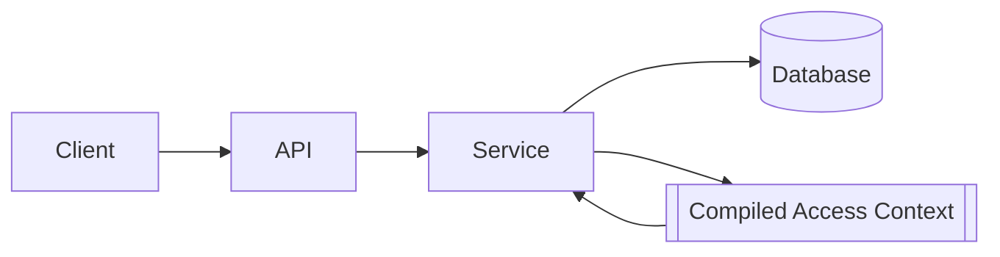
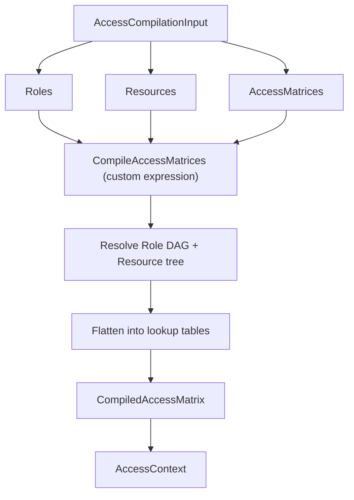

# Role-Based Access Control (RBAC): Walkthrough

> Generated from Ocean-Atlas v0.1.0 (content a0c57f8d). Canonical source: https://atlas.ocean-lab.ai/examples/rbac/

**Contents**

- [Horizon](#horizon)
- [Voyage](#voyage)

Horizon and Voyage explanation for the Role-Based Access Control (RBAC) example.

Source: https://atlas.ocean-lab.ai/examples/rbac/

## Horizon

### RBAC at a Glance

#### Overview

Many applications need to control access to menus, screens, actions, and data by role, without hand-coding every combination. This example models access control as a matrix: one axis of hierarchical Roles, one axis of hierarchical Resources, and cells that hold an explicit `allow` or `deny`.

Only explicit assignments are stored. Every other cell resolves its access through inheritance, and a cell that resolves to nothing defaults to `deny` — a secure, fail-closed model.

#### Roles and Resources

Roles form a directed acyclic graph: a role may compose access from one or more parent roles, and inheritance is transitive. Resources form a tree of menus, screens, actions, buttons, and other protected capabilities, optionally instantiated in bulk from a reusable Resource Type template. Both hierarchies drive inheritance independently of one another.

#### Architecture



The service loads Roles, Resources, and Access Matrices once, compiles them into fast lookup structures, and answers access queries from that compiled representation instead of the database.

#### What It Demonstrates

- `@datatype` — enums for access effect, access state, and resolution policy, plus hierarchical Role, Resource, and Resource Type shapes.
- `@database` — self-referential relations that persist a Role DAG and a Resource tree as sparse, explicit data.
- `@api` — REST endpoints for managing roles, resource types, resources, and access matrices, and for resolving effective access.
- `@service` and `@context` — a runtime access context assembled once at startup and reused for every query.
- A custom expression implementation for graph-shaped domain logic that a declarative expression does not comfortably cover.

#### Expected Result

You will define a role hierarchy and a resource hierarchy, assign explicit access to specific Role × Resource cells, and query effective access for any cell — observing explicit, inherited, and default resolution, and how conflicting inherited signals resolve differently under each resolution policy.

## Voyage

### 1. Problem and Constraints

- Roles form a DAG: no self-reference, no cycles, multiple parents allowed.
- Resources form a tree: at most one parent, no cycles.
- Only explicit `allow`/`deny` is persisted; the matrix itself stays sparse.
- At most one assignment exists per (matrix, role, resource).
- An explicit cell always wins; conflicting *inherited* effects resolve per the matrix's `accessResolutionPolicy`.
- A cell with no resolvable access defaults to `deny`.
- A Resource Type's structure becomes immutable once used to instantiate a Resource tree.
- Removing or deleting a Role or Resource cascades and removes its assignments; a Role referenced as another Role's parent cannot be deleted.

### 2. Prerequisites

- The Ocean toolchain, at the version this example targets.
- Docker, to run the generated Postgres database service.
- `curl` and `jq`, to run the sample-data seed script (optional).
- [hurl](https://hurl.dev), to run the included component test suite (optional).

### 3. Example Structure

Executable model files are grouped by DSL section:

```text
0010-rbac/
├── rbac-context.ocn
├── config.ocn
├── database.ocn
├── datatype/
│   ├── datatype.ocn
│   └── impl-datatype.ocn
├── api/
│   └── rbac-api.ocn
├── expression/
│   ├── access-control.go
│   └── rbac-deploy.ocn
├── service/
│   └── rbac-service.ocn
├── ui/
│   ├── rbac-ui.html
│   ├── nginx.conf
│   └── Dockerfile.txt
├── info/
│   └── info.ocn
└── example-info/
    └── example-info.html
```

`api/` also holds a hurl component test suite and `service/` a sample-data seed script for exploring the console UI; both are documented in their own directories.

### 4. Model the Domain

Access effect and resolution state are closed enums, so every request deterministically resolves to `allow` or `deny`.

```ocean-dsl
@datatype

enum AccessEffect
    allow
    deny

enum AccessState
    explicit
    inherited
    default

enum AccessResolutionPolicy
    denyOverrides
    allowOverrides
```

Role and Resource carry their own hierarchies directly as typed relations, and `AccessMatrix` brings a set of participating Roles and Resources together with the explicit assignments between them.

```text
Role
    id pattern ROLE-UUID
    displayName: String
    description: String
    parents: List<Role>

Resource
    id pattern RSC-UUID
    displayName: String
    description: String
    parent: *Resource
    resourceType: ResourceType

AccessAssignment
    id pattern AA-UUID
    accessMatrixId: String
    role: Role
    resource: Resource
    accessEffect: AccessEffect
```

`EffectiveAccess` is a computed shape, never stored: it pairs the resolved `accessEffect` with the `accessState` that explains how it was reached, and `hasMixedDescendantAccess` for display.

### 5. Persist Roles, Resources, and Assignments

The Role DAG and Resource tree are ordinary self-referential relations. Only explicit assignments are stored, and a unique index enforces at most one assignment per matrix, Role, and Resource.

```text
Entity Role
    key(id)
    parents -m2m-> Role

Entity Resource
    key(id)
    indexes: index(parentId), index(resourceTypeId)
    resourceType -m2o-> ResourceType
    parent -m2o-> Resource

Entity AccessAssignment
    key(id)
    indexes: unique(accessMatrixId, roleId, resourceId), index(accessMatrixId), index(roleId), index(resourceId)
    role -m2o-> Role [not-null]
    resource -m2o-> Resource [not-null]
```

`AccessMatrix` owns its assignments and declares which Roles and Resources participate in it; the same Role or Resource may participate in more than one matrix.

### 6. Define the API

CRUD endpoints manage Roles, Resource Types, Resources, and Access Matrices. Effective access and explicit assignments are reached only through their owning matrix — they have no independent endpoints.

```text
get    /role/{roleId}                      getRole(roleId:String) : Role
post   /role                               createRole(role:Role) : Role
put    /role                               updateRole(role:Role) : Role
delete /role/{roleId}                      deleteRole(roleId:String) : _

get    /effective-access/{matrixId}/{roleId}/{resourceId} getEffectiveAccess(matrixId:String, roleId:String, resourceId:String) : EffectiveAccess

post   /assignments/{matrixId}/{roleId}/{resourceId} setExplicitAssignment(matrixId:String, roleId:String, resourceId:String, input:SetAccessAssignmentInput) : EffectiveAccess
delete /assignments/{matrixId}/{roleId}/{resourceId} removeExplicitAssignment(matrixId:String, roleId:String, resourceId:String) : Void
```

`setExplicitAssignment` returns the resulting `EffectiveAccess` directly, so a client sees the outcome of its own write without a second request.

### 7. Compile Effective Access at Runtime

Resolving access by walking the Role DAG and Resource tree on every request would mean recursive queries on the request path. Instead, the service holds a compiled `AccessContext` in memory — derived state, rebuilt from the database, never persisted itself.

```ocean-dsl
@context

AccessContext
    compiledMatrices: Map<String, CompiledAccessMatrix>
```

Compiling a matrix means resolving both hierarchies, flattening every applicable assignment, and applying the matrix's `AccessResolutionPolicy` to any conflicting inherited effects — graph-shaped work that is easier to express directly in code than as a declarative expression. This example implements that compilation as a custom expression in an external language, called like any other Ocean expression.



At service startup, an `init` expression loads every Role, Resource, and Access Matrix, compiles them, and stores the result in the context. From then on, `getEffectiveAccess` reads directly from the compiled context rather than the database.

### 8. Assemble the Service

```text
RbacService
    use config RbacConfig as myCfg
    impl api RbacApi as api on myCfg.apiConfig.port
    use database RbacDb as rbacDb
    use context AccessContext as svcCtx

    connect myCfg.dbConfig -> rbacDb

    use expression ReloadAccessContext
    use expression GetEffectiveAccess
    use expression SetExplicitAssignment

    init ReloadAccessContext

    connect api.getEffectiveAccess    -> GetEffectiveAccess
    connect api.setExplicitAssignment -> SetExplicitAssignment
```

Plain CRUD endpoints, such as `createRole` or `listResources`, connect straight to database queries and commands; only access resolution and mutation route through the compiled context.

### 9. Select Technologies and Configure Generation

The API is generated with a REST engine on a configurable port, the database uses a packaged Postgres image, and the service depends on it at deploy time.

```text
ApiConfig
    port: Int (default=8080)

RbacDeploy
    service     RbacService
    replica     1
    export      9099:RbacService.api
    dependsOn   RbacDatabase

RbacDatabase
    service     PostgresqlDB
```

A separate, hand-written single-page console (`ui/rbac-ui.html`) is included as a supporting artifact, not generated by Ocean. It is packaged with its own `nginx.conf` and `Dockerfile.txt` to serve it on port `5500`, the origin the API's CORS policy already allows.

### 10. Validate, Generate, and Run

1. From `0010-rbac/`, validate and generate the example with the Ocean toolchain.
2. Start the generated database and `RbacService`; wait for a healthy `/health/ready` response on port `9099`.
3. Optionally build and run the console image from `ui/`, or open `ui/rbac-ui.html` directly in a browser.
4. Optionally run `./service/seed-sample-data.sh seed` to populate a demo role DAG and menu tree for browsing the console.

### 11. Verify the Result

Build a three-level role chain and give its ends conflicting explicit assignments on the same resource, to see inheritance and policy resolution at work.

```text
POST /v1/role   {"displayName":"base","parents":[]}                  -> base
POST /v1/role   {"displayName":"mid","parents":[{"id":"<base>"}]}     -> mid
POST /v1/role   {"displayName":"leaf","parents":[{"id":"<mid>"}]}     -> leaf
POST /v1/resource {"displayName":"target"}                            -> target

POST /v1/access-matrix
    {"displayName":"deny-wins","accessResolutionPolicy":"denyOverrides",
     "roles":[{"id":"<base>"},{"id":"<mid>"},{"id":"<leaf>"}],
     "resources":[{"id":"<target>"}]}                                -> matrix

POST /v1/assignments/<matrix>/<base>/<target>  {"accessEffect":"allow"}
POST /v1/assignments/<matrix>/<mid>/<target>   {"accessEffect":"deny"}

GET /v1/effective-access/<matrix>/<leaf>/<target>
```

`leaf` has no assignment of its own, so it inherits a conflicting `allow` from `base` and `deny` from `mid`. Under `denyOverrides` the response is `{"accessEffect":"deny","accessState":"inherited"}`; create an equivalent matrix with `allowOverrides` and the same assignments, and the same query for `leaf` returns `allow` instead. A resource with no assignment anywhere returns `{"accessEffect":"deny","accessState":"default"}`.

`api/30_matrix_and_effective_access.hurl` automates exactly this scenario, plus cleanup; run it with `hurl --test --variable base_url=http://localhost:9099 api/30_matrix_and_effective_access.hurl`.

### 12. Troubleshooting

- **Console reports a network error reaching the API:** its "API Base URL" field defaults to a placeholder port — update it to the port the generated service actually exports (`http://localhost:9099` by default).
- **Creating, updating, or deleting a Role or Resource returns `409 Conflict`:** the change would break the DAG or tree invariant — a cycle, self-reference, or a Role still referenced as another Role's parent.
- **`getEffectiveAccess` returns `404 Not Found`:** the Role or Resource does not participate in the referenced matrix — add its participation before assigning or resolving access for it.

### 13. Experiments and Extensions

- Toggle a matrix's `accessResolutionPolicy` between `denyOverrides` and `allowOverrides` against the same conflicting data and compare results.
- Create a Resource Type such as `StandardOperations` and instantiate it as a Resource's `resourceTypeId` to see a full child subtree generated atomically.
- Run `service/seed-sample-data.sh seed` for a larger sample role DAG and menu tree, then explore it through the console.
- The compiled context is currently rebuilt once at service startup; `info/80-runtime-compilation.md` outlines an event-driven refresh for keeping multiple running instances converged after a matrix changes.
