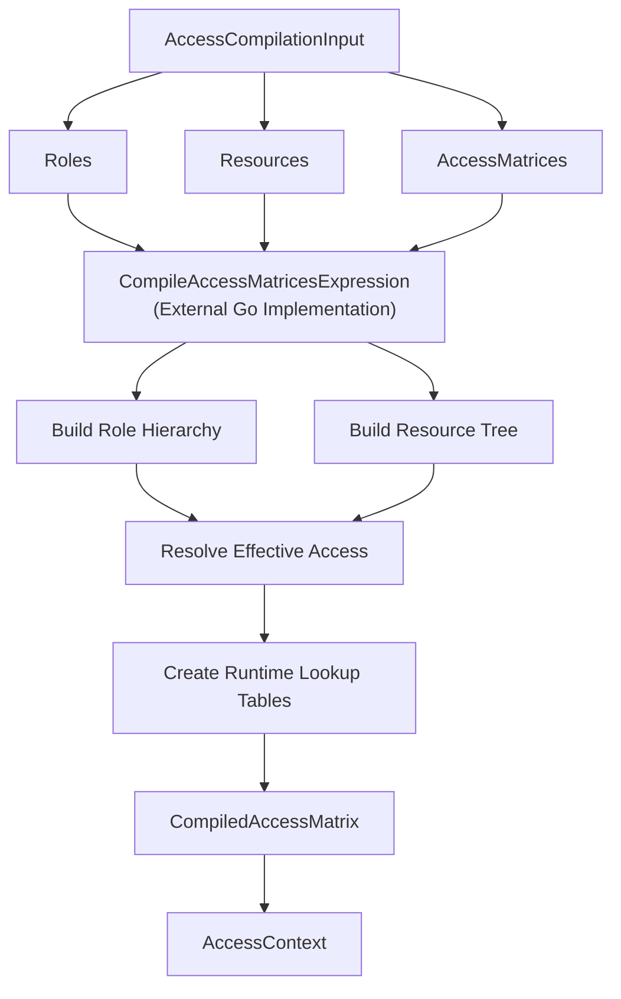
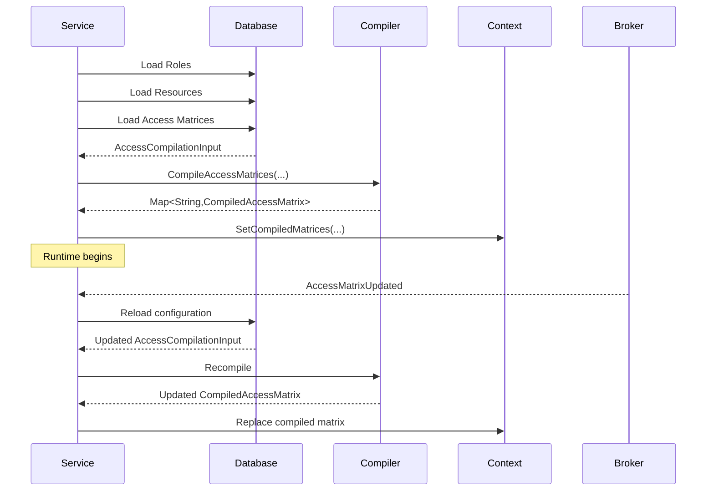

# Role-Based Access Control (RBAC)

> Generated from Ocean-Atlas v0.1.0 (content a0c57f8d). Canonical source: https://atlas.ocean-lab.ai/examples/rbac/

**Contents**

- [Overview](#overview)
- [Files](#files)
- [DSL source files](#dsl-source-files)
- [Diagrams](#diagrams)
- [Walkthrough](#walkthrough)
- [Other files in the example (not inlined)](#other-files-in-the-example-not-inlined)

Resolve allow or deny access for hierarchical roles and hierarchical resources from a sparse, explicitly assigned access matrix.

Source: https://atlas.ocean-lab.ai/examples/rbac/

Level: advanced · Estimated time: 25 minutes · Version: 1.0.0 · Onboarding example: no

Components: 1 services, 0 brokers, 1 databases

Tags: access-control, access-matrix, api, authorization, dag, database, effective-access, go, hierarchy, native-expression, rbac, resources, rest, roles, tree, ui

## Overview

This example shows how Ocean models role-based access control as an explicit
access matrix over two independent hierarchies — a role DAG and a resource
tree — compiled once into a runtime access context and resolved through a
custom expression implementation. Its executable DSL and its Horizon and
Voyage explanation are maintained together in this example directory.

## Files

DSL source comes first, then diagrams; the long Horizon and Voyage walkthroughs are at the end. You can stop after the source files.

| File | Section | Lines |
| --- | --- | --- |
| `api/rbac-api.ocn` | `@api` | 13 |
| `config.ocn` | `@config` | 12 |
| `database.ocn` | `@database` | 13 |
| `datatype.ocn` | `@datatype` | 14 |
| `deploy/deploy.ocn` | `@deploy` | 23 |
| `expression/expression.ocn` | `@expression` | 13 |
| `info/info.ocn` | `@info` | 13 |
| `service/rbac-service.ocn` | `@service` | 13 |

## DSL source files

### `api/rbac-api.ocn`

```ocean-dsl
# @ocean-meta-start
# tags:
#   - rbac-api
#   - rest-api
# perspective:
#   feature: rbac
#   service: rbac-service
# @ocean-meta-end

@api

@include O.rbac.api@1.0.0
```

### `config.ocn`

```ocean-dsl
# @ocean-meta-start
# tags:
#   - configuration
#   - inclusion
# perspective:
#   feature: rbac
# @ocean-meta-end

@config

@include O.rbac.config@1.0.0
```

### `database.ocn`

```ocean-dsl
# @ocean-meta-start
# tags:
#   - database
#   - inclusion
# perspective:
#   feature: rbac
#   service: rbac-service
# @ocean-meta-end

@database

@include O.rbac.database@1.0.0
```

### `datatype.ocn`

```ocean-dsl
# @ocean-meta-start
# tags:
#   - inclusion
#   - datatype
# perspective:
#   feature: rbac
#   service: rbac-service
# @ocean-meta-end

@datatype

@include O.rbac.datatype.standard@1.0.0
@include O.rbac.datatype.impl@1.0.0
```

### `deploy/deploy.ocn`

```ocean-dsl
# @ocean-meta-start
# tags:
#   - deployment
# perspective:
#   feature: rbac
#   service: rbac-service
# @ocean-meta-end

@deploy

Name: RBAC-deploy

@import service P.db.postgres.docker@1.0.0 as PostgresqlDB

RbacDeploy
    service     RbacService
    replica     1
    export      9099:RbacService.api
    dependsOn   RbacDatabase

RbacDatabase
    service     PostgresqlDB
```

### `expression/expression.ocn`

```ocean-dsl
# @ocean-meta-start
# tags:
#   - expression
#   - inclusion
# perspective:
#   feature: rbac
#   service: rbac-service
# @ocean-meta-end

@expression

@include O.rbac.expression.standard@1.0.0
```

### `info/info.ocn`

```ocean-dsl
# @ocean-meta-start
# tags:
#   - documentation
# perspective:
#   feature: rbac
# @ocean-meta-end

@info

name: Role-Based Access Control  
version: 1.0.0  
description: The Role-Based Access Control application provides centralized management of Roles, hierarchical Resources, and AccessMatrices.<br><br>It supports Role composition through inheritance, reusable ResourceTypes, explicit allow or deny assignments, and deterministic effective-access resolution across Role and Resource hierarchies. Unresolved or conflicting inherited access is denied by default.
```

### `service/rbac-service.ocn`

```ocean-dsl
# @ocean-meta-start
# tags:
#   - rbac-api
#   - service
# perspective:
#   feature: rbac
#   service: rbac-service
# @ocean-meta-end

@service

@include O.rbac.service@1.0.0
```

## Diagrams

### `expression/complie-process.mmd`



### `service/Startup-and-Refresh-Lifecycle.mmd`



## Walkthrough

A long, step-by-step explanation (Horizon and Voyage) is in [Role-Based Access Control (RBAC) walkthrough](rbac-walkthrough.md). Read it only if you need the reasoning behind the design.

## Other files in the example (not inlined)

Fixtures, scripts and supporting artifacts. See the example on the Atlas site for their purpose.

- `api/00_health.hurl` (fixture)

- `api/10_roles_crud.hurl` (fixture)

- `api/20_resource_types_and_resources.hurl` (fixture)

- `api/30_matrix_and_effective_access.hurl` (fixture)

- `api/40_hierarchy_and_mixed_access.hurl` (fixture)

- `api/50_delete_while_referenced.hurl` (fixture)

- `api/rbac-test-README.md` (artifact)

- `api/rbac-test-cleanup.sh` (artifact)

- `deploy/runtime-architecture.md` (artifact)

- `info/10-core-design.md` (artifact)

- `info/20-Ubiquitous-Language.md` (artifact)

- `info/30-datatypes.md` (artifact)

- `info/40-domain-behavior.md` (artifact)

- `info/50-access-resolution.md` (artifact)

- `info/60-api.md` (artifact)

- `info/70-database-model.md` (artifact)

- `info/80-runtime-compilation.md` (artifact)

- `service/seed-sample-data.md` (artifact)

- `service/seed-sample-data.sh` (artifact)

- `ui/Dockerfile.txt` (fixture)

- `ui/nginx.conf` (artifact)

- `ui/rbac-ui.html` (artifact)
