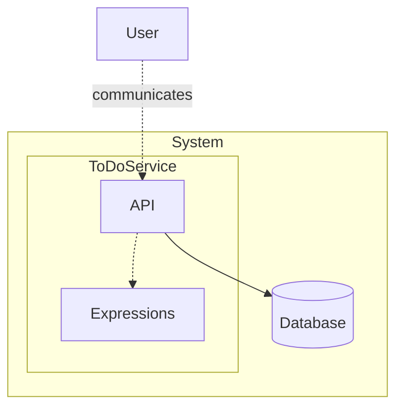

# Task Manager

> Generated from Ocean-Atlas v0.1.0 (content a0c57f8d). Canonical source: https://atlas.ocean-lab.ai/examples/task-manager/

**Contents**

- [Overview](#overview)
- [Files](#files)
- [DSL source files](#dsl-source-files)
- [Diagrams](#diagrams)
- [Walkthrough](#walkthrough)
- [Other files in the example (not inlined)](#other-files-in-the-example-not-inlined)

Create, find, update, and delete persistent tasks through an API while applying task lifecycle rules.

Source: https://atlas.ocean-lab.ai/examples/task-manager/

Level: easy · Estimated time: 10 minutes · Version: 1.0.0 · Onboarding example: yes

Components: 1 services, 0 brokers, 1 databases

Tags: api, crud, database, expressions, management, rest, tasks, ui

## Overview

This example shows how Ocean models a task-management system whose API supports persistent CRUD operations and whose expressions apply task lifecycle rules. Its executable DSL and its Horizon and Voyage explanation are maintained together in this example directory.

## Files

DSL source comes first, then diagrams; the long Horizon and Voyage walkthroughs are at the end. You can stop after the source files.

| File | Section | Lines |
| --- | --- | --- |
| `00-todo-info.ocn` | `@info` | 14 |
| `app-todo-api.ocn` | `@api` | 37 |
| `app-todo-config.ocn` | `@config` | 25 |
| `app-todo-dashborad.ocn` | `@dashboard` | 98 |
| `app-todo-db.ocn` | `@database` | 33 |
| `app-todo-deploy.ocn` | `@deploy` | 29 |
| `app-todo-dt.ocn` | `@datatype` | 26 |
| `app-todo-expression.ocn` | `@expression` | 84 |
| `app-todo-service.ocn` | `@service` | 39 |
| `app-todo-ui.ocn` | `@ui` | 56 |

## DSL source files

### `00-todo-info.ocn`

```ocean-dsl
# @ocean-meta-start
# tags:
#   - task-management
#   - documentation
# perspective:
#   feature: task-manager
# @ocean-meta-end

@info

name: ToDo App
version: 1.0.0
description: This app helps you to organize your tasks
```

### `app-todo-api.ocn`

```ocean-dsl
# @ocean-meta-start
# tags:
#   - task-manager-api
#   - rest-api
# perspective:
#   feature: task-manager
#   service: todo-service
# @ocean-meta-end

@api

TodoApi style: rest
    engine           = gin
    configType       = ApiConfig
    tags             = external
    version          = 1.0.0
    description      = ToDo API Description
    basePath         = /
    generateSwagger  = true

    get /todo/info                   getInfo(_)                        :  String
    get /todo/items/{offset}/{limit} listItems(offset:Int, limit:Int)  :  List<TodoItem>
    get /todo/item/{id}              getItem(_)                        :  TodoItem
    get /todo/item/                  getItem2(id:String in-query)      :  TodoItem
    get /todo/title/{title}          findItemByTitle(title:String)     :  List<TodoItem>
    get /todo/title-and-priority/{title}/{priority} findItemByTitleAndPriority(
        title     :  String,
        priority  :  Priority,
    ) : List<TodoItem>
    get /todo/title-or-priority/{title} findItemByTitleOrPriority(
        title     :  String,
        priority  :  Priority in-query,
    ) : List<TodoItem>
    post   /todo/item      createItem(item:TodoItem)  :  TodoItem
    put    /todo/item      adjustItem(item:TodoItem)  :  TodoItem
    delete /todo/item/{id} deleteItem(_)              :  _
```

### `app-todo-config.ocn`

```ocean-dsl
# @ocean-meta-start
# tags:
#   - configuration
# perspective:
#   feature: task-manager
#   service: all
# @ocean-meta-end

@config

@import config O.database.postgres.config@1.0.0 as DatabaseConfig
@import config O.log.config@1.0.0 as LogConfig

TodoServiceConfig
    apiConfig : ApiConfig
    dbConfig  : DatabaseConfig
    logConfig : LogConfig

TodoUiConfig
    port: Int (default=8080)
    logConfig : LogConfig
    
ApiConfig
    port: Int (default=8080)
```

### `app-todo-dashborad.ocn`

```ocean-dsl
# @ocean-meta-start
# tags:
#   - ui
#   - dashboard
# perspective:
#   feature: task-manager
#   service: ui-service
# @ocean-meta-end

@dashboard

TodoViewDashboard
    title: Todo Items
    subtitle: See all your tasks!
    layout: TwoColumnLayout

    Widget TodoTable of type Table
        title = Tasks Table
        columns:
            - id String
            - title String
            - status TaskLifecycle
            - dueDate DateTime

TodoSearchDashboard
    title: Search Todos
    subtitle: Find tasks!
    layout: SingleColumnLayout

    Widget TodoSearchForm of type Form
        title = Find Task
        fields:
            - title String
            - priority Priority
        buttons:
            submit : Search
            cancel : Reset

TodoDeleteDashboard
    title: Delete Todos
    subtitle: Delete tasks!
    layout: SingleColumnLayout

    Widget TodoDeleteForm of type Form
        title = Delete Task
        fields:
            - id String
        buttons:
            submit : Delete
            cancel : Reset

TodoSubmitDashboard
    title: Create Todo
    subtitle: Add tasks!
    layout: SingleColumnLayout

    Widget CreateTodoForm of type Form
        title = Create Task
        fields:
            - title String
            - priority Priority
            - dueDate DateTime
        buttons:
            submit : Create Todo
            cancel : Cancel

TodoEditDashboard
    title: Edit Todo
    subtitle: change tasks!
    layout: TwoColumnLayout

    Widget EditTodoForm of type Form
        title = Edit Task
        fields:
            - id String
            - title String
            - dueDate DateTime
            - priority Priority
            - status TaskLifecycle
        buttons:
            submit : Update
            cancel : Cancel
            fetch : 🔄 Fetch by ID
            
AboutDashboard
    title: About
    subtitle: App information!
    layout: SingleColumnLayout

    Widget AboutText of type Text
        title = About ToDo App
        subtitle = This app helps you to organize your tasks 📝
        content = This is the Todo App. Version 1.0.0 ⚡ Built with Ocean-lab.
        content = The ToDo App is a simple yet powerful tool designed to help you manage your daily tasks with ease and clarity. Whether you're organizing personal errands, tracking work assignments, or planning long-term goals, this app provides a clean and efficient interface to keep everything under control.<br><br>⚡ Built with Ocean-lab, this application demonstrates the flexibility and expressiveness of our domain-specific design system. It’s lightweight, easy to extend, and serves as a perfect starting point for building more complex productivity tools.

    Widget InfoButton of type Button
        color = secondary
```

### `app-todo-db.ocn`

```ocean-dsl
# @ocean-meta-start
# tags:
#   - database
#   - postgres
# perspective:
#   feature: task-manager
#   service: todo-service
# @ocean-meta-end

@database

Database TodoDB
    engine = postgres
    configType = DatabaseConfig
    encryptionKey = generate
    tags = primary

    Entity TodoItem
        key(id)
        indexes: unique(title), index(title), index(dueDate)

        # Queries
        query listTodoItems(offset:Int, limit:Int) : List<TodoItem>
        query findById(id: String) : TodoItem
        query findByTitle(title: String) : List<TodoItem>
        query findByTitleAndPriority(title: String, priority: Priority) : List<TodoItem>
        query findByTitleOrPriority(title: String, priority : Priority) : List<TodoItem>

        # Commands
        command Transactional createTodoItem(item:TodoItem) : TodoItem
        command T updateTodoItem(item:TodoItem) : TodoItem
        command deleteTodoItem(id:String) : _
```

### `app-todo-deploy.ocn`

```ocean-dsl
# @ocean-meta-start
# tags:
#   - deployment
# perspective:
#   feature: task-manager
#   service: all
# @ocean-meta-end

@deploy

Name: TaskMgt-deploy

@import service P.db.postgres.docker@1.0.0 as PostgresqlDB

TodoDeploy
    service     TodoService
    replica     2
    export      9091:TodoService.api
    dependsOn   TodoDatabase

TodoDatabase
    service     PostgresqlDB

TodoUiDeploy
    service     TodoUi
    replica     1
    export      8081:TodoUi.config
    dependsOn   TodoDeploy
```

### `app-todo-dt.ocn`

```ocean-dsl
# @ocean-meta-start
# tags:
#   - datatype
# perspective:
#   feature: task-manager
# @ocean-meta-end

@datatype

TodoItem
    id pattern UR-UUID
    title: String
    dueDate: DateTime
    priority: Priority
    status: TaskLifecycle

enum Priority
    low
    medium
    high

enum TaskLifecycle
    inProgress
    done
    expired
```

### `app-todo-expression.ocn`

```ocean-dsl
# @ocean-meta-start
# tags:
#   - expression
# perspective:
#   feature: task-manager
#   service: backend
# @ocean-meta-end

@expression

GetInfo
    input  : _
    output : res:String
    logic
        msg = "Hello from backend!"
        tgdMsg = TagWrap(msg, "i")
        tgdMsg = TagSuffix(tgdMsg, "br")
        tip = tipOfTheDay()
        tip = StringConcat2("🌟 ", tip)
        tgdTip = TagWrap(tip, "b")
        tgdTip = TagSuffix(tgdTip, "br")
        nh = NowHumanized()
        ts = StringConcat2("🕒 ", nh)
        tgdTs = TagWrap(ts, "i")
        tmp = StringConcat2(tgdMsg, tgdTip)
        res = StringConcat2(tmp, tgdTs)

CreateItem
    input  : todo:TodoItem
    output : result:TodoItem
    logic
        todo.status = TaskLifecycle.inProgress
        temp = TodoItem.createTodoItem(todo)
        result = CheckItem(temp)

DeleteItem
    input  : id: String
    output : _
    logic
        TodoItem.deleteTodoItem(id)

AdjustItem
    input  : todo:TodoItem
    output : result:TodoItem
    logic
        temp = TodoItem.updateTodoItem(todo)
        result = CheckItem(temp)

GetItem
    input  : id:String
    output : result:TodoItem
    logic
        temp = TodoItem.findById(id)
        result = CheckItem(temp)

GetAll
    input  : offset:Int & limit:Int
    output : result:List<TodoItem>
    logic
        temp = TodoItem.listTodoItems(offset, limit)
        result = MapSlice(temp, CheckItem)

IsOverdue
    input  : todo:TodoItem
    output : result:Boolean
    logic
        result = now() > todo.dueDate

CheckItem
    input  : todo:TodoItem
    output : result:TodoItem
    logic
        overdue = IsOverdue(todo)
        if todo.status != TaskLifecycle.done AND overdue then
            todo.status = TaskLifecycle.expired
        end
        result = todo

UnusedExpr
    input  : todo:TodoItem
    output : result:TodoItem
    logic
        result = todo
```

### `app-todo-service.ocn`

```ocean-dsl
# @ocean-meta-start
# tags:
#   - task-manager
#   - orchestrator
#   - service
# perspective:
#   feature: task-manager
#   service: todo-service
# @ocean-meta-end

@service

TodoService

    @perspectives: version:0.1.0, lifestyle:stable

    use config TodoServiceConfig as myCfg
    impl api TodoApi as api on myCfg.apiConfig.port
    use database TodoDB as appDb
    use expression GetInfo as info
    use expression GetItem as get
    use expression GetAll as all
    use expression CreateItem as crt
    use expression AdjustItem as adj
    use expression DeleteItem as dlt

    connect myCfg.dbConfig -> appDb

    connect api.getInfo -> info
    connect api.getItem -> get
    connect api.getItem2 -> TodoItem.findById
    connect api.findItemByTitle -> TodoItem.findByTitle
    connect api.findItemByTitleAndPriority -> TodoItem.findByTitleAndPriority
    connect api.findItemByTitleOrPriority -> TodoItem.findByTitleOrPriority
    connect api.listItems -> all
    connect api.createItem -> crt
    connect api.adjustItem -> adj
    connect api.deleteItem -> dlt
```

### `app-todo-ui.ocn`

```ocean-dsl
# @ocean-meta-start
# tags:
#   - orchestrator
#   - ui
# perspective:
#   feature: task-manager
#   service: ui-service
# @ocean-meta-end

@ui

TodoUi

    @perspectives: version:0.1.0, lifestyle:stable

    framework: htmx
    styling: bootstrap
    template: go-html-template
    backend: go-gin
    static: static
    configType: TodoUiConfig

    nav View dashboard = TodoViewDashboard
    nav Search dashboard = TodoSearchDashboard
    nav Submit dashboard = TodoSubmitDashboard
    nav Edit dashboard = TodoEditDashboard
    nav Delete dashboard = TodoDeleteDashboard
    nav About dashboard = AboutDashboard
    nav Company link = https://company.com
    nav Schema file = static/schema.pdf

    header title = 📝 ToDo App
    header subtitle = Simple Task Manager
    header align = center

    footer title = ⚡ Built with Ocean-lab
    footer subtitle = Version 1.0.0
    footer align = center

    use dashboard TodoViewDashboard as view
    use dashboard TodoSearchDashboard as search
    use dashboard TodoSubmitDashboard as submit
    use dashboard TodoEditDashboard as edit
    use dashboard TodoDeleteDashboard as delete
    use dashboard AboutDashboard as about

    use api TodoApi

    connect view.TodoTable.listRows -> TodoApi.listItems
    connect search.TodoSearchForm.submit -> TodoApi.findItemByTitleOrPriority # could be AND
    connect submit.CreateTodoForm.submit -> TodoApi.createItem
    connect edit.EditTodoForm.submit -> TodoApi.adjustItem
    connect edit.EditTodoForm.fetch -> TodoApi.getItem
    connect delete.TodoDeleteForm.submit -> TodoApi.deleteItem
    connect about.InfoButton.click -> TodoApi.getInfo
```

## Diagrams

### `spec-task-management.mmd`



## Walkthrough

A long, step-by-step explanation (Horizon and Voyage) is in [Task Manager walkthrough](task-manager-walkthrough.md). Read it only if you need the reasoning behind the design.

## Other files in the example (not inlined)

Fixtures, scripts and supporting artifacts. See the example on the Atlas site for their purpose.

- `api/component-test.hurl` (fixture)

- `info/mermaid-preview-gallery.md` (artifact)
