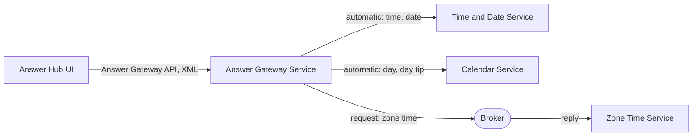

# XML Gateway Answer Hub: Walkthrough

> Generated from Ocean-Atlas v0.1.0 (content a0c57f8d). Canonical source: https://atlas.ocean-lab.ai/examples/xml-gateway-answer-hub/

**Contents**

- [Horizon](#horizon)
- [Voyage](#voyage)

Horizon and Voyage explanation for the XML Gateway Answer Hub example.

Source: https://atlas.ocean-lab.ai/examples/xml-gateway-answer-hub/

## Horizon

### Example at a Glance

#### Overview

This example gives clients one public Answer API for the current time, date, day, day tip, and Amsterdam zone time — the same gateway as `gateway-answer-hub` — but every operation declares `@response:xml`, so Ocean generates handlers and clients that answer in XML instead of JSON.

It is the XML counterpart of `gateway-answer-hub`: only the payload representation changes, operation by operation. The API style stays REST/`gin`, unlike `soap-gateway-answer-hub`, where the API style itself is SOAP and XML comes from its envelope.

#### Architecture



The UI calls only the gateway and decodes XML responses through its generated client. Four operations are forwarded automatically to included APIs; zone time is routed explicitly to a broker responder.

#### What It Demonstrates

- `@api` — the `@response:xml` payload representation attribute on a REST operation, generating an XML-serializing handler and client instead of the JSON default.
- `@api` — `include` composes two provider APIs into one public gateway API; each included operation keeps its own declared representation.
- `@service` — `impl gateway api ... including` forwards matching operations automatically, and an explicit `connect` routes the rest, independent of payload representation.
- `@broker` — a request-response topic answered by a service that exposes no API; the broker hop is unaffected by the gateway's own REST representation.
- `@expression` — small provider expressions that produce each answer.
- `@dashboard` and `@ui` — a generated interface whose buttons call only the gateway API and transparently decode its XML responses.
- `@config` and `@deploy` — shared service configuration and deployment of the gateway, providers, broker, and UI.

#### Expected Result

Each dashboard button calls one operation of the public gateway API and displays its answer. Time, date, day, and day tip come from their provider services through automatic forwarding; zone time comes from the broker responder through the explicit route. Every response on the wire is XML.

## Voyage

### 1. Problem and Constraints

Some clients or contracts require XML instead of JSON, but that choice should not force a different API style, a different gateway, or a different routing model. Payload representation must be declarable per operation, defaulted sensibly, and preserved through composition and forwarding. Gateway policies such as authentication, CORS, and rate limiting are out of scope here, exactly as in `gateway-answer-hub`.

### 2. Prerequisites

- Ocean UI with the gateway capability of `@service`, API composition in `@api`, and REST payload representation attributes.
- A container runtime for the generated deployment.
- Recommended: `gateway-answer-hub`, the same example answering in JSON.
- Optional: `soap-gateway-answer-hub`, for contrast with a SOAP API style whose envelope is always XML.

### 3. Example Structure

```text
0019-xml-gateway-answer-hub/
├── 00-xgah-info.ocn
├── 10-xgah-api.ocn
├── 20-xgah-broker.ocn
├── 30-xgah-config.ocn
├── 40-xgah-expression.ocn
├── 50-xgah-service-calendar.ocn
├── 50-xgah-service-gateway.ocn
├── 50-xgah-service-time-date.ocn
├── 50-xgah-service-zone-time.ocn
├── 55-xgah-dashboard.ocn
├── 56-xgah-ui.ocn
├── 60-xgah-deploy.ocn
├── architecture.mmd
├── broker-communication.mmd
└── example-info/example-info.html
```

### 4. Declare the XML Response Representation

`10-xgah-api.ocn` is `10-gah-api.ocn` with `@response:xml` added to every operation. No operation declares `@request`: every operation is a bodyless `GET`, and `GET`/`DELETE` cannot declare a request representation at all.

```text
TimeDateApi style:rest
    engine = gin
    configType = ApiConfig
    version = 1.0.0
    basePath = /time-date
    generateSwagger = true

    get /time getTime() : String @response:xml
    get /date getDate() : String @response:xml
```

`include` still reuses the provider operations without repeating them; each included operation keeps the representation it was declared with.

```text
AnswerGatewayApi style:rest
    engine = gin
    configType = ApiConfig
    version = 1.0.0
    basePath = /answers
    generateSwagger = true

    include TimeDateApi, CalendarApi

    get /zone-time getZoneTime() : String @response:xml
```

The generated handler for each operation writes its result with `c.XML(http.StatusOK, result)` instead of `c.JSON(...)`, and its Swagger annotation declares `@Produce application/xml`.

### 5. Implement the Gateway Service

`50-xgah-service-gateway.ocn` is unchanged from `gateway-answer-hub`: forwarding and explicit routing do not depend on payload representation.

```text
use api TimeDateApi as timeDate
use api CalendarApi as calendar
use broker AnswerHubBroker as broker

impl gateway api AnswerGatewayApi as gw on gwCfg.apiConfig.port
    including timeDate, calendar

connect gw.getZoneTime -> broker.answers.zoneTime
```

### 6. Provide the Answers

`TimeDateService` and `CalendarService` implement their provider APIs with ordinary `connect` statements to expressions; nothing changes here because the representation is declared on the API, not the service. `ZoneTimeService` implements no API: it answers the request-response topic declared in `20-xgah-broker.ocn`, which is untouched by `@response:xml`.

```text
AnswerHubBroker
    engine = nats
    configType = AnswerHubBrokerConfig

    answers.zoneTime : _-String as request-response with timeout:2s

ZoneTimeService
    use broker AnswerHubBroker as broker
    use expression GetAmsterdamTime as zoneTime

    connect broker.answers.zoneTime -> zoneTime
```

### 7. Call Only the Gateway from the UI

`AnswerHubUi` uses `AnswerGatewayApi` and nothing else. Its generated backend client decodes the XML response of each call transparently, so the dashboard wiring is identical to the JSON example.

```text
use api AnswerGatewayApi as gateway

connect answers.TimeButton.click -> gateway.getTime
connect answers.ZoneTimeButton.click -> gateway.getZoneTime
```

### 8. Select Technologies and Deploy

The APIs use the `gin` REST engine, the broker uses `nats`, and the UI is generated with HTMX, Bootstrap, and Go templates. `60-xgah-deploy.ocn` imports a NATS container and starts the gateway after its providers and the broker.

```text
GatewayDeploy
    service AnswerGatewayService
    replica 1
    export 9100:AnswerGatewayService.gw
    dependsOn TimeDateDeploy, CalendarDeploy, ZoneTimeDeploy, Broker

AnswerHubUiDeploy
    service AnswerHubUi
    replica 1
    export 8085:AnswerHubUi.config
    dependsOn GatewayDeploy
```

The provider APIs are also exported on ports `9101` and `9102` for direct inspection. The UI does not use them.

### 9. Validate, Generate, and Run

1. Open the `XML Gateway Answer Hub` example in Ocean UI.
2. Validate and generate the complete model.
3. Follow the generated `Readme.md` to start the broker, services, and UI.
4. Open the UI at `localhost:8085`.

### 10. Verify the Result

1. Use the time, date, day, and day tip buttons; each answer is forwarded by the gateway to its provider service and rendered from an XML response.
2. Use the Amsterdam zone time button; the answer is returned by `ZoneTimeService` through the broker and still rendered as XML by the gateway.
3. Call `GET localhost:9100/answers/time` directly and compare the response body and `Content-Type` with `GET localhost:9101/time-date/time`; both are `application/xml` and look like `<string>the current time</string>`.
4. Stop `ZoneTimeService` and call `/answers/zone-time`; the request fails after its two-second timeout while the forwarded operations still answer.

### 11. Experiments

- Remove `@response:xml` from `getZoneTime` only, and validate; the gateway now answers `getZoneTime` in JSON while the other four operations stay XML, since representation is per-operation.
- Add `connect gw.getTime -> broker.answers.zoneTime` and observe that the explicit route overrides automatic forwarding, unrelated to representation.
- Remove `calendar` from `including` and validate; `getDay` and `getDayTip` become unresolved public operations.
- Compare this directory with `gateway-answer-hub` using a diff; the only substantive change is the five `@response:xml` annotations in `10-xgah-api.ocn`.

### 12. Related Knowledge

- `dsl.api` — REST payload representation attributes (§3.5).
- `dsl.service` — gateway implementations, unaffected by payload representation.
- `dsl.broker` — request-response topics.
- `examples.gateway-answer-hub` — the same gateway answering in JSON.
- `examples.soap-gateway-answer-hub` — the same gateway with SOAP as the API style instead of a REST payload representation.
