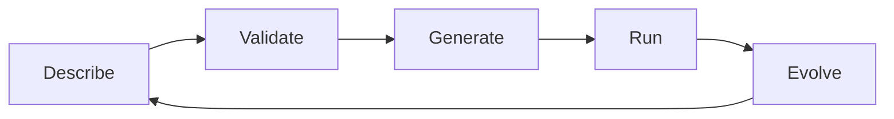
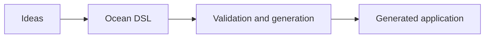
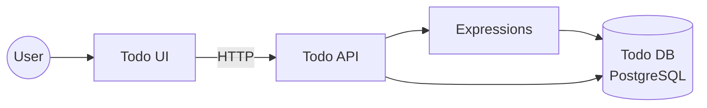
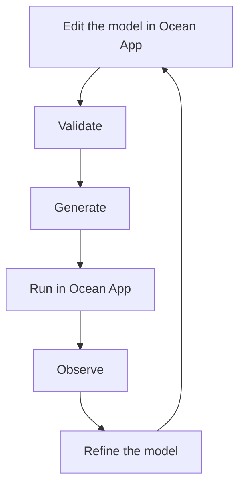

# Getting Started

> Generated from Ocean-Atlas v0.1.0 (content a0c57f8d). Canonical source: https://atlas.ocean-lab.ai/getting-started/

**Contents**

- [Getting Started](#getting-started-1)
- [What Is Ocean?](#what-is-ocean)
- [Prerequisites](#prerequisites)
- [Run the First Example](#run-the-first-example)
- [Understand the First Bundle](#understand-the-first-bundle)
- [Make the First Change](#make-the-first-change)
- [The Everyday Workflow](#the-everyday-workflow)
- [Next Steps](#next-steps)

## Getting Started

A compact, browser-based onboarding path for understanding Ocean, running the onboarding example in Ocean App, and learning how its Bundle drives generation.

Source: https://atlas.ocean-lab.ai/getting-started/

Status: Approved · Authority: Informative

### 1. Overview

Ocean is a domain-specific language and generation platform for describing
software systems once, independently of the technology used to build them,
and turning that description into a real, running implementation. You
write what a system *is* — its data, behavior, interfaces, and
connections — and Ocean's generators handle turning that into code for a
chosen language, framework, and database.

Ocean exists for the gap between "I know what this system should do" and
"I have working code for it": the repetitive plumbing, the drift between
documentation and implementation, and the cost of re-describing the same
architecture every time the target technology changes. If you've ever
redrawn the same service diagram for the third framework this year, that's
the problem Ocean is for.

This path is for anyone who wants a working feel for Ocean before reading
deep reference material — engineers evaluating Ocean, new team members,
and curious readers alike. No prior Ocean knowledge is assumed.

The complete path is designed to deliver this outcome:

> opened Ocean App, explored the **Onboarding: Task Manager** Bundle,
> generated and ran its application, modified its DSL, and regenerated it —
> all in the browser, with nothing to install.

Reading and doing all of it takes about 30–45 minutes, most of it hands-on
rather than reading.

### 2. The Path

Each page builds on the one before it. Follow them in order the first
time through:

1. [What Is Ocean?](#what-is-ocean) — the mental model, in a few minutes.
2. [Prerequisites](#prerequisites) — what you actually need (less than you'd expect).
3. [Run the First Example](#run-the-first-example) — open, generate, and run **Onboarding: Task Manager** in Ocean App.
4. [Understand the First Bundle](#understand-the-first-bundle) — what you just explored, explained.
5. [Make the First Change](#make-the-first-change) — edit the model, regenerate, and observe the expected effect.
6. [The Everyday Workflow](#the-everyday-workflow) — the loop you'll repeat from here on.
7. [Next Steps](#next-steps) — where to go depending on your goal.

### 3. Already Comfortable Reading DSL? Use an Example Instead

If you'd rather explore hands-on without the guided narration, skip
straight to [Examples](https://atlas.ocean-lab.ai/examples/) — every example includes its own
Horizon (orientation) and Voyage (walkthrough). This path exists for
readers who want the narration; it doesn't gatekeep anything the examples
don't already offer.

### 4. Ocean, Not Ocean-Atlas

One distinction worth making before you start: **Ocean** is the platform
and DSL this path teaches you to use. **Ocean-Atlas** — the site you're
reading right now — is the canonical knowledge base *about* Ocean. You're
using Ocean-Atlas to learn Ocean; you are not installing or running
Ocean-Atlas itself. Nothing in this path requires cloning or building this
documentation site.

## What Is Ocean?

A short, conceptual introduction to Ocean, its workflow, and the roles in its ecosystem — enough to start, with links to the full concepts.

Source: https://atlas.ocean-lab.ai/getting-started/01-what-is-ocean/

Status: Approved · Authority: Informative

### 1. Ocean in One Idea

Ocean is a system-design and generation platform. You describe a system —
its data, its behavior, its interfaces, how its parts connect — in **Ocean
DSL**, a domain-specific language that stays independent of any particular
programming language, framework, or database. Ocean validates that
description, then generates a real implementation from it.

The description is the source of truth. The generated code is an output —
useful, runnable, but reproducible from the model, not the other way
around.

### 2. From Model to Running System



- **Describe** — write the system as Ocean DSL: data types, APIs,
  databases, services, and how they connect.
- **Validate** — Ocean checks the model for consistency before anything is
  generated: unresolved references, type mismatches, and structural
  problems surface here, not at runtime.
- **Generate** — a generator turns the validated model into an
  implementation for a chosen target technology.
- **Run** — the generated system runs like any other application in its
  target technology.
- **Evolve** — you change the model, not the generated code, and go
  around again.

This loop is the whole rhythm of working in Ocean. You'll run it yourself,
by hand, in [Make the First Change](#make-the-first-change), and
see it explained in full in
[The Everyday Workflow](#the-everyday-workflow).

### 3. What Ocean Gives You

- **Technology independence** — the same model can target different
  languages, frameworks, and databases without being rewritten.
- **Consistent architecture** — the model, not scattered hand-written
  boilerplate, is the one place system structure is decided.
- **Reusable definitions** — data types, expressions, and other
  constructs can be shared and versioned through the
  [Ocean Repository](concepts.md#ocean-repository) instead of copied.
- **Multi-target generation** — one description, more than one possible
  implementation.
- **Automation and AI readiness** — a structured, technology-independent
  model is far easier for tooling — and future AI assistance — to reason
  about than hand-written source spread across a codebase.

### 4. What Ocean Is Not

- **Not merely a programming language.** Ocean DSL describes a system;
  it does not replace general-purpose programming for every concern.
- **Not a framework tied to one runtime.** Ocean doesn't lock you to a
  single language, web framework, or database engine.
- **Not a replacement for all implementation code.** Generated code is a
  starting point; real systems still have custom logic that belongs
  alongside — not inside — generated output. See
  [The Everyday Workflow](#the-everyday-workflow) for exactly
  where that line sits.
- **Not Ocean-Atlas itself.** Ocean is the platform; Ocean-Atlas is the
  knowledge base you're reading. See the note in the
  [Getting Started overview](#4-ocean-not-ocean-atlas).

### 5. The Ecosystem at a Glance



A few names you'll see throughout this path and across Ocean-Atlas:

- **Ocean DSL** — the language you write: the technology-independent
  description of a system.
- **Ocean App** — the web application in which you describe, validate, and
  generate a system. [Prerequisites](#prerequisites)
  explains everything needed to use it.
- **Generators** — produce a target-specific implementation from a
  validated model.
- **[Ocean Repository](concepts.md#ocean-repository)** — supplies reusable,
  versioned definitions so common building blocks don't get rewritten per
  project.
- **[Ocean Examples](https://atlas.ocean-lab.ai/examples/)** — runnable projects, each with its own
  guided explanation, that demonstrate real Ocean models end to end.
- **Ocean-Atlas** — this site: the canonical knowledge base about Ocean.
- **Ocean UI** — presents or interacts with a generated system, where a
  system has one.
- **Ocean AI Assistant** — a *planned* design-time assistant for authoring
  Ocean models. This is [roadmap](decisions.md#roadmap) direction, not a currently
  available capability — mentioned here only so the name doesn't surprise
  you elsewhere.

For the deeper explanation behind any of this, [Concepts](concepts.md#concepts-1) is
where the short version above becomes the full one.

## Prerequisites

Ocean requires no local CLI or toolchain: modeling, validation, and generation happen in Ocean App.

Source: https://atlas.ocean-lab.ai/getting-started/02-prerequisites/

Status: Approved · Authority: Informative

There isn't much here, and that's not an omission — Ocean has no local
prerequisites or CLI to install. Describing, validating, and generating a
system all happen in **Ocean App**, Ocean-Lab's web application, not on
your machine.

### 1. To Use Ocean

- An internet connection.
- A modern web browser.
- Access to [Ocean App](https://app.ocean-lab.ai).

That's it for Ocean itself. There's nothing to install locally, no runtime
version to match, and no package manager to configure.

### 2. To Run What Ocean Generates

Once Ocean-Lab generates an application from your Bundle, *that* generated
project has its own prerequisites — a runtime, maybe a database, whatever
its target languages and engines need. Those requirements depend entirely
on what you modeled and which technologies you selected, so they differ
from one generated project to the next.

The generated project's own `README` is the authoritative source for its
prerequisites — not this page. Ocean-Atlas doesn't maintain a separate,
general-purpose list of "things a generated Ocean project might need,"
because that list is different for every project.

### 3. What's Next

[Run the First Example](#run-the-first-example) walks through
using Ocean-Lab itself to work with the first Bundle.

## Run the First Example

Open, generate, and run “Onboarding: Task Manager” entirely inside Ocean App.

Source: https://atlas.ocean-lab.ai/getting-started/03-quick-start/

Status: Approved · Authority: Informative

Everything in this guide happens inside
[Ocean App](https://app.ocean-lab.ai). You do not need to install a CLI,
clone a repository, or use a terminal.

Ocean App presents **Onboarding: Task Manager** specifically for this first
experience. It is a small but complete application that persists tasks,
applies lifecycle rules, exposes a REST API, and provides a UI. Its model
is documented in Ocean-Atlas as the
[Task Manager example](examples/task-manager.md).

### 1. Open Ocean App

Go to [app.ocean-lab.ai](https://app.ocean-lab.ai) and access Ocean App.

### 2. Open Onboarding: Task Manager

From Ocean App's available examples, open **Onboarding: Task Manager**.
Choose the provided example rather than creating a project from scratch.

### 3. Look at the Model

The example opens the Bundle used throughout this path: ten small DSL
files that together model Task Manager.

```text
00-todo-info.ocn
app-todo-api.ocn
app-todo-config.ocn
app-todo-dashborad.ocn
app-todo-db.ocn
app-todo-deploy.ocn
app-todo-dt.ocn
app-todo-expression.ocn
app-todo-service.ocn
app-todo-ui.ocn
```

You don't need to understand them yet —
[Understand the First Bundle](#understand-the-first-bundle)
walks through each one next. For now, just look around.

### 4. Generate the Application

Use Ocean App's generation action for the example. Ocean App
validates the Bundle as part of this workflow and generates its concrete
implementation.

The current Task Manager model targets a Go API using Gin, PostgreSQL
persistence, and an HTMX/Bootstrap/Go-template UI, as documented by the
example's Voyage.

### 5. Run It

Run the generated application from within Ocean App. The app manages this
first execution experience; no local runtime or database setup is required
for the onboarding flow.

### 6. See It Work

Once the application is running, explore its generated UI. In particular,
look for the behavior backed by these two API operations:

- **`getInfo`** — the simplest operation, with no dependencies: a good
  first thing to try.
- **`listItems`** — reads persisted tasks back, exercising the
  [Database-Backed CRUD pattern](patterns.md#database-backed-crud) this
  example demonstrates.

The Bundle declares deployment details such as API and UI ports, but Ocean
App handles those runtime details for this in-app experience.

### 7. Downloading the Generated Project Is Optional

You may download the generated source when you want to inspect or run it
outside Ocean App. Local prerequisites are target-specific; follow the
generated project's own `README` for its required runtime, dependencies,
configuration, build, and execution steps.

Downloading or running the source locally is not required to complete this
Getting Started path.

### What's Next

You have opened a real Ocean Bundle, generated its implementation, and run
it inside Ocean App.
[Understand the First Bundle](#understand-the-first-bundle)
explains what you just looked at, in detail.

## Understand the First Bundle

A guided reading of the Task Manager Bundle using Ocean's own Horizon, Voyage, and Implementation facets.

Source: https://atlas.ocean-lab.ai/getting-started/04-understand-the-bundle/

Status: Approved · Authority: Informative

Ten small files, read in the right order, tell a complete story. This page
tells it using the same three facets every Ocean example uses — Horizon,
Voyage, and Implementation — so the shape becomes familiar before you meet
it again in other examples.

### 1. Horizon: The System From Above

Task Manager models a task manager built around one persistent record: a
`TodoItem`, with a title, a due date, a priority, and a lifecycle status.
An API creates, finds, updates, and deletes tasks; a database persists
them; expressions apply the lifecycle rule that turns an overdue task
`expired`; a UI presents all of it.



- **Actors:** one human user, interacting through the UI or directly
  through the API.
- **Services:** `TodoService` (API, expressions, persistence) and `TodoUi`
  (presentation), deployed separately.
- **API:** `TodoApi` — REST, one base path.
- **Database:** `TodoDB` — one entity, `TodoItem`.
- **Brokers:** none. This example doesn't touch messaging.
- **Model boundary:** the Bundle describes the application structure shown
  above; generators and imported reusable definitions participate in
  producing the concrete implementation.

That's the whole system. Everything past this point is the same picture,
in more detail.

### 2. Voyage: Reading the Bundle in Order

Read the files in this order — it's the order each piece starts depending
on the one before it.

#### 2.1 Project Information — `00-todo-info.ocn`

| | |
| --- | --- |
| **Describes** | The Bundle's identity: name, version, description. |
| **Why it's needed** | Every Bundle is identified by its `@info` section — see [Ocean Bundle](concepts.md#ocean-bundle). |
| **Referenced by** | Nothing inside the Bundle; it identifies the Bundle as a whole. |
| **Reference** | [Info DSL Reference](dsl/info.md) |

#### 2.2 Datatypes — `app-todo-dt.ocn`

| | |
| --- | --- |
| **Describes** | `TodoItem` and its two enums, `Priority` and `TaskLifecycle`. |
| **Why it's needed** | Every other section — API, database, expressions, UI — shares this one definition of what a task *is*, instead of each redefining its own shape. |
| **Referenced by** | The API (operation parameters and returns), the database entity, the expressions, and the UI's dashboard fields. |
| **Reference** | [Datatype DSL Reference](dsl/datatype.md) |

#### 2.3 Configuration — `app-todo-config.ocn`

| | |
| --- | --- |
| **Describes** | `TodoServiceConfig` and `TodoUiConfig`, composed from imported, reusable `DatabaseConfig` and `LogConfig` definitions. |
| **Why it's needed** | The service and the UI both need typed, environment-specific settings — a port, a database connection — without hardcoding them into behavior. |
| **Referenced by** | The service (`use config TodoServiceConfig`) and the UI (`configType: TodoUiConfig`). |
| **Reference** | [Config DSL Reference](dsl/config.md) |

#### 2.4 Persistence — `app-todo-db.ocn`

| | |
| --- | --- |
| **Describes** | `Database TodoDB`, one `Entity TodoItem`, and its queries and commands — find by ID, find by title, list, create, update, delete. |
| **Why it's needed** | Tasks need to persist across requests, not just live in memory. |
| **Referenced by** | The expressions, which call `TodoItem.createTodoItem`, `.findById`, and similar directly; and the service, which uses the database. |
| **Reference** | [Database DSL Reference](dsl/database.md) |

#### 2.5 API — `app-todo-api.ocn`

| | |
| --- | --- |
| **Describes** | `TodoApi`: the public REST operations — get, list, find, create, update, delete. |
| **Why it's needed** | This is the system's public contract — what a caller (the UI, or you, with `curl`) can actually do. |
| **Referenced by** | The service, which implements it; the UI, which connects widget actions to its operations. |
| **Reference** | [API DSL Reference](dsl/api.md) |

#### 2.6 Expressions — `app-todo-expression.ocn`

| | |
| --- | --- |
| **Describes** | The logic between API and database: `CreateItem`, `GetItem`, `GetAll`, `AdjustItem`, `DeleteItem`, and the lifecycle rule `IsOverdue` / `CheckItem` that marks a task `expired`. |
| **Why it's needed** | Not every API call is a plain database pass-through — a created or fetched task needs its overdue status checked first. This is where that rule lives, in one place. |
| **Referenced by** | The service, which connects API operations to these expressions instead of straight to the database where a rule applies. |
| **Reference** | [Expression DSL Reference](dsl/expression.md) |

#### 2.7 Service — `app-todo-service.ocn`

| | |
| --- | --- |
| **Describes** | `TodoService`: the orchestration unit that wires configuration, the API implementation, the database, and the expressions together with `connect`. |
| **Why it's needed** | Something has to decide, for each API operation, whether it's a direct database call or one that runs through an expression first. This is that something. |
| **Referenced by** | Deployment, which materializes it as a running unit. |
| **Reference** | [Service DSL Reference](dsl/service.md) |

#### 2.8 Dashboards and UI — `app-todo-dashborad.ocn`, `app-todo-ui.ocn`

| | |
| --- | --- |
| **Describes** | Six dashboards (view, search, create, edit, delete, about) made of typed widgets, composed by `TodoUi` into one navigable application connected to `TodoApi`. |
| **Why it's needed** | A generated API is not, by itself, something most people want to use directly. |
| **Referenced by** | Deployment, as a separately deployed service from the API. |
| **Reference** | [Dashboard DSL Reference](dsl/dashboard.md), [UI DSL Reference](dsl/ui.md) |

#### 2.9 Deployment — `app-todo-deploy.ocn`

| | |
| --- | --- |
| **Describes** | How `TodoService` and `TodoUi` become running units: replica counts, exported ports (`9091` and `8081`), and `TodoService`'s dependency on a Dockerized PostgreSQL instance. |
| **Why it's needed** | A validated model isn't a running system yet — this is what turns it into one. |
| **Referenced by** | Nothing further; this is where the model becomes runtime topology. |
| **Reference** | [Deploy DSL Reference](dsl/deploy.md) |

### 3. Implementation: What's Actually There

- **Authored Ocean DSL:** the ten `.ocn` files above — this is what you,
  or anyone extending this example, would edit.
- **Supporting the example, not part of the model:** `example.md` (the
  Atlas descriptor) and `example-info/example-info.html` (the Horizon and
  Voyage explanation you're reading a guided version of right now).
- **What the generator produces:** a Go/Gin API, PostgreSQL persistence,
  and an HTMX/Bootstrap/Go-template UI, per the example's own
  documentation.
- **Where custom logic belongs, and how regeneration behaves:** this is
  general to every Ocean project, not specific to Task Manager — see
  [The Everyday Workflow](#the-everyday-workflow) for the full
  answer and the ownership table behind it.

This page reads the model; it doesn't reproduce the example itself. For
the complete, canonical version — including the parts not walked through
above — see [Task Manager](examples/task-manager.md) directly.

### What's Next

You've read the whole Bundle. [Make the First Change](#make-the-first-change)
is where you edit one small piece of it and watch the effect ripple
through.

## Make the First Change

Edit the Bundle inside Ocean App, regenerate, and confirm one enum value reaching the API and every generated form that references it.

Source: https://atlas.ocean-lab.ai/getting-started/05-first-change/

Status: Approved · Authority: Informative

This is the moment the rest of this path has been building toward: you
change the model, not the generated code, and the system changes with
it — entirely inside [Ocean App](https://app.ocean-lab.ai), on the
Onboarding: Task Manager project you already opened.

### 1. The Change

`Priority` — one of the two enums in `app-todo-dt.ocn` — currently has
three values:

```text
enum Priority
    low
    medium
    high
```

Add a fourth:

```text
enum Priority
    low
    medium
    high
    urgent
```

That's the entire change: one new line in one definition.

### 2. Edit the Bundle in Ocean App

Open the `Priority` datatype in Ocean App and add the `urgent` value above.
Nothing else in the Bundle needs to change — adding an enum value doesn't
break anything that already references `Priority` by type. It only adds a
possibility, and every existing reference stays valid.

### 3. Regenerate

Use Ocean App's generation action again, the same way you did in
[Run the First Example](#run-the-first-example). Ocean App
validates the edited Bundle and regenerates the application from it.

### 4. What Changes, and Why

Search `app-todo-dt.ocn` for `Priority`, and you'll find it used far
beyond the field it's declared on:

- `TodoApi`'s `findItemByTitleAndPriority` and
  `findItemByTitleOrPriority` operations both take a `priority:Priority`
  parameter — they now accept `urgent` without a single line of API DSL
  changing.
- Three dashboard forms — `TodoSearchDashboard`, `TodoSubmitDashboard`,
  and `TodoEditDashboard` — each have a `priority Priority` field, and
  each should offer `urgent` as an option once regenerated, without any
  dashboard or UI DSL changing either.

Nobody edited the API. Nobody edited three separate forms by hand. One
enum value, declared once, reached every place that referenced its type —
because those places reference the *type*, not a hardcoded list of its
values.

### 5. Confirm It

Once regeneration finishes, confirm the result through the running
application:

1. Open the generated Submit form.
2. Confirm that `urgent` appears among the priority options.
3. Create a task whose priority is `urgent`.
4. Open or search for that task.
5. Confirm that its displayed priority remains `urgent`.

This single interaction verifies the whole path: the generated form knows
the new enum value, the API accepts it, persistence retains it, and the UI
reads it back correctly.

### 6. Optional: Download and Compare

If you downloaded the generated project in
[Run the First Example](#run-the-first-example), download it
again after this change and diff the two — a concrete way to see exactly
what one model edit changed in the generated output, beyond what's
visible in the running UI.

### What Just Happened

You changed one line in the model. The API's accepted values, the search
form, the create form, and the edit form all changed with it — because
all four were always describing the same `Priority`, not four independent
copies of it. This is the whole point of a model-first system: change the
description once, and everything downstream stays in sync by
construction, not by remembering to update every place separately.

### What's Next

[The Everyday Workflow](#the-everyday-workflow) turns this one
change into the loop you'll repeat for every change from here on.

## The Everyday Workflow

The development loop you'll repeat for every Ocean change, who owns which files, essential terminology, and the errors beginners hit most.

Source: https://atlas.ocean-lab.ai/getting-started/06-basic-workflow/

Status: Approved · Authority: Informative

This is the loop you just ran in
[Make the First Change](#make-the-first-change) — the same one
you'll run for ordinary Ocean development from here on.

### 1. The Ocean App Loop



- **Edit** — create or change Ocean DSL in the Bundle. The model is where
  you author the system's structure and intent.
- **Validate** — Ocean checks that references resolve, types match, and
  the Bundle is structurally consistent.
- **Generate** — Ocean translates the validated model into a concrete
  implementation for its selected engines and targets.
- **Run** — launch the generated application inside Ocean App, without
  installing its target-specific dependencies locally.
- **Observe** — exercise the application and compare its behavior with
  what the Bundle describes.
- **Refine** — put what you learned back into the model, regenerate, and
  repeat.

This browser-based loop is the normal starting point. Ocean App manages
validation, generation, and the first execution experience; the user
remains responsible for the model.

### 2. Working With the Model

- **Resolve references deliberately.** Every reference — for example, a
  datatype used by an API or an expression connected by a service — must
  resolve to a local or explicitly reused definition.
- **Select technologies through the model.** Attributes such as
  `engine = postgres` or `engine = gin` select concrete technologies
  without changing the technology-independent purpose of the construct.
- **Regenerate after model changes.** The implementation is derived from
  the current Bundle. A model change does not reach the application until
  it is regenerated.
- **Reuse before rebuilding.** Check the
  [Ocean Repository](concepts.md#ocean-repository) before recreating a
  datatype, expression, service, or other reusable definition.
- **Use canonical semantics.** When behavior is unclear, the relevant
  [DSL reference](dsl/overview.md) is authoritative; concepts and patterns explain
  how the constructs fit together.

### 3. When You Download the Generated Project

Downloading is optional. Do it when you want to inspect, extend, build,
test, or deploy the implementation outside Ocean App.

The generated project's `README` is authoritative for its local workflow,
including:

- required runtimes and tools;
- dependencies such as databases or brokers;
- configuration and secrets;
- build and test commands;
- startup and shutdown;
- ports and service endpoints;
- deployment instructions;
- supported extension points.

Generated code should be built and tested like any other implementation
before it is deployed. Custom logic belongs in extension points or files
the generator does not own—not in output that regeneration may replace.
Whether a team commits generated output is a project policy; whatever the
choice, keep the model and generator version traceable.

### 4. Who Owns What

| Artifact | Typical owner |
| --- | --- |
| Ocean DSL | User/team |
| Generator configuration | User/team |
| Generated files | Generator |
| Extension/custom code | User/team |
| Canonical language semantics | Ocean DSL reference |

The rule underneath the table is simple: if regeneration can overwrite a
file, do not hand-edit it. User-owned implementation belongs in a supported
extension point or outside the generator's output boundary.

### 5. Generated Code, Answered Directly

- **Is generated code committed?** That is a project decision. Some teams
  commit it for auditability or deployment; others reproduce it from the
  model and pinned generator version. Be consistent and keep the inputs
  traceable.
- **Can generated code be edited?** Not safely. An edit made directly to
  generated output is silently at risk the next time someone regenerates.
- **What happens when I regenerate?** The generator re-derives its output
  from the current model. Anything the generator owns should end up
  correct again; anything you hand-edited inside generated files is at
  risk of being overwritten.
- **Where should custom logic live?** Outside files the generator writes —
  in extension points the generator provides, or in code that calls into
  generated output rather than living inside it.
- **How do I switch target language or engine?** Change the relevant
  technology-selection field in the model (an `engine =` value, a
  generator target) and regenerate. The model's meaning doesn't change;
  its translation does.
- **How does Ocean preserve architecture across targets?** The model is
  technology-independent by construction — see
  [Ocean System Design Model](concepts.md#ocean-system-design-model). Switching
  targets changes the implementation, not the described architecture.
- **What is deterministic generation?** The same model, generator, and
  configuration should produce equivalent output every time — generation
  is a translation, not a one-off creative decision.
- **Which parts remain target-specific?** Anything the DSL doesn't model —
  low-level performance tuning, target-specific idioms, infrastructure
  details outside `@deploy`'s scope — stays in the generator's domain, not
  the model's.

### 6. Essential Terms

Enough vocabulary to keep reading comfortably — full definitions live in
the [Glossary](glossary.md#glossary-1):

[Ocean](glossary.md#ocean) ·
[Ocean DSL](glossary.md#ocean-dsl) ·
[Bundle](glossary.md#bundle) ·
[Section](glossary.md#section) ·
[Definition](glossary.md#definition) ·
[Datatype](glossary.md#datatype) ·
[Expression](glossary.md#expression) ·
[FSM](glossary.md#fsm) ·
[Component](glossary.md#component) ·
[Service](glossary.md#service) ·
[Generator](glossary.md#generator) ·
[Engine](glossary.md#engine) ·
[Artifact](glossary.md#artifact) ·
[Ocean Repository](glossary.md#ocean-repository) ·
[Horizon](glossary.md#horizon) ·
[Voyage](glossary.md#voyage) ·
[Implementation](glossary.md#implementation)

### 7. Errors You're Likely to Meet Early

Exact compiler wording isn't catalogued here yet — treat the messages you
actually see as more precise than this table. What's stable is the
category and the fix:

| Scope | You'll likely see something about... | It usually means | Start by checking |
| --- | --- | --- | --- |
| Ocean App | An unknown section | A typo in a `@section` name, or a section not yet supported | [Ocean DSL](dsl/overview.md) section list |
| Ocean App | Invalid syntax | A malformed declaration inside a section | The syntax in that section's DSL reference |
| Ocean App | An unresolved reference | A definition does not exist locally or has not been reused correctly | Spelling and the relevant `@import` or `@include` declaration |
| Ocean App | A duplicate definition | The same name appears twice in a scope that requires uniqueness | Search the Bundle for the name |
| Ocean App | An incompatible type | A value or reference does not match the expected datatype | The datatype's declared shape |
| Ocean App | A missing generator or engine | The selected target is unavailable or unsupported for a construct | The model's engine selection and available generation target |
| Downloaded project | Missing environment configuration | A runtime configuration or secret value is absent | The generated `README`, [Config](dsl/config.md), and [Vault](dsl/vault.md) |
| Downloaded project | An unavailable port | Another process is using a port required by the generated application | The generated `README` and local processes |
| Downloaded project | A dependency startup failure | A required database, broker, or service is unavailable or not ready | The generated `README` and dependency logs |
| Downloaded project | A regeneration conflict | Generated output was edited or overlaps user-owned code | [Section 5](#5-generated-code-answered-directly) and the generator's extension guidance |

For anything not covered by this table, or a full diagnostic
walkthrough, go to [Troubleshooting](troubleshooting.md#troubleshooting-1).

### What's Next

You now have the whole loop, not just one pass through it.
[Next Steps](#next-steps) points you toward whichever
part of Ocean-Atlas matches what you want to do next.

## Next Steps

Goal-oriented routes into the rest of Ocean-Atlas, and which examples to try next by difficulty.

Source: https://atlas.ocean-lab.ai/getting-started/07-next-steps/

Status: Approved · Authority: Informative

You've opened Ocean App, run the onboarding example, read its Bundle end
to end, and changed and regenerated it yourself. From here, where you go
depends on what you're trying to do.

### 1. Where Do I Go If I Want To

| Goal | Go to |
| --- | --- |
| Understand Ocean's mental model in depth | [Concepts](concepts.md#concepts-1) |
| Learn exact DSL syntax | [DSL Reference](dsl/overview.md) |
| Build another system | [Examples](https://atlas.ocean-lab.ai/examples/) |
| Start from a proven, reusable design | [Patterns](patterns.md#patterns-1) |
| Understand how Ocean-Atlas itself is put together | [Architecture](architecture.md#architecture-1) |
| Reuse a definition instead of writing one | [Ocean Repository](concepts.md#ocean-repository) |
| Resolve a problem I've hit | [Troubleshooting](troubleshooting.md#troubleshooting-1) |
| Look up a term precisely | [Glossary](glossary.md#glossary-1) |
| Understand why something was built the way it was | [Architecture Decision Records](https://atlas.ocean-lab.ai/decisions/adrs/) |
| See what's currently open for debate | [Requests for Comment](https://atlas.ocean-lab.ai/decisions/rfcs/) |
| See where Ocean is headed | [Roadmap](decisions.md#roadmap) |

### 2. Your Next Example, by Level

Task Manager was chosen for this path because it's the one example marked
for onboarding. Once you're comfortable, these are the others, grouped by
how much they ask of you:

**Beginner** — similar scope to Task Manager, different shape:

- [Broker-Based Math Service](examples/math-service.md) — typed
  request-response messaging through a broker, something Task Manager
  doesn't touch at all.
- [In-Memory Calculator FSM](examples/in-memory-calculator-fsm.md) — your
  first finite state machine, without persistence to think about at the
  same time.

**Intermediate** — more moving parts, still approachable:

- [Inventory Management](examples/inventory-management.md) — a larger,
  more CRUD-heavy domain than Task Manager's single entity.
- [Entity-Based Order FSM](examples/entity-order-fsm.md) — a persisted
  entity whose lifecycle is governed by an FSM, not by an expression rule
  like Task Manager's `IsOverdue`.
- [Simple Vault Usage](examples/simple-vault-usage.md) — typed secrets,
  kept out of the DSL entirely.

**Advanced** — multi-service systems:

- [Asynchronous Answer Aggregation](examples/answer-async.md) — broker
  request-response, shared context, and multi-service coordination.
- [Synchronous Answer Aggregation](examples/answer-sync.md) — composing
  several synchronous services into one answer.
- [Invoice Approval Workflow](examples/invoice-approval.md) — a full
  decision-driven approval process across invoices, users, and customers.

### 3. If You're Not Sure Yet

That's fine — [What Is Ocean?](#what-is-ocean) and
[Concepts](concepts.md#concepts-1) are both short enough to revisit before committing
to a direction. The path doesn't expect you to know where you're headed
by the end of it; it only expects you to know enough to choose.
