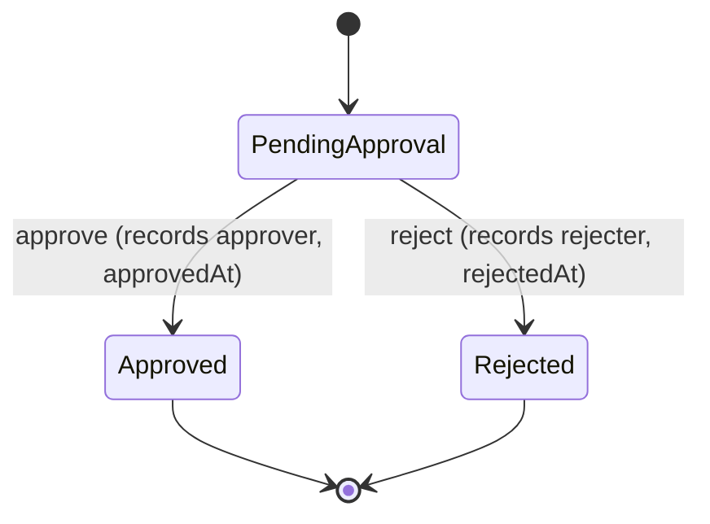
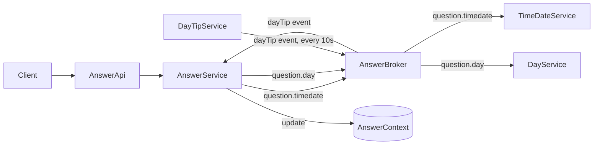
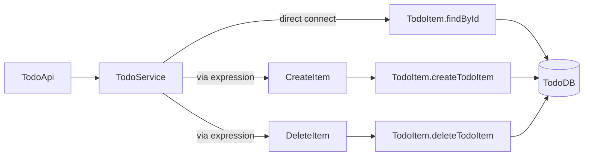
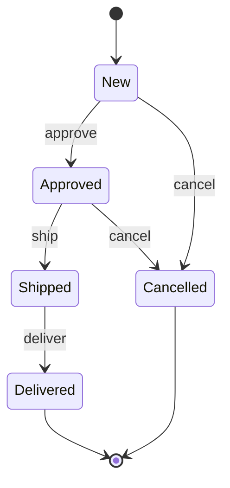
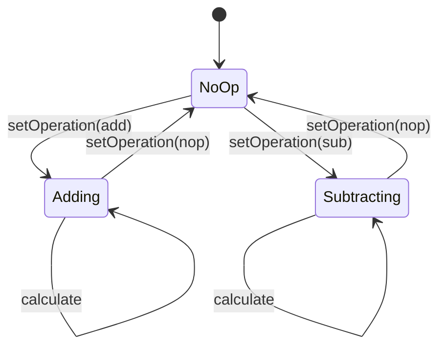
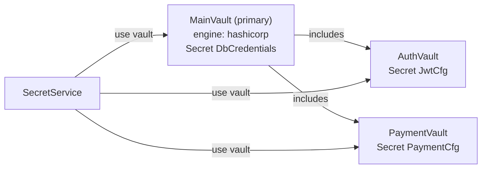
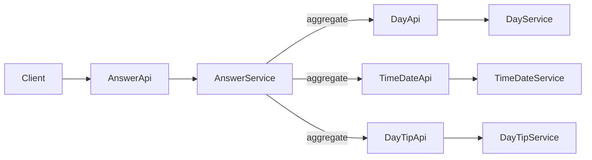

# Patterns

> Generated from Ocean-Atlas v0.1.0 (content 8776e975). Canonical source: https://atlas.ocean-lab.ai/patterns/

**Contents**

- [Patterns](#patterns-1)
- [Approval Workflow](#approval-workflow)
- [Asynchronous Request-Response](#asynchronous-request-response)
- [Database-Backed CRUD](#database-backed-crud)
- [Entity-Backed FSM](#entity-backed-fsm)
- [In-Memory FSM](#in-memory-fsm)
- [Secure Secret Access](#secure-secret-access)
- [Synchronous API Composition](#synchronous-api-composition)

## Patterns

Browsable catalogue of reusable Ocean modeling patterns — recurring design problems, the recommended DSL structure, and where each is demonstrated.

Source: https://atlas.ocean-lab.ai/patterns/

Status: Accepted · Authority: Informative

### 1. Overview

A pattern is a reusable Ocean modeling solution — not a complete
application, and not a DSL specification. Each pattern answers one
question:

> When I face this recurring design problem in Ocean, what modeling
> structure should I use, and why?

Patterns encode design judgment, not just facts. They matter most when
deciding *how* to model something new — which is also what makes them
valuable for retrieval-augmented generation and agents deciding how to
approach a system they haven't seen before.

### 2. How Patterns Differ from Other Knowledge

| Knowledge type | Answers |
| --- | --- |
| **DSL reference** | What does this syntax mean? |
| **Concept** | What is the underlying model, and why does it work this way? |
| **Pattern** | Given this recurring problem, what reusable structure should I use? |
| **Example** | Does this solution actually work, end to end? |
| **Voyage** | How and why was this example built, step by step? |

These roles chain together rather than duplicate each other:

```text
Pattern: Asynchronous Request-Response
    ↓ recommends
Broker + correlation identifier + timeout handling
    ↓ demonstrated by
Asynchronous Answer Aggregation (async)
    ↓ governed by
Broker, Service, Context, and Expression references
```

A pattern recommends a structure. An example proves it in a runnable
system. A Voyage teaches how that example was built. The DSL references
that a pattern points to remain the authority on what its syntax means.

### 3. Pattern Structure

Every pattern in this catalogue follows the same eleven sections: Context,
Problem, Forces, Solution, Structure (a small diagram), a minimal DSL
sketch, Consequences, Alternatives, Related DSL, Working examples, and
Related patterns. A DSL sketch is illustrative — the authoritative,
runnable model lives in the linked working example, not in the pattern
page.

### 4. Catalogue

Patterns already demonstrated by the published Ocean examples:

| Pattern | Recurring problem | Demonstrated by |
| --- | --- | --- |
| [Synchronous API Composition](#synchronous-api-composition) | Combine several synchronous API results into one answer. | [Synchronous Answer Aggregation](examples/answer-sync.md) |
| [Asynchronous Request-Response](#asynchronous-request-response) | Answer a caller using broker request-response instead of direct API calls. | [Asynchronous Answer Aggregation](examples/answer-async.md) |
| [Entity-Backed FSM](#entity-backed-fsm) | Govern a persistent entity's lifecycle so only valid transitions apply. | [Entity-Based Order FSM](examples/entity-order-fsm.md) |
| [In-Memory FSM](#in-memory-fsm) | Model transient, mode-dependent behavior with no persisted identity. | [In-Memory Calculator FSM](examples/in-memory-calculator-fsm.md) |
| [Approval Workflow](#approval-workflow) | Record a human approve/reject decision atomically with its transition. | [Invoice Approval Workflow](examples/invoice-approval.md) |
| [Secure Secret Access](#secure-secret-access) | Give a service typed secret access without secret values in the DSL. | [Simple Vault Usage](examples/simple-vault-usage.md) |
| [Database-Backed CRUD](#database-backed-crud) | Connect a public API directly to an entity's persistence operations. | [Task Manager](examples/task-manager.md) |

### 5. Candidate Patterns Not Yet Published

These are good pattern candidates once a clear demonstrating example
exists. They are listed here as a backlog, not published pages, so this
catalogue never links to an empty document:

- Service orchestration across several owned domain behaviors
- Event-driven state transition without a synchronous request
- External expression implementation (delegating logic to native code)
- UI-to-API integration
- Reusable definition through Import or Include
- Idempotent event handling
- Timeout and failure handling as a cross-cutting concern

### 6. Contributing a Pattern

A new pattern belongs in this catalogue once it has a working example that
demonstrates it. Give it a stable ID of the form `pattern.<identifier>`, a
dedicated `patterns/<identifier>.md` file following the structure in
[Section 3](#3-pattern-structure), and add it to the table in
[Section 4](#4-catalogue).

## Approval Workflow

Model human approve/reject decisions as FSM transitions that record the deciding actor and decision data in the same transition handler.

Source: https://atlas.ocean-lab.ai/patterns/approval-workflow/

Status: Accepted · Authority: Guidance

### 1. Context

A persistent record — an invoice, a request, a document — needs a bounded
set of human-in-the-loop decisions, typically approve or reject, each of
which must record who decided and when, and each of which is a terminal or
near-terminal transition.

### 2. Problem

How do you model a decision-driven lifecycle where each transition is
triggered by a specific actor's decision, and that actor and decision must
be captured as part of the transition itself, not just the resulting
status?

### 3. Forces

- **Consistency** — the recorded decision (approver, timestamp, remark or
  reason) should be updated in the same transition handler as the state change
  it causes.
- **Coupling** — the FSM needs to resolve the deciding actor without owning
  that actor's entity itself.
- **Reuse** — approve/reject is a recurring shape across many domains
  (invoices, requests, orders) and should follow the same modeling
  structure each time.
- **Complexity** — some transitions are effectively terminal (`Approved`,
  `Rejected`) and need no further events.

### 4. Solution

Apply [Entity-Backed FSM](#entity-backed-fsm) with events shaped
as decisions: `event approve in(req:ApproveReq) out(...)` and
`event reject in(req:RejectReq) out(...)`. Inside each transition, resolve
the deciding actor, stamp the decision fields on `this`, and move to the
terminal state with `next`.

### 5. Structure



### 6. DSL Sketch

```text
@fsm

InvoiceApprovalFSM controls Invoice.status
    key: id

    event approve in(appReq:ApproveInvoiceReq) out(appInvoice:*Invoice)
    event reject  in(rejReq:*RejectInvoiceReq) out(rejInvoice:Invoice)

    state PendingApproval
        on event approve:
            this.remark = appReq.remark
            this.approvedAt = nowUTC()
            approver = User.findById(appReq.approvedBy)
            this.approvedBy = approver
            next Approved

        on event reject:
            this.remark = rejReq.reason
            this.rejectedAt = nowUTC()
            rejector = User.findById(rejReq.rejectedBy)
            this.rejectedBy = rejector
            next Rejected

    state Approved
    state Rejected
```

This is a minimal illustrative fragment, not a complete duplicated example —
see [Working Examples](#10-working-examples) for the full, runnable model.

### 7. Consequences

#### Benefits

- Decision data and the state change are defined together in one transition
  handler, making the required actor and audit fields explicit.
- The shape generalizes across domains: the same approve/reject structure
  fits invoices, requests, or any decision-gated record.

#### Trade-offs

- This pattern models exactly one decision per transition. Multi-step or
  multi-approver workflows (for example, two required approvals) need
  additional states and events, not a bigger `approve` event.
- Resolving the deciding actor (`User.findById`) introduces a read
  dependency on another entity during the transition.
- Transaction-level atomicity depends on the active FSM, persistence engine,
  and generator contract; this pattern does not establish that guarantee by
  itself.

### 8. Alternatives

- If no human decision or actor needs to be recorded — the transition is
  purely system- or event-driven — use plain
  [Entity-Backed FSM](#entity-backed-fsm) instead.
- If the record being decided on has no persisted identity, this pattern
  does not apply; see [In-Memory FSM](#in-memory-fsm).

### 9. Related DSL

- [FSM DSL Reference](dsl/fsm.md) — events, states, and transitions.
- [Database DSL Reference](dsl/database.md) — the entity whose status the FSM
  controls, and the actor entity it resolves.
- [Service DSL Reference](dsl/service.md) — connecting approve/reject API
  operations to FSM events.
- [Expression DSL Reference](dsl/expression.md) — supporting logic invoked
  around a decision.

### 10. Working Examples

- [Invoice Approval Workflow](examples/invoice-approval.md) — an entity-based
  approval workflow connecting persistent invoices, users, customers, and
  recorded decisions.

### 11. Related Patterns

- [Entity-Backed FSM](#entity-backed-fsm) — the general pattern
  this one specializes.
- [Database-Backed CRUD](#database-backed-crud) — the persistence
  and API surface an approval workflow typically sits alongside.

## Asynchronous Request-Response

Answer a synchronous caller through typed broker request-response topics with explicit timeouts instead of direct API calls.

Source: https://atlas.ocean-lab.ai/patterns/async-request-response/

Status: Accepted · Authority: Guidance

### 1. Context

A service needs an answer from one or more other services, but those
services are reached through a message broker rather than called directly —
for decoupling, independent deployability, or fan-out to responders whose
network address the caller should not need to know.

### 2. Problem

How do you give a synchronous caller an answer when the actual work happens
through asynchronous message exchange, potentially involving several
independent responders and state accumulated along the way?

### 3. Forces

- **Coupling** — a broker decouples the caller and responder's network
  addresses and availability, but they still share a message contract and
  topic name.
- **Latency** — must be bounded by an explicit timeout per request-response
  leg, not left open-ended.
- **Consistency** — partial results from independent responders may need to
  be merged before answering the original caller.
- **Failure handling** — one non-responding leg must not hang the whole
  request.
- **Reuse** — the same topic can be consumed by multiple independent
  responder services without the caller depending on their APIs directly.

### 4. Solution

Declare a `@broker` with a typed `request-response` topic for each
request/answer pair and give each topic an explicit timeout. A coordinating
`@service` uses the broker, issues typed requests, and maps the responses
before answering its own synchronous API. Responder services connect their
local logic to the same broker topics.

When the answer also depends on values that update independently, add a plain
`event` topic and an optional service-local `@context` to cache or accumulate
those values. Context and event caching extend the core request-response
pattern; they are not required for every use.

### 5. Structure



### 6. DSL Sketch

```text
@broker

AnswerBroker
    engine = nats
    configType = AnswerBrokerConfig

    dayTip            : String                            as event
    question.day      : _-String                          as request-response with timeout:1s
    question.timedate : TimeDateRequest-TimeDateResponse   as request-response with timeout:1s

@context

AnswerContext
    tip : String (default=enjoy your day!)

@service

AnswerService
    use broker AnswerBroker as svcBroker
    use context AnswerContext as svcCtx
    use function Func<TimeDateRequest,TimeDateResponse> as GetTimeDate

    connect svcBroker.dayTip  -> HandleDayTip(ctx:svcCtx)
    connect GetTimeDate       -> svcBroker.question.timedate & timeout(3:s)
```

This is a minimal illustrative fragment, not a complete duplicated example —
see [Working Examples](#10-working-examples-1) for the full, runnable model.

### 7. Consequences

#### Benefits

- The caller and responders don't need each other's network address, only a
  shared broker and topic contract.
- Per-topic timeouts bound the worst-case latency of each leg.
- When needed, a service-local context lets slow-changing values (like a
  cached tip) be refreshed independently of any single request.

#### Trade-offs

- Debugging a request requires broker visibility, not just a call stack.
- Message contracts (request and response types) must stay in sync across
  independently deployed services.
- The composed path only works while the broker infrastructure is running —
  there is no direct fallback path.

### 8. Alternatives

- If every composed call is reachable as a directly callable API and a
  bounded fan-out is enough, prefer
  [Synchronous API Composition](#synchronous-api-composition) —
  it has fewer moving parts.
- If a request only needs a periodic or cached value rather than a live
  answer, a broker `event` topic alone, without `request-response`, may be
  enough.

### 9. Related DSL

- [Broker DSL Reference](dsl/broker.md) — event and request-response topics,
  timeouts.
- [Service DSL Reference](dsl/service.md) — broker usage and connections.
- [Context DSL Reference](dsl/context.md) — service-local shared state used to
  merge or cache results.
- [Expression DSL Reference](dsl/expression.md) — request/response handling
  logic.

### 10. Working Examples

- [Asynchronous Answer Aggregation](examples/answer-async.md) — a
  coordinating service that answers synchronously while resolving day, time,
  and date through broker request-response, with a cached tip in context.
- [Broker-Based Math Service](examples/math-service.md) — the same
  request-response broker mechanics applied to routing typed arithmetic
  operations to specialized services.

### 11. Related Patterns

- [Synchronous API Composition](#synchronous-api-composition) —
  the direct-API alternative when broker decoupling isn't needed.

## Database-Backed CRUD

Connect a public API directly to a persistent entity's queries and commands, using expressions only where a rule must run before storage.

Source: https://atlas.ocean-lab.ai/patterns/database-backed-crud/

Status: Accepted · Authority: Guidance

### 1. Context

A domain entity needs standard persistence operations — create, read,
update, delete, and a handful of lookups — exposed through a public API.

### 2. Problem

How do you connect a public API directly to persistent storage operations
for a domain entity, without hand-writing repetitive create/read/update/
delete plumbing in every service?

### 3. Forces

- **Consistency** — create and update paths often need a domain rule
  applied before, or instead of, touching the database directly.
- **Reuse** — query and command shapes (find-by-field, list with paging)
  recur across most entities.
- **Coupling** — the API's operation names and the database's query and
  command names are independent vocabularies that the service must connect
  deliberately.
- **Complexity** — some operations are simple pass-throughs to storage;
  others need an expression in between for validation or transformation.

### 4. Solution

Declare the entity's persistence surface in `@database` (`key`, `indexes`,
`query`, `command`), declare the matching public operations in `@api`, and
in `@service` connect each API operation either directly to a database
query or command for simple pass-throughs, or through an intermediate
`@expression` when a rule needs to run first.

### 5. Structure



### 6. DSL Sketch

```text
@database

Database TodoDB
    engine = postgres
    configType = DatabaseConfig

    Entity TodoItem
        key(id)
        query findById(id: String) : TodoItem
        command Transactional createTodoItem(item:TodoItem) : TodoItem
        command deleteTodoItem(id:String) : _

@api

TodoApi style: rest
    engine = gin
    configType = ApiConfig

    get    /todo/item/{id} getItem2(_)             : TodoItem
    post   /todo/item      createItem(item:TodoItem) : TodoItem
    delete /todo/item/{id} deleteItem(_)           : _

@service

TodoService
    use database TodoDB as appDb
    use expression CreateItem as crt
    use expression DeleteItem as dlt

    connect api.getItem2    -> TodoItem.findById
    connect api.createItem  -> crt
    connect api.deleteItem  -> dlt
```

This is a minimal illustrative fragment, not a complete duplicated example —
see [Working Examples](#10-working-examples-2) for the full, runnable model.

### 7. Consequences

#### Benefits

- Read-only lookups can bypass the expression layer entirely when no rule
  applies.
- The service stays the single place where API operations are wired to
  storage.
- The pattern scales from a handful of fields to a full domain entity
  without changing shape.

#### Trade-offs

- As domain rules grow, more operations move from direct `connect` to
  expression-mediated `connect`, and deciding which is which becomes the
  service author's job.
- This pattern does not by itself enforce lifecycle rules — see
  [Entity-Backed FSM](#entity-backed-fsm) when not every state
  transition should be a valid `update`.

### 8. Alternatives

- If the entity has a constrained lifecycle where not every state
  transition is valid, layer
  [Entity-Backed FSM](#entity-backed-fsm) on top of the entity's
  status field rather than allowing arbitrary updates through `command`.

### 9. Related DSL

- [Database DSL Reference](dsl/database.md) — entities, queries, and
  commands.
- [API DSL Reference](dsl/api.md) — the public operations exposed to
  clients.
- [Service DSL Reference](dsl/service.md) — connecting API operations to
  database queries, commands, or expressions.

### 10. Working Examples

- [Task Manager](examples/task-manager.md) — a persistent task-management
  application with lifecycle rules and CRUD operations exposed through an
  API.
- [Inventory Management](examples/inventory-management.md) — a larger,
  CRUD-heavy domain covering materials, locations, stock states, and
  movements.

### 11. Related Patterns

- [Entity-Backed FSM](#entity-backed-fsm) — adds constrained
  lifecycle rules on top of an entity this pattern otherwise updates freely.
- [Secure Secret Access](#secure-secret-access) — how the
  database credentials behind this pattern are typically supplied.
- [Approval Workflow](#approval-workflow) — a decision-driven
  lifecycle that typically sits alongside this pattern's persistence and API
  surface for the same entity.
- [Synchronous API Composition](#synchronous-api-composition) —
  another shape of service-level connection, for composition rather than
  persistence.

## Entity-Backed FSM

Govern a persistent entity's lifecycle through an FSM that defines the permitted transitions for one controlled field.

Source: https://atlas.ocean-lab.ai/patterns/entity-backed-fsm/

Status: Accepted · Authority: Guidance

### 1. Context

A persistent entity — an order, an invoice, a shipment — has a well-defined
lifecycle: a limited set of valid states and transitions, and every
transition must update the stored record.

### 2. Problem

How do you centralize the permitted state transitions for a persistent entity
without scattering status-check `if` logic across every service method that
might change it?

### 3. Forces

- **Consistency** — the entity's persisted status and its in-memory
  transition must never disagree.
- **Coupling** — the FSM needs to know which persisted field it controls,
  without owning the entity's other persistence concerns (queries, indexes).
- **Reuse** — the same entity may be read through several unrelated database
  operations that must not bypass the FSM's transition rules.
- **Complexity** — entry/exit rules (timestamps, computed fields) need one
  defined place to live, not one per caller.

### 4. Solution

Declare an `@fsm` that `controls` one persisted field of a `@database`
entity (`controls Order.status`), keyed by the entity's identity. Declare
each valid `event`, and per-state `on event` rules using
`next <State> : <field assignment>`. Treat the FSM as the ownership boundary
for the controlled field: API and service operations should trigger FSM events
instead of exposing database commands that modify that field directly. Other
database queries and commands remain free to read and write the rest of the
entity.

### 5. Structure



### 6. DSL Sketch

```text
@database

Database OrderDb
    engine = postgres
    configType = DatabaseConfig

    Entity Order
        key(id)
        query findById(id: String) : Order
        command T updateOrder(order: Order) : Order

@fsm

OrderFSM controls Order.status
    key: id

    event approve in(_) out(order:Order)
    event ship    in(_) out(order:Order)
    event cancel  in(_) out(order:Order)

    state New
        on event approve:
            next Approved : this.updatedAt = nowUTC()
        on event cancel:
            next Cancelled : this.updatedAt = nowUTC()

    state Approved
        on event ship:
            next Shipped : this.updatedAt = nowUTC()

    state Shipped
    state Delivered
    state Cancelled
```

This is a minimal illustrative fragment, not a complete duplicated example —
see [Working Examples](#10-working-examples-3) for the full, runnable model.

### 7. Consequences

#### Benefits

- Transition rules live in one place, independent of every API or service
  that might trigger them.
- Unsupported transitions (for example, `Delivered` back to `Shipped`) are
  absent from the FSM's event rules rather than guarded by scattered
  conditionals.
- Per-transition field updates are explicit and auditable.

#### Trade-offs

- The FSM only controls the one field it declares; broader entity
  consistency (other fields, related entities) remains the service's and
  database's responsibility.
- The model must avoid alternate database commands that bypass the FSM and
  modify the controlled field directly unless the active toolchain explicitly
  enforces exclusive ownership.
- Adding a new state or event means touching the FSM definition — a single
  coupling point, by design.

### 8. Alternatives

- If the behavior has no persisted identity worth controlling (a transient
  calculation session), use [In-Memory FSM](#in-memory-fsm)
  instead.
- If the transitions are really human approve/reject decisions with a
  recorded actor, see [Approval Workflow](#approval-workflow),
  which specializes this pattern.

### 9. Related DSL

- [FSM DSL Reference](dsl/fsm.md) — `controls`, events, states, transitions.
- [Database DSL Reference](dsl/database.md) — the entity and field the FSM
  controls.
- [Service DSL Reference](dsl/service.md) — connecting API operations to FSM
  events.

### 10. Working Examples

- [Entity-Based Order FSM](examples/entity-order-fsm.md) — an order lifecycle
  governed by an FSM controlling a persisted status field.
- [Invoice Approval Workflow](examples/invoice-approval.md) — a
  decision-oriented variant; see
  [Approval Workflow](#approval-workflow).

### 11. Related Patterns

- [In-Memory FSM](#in-memory-fsm) — the alternative when there is
  no persisted entity to control.
- [Approval Workflow](#approval-workflow) — a specialization for
  human decision-driven transitions.
- [Database-Backed CRUD](#database-backed-crud) — the free-form
  persistence and API surface this pattern constrains for one field.

## In-Memory FSM

Model transient, mode-dependent behavior with an FSM that has no persisted entity, using `in-memory` states and a service-local context.

Source: https://atlas.ocean-lab.ai/patterns/in-memory-fsm/

Status: Accepted · Authority: Guidance

### 1. Context

A service needs stateful, mode-dependent behavior for the lifetime of a
session or a single logical flow — for example, a calculator whose next
operation depends on which mode it is currently in — but that state has no
independent persisted identity worth storing in a database.

### 2. Problem

How do you model behavior that depends on "which mode am I in" without
persisting a database entity purely to hold a status field?

### 3. Forces

- **Consistency** — state must still change only through defined
  transitions, even without a database backing it.
- **Reuse** — the same event and state vocabulary as an entity-backed FSM
  should stay usable, so behavior can move to persistence later without a
  redesign.
- **Complexity** — entry and exit hooks and validation still need a defined
  place to run.
- **Persistence** — explicitly out of scope: state resets between instances
  or deployments unless mirrored elsewhere.

### 4. Solution

Declare an `@fsm` with `in-memory` instead of `controls <Entity>.<field>`,
list its `states` and `default` state directly, and use `on enter`,
`on exit`, and `on event` blocks the same way an entity-backed FSM would.
Pair it with a service-local `@context` for values that should survive
across events within the same session, such as the last computed mode.

### 5. Structure



### 6. DSL Sketch

```text
@context

CalcFsmContext
    mode : String (default=no operation)

@fsm

CalcFSM in-memory
    states  : NoOp, Adding, Subtracting
    default : NoOp

    event setOperation in(op:String) out(result:String)
    event calculate    in(a:Float & b:Float) out(r:Float)

    use context CalcFsmContext as fsmCtx
    use expression CalcAdd as add
    use expression CalcSub as sub

    state Every
        on event setOperation : logic
            if op == "add" then
                next Adding : result = "ADD"
            end
            next NoOp

    state NoOp
        on enter : logic
            update fsmCtx.mode = "No-operation mode."
        on event calculate : logic
            emit r = 0

    state Adding
        on enter:
            update fsmCtx.mode = "Adding mode."
        on event calculate:
            emit r = add(a, b)
```

This is a minimal illustrative fragment, not a complete duplicated example —
see [Working Examples](#10-working-examples-4) for the full, runnable model.

### 7. Consequences

#### Benefits

- No database or entity overhead for behavior that is genuinely transient.
- The same event and transition vocabulary as Entity-Backed FSM keeps the
  two patterns easy to move between as requirements change.
- A service-local context gives a small amount of state that survives
  across events without persistence.

#### Trade-offs

- State does not survive a process restart or move across instances unless
  explicitly synchronized elsewhere.
- Not appropriate once the behavior needs to be queried, audited, or resumed
  by identity outside the current session.

### 8. Alternatives

- If the modeled behavior must be queryable, auditable, or resumed by
  identity across sessions, use
  [Entity-Backed FSM](#entity-backed-fsm) instead.

### 9. Related DSL

- [FSM DSL Reference](dsl/fsm.md) — `in-memory` mode, states, and default
  state.
- [Context DSL Reference](dsl/context.md) — service-local state that survives
  across events.
- [Service DSL Reference](dsl/service.md) — using an in-memory FSM from a
  service.

### 10. Working Examples

- [In-Memory Calculator FSM](examples/in-memory-calculator-fsm.md) — an
  in-memory FSM whose active state selects calculator behavior and updates
  shared context.

### 11. Related Patterns

- [Entity-Backed FSM](#entity-backed-fsm) — the alternative when
  the behavior does have a persisted identity to control.

## Secure Secret Access

Give a service typed, named access to secret values through focused vaults composed into one primary vault, without ever writing secret values into the DSL.

Source: https://atlas.ocean-lab.ai/patterns/secure-secret-access/

Status: Accepted · Authority: Guidance

### 1. Context

A service needs credentials or provider configuration — database
credentials, JWT signing configuration, payment provider configuration —
that must never appear in the DSL or generated source as literal values.

### 2. Problem

How do you give a service typed, named access to secret values from
potentially different secret backends, without hardcoding any secret value
anywhere in the model?

### 3. Forces

- **Coupling** — services should depend on a typed secret contract, not on a
  specific secret-backend product.
- **Reuse** — related secrets (auth, payment) are easier to maintain as
  small, focused vaults than as one large flat set.
- **Security** — secret values must never be written into the DSL; only
  their type and shape are declared.
- **Composition** — one physical backend often needs to serve several
  logical secret groups at once.

### 4. Solution

Declare small, focused `@vault` blocks per concern (for example `AuthVault`,
`PaymentVault`), each with the required `engine` and `configType` attributes
and typed `Secret` declarations (`type = <TypeRef>`, never a value). Compose
them into one primary vault using `includes`. A service then
`use vault`s the vaults it needs and connects an expression to retrieve each
secret through its typed contract.

### 5. Structure



### 6. DSL Sketch

```text
@vault

Vault AuthVault
    primary = false
    engine = hashicorp
    configType = VaultConfig
    Secret JwtCfg
        type = JwtConfig

Vault PaymentVault
    primary = false
    engine = hashicorp
    configType = VaultConfig
    Secret PaymentCfg
        type = PaymentApiConfig

Vault MainVault
    primary = true
    includes = AuthVault, PaymentVault
    engine = hashicorp
    configType = VaultConfig
    Secret DbCredentials
        type = DatabaseCredentials

@service

SecretService
    use vault MainVault
    use vault AuthVault
    use vault PaymentVault
    use expression GetDbCredentials
    use expression GetJwtConfig

    connect api.getDbCredentials -> GetDbCredentials
    connect api.getJwtConfig     -> GetJwtConfig
```

This is a minimal illustrative fragment, not a complete duplicated example —
see [Working Examples](#10-working-examples-5) for the full, runnable model.

### 7. Consequences

#### Benefits

- Secret values never appear in the DSL — only typed contracts do.
- Splitting vaults by concern keeps each one small and independently owned.
- A primary composition can map several logical vaults to one physical
  backend while preserving their qualified identities.

#### Trade-offs

- Each vault must declare a valid engine and compatible configuration schema;
  the corresponding environment values must be supplied correctly at
  deployment time.
- A service that composes many vaults takes on a dependency on all of their
  secret contracts being resolvable at runtime.

### 8. Alternatives

- If a value is genuinely not secret (feature flags, timeouts, ports), model
  it with `@config` instead of `@vault` — see the
  [Config DSL Reference](dsl/config.md). Most real services combine both:
  `@config` for non-secret settings, `@vault` for secret ones.

### 9. Related DSL

- [Vault DSL Reference](dsl/vault.md) — vault composition, `includes`, and
  typed secrets.
- [Config DSL Reference](dsl/config.md) — non-secret typed configuration used
  alongside vaults.
- [Service DSL Reference](dsl/service.md) — using vaults from a service.

### 10. Working Examples

- [Simple Vault Usage](examples/simple-vault-usage.md) — typed database,
  authentication, and payment secrets in focused vaults, composed into one
  primary vault for service access.

### 11. Related Patterns

- [Database-Backed CRUD](#database-backed-crud) — a common
  consumer of vault-protected database credentials.

## Synchronous API Composition

Compose several synchronous API results into one coordinated answer using a coordinating service and `aggregate`.

Source: https://atlas.ocean-lab.ai/patterns/synchronous-api-composition/

Status: Accepted · Authority: Guidance

### 1. Context

A system exposes one coordinating operation whose answer is assembled from
several other synchronous API calls, each potentially served by a different
service (for example, a "day tip" answer built from a day service, a
time/date service, and a tip service).

### 2. Problem

How do you combine multiple synchronous API results into one response,
without pushing orchestration logic into the client and without collapsing
every capability into one monolithic service?

### 3. Forces

- **Coupling** — the coordinating service must know each source API's
  contract, coupling it to their shape.
- **Latency** — composed calls should run as a bounded fan-out, not an
  unbounded chain, or total latency accumulates linearly.
- **Consistency** — the assembled answer should reflect a coherent set of
  underlying calls even if one branch is slow.
- **Failure handling** — any composed call can hang or fail without a bound;
  the aggregate must not inherit that risk unbounded.
- **Reuse** — the services being composed should stay independently usable
  and independently deployable, not fused into the coordinator.

### 4. Solution

Expose a coordinating `@api` operation and implement it in a coordinating
`@service`. Use `connect` for simple one-to-one passthroughs to a single
source API, and `aggregate` for fan-out compositions that combine several
source calls — optionally transforming each branch with an expression and
bounding the whole composition with a timeout.

### 5. Structure



### 6. DSL Sketch

```text
@service

AnswerService
    use config CommonServiceConfig as svcCfg
    impl api AnswerApi as api on svcCfg.apiConfig.port
    use api DayApi as day
    use api TimeDateApi as td
    use api DayTipApi as tip
    use expression PrettyDate
    use expression PrettyTime
    use expression PrettyTip

    aggregate api.getTimeAnswer -> day.getDay | td.getDate using PrettyDate | td.getTime using PrettyTime | tip.getDayTip using PrettyTip - timeout 2s

    connect api.getDay -> day.getDay
```

This is a minimal illustrative fragment, not a complete duplicated example —
see [Working Examples](#10-working-examples-6) for the full, runnable model.

### 7. Consequences

#### Benefits

- One client-facing contract instead of several client-side calls.
- Per-branch transforms via expressions keep response shaping out of the
  source services.
- An explicit timeout bounds the composition's worst-case latency.

#### Trade-offs

- The coordinating service takes a runtime dependency on every composed API
  being reachable.
- Partial-failure semantics (what happens if one branch times out) must be
  defined deliberately through the aggregation's timeout behavior.
- More moving parts than a single flat service for the same capability.

### 8. Alternatives

- If the composed calls don't need to run as a fan-out — one source is
  enough — use a plain `connect` instead of `aggregate`.
- If the composed operations don't need to answer synchronously, prefer
  [Asynchronous Request-Response](#asynchronous-request-response)
  instead.

### 9. Related DSL

- [Service DSL Reference](dsl/service.md) — `aggregate` and `connect` syntax.
- [API DSL Reference](dsl/api.md) — the composed and coordinating API
  contracts.
- [Expression DSL Reference](dsl/expression.md) — per-branch transforms.

### 10. Working Examples

- [Synchronous Answer Aggregation](examples/answer-sync.md) — a coordinating
  service that composes day, time/date, and tip APIs into one answer.

### 11. Related Patterns

- [Asynchronous Request-Response](#asynchronous-request-response) — the
  broker-based alternative when calls don't need to be direct API calls.
- [Database-Backed CRUD](#database-backed-crud) — another shape of
  service-level connection, for persistence rather than composition.
